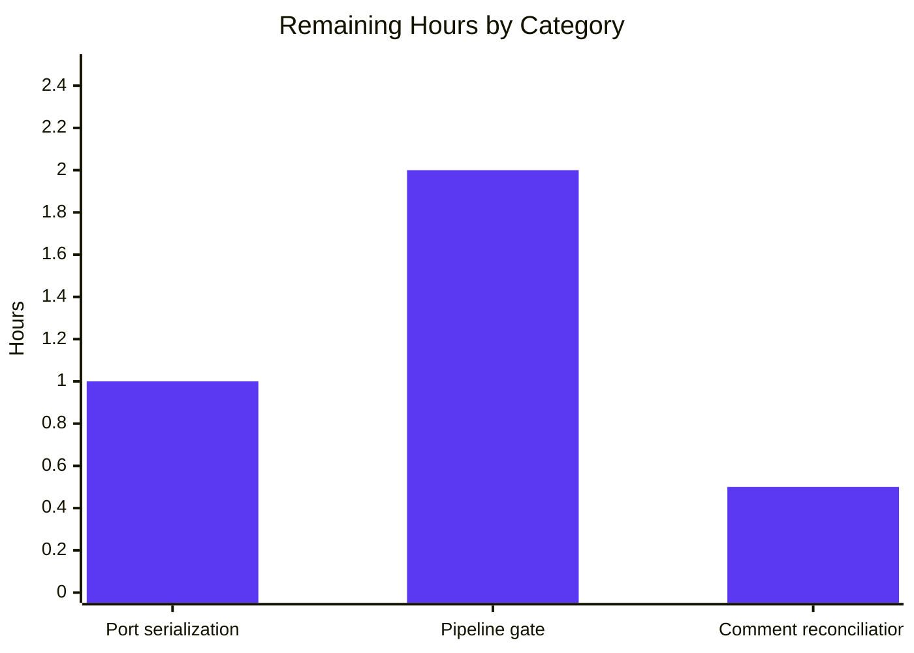

# 1. Executive Summary

This guide is the verification record for the test coverage added to the `hello_world` service: what was delivered, what was exercised to prove it, what is open, and the path to production.

## 1.1 Project Overview

This work adds the automated test the service never had: one minimal test file proving that a request returns HTTP status 200 with exactly the body `Hello, World!\n`. The system is one Node.js module, `server.js` (15 lines), answering every request identically over loopback on `127.0.0.1:3000`, with no UI, datastore, dependency or configuration. The change adds `server.test.js` beside it and points `npm test` at that file, so a contract the service has always claimed is now enforced by a command that passes or fails loudly rather than by inspection.

## 1.2 Completion Status


| Metric | Hours |
|---|---|
| Total Project Hours | 19.0 |
| Completed Hours (AI + Manual) | 15.5 |
| Remaining Hours | 3.5 |

**81.6% complete (15.5 of 19.0 hours).** Every deliverable the specification names is delivered and passing; the remaining hours are path-to-production work — a pipeline gate and a serialized run procedure for the single fixed port — plus one documentation decision.

## 1.3 Key Accomplishments

- A two-case HTTP suite driving the real listener over loopback and asserting the exact 14-byte body (`server.test.js`).
- Either case can be run alone with the runner's name filter.
- `npm test` now runs the suite, replacing a script that always exited 1.
- Failure signalling proven: a one-byte change to the served body fails both cases with a non-zero exit.
- Run termination solved for a module exporting no handle: an explicit exit carries the runner's own status.
- Zero dependencies, no lockfile entry, no install step, no configuration file.
- Deterministic and isolated: identical results each run, the port held for one run and released after.
- The module under test is byte-for-byte unchanged, and no other repository path was touched.

## 1.4 Critical Unresolved Issues

Three of the 30 items this work was scoped against are open: one of the 28 requirements the specification states or restates, and both path-to-production items. None needs a code change, and none blocks the delivered suite, which compiles and passes on every run.

| Issue | Impact | Owner | ETA |
|---|---|---|---|
| The test file carries one more comment line than the specification's comment bound enumerates (`server.test.js:4`) | No behavioural effect; needs a decision recorded against the specification, not a code change | Repository owner | 0.5 h |
| Nothing in the project runs `npm test` automatically | The two-case contract is guarded only when the command is run by hand | Repository owner | 2.0 h |
| No serialized run procedure for the fixed listener port | On a shared host, an occupied `127.0.0.1:3000` fails the run at load with `EADDRINUSE` | Repository owner / pipeline owner | 1.0 h |

## 1.5 Access Issues

No access issues identified. Nothing here needs a credential, a registry account, an external service or elevated permission: the suite starts its own loopback listener.

## 1.6 Recommended Next Steps

1. **[High]** Serialize the suite's invocation so the gate survives a host where the fixed port may already be held — 1.0 h.
2. **[Medium]** Make `npm test` a required pipeline check so the contract is guarded on every change — 2.0 h.
3. **[Low]** Record the comment-count decision against the specification, changing the specification rather than the delivered file — 0.5 h.
4. **[Low]** Point the manifest's `main` field at `server.js`, or drop it — hygiene outside this change, so not counted above.

# 2. Project Hours Breakdown

Hours are the measure: every component below traces to a requirement the specification states or restates, and the two tables together account for all 19.0 h of the project.

## 2.1 Completed Work Detail

| Component | Hours | Description |
|---|---|---|
| Two-case loopback response suite | 4.5 | `server.test.js`: two cases that load the module for its binding side effect and assert status 200 and the exact 14-byte body over real HTTP, with the case set held to exactly two and the expected values inline. |
| Process-exit design and failure signalling | 3.0 | The deferred explicit exit required by a module that exports no handle, carrying the runner's own status with no hard-coded success, and the measured consequence of each alternative. |
| Dependency-free runner wiring and manifest gate | 2.0 | `scripts.test` pointed at the suite and proven end to end, with zero dependencies, no lockfile entry, no install step and no configuration file. |
| Assertion exactness and discriminating power | 2.5 | Byte-for-byte comparison including the trailing newline under strict equality, with negative controls proving the comparison fails loudly on a one-byte change. |
| Determinism, port isolation and runtime verification | 2.0 | Repeat-run stability, exclusive use and release of the single host port, loopback-only binding, and a per-run cost of about 80 ms. |
| Bounded-scope conformance and untouched-system verification | 1.5 | The change held to two paths, the module under test and every other file and field byte-identical, and no hardening, environment configuration or coverage tooling added. |
| **Total** | **15.5** | |

## 2.2 Remaining Work Detail

| Category | Hours | Priority |
|---|---|---|
| Serialized run procedure for the single host port (path-to-production) | 1.0 | High |
| Pipeline gate running `npm test` (path-to-production) | 2.0 | Medium |
| Comment-count reconciliation (the divergence recorded in 5.2) | 0.5 | Low |
| **Total** | **3.5** | |

**Calculation:** completed 15.5 h + remaining 3.5 h = **19.0 h total project hours**; completion = 15.5 / 19.0 × 100 = **81.6%**.

The two path-to-production rows put the delivered suite into service: today it guards the response contract only when someone runs it by hand, and on a host where the fixed listener port is already taken it fails at load rather than retrying. The third row is the documentation decision attached to the one divergence, and needs no code change. Removing the port dependency from inside the code would mean editing the module under test, which this change's scope forbids.

# 3. Test Results

Every result below was produced by running the command in this section against the delivered code on the repository's runtime. The project has no coverage tooling, so no coverage figure is measured or claimed anywhere in this guide.

| Area / Category | Framework | Tests | Passed | Failed | Coverage | What This Proves |
|---|---|---|---|---|---|---|
| Response contract, both cases | `node:test` via `node --test` and `npm test` | 2 | 2 | 0 | Not measured (no tool configured) | Every request reaches the real listener over loopback and is answered 200 with the exact 14-byte body. |
| Case independence, name filter | `node:test --test-name-pattern` | 1 | 1 | 0 | — | The second case stands alone and exercises a genuinely different method. |
| Repeat-run stability | `node:test`, five consecutive runs | 10 | 10 | 0 | — | Results are identical on every run: no flakiness and no ordering dependence. |
| Failure visibility and byte exactness (control) | `node:test` against a mutated copy of the module | 2 | 0 | 2 | — | A one-byte change to the served body fails both cases with a non-zero exit, so a pass means the contract holds rather than that nothing was compared. |
| Run termination (control) | `node:test` with the exit statement removed | 1 | 1 | 0 | — | The explicit deferred exit is what ends the run: without it the process stays alive until killed. |
| Served contract at the wire level | `curl` against the running application | 7 | 7 | 0 | — | `GET`, `POST` with an empty body, `PUT`, `DELETE`, `HEAD` and an unmatched path all return 200 with the identical 14 bytes, and the binding answers on loopback only. |
| Browser-delivered response | Headless Chrome | 3 | 3 | 0 | — | A real browser receives `text/plain` with `Content-Length: 14` and renders the body including its trailing newline, for `/` and for an unmatched path, with no console errors and no failed requests. |
| Parse gate | `node --check` on both files | 2 | 2 | 0 | — | Both JavaScript files parse cleanly before any run. |

The two control rows are deliberate: they were run against a mutated copy of the module and the test file, never the delivered files, to show the assertions and the exit path have teeth.

**Not covered.** The following are delivered behaviour that no test exercises, because the agreed case set was fixed at exactly two cases:

- **Response headers.** `Content-Type: text/plain` and `Content-Length: 14` are produced and were observed with a client, but no test asserts them. If they belong to the contract you intend to guarantee, add a case before release.
- **Any method or path beyond the two cases.** `PUT`, `DELETE`, `HEAD` and unmatched paths were probed by hand and answered identically, but nothing pins that behaviour.
- **404 and error behaviour.** The handler has neither, and neither is tested.
- **Startup and shutdown assertions.** There are none by design: the module exports no handle, so the run ends by an explicit exit rather than a graceful close.
- **No coverage measurement exists at all**, and no lint, format or dependency-audit gate exists either — `npm test` is the entire gate.

# 4. Runtime Validation & UI Verification

- ✅ **Application start-up** — `node server.js` bound `127.0.0.1:3000` and printed its startup line; the same line appears in the test run before the first case, which is direct evidence that loading the module binds the listener.
- ✅ **Load side effect** — requiring the module binds the listener while the module exports nothing.
- ✅ **Primary contract** — `GET /` returned 200, `text/plain`, `Content-Length: 14` and the 14-byte body.
- ✅ **Second method** — `POST /` with an empty body returned a byte-identical response.
- ✅ **Non-matching requests** — `PUT`, `DELETE`, `HEAD` and an unmatched path all returned the identical response; the handler branches on nothing.
- ✅ **Browser pass** — headless Chrome over `/` and `/unmatched-path` rendered `Hello, World!` with its trailing newline, with zero console messages and no failed requests; an in-page `POST` returned the same 14 bytes.
- ✅ **`npm test` gate** — exit 0 with both cases reporting, on every invocation.
- ⚠ **Unmatched paths** — answering 200 for every path is the delivered behaviour, but no test asserts it; a 404 expectation would fail today.
- ✅ **Port lifecycle** — free before each run, released after each, and released immediately when the application is stopped by pid.
- ✅ **Failure path** — with the port already held the run exits non-zero with `EADDRINUSE` instead of hanging; with a mutated body both cases fail with a non-zero exit.

Never exercised at runtime: a graceful shutdown path, which does not exist — the run ends by an explicit exit; and any non-loopback access, which the binding refuses. This project exposes no user interface at all — its only client is an HTTP client — so the browser pass above verifies the delivered bytes as a client receives them, not a screen.

# 5. Compliance & Quality Review

Compliance is reported per deliverable, as each stands now, against the quality and scope benchmarks this work was held to: the contract the suite must prove, the runtime it must use, the boundaries it must not cross, and the instrumentation the project does or does not have.

## 5.1 Compliance Matrix

| # | Deliverable | Verified status | Progress |
|---|---|---|---|
| 1 | Two-case response contract over loopback (`server.test.js`) | Pass — both cases asserted and passing on every run | ✅ Complete |
| 2 | Runtime's own runner only; no framework, dependency, lockfile entry, install step or configuration file | Pass — two runtime built-ins plus the local module; zero declared dependencies | ✅ Complete |
| 3 | Module under test reached by load side effect, left unmodified, run ended explicitly | Pass — module byte-identical and export-free; explicit deferred exit | ✅ Complete |
| 4 | One new file and one manifest field, nothing else | Pass — `M package.json`, `A server.test.js`, 24 insertions and 1 deletion | ✅ Complete |
| 5 | No 404 handler, error handler, environment configuration or hardening | Pass — none present in either file | ✅ Complete |
| 6 | Comment doctrine: one line per case, no header block, banners or JSDoc | Pass as stated — one line above each case and one above the exit; documented count note in 5.2 | ⚠ One comment line over the restated bound |
| 7 | Exit design and failure visibility | Pass — failing assertion reported with a non-zero exit; no hard-coded success | ✅ Complete |
| 8 | Assertion exactness and density | Pass — two strict assertions per case, byte-exact including the trailing newline | ✅ Complete |
| 9 | Determinism, isolation and port lifecycle | Pass — identical results on every run; the port held for one run and released | ✅ Complete |
| 10 | Scope boundaries honoured in both directions | Pass — every other path, field and file unchanged | ✅ Complete |
| 11 | Documented commands and stated preconditions | Pass — manifest gate, runner form and single-case form all reproduced | ✅ Complete |
| 12 | Quality instrumentation (coverage, lint, pipeline) | Not applicable by design — none configured and none added; `npm test` is the entire gate | ⚪ None configured |

## 5.2 AAP & Rule Divergences and Gaps

Two divergences were identified against the specification and the rules that governed this work.

| What the AAP / Rule Required | What Was Delivered Instead | Why It Diverged | Impact | Remediation |
|---|---|---|---|---|
| "Comments minimal: one line per case, no header block, banners or JSDoc", restated as one comment line above each case and one above the exit statement — three comment statements | Four comment statements: the three restated, plus an inline comment on the `require('./server.js')` line at `server.test.js:4` | The same specification's prescribed file content carries that fourth line verbatim, and the requirement itself names that content section as its answer. The specification is fixed and lives outside the codebase, so the two statements cannot be reconciled by editing the test | None behavioural — the file is byte-identical to the prescribed content, parses cleanly and passes both cases | Decide whether the three-statement enumeration is exhaustive; if it is, the specification's prescribed content is what changes. No code change either way |
| The platform's pre-commit linter/format step, which expects delivered files to be linted before commit **(sanctioned)** | No lint run, and no linter introduced | Sanctioned by a higher source: the repository ships no linter, formatter, lint configuration or developer dependencies, none is installed, and the constraints this work was given forbid adding tooling or any script beyond `test` | None on the delivered files — both parse cleanly and the test file matches the prescribed content exactly; the change simply carries no lint signal, and none is claimed | No action owed. Adopting a linter would be a separate, separately scoped change |

The requirement and the delivered file disagree by one line, and the disagreement is inside the specification itself. Its requirement list counts a comment line above each case and one above the exit statement — three — while the file content it prescribes, which the delivered file matches byte for byte, carries a fourth at `server.test.js:4`: the inline comment explaining that the require exists for its side effect. That require is load-bearing, since loading the module is what binds the listener. Nothing behaves differently — the file parses, passes both cases, and the line is accurate. What remains is a decision, not a defect: if the three-statement count is meant to be exhaustive, the specification's prescribed content is what has to change.

The platform asks for a lint pass before commit. This repository has no linter, formatter, lint configuration or developer dependencies, and none is installed on this machine; the constraints this work was given also forbid adding tooling or a script beyond the test command. No lint run happened, and none is claimed. Nothing was lost: both JavaScript files parse cleanly under `node --check`, the manifest parses, and the delivered test file is byte-identical to the content the specification prescribes. Closing this would mean adopting a linter, which is a separate change with its own scope, and no hours are owed on it here.

# 6. Risk Assessment

| Risk | Category | Severity | Probability | Mitigation | Status |
|---|---|---|---|---|---|
| The listener's port is a single host-global resource and the run adds no readiness handling or retry, so a host where `127.0.0.1:3000` is already bound fails the gate at load | Operational | Medium | High on a shared or parallel host | Serialize runs with an advisory lock or guarantee the port free, and treat a non-zero exit from a busy port as a retry condition rather than a test defect | Open |
| Failure signalling depends on the runner form: `node --test server.test.js` carries a failing assertion to a non-zero exit, while running the same file directly prints the failures and exits 0 | Technical | Medium | Low while the manifest pins the runner form | Keep `scripts.test` on `node --test`; treat any change to that string as a weakening of the gate | Monitored |
| Nothing in the project runs `npm test` automatically, so the response contract is guarded only when someone runs it by hand | Operational | Medium | High as the code evolves | Make `npm test` a required check in the pipeline | Open |
| The run ends by an explicit exit deferred one event-loop turn, so the report depends on the runner's writes flushing within that turn | Technical | Low | Low — complete reports on every run, against a small output volume | Re-measure the counters if the case set grows materially or a slower output path is used | Monitored |
| `package.json` names `index.js` as the entry point and no such file exists, so a consumer resolving the package by name would fail | Integration | Low | Medium if the package is published or required by name | Point `main` at `server.js`, or drop the field | Open |
| The suite asserts status and body only, so a change to the response headers — or to any other method or path's handling — would pass unnoticed | Technical | Low | Medium | Decide whether `Content-Type` and `Content-Length` belong to the guaranteed contract, and extend the case set if they do | Open |
| The service has no hardening, no input validation and no error handling, and binds loopback only; if it were ever exposed beyond the loopback interface there is nothing to build that behaviour on | Security | Medium if exposure changes | Low while it stays loopback-bound | Keep the binding loopback-only, and treat any change in exposure as a new, separately scoped piece of work with its own security review | Accepted |
| The tree carries unrelated heavy assets and untracked screenshot artifacts beside the delivered files, so a broad staging command would sweep them into a commit | Operational | Low | Low | Stage paths explicitly, and remove the unused assets and capture directory when convenient | Open |

None of these risks is realised in the delivered code: the suite passes on every run, the run writes nothing into the tree, and the port is released after each run.

# 7. Visual Project Status


Completed work is shown in Blitzy Dark Blue (`#5B39F3`) and remaining work in White (`#FFFFFF`).



| Remaining category | Hours | Priority |
|---|---|---|
| Serialized run procedure for the single host port | 1.0 | High |
| Pipeline gate running `npm test` | 2.0 | Medium |
| Comment-count reconciliation | 0.5 | Low |
| **Total** | **3.5** | |

# 8. Summary & Recommendations

**What was delivered.** This change gives the `hello_world` service the automated test it never had. `server.test.js` loads the module for its binding side effect and puts two real HTTP requests to the listener it starts, asserting status 200 and the exact 14-byte body `Hello, World!\n` in both; `package.json`'s test script now runs that file, replacing a placeholder that always exited 1. The module under test, the lockfile and every other path are byte-for-byte unchanged, no dependency was added, and no configuration file was introduced.

**What was verified.** The suite passes on every run I made it — the manifest gate, the runner form, and the name-filtered single-case form all exit 0 with `# tests 2 / # pass 2 / # fail 0` at roughly 80 ms a run — and it cannot pass silently: against a module whose body lacks the trailing newline both cases fail with a non-zero exit, and removing the exit statement leaves the process running until it is killed. The served contract was confirmed independently of the suite with a client and with a browser: `GET /`, `POST /`, `PUT`, `DELETE`, `HEAD` and an unmatched path all return 200, `text/plain`, `Content-Length: 14` and the identical 14 bytes; the binding answers on loopback only; and the port is free before every run and released after every run.

**Completion.** On the hours this work was scoped against, the project stands at **81.6% complete — 15.5 of 19.0 hours** (Section 1.2). Every deliverable the specification names is delivered and passing; the 3.5 remaining hours are the path to production rather than unfinished feature work: 1.0 h to give the suite a serialized invocation so it can run where the fixed port may already be held, 2.0 h to make `npm test` a required pipeline check, and 0.5 h for the documentation decision attached to the single divergence in 5.2.

**Recommendations and readiness.** The critical path is short and does not touch the delivered code: serialize the run, then gate on it. After that the change is production-ready for what it was scoped to do — a headless service whose contract is now enforced by a command instead of by inspection. Two limits are deliberate and worth stating plainly: the port cannot be repartitioned from inside the code without editing the module under test, and the suite covers the response contract only, so a change to the response headers would not be caught. Decide whether those headers are part of the contract you intend to guarantee; if they are, the case set is the place to say so. One divergence remains on the record — a comment line the specification's own prescribed content requires while its comment bound counts one fewer — and it needs a decision, not a code change.

# 9. Development Guide

### System prerequisites

- **Node.js 22.23.3** — the release this project was built and verified on. The suite uses only facilities that ship with the runtime: `node:test`, `node:assert/strict` and the global `fetch`.
- **npm 11.21.0** — used only to invoke the manifest script. The suite itself needs nothing but the `node` binary.
- **No external services.** No database, broker, cache, container or registry is involved, and no network access is required: the only address the code uses is the loopback listener the module starts itself.
- **Git**, with the repository's LFS hooks in place; nothing in this workflow needs LFS objects.

### Environment setup

None. There is no virtual environment, no `.env`, no configuration file and no environment variable to set — the host and port are constants in the code, and no repository file reads the environment. Confirm the toolchain:

```bash
node --version    # v22.23.3
npm --version     # 11.21.0
```

### Dependency installation

There is nothing to install, and `npm install` must **not** be run: the package declares zero dependencies, there is no `node_modules`, and the lockfile holds a single root entry.

```bash
node -e "const p = require('./package.json'); console.log(p.dependencies ?? 'no dependencies declared')"
```

### Application startup

Run the service from the repository root. It binds `127.0.0.1:3000` — loopback only, so the machine's own address will not answer, which is intentional.

```bash
# Foreground: prints "Server running at http://127.0.0.1:3000/" and stays attached
node server.js

# Detached: returns the pid so you can stop it later
nohup node server.js > server.log 2>&1 & echo $!
```

Stop it with `kill <pid>`; the port is released immediately. Never leave a second listener on `127.0.0.1:3000` — the address is fixed in both the module and the suite, so only one process can hold it.

### Verification steps

```bash
# 1. Parse check on both JavaScript files (exit 0, no output)
node --check server.js
node --check server.test.js

# 2. Run the suite directly
node --test server.test.js

# 3. Run it through the manifest, the way a pipeline would
npm test

# 4. Run a single case
node --test --test-name-pattern "POST /" server.test.js
```

Expected output from steps 2 and 3, with exit code 0 and a run of roughly 75–90 ms:

```text
TAP version 13
# Server running at http://127.0.0.1:3000/
# Subtest: GET / returns 200 and the exact body
ok 1 - GET / returns 200 and the exact body
# Subtest: POST / returns the same status and body
ok 2 - POST / returns the same status and body
1..2
# tests 2
# suites 0
# pass 2
# fail 0
# cancelled 0
# skipped 0
# todo 0
```

The runner also discovers the file by name, so `node --test` with no argument runs the same two cases.

### Example usage

With the service running:

```bash
curl -sS -D - http://127.0.0.1:3000/
# HTTP/1.1 200 OK
# Content-Type: text/plain
# Content-Length: 14
# Hello, World!

curl -sS -X POST http://127.0.0.1:3000/            # identical response
curl -sS -X PUT  http://127.0.0.1:3000/anything    # identical response
curl -sS http://127.0.0.1:3000/ | od -c            # H e l l o ,   W o r l d ! \n
```

Because the port is shared and fixed, check whether it is free before starting a run. This host has no `ss`, `lsof`, `netstat`, `fuser` or `nc`, so use the client itself:

```bash
curl -sS -o /dev/null -m 3 -w '%{http_code}\n' http://127.0.0.1:3000/
# 000 (curl exit 7) = free;  200 = a listener is answering
```

To serialize runs against that single port, wrap the command in an advisory lock whose lock file lives **outside** the repository, so nothing is written into the tree:

```bash
flock <lock-file> npm test
```

### Troubleshooting

| Symptom | Cause | Resolution |
|---|---|---|
| `Error: listen EADDRINUSE: address already in use 127.0.0.1:3000`, exit code 1 | Another process holds the fixed port | Free the port, or run under an advisory lock. The run fails loudly rather than hanging, so treat a busy port as a retry condition, not a test defect. |
| The run never returns | The exit statement at the end of the test file was changed or removed | Restore `after(() => setImmediate(() => process.exit(process.exitCode || 0)));`. The module exports no handle, so nothing else ends the process. |
| The run prints fewer cases than expected | The exit was made immediate (a bare `process.exit(0)`), truncating the run's output | Keep the one-turn `setImmediate` deferral. |
| Failures are printed but the exit code is 0 | The file was run as `node server.test.js` rather than through the runner | Use `node --test server.test.js`, which is what the manifest pins. |
| The port looks busy although nothing is listening | `TIME_WAIT` socket rows are not listeners | Re-probe with the curl command above; only a `200` means a live listener. |
| The suite cannot be pointed at another host or port | The address is a constant in both the module and the test, and one address cannot serve two runs | Run on `127.0.0.1:3000`, one run at a time. |

No build step exists, so there is nothing to clean; and no command here writes anything into the repository — runs leave the working tree untouched.

# 10. Appendices

The subsections below collect the operational reference for this project: the commands that were run and their observed results, the one host-global resource, the files that matter, the toolchain versions, the (empty) environment surface, the developer tools that exist, and a short glossary.

## A. Command Reference

| Purpose | Command | Observed result |
|---|---|---|
| Check the toolchain | `node --version` / `npm --version` | `v22.23.3` / `11.21.0` |
| Parse check | `node --check server.js` / `node --check server.test.js` | exit 0, no output |
| Run the suite | `node --test server.test.js` | exit 0, `# tests 2 / # pass 2 / # fail 0`, ~80 ms |
| Run the manifest gate | `npm test` | exit 0 with the same counters |
| Run one case | `node --test --test-name-pattern "POST /" server.test.js` | exit 0, `# tests 1 / # pass 1 / # fail 0` |
| Run by discovery | `node --test` | exit 0, `# tests 2 / # pass 2 / # fail 0` |
| Serialize a run | `flock <lock-file> npm test` | exit 0 with the same counters |
| Start the service | `node server.js` | prints `Server running at http://127.0.0.1:3000/` |
| Start it detached | `nohup node server.js > server.log 2>&1 & echo $!` | prints the pid |
| Request the service | `curl -sS -D - http://127.0.0.1:3000/` | `HTTP/1.1 200 OK`, `Content-Length: 14`, body `Hello, World!` |
| Probe the port | `curl -sS -o /dev/null -m 3 -w '%{http_code}\n' http://127.0.0.1:3000/` | `000` and exit 7 when free; `200` when busy |
| Stop the service | `kill <pid>` | port released immediately |

## B. Port Reference

| Port | Protocol | Bound by | Notes |
|---|---|---|---|
| `3000` on `127.0.0.1` | TCP / HTTP | `server.js` (constants at lines 3-4, `listen` at line 12) | The only port in the project. It is also hard-coded in the test's base URL (`server.test.js:6`). It cannot be repointed or partitioned: one process holds it at a time, parallel runs collide, and the address is not configurable by environment variable or flag. The binding refuses any non-loopback address. |

There is no other listening socket, no outbound endpoint and no service dependency in this project.

## C. Key File Locations

| Path | Role |
|---|---|
| `server.js` | The service: a 15-line module that answers every request with status 200, `Content-Type: text/plain` and the 14-byte body `Hello, World!\n`. Exports nothing; unchanged by this work. |
| `server.test.js` | The suite: two `node:test` cases asserting status and the exact body over loopback, plus the explicit deferred exit that ends the run. The file delivered by this change. |
| `package.json` | The manifest. Its `scripts.test` is `node --test server.test.js`; it declares no dependencies, no `devDependencies`, no `engines` and no `type`. |
| `package-lock.json` | Lockfile, version 3, holding a single root entry and no dependencies. Unchanged by this work. |
| `README.md` | Pre-existing project readme; not part of this change. |

The repository root also carries pre-existing unrelated assets — a video, a spreadsheet, a `.docx`, a `.pdf` and a text file describing a different task — none of which any code reads. Untracked screenshot artifacts also sit under a capture directory and are deliberately left out of the change set.

## D. Technology Versions

| Component | Version | Source |
|---|---|---|
| Node.js | `v22.23.3` | The runtime this project was built and verified on; supplies `node:test`, `node:assert/strict` and the global `fetch`. |
| npm | `11.21.0` | Used only to run the manifest script. |
| Module format | CommonJS | Both JavaScript files use `require`; the manifest declares no `type` field. |
| Dependencies | None | No `dependencies`, no `devDependencies`, no `node_modules`, no install step. |
| Lockfile | `lockfileVersion: 3` | A single root entry and zero dependency entries. |
| Test framework | Built-in | `node:test` with `node:assert/strict`; no Jest, Mocha or other framework, and no test configuration file. |
| Coverage tooling | None | Not installed, not configured, not run. No coverage percentage is measured or claimed. |

## E. Environment Variable Reference

| Variable | Read by | Notes |
|---|---|---|
| *(none)* | No code in this repository | Host and port are constants in `server.js` (lines 3-4). Neither the service nor the suite reads the environment, sets a variable or accepts configuration input, so nothing has to be exported before a run. |

A `HOST` variable may be present in some hosting environments; it is consumed by nothing in this repository. The suite was verified to pass with the entire environment cleared, which confirms that no variable is required.

## F. Developer Tools Guide

| Tool | How to use it | Notes |
|---|---|---|
| `node --check <file>` | Parse-only verification of a JavaScript file; exit 0 with no output when it is valid | The only static check available in this project. Both delivered files pass. |
| `node --test <file>` | Runs the suite and prints TAP output | Carries a failing assertion through to a non-zero exit, which is why the manifest pins this form. |
| `node --test --test-name-pattern "<text>"` | Runs only the cases whose names match | Useful for isolating one case; the pattern `"POST /"` selects the second case alone. |
| `node --test` | Discovers `*.test.js` files by name, with no argument | Runs the same two cases. |
| `curl` | Issuing requests to the running service and probing port occupancy | The only network client needed; the usual port-inspection tools are not installed on this host. |
| `flock` | Advisory serialization of a run against the single fixed port | Wrap the command and keep the lock file outside the repository. |
| Watch mode, coverage, lint, format and debug configurations | Not available and not added | The runner is invoked once and exits; no coverage, lint or formatting tool exists in the repository, and no debug configuration is defined — attach the runtime's own inspector if you need one. |

## G. Glossary

| Term | Meaning in this project |
|---|---|
| **TAP** | The text output format the runtime's test runner prints — `ok 1 - …`, `1..2`, and `# tests` / `# pass` / `# fail` counters at the end. |
| **`node:test`** | The test runner built into the Node.js runtime. No framework package is involved. |
| **`node:assert/strict`** | The runtime's assertion module in strict mode, where `equal` compares exactly, including type. |
| **Load side effect** | The behaviour of `require('./server.js')`: importing the module runs its top-level `listen` call, so the listener is bound simply by loading it. The module exports nothing, so the test never receives a handle it could close. |
| **Loopback address** | `127.0.0.1` — the interface the service binds. Requests must originate on the same machine, and the binding refuses non-loopback addresses. |
| **Explicit exit** | The `after` hook that ends the run deliberately, deferred by one event-loop turn and carrying the runner's own status, because there is no server handle to close. |
| **`EADDRINUSE`** | The error raised when another process already holds the port; the run fails at load with a non-zero exit. |
| **Advisory lock** | A cooperative lock (`flock`) used to make sure only one run holds port 3000 at a time. |
| **Response contract** | The asserted behaviour of the service: status 200 with the exact 14-byte body `Hello, World!\n`, including the trailing newline. |
