# Technical Specification

# 1. Introduction

## 1.1 Executive Summary

### 1.1.1 Project Overview

The repository is a minimal, single-file Node.js HTTP server. `README.md` titles it `hao-backprop-test` and describes it as a "test project for backprop integration." `package.json` publishes it as `hello_world` version `1.0.0`. All runtime behavior is in `server.js`, a 15-line CommonJS script. It uses only Node.js's built-in `http` module and answers every request on `127.0.0.1:3000` with HTTP `200`, `Content-Type: text/plain`, and the body `Hello, World!\n`.

The repository also holds planning, sample-data and media artifacts that the runtime never loads. All files arrived in a single commit (`3976c7d`, "Add files via upload"), and there are no subfolders.

| Attribute | Value | Evidence |
|---|---|---|
| Repository title | `hao-backprop-test` | `README.md` line 1 |
| Package name / version | `hello_world` / `1.0.0` | `package.json`, `package-lock.json` |
| Package description | "Hello world in Node.js" | `package.json` |
| Author / license | `hxu` / MIT | `package.json` |
| Runtime entry point | `server.js` (the manifest declares `main: index.js`, which does not exist) | `package.json`, repository root |
| Third-party dependencies | None | `package.json`, `package-lock.json` (lockfile v3, root package only) |

The repository files fall into these groups:

| Artifact Group | Files | Role |
|---|---|---|
| Runtime | `server.js` | The HTTP server |
| npm metadata | `package.json`, `package-lock.json` | Package identity; no dependencies |
| Project documentation | `README.md` | Two-line project description |
| Originating request | `codebase_context (42).md` | Request for a Node.js tutorial with a `/hello` endpoint |
| Agent action plans | `Response.txt`, `tech_spec.pdf` | Proposed hardening and documentation initiatives; not applied |
| Sample / auxiliary data | `phonenumber.csv`, `defect_for_task_1.docx`, `s1.png`, `20250304165759.mp4` | Not used by the runtime |

### 1.1.2 Core Business Problem

The system is a test fixture and teaching sample, not a commercial product. It provides a small, predictable target with no dependencies for:

- **Integration testing.** `README.md` names "backprop integration" as the project's purpose. The integration itself is not defined anywhere in the repository.
- **Automated analysis and specification workflows.** Two AI-generated "Agent Action Plans" from the Blitzy platform both take `server.js` as their subject. `Response.txt` proposes production hardening. `tech_spec.pdf` (project label `existing_project_2511_lakshya_github_5`, generated 2025-11-25) proposes a documentation upgrade.
- **Tutorial instruction.** `codebase_context (42).md` asks for "a nodejs tutorial project that features one end point '/hello' that returns "Hello world" to the calling HTTP client". The server is a canonical example of Node.js's built-in HTTP API.

### 1.1.3 Key Stakeholders and Users

| Stakeholder / User | Interest | Evidence |
|---|---|---|
| Package author (`hxu`) | Owns the package metadata and license | `package.json` |
| Integration engineers and test harnesses | Use the server as a known, fixed target for "backprop integration" | `README.md` |
| Tutorial learners (Node.js beginners) | Learn the smallest working HTTP server | `codebase_context (42).md` |
| Automated agent pipelines (Blitzy platform) | Analyze `server.js` and write action plans and specifications | `Response.txt`, `tech_spec.pdf` |
| Local HTTP clients (curl, browsers, scripts) | Call the endpoint on the loopback interface | `server.js` lines 3–4, 12–14 |

### 1.1.4 Business Impact and Value Proposition

The repository states no revenue, market or operational impact targets. Its value comes from properties that can be observed in the code:

| Value Driver | What Delivers It | Evidence |
|---|---|---|
| Deterministic output | `GET /`, `GET /hello`, `GET /anything` and `POST /hello` all return `200` with the same 14-byte `Hello, World!\n` body, so results are easy to assert | `server.js` lines 6–10; checked at runtime |
| No dependencies to install or audit | No `dependencies` or `devDependencies`; the lockfile lists only the root package | `package.json`, `package-lock.json` |
| Small surface for analysis | 15 lines of code, so line-level findings are possible; both action plans cite exact `server.js` line ranges | `server.js`, `Response.txt`, `tech_spec.pdf` |
| Teaching clarity | Shows `http.createServer`, response status and headers, and `server.listen` without framework abstraction | `server.js` |

## 1.2 System Overview

### 1.2.1 Project Context

#### Business Context and Market Positioning

The system has no market positioning. It is a reference and test artifact: an integration test target (`README.md`), the subject of AI planning documents (`Response.txt`, `tech_spec.pdf`), and a tutorial-style sample (`codebase_context (42).md`). Its identity is inconsistent across files:

| Identifier | Value | Source |
|---|---|---|
| Repository title | `hao-backprop-test` | `README.md` |
| npm package name | `hello_world` | `package.json`, `package-lock.json` |
| Specification project label | `existing_project_2511_lakshya_github_5` | `tech_spec.pdf` page header |

`tech_spec.pdf` flags the `package.json`/`README.md` name mismatch and says it may be documented "without fixing it".

#### Current System Limitations

The system is not replacing a predecessor. Its limitations relative to its stated and proposed uses are:

| Limitation | Evidence | Effect |
|---|---|---|
| No routing or method handling | The handler at `server.js` lines 6–10 ignores `req.url` and `req.method` | Every path and method gets the same response. The `/hello` → "Hello world" contract in `codebase_context (42).md` is not met as written: the body is `Hello, World!\n` on every path |
| Configuration is hard-coded | `hostname` and `port` are constants at `server.js` lines 3–4; no environment variables are read | Changing the address or port means editing the code |
| No server `error` listener | `server.listen` at line 12 has no `error` handler | Starting a second instance on the same port throws an uncaught `EADDRINUSE` error and exits with code 1 (checked at runtime) |
| No graceful shutdown | There are no `process.on('SIGTERM'/'SIGINT')` handlers | The process stops at once on a signal, and `Response.txt` notes that in-flight requests are dropped |
| No protection around the handler | There is no `try/catch` in the handler | Any exception thrown in the handler would end the process |
| No `clientError` listener | No listener is registered | `Response.txt` says malformed requests "crash" the server. In a runtime check, Node.js's default behavior replied `HTTP/1.1 400 Bad Request` and the server kept serving, which contradicts that claim |
| Manifest does not match the files | `package.json` has `main: index.js` (no such file) and no `start` script | `node server.js` is the only way to start the server |
| No tests | `scripts.test` is `echo "Error: no test specified" && exit 1` | `npm test` always fails; there is no test directory and no CI |
| Very little documentation | `README.md` is two lines; `server.js` has no comments | `tech_spec.pdf` measures README coverage at 1 of 17 sections (5.9%) and JSDoc coverage at 0 of 7 elements (0%) |

#### Integration with the Existing Enterprise Landscape

The system has no enterprise integrations. It listens only on the loopback interface (`127.0.0.1`). It makes no outbound network calls and uses no database, message broker, identity provider or telemetry. The "backprop integration" named in `README.md` has no code, configuration or interface definition in the repository. `phonenumber.csv` (message and phone-number pairs) looks like sample data for messaging, but no code reads it.

### 1.2.2 High-Level Description

#### Primary System Capabilities

| Capability | Behavior | Evidence |
|---|---|---|
| HTTP listener | Binds to `127.0.0.1:3000` | `server.js` lines 3–4, 12 |
| Catch-all response | Returns status `200`, `Content-Type: text/plain`, body `Hello, World!\n` for any request | `server.js` lines 6–10 |
| Startup logging | Writes `Server running at http://127.0.0.1:3000/` to stdout | `server.js` line 13 |
| Default HTTP/1.1 behavior from Node.js | Sends `Content-Length: 14`, `Connection: keep-alive`, `Keep-Alive: timeout=5`, and a default `400` for malformed requests | Checked at runtime |

#### Major System Components

| Component | Location | Responsibility |
|---|---|---|
| HTTP module import | `server.js` line 1 | Loads Node.js's built-in `http` module through `require` |
| Network configuration | `server.js` lines 3–4 | `hostname = '127.0.0.1'`, `port = 3000` |
| Request handler | `server.js` lines 6–10 | An inline arrow function passed to `http.createServer` that writes the fixed response |
| Listener bootstrap | `server.js` lines 12–14 | Calls `server.listen(port, hostname, callback)` and logs the URL |
| Package manifest and lockfile | `package.json`, `package-lock.json` | Package identity, license and the failing test placeholder |
| Planning artifacts | `Response.txt`, `tech_spec.pdf`, `codebase_context (42).md` | Requirements and proposed changes; not executed |

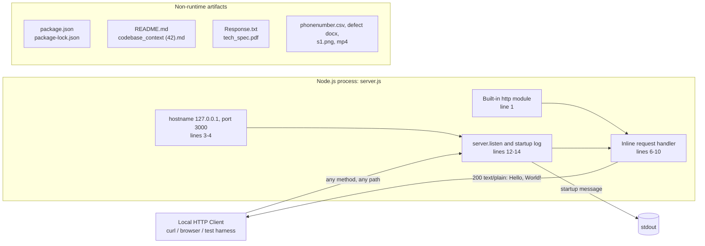

#### Core Technical Approach

The server uses plain Node.js with no framework. It is a single process that relies on the event loop, uses CommonJS `require`, and passes callbacks for both the request handler and the listen notification. There is no build step, transpilation or dependency installation. The whole server reduces to:

```javascript
const server = http.createServer((req, res) => { res.statusCode = 200; /* ... */ res.end('Hello, World!\n'); });
server.listen(port, hostname, () => console.log(`Server running at http://${hostname}:${port}/`));
```

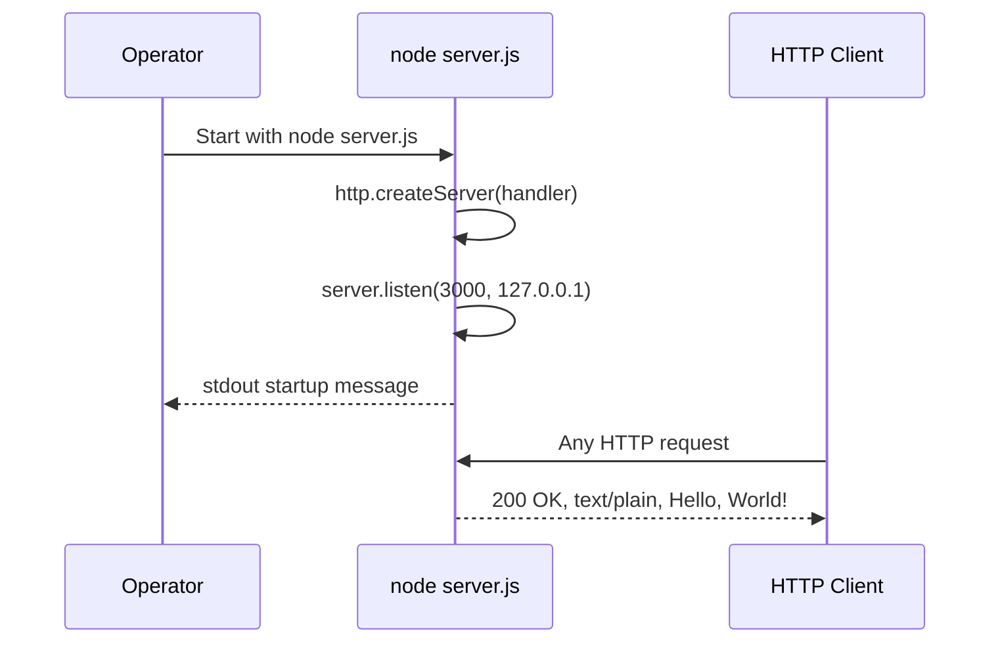

No runtime version is pinned: `package.json` has no `engines` field. `tech_spec.pdf` recorded Node.js 20.19.5 and npm 10.8.2 at analysis time and recommends documenting compatibility with Node.js 12.x and later. The lockfile uses `lockfileVersion` 3, the format written by npm 9 and later, which npm 7 and later can read.

### 1.2.3 Success Criteria

The repository defines no formal KPIs, and its only test script always fails. The success criteria below come from two sources: the baseline behavior that both action plans require to stay unchanged, and the targets those plans propose.

#### Measurable Objectives (Baseline Behavior Contract)

| Objective | Target | Current Status |
|---|---|---|
| Startup message | `Server running at http://127.0.0.1:3000/` | Met (checked at runtime) |
| Response status and type | `200`, `Content-Type: text/plain`, for any path and method | Met (checked at runtime) |
| Response body | `Hello, World!\n` (14 bytes) | Met (checked at runtime) |
| Bind address | `127.0.0.1:3000` | Met (`server.js` lines 3–4) |
| Dependency footprint | Zero third-party packages | Met (`package-lock.json`) |

#### Critical Success Factors

- **Behavior is preserved.** `Response.txt` (section 0.5) and `tech_spec.pdf` (section 0.8) both forbid changing the port, hostname, response text, `Content-Type` or the `require()` style.
- **No dependencies are added.** Both plans exclude new dependencies, frameworks and logging libraries.
- **The footprint stays small.** Both plans expect `server.js` to grow from 15 lines to about 70–75 lines and the structure to stay flat.
- **Results stay deterministic.** One fixed response keeps integration and verification assertions simple.

#### Key Performance Indicators (Proposed in Planning Artifacts)

These targets are not implemented, and the repository has no tooling to measure them.

| KPI | Target | Source |
|---|---|---|
| Local response time | < 50 ms per request | `Response.txt` 0.6 |
| Memory footprint | < 50 MB RSS | `Response.txt` 0.6 |
| Concurrency | 100+ simultaneous connections (`ab -n 1000 -c 100`) with a 0% error rate under normal load | `Response.txt` 0.6 |
| Shutdown and fault exit codes | `SIGTERM` → exit 0 after draining; `EADDRINUSE` → logged, exit 1; forced exit after 10 s | `Response.txt` 0.4, 0.6 |
| JSDoc coverage | 0 of 7 elements → 7 of 7 (100%) | `tech_spec.pdf` 0.7 |
| README coverage | 1 of 17 sections (5.9%) → 17 of 17 | `tech_spec.pdf` 0.7 |
| API and configuration documentation | 0 of 1 endpoint and 0 of 2 parameters → 100% | `tech_spec.pdf` 0.7 |

`Response.txt` reports 98% confidence in its fix based on test files (`test_server.js`, `server_fixed.js`, `test_fixes.js`). None of these files exist in the repository.

## 1.3 Scope

### 1.3.1 In-Scope

#### Core Features and Functionalities

Must-have capabilities, as implemented:

| Capability | Description | Evidence |
|---|---|---|
| Catch-all HTTP endpoint | Every request gets `200`, `Content-Type: text/plain`, `Hello, World!\n`, whatever its path, method, headers or body | `server.js` lines 6–10 |
| Fixed loopback binding | Listens on `127.0.0.1` port `3000` | `server.js` lines 3–4, 12 |
| Startup notification | Logs `Server running at http://127.0.0.1:3000/` once the server is listening | `server.js` line 13 |
| Runtime without dependencies | Uses only the built-in `http` module; nothing needs installing | `server.js` line 1, `package-lock.json` |

#### Primary User Workflows

| Workflow | Steps | Outcome |
|---|---|---|
| Start the server | Run `node server.js` from the repository root | Startup message on stdout; port 3000 bound on loopback |
| Call the endpoint | `curl http://127.0.0.1:3000/`, with any path or method | `Hello, World!` |
| Automated verification | Start in the background, capture the PID, request the endpoint, compare the body, then send `kill` to the PID | The pattern used by the verification scripts in `Response.txt` 0.6 |
| Stop the server | Ctrl+C (`SIGINT`) or `SIGTERM` | Node.js's default termination, with no connection draining |

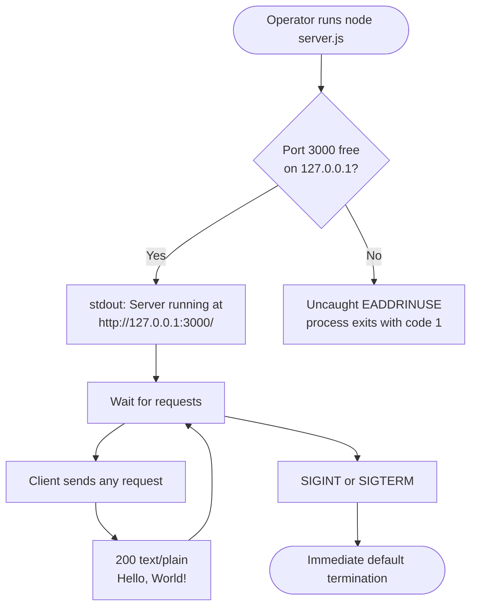

#### Essential Integrations

| Integration | Type | Status |
|---|---|---|
| Node.js runtime and the built-in `http` module | Runtime platform | Required. No version is pinned (no `engines` field) |
| npm | Package metadata and lockfile tooling | Optional. There is nothing to install, and `npm test` fails by design |
| Local HTTP clients | Inbound HTTP/1.1 over loopback | Supported |

#### Key Technical Requirements

- A Node.js runtime that provides the `http` module. `tech_spec.pdf` recorded Node.js 20.19.5 and npm 10.8.2 in its analysis environment.
- Port `3000` free on `127.0.0.1` at startup.
- Start with `node server.js` directly. `package.json` has no `start` script, and its `main` points to a missing `index.js`.
- No network access or dependency installation is needed to run the server.

### 1.3.2 Implementation Boundaries

#### System Boundaries

| Boundary | Definition | Evidence |
|---|---|---|
| Process | One Node.js process running one source file | `server.js` |
| Network | Inbound only, loopback interface only; not reachable from other hosts | `server.js` line 3 (`127.0.0.1`) |
| Persistence | None: no files, databases or caches are read or written | `server.js` |
| Outbound calls | None | `server.js` |
| Repository layout | Flat root with 11 tracked files and no subfolders | Repository root, commit `3976c7d` |

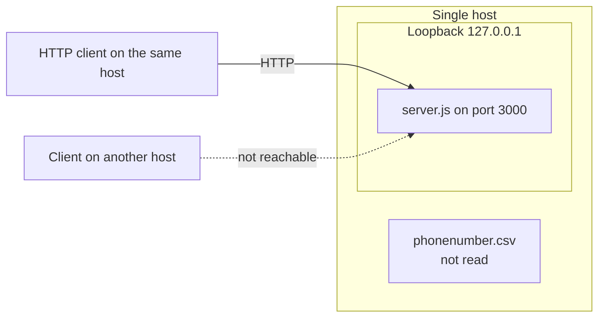

#### User Groups Covered

| User Group | Coverage |
|---|---|
| Local developers and tutorial learners | Run and query the server on their own machine |
| Integration test harnesses ("backprop integration") | Use the fixed response as a known target |
| Automated analysis and documentation agents | Read and plan changes to `server.js` |
| Remote or end-user clients | Not covered: the server is bound to loopback only |

#### Geographic and Market Coverage

None applies. The service runs on a single host's loopback interface. Its only output is a fixed English string, with no localization, time-zone or regional handling. `phonenumber.csv` holds plus-prefixed numbers from `+11111111201` to `+11111111223` that look synthetic, and no code reads them.

#### Data Domains Included

| Data Domain | Artifact | Processed by Runtime |
|---|---|---|
| HTTP request/response | `server.js` | Yes. The request content is ignored and the response is fixed |
| Package metadata | `package.json`, `package-lock.json` | No (npm tooling only) |
| Message and phone-number samples (15 rows, columns `message,phonenumber`) | `phonenumber.csv` | No |
| Requirements and specifications | `codebase_context (42).md`, `Response.txt`, `tech_spec.pdf` | No |
| Defect report and media | `defect_for_task_1.docx`, `s1.png` (1152×958), `20250304165759.mp4` (1920×1080, 60 s) | No |

The runtime does not store or process any user data or personal data.

### 1.3.3 Out-of-Scope

#### Excluded Features and Capabilities

Each item below is absent from `server.js`. The Basis column shows which planning artifact excludes it explicitly.

| Excluded Capability | Basis |
|---|---|
| Routing, extra endpoints, request-parsing middleware | `Response.txt` 0.5; `tech_spec.pdf` 0.8 |
| Web frameworks (for example Express.js) | `Response.txt` 0.5 |
| Authentication and authorization | `Response.txt` 0.5 |
| HTTPS/TLS | `Response.txt` 0.5 |
| Databases and external service integrations | `Response.txt` 0.5; `tech_spec.pdf` 0.8 |
| Clustering and load balancing | `Response.txt` 0.5 |
| Health-check endpoints, metrics, monitoring | `Response.txt` 0.5 |
| Logging libraries (winston, morgan) | `Response.txt` 0.5 |
| Configuration management and environment variables | `Response.txt` 0.5 |
| TypeScript conversion | `Response.txt` 0.5 |
| Unit tests, test frameworks, CI/CD pipelines | `Response.txt` 0.5; `tech_spec.pdf` 0.8 |
| New dependencies, npm scripts, linters, build tooling | `tech_spec.pdf` 0.8 |

#### Future Phase Considerations

The repository contains two proposed initiatives. Neither has been applied.

| Initiative | Source | Proposed Content |
|---|---|---|
| Production hardening | `Response.txt` | A `try/catch` in the handler (500 if headers are not yet sent), a `server.on('error')` listener for `EADDRINUSE`/`EACCES`, a `clientError` listener that returns 400, a `gracefulShutdown` that calls `server.close` and forces exit after 10 s, and `SIGTERM`/`SIGINT` handlers |
| Documentation upgrade | `tech_spec.pdf` | JSDoc for all 7 documentable elements, a 300–400 line README with 17 sections, at least 3 Mermaid diagrams and at least 8 examples, plus deployment guides (Docker, Heroku, AWS, Azure, DigitalOcean, PM2) |
| Tutorial `/hello` contract | `codebase_context (42).md` | A single `/hello` endpoint that returns `Hello world` |

The two plans conflict. `tech_spec.pdf` 0.8 rules out "error handling additions" and lists "No bug fixes (none identified)". `Response.txt` names six production-readiness defects and changes only error handling. The repository does not say which plan comes first or whether they will be combined.

#### Integration Points Not Covered

- **Backprop integration.** `README.md` names it, but the repository has no interface, client, configuration or contract for it.
- **Messaging or SMS.** `phonenumber.csv` suggests a message-dispatch dataset, but there is no consuming code or provider integration.
- **Defect tracking.** `defect_for_task_1.docx` lists unrelated UI defects ("Overlapping with header in Event update", "Overlapping of Hindi characters", "Skype link not working in simple play.com") with no link to this server.
- **Deployment platforms.** There is no Dockerfile, process-manager configuration, cloud manifest or package-registry publishing setup.

#### Unsupported Use Cases

| Use Case | Why Unsupported |
|---|---|
| Access from other hosts | Bound to `127.0.0.1` only |
| Dynamic or path-specific content | The handler ignores the request entirely |
| Request bodies, query strings, non-text content types | No parsing; the response is always `text/plain` |
| Several instances on one host | Port 3000 is hard-coded, and a second instance exits on uncaught `EADDRINUSE` |
| Zero-downtime or graceful restarts | No signal handling or connection draining |
| Starting with `npm start` or loading through `require('hello_world')` | No `start` script; `main` points to the missing `index.js` |
| Running `npm test` | The test script exits with code 1 by design |

## 1.4 References

- `server.js` - The entire runtime: `http` import (line 1), `127.0.0.1:3000` constants (lines 3–4), catch-all `200 text/plain "Hello, World!\n"` handler (lines 6–10), `server.listen` with startup log (lines 12–14). It has no routing, error listeners or signal handlers.
- `package.json` - Package `hello_world` 1.0.0, description "Hello world in Node.js", `main: index.js` (missing file), placeholder failing test script, author `hxu`, MIT license, no dependencies, no `start` script or `engines` field.
- `package-lock.json` - `lockfileVersion` 3 listing only the root package, which confirms there are no third-party dependencies.
- `README.md` - Repository title `hao-backprop-test` and the purpose "test project for backprop integration."
- `codebase_context (42).md` - The original tutorial request for a single `/hello` endpoint that returns "Hello world".
- `Response.txt` - The Blitzy Agent Action Plan for production hardening: six identified gaps, the proposed fix, scope exclusions (0.5), performance and verification targets (0.6), and the 98% confidence claim.
- `tech_spec.pdf` - The Blitzy Agent Action Plan for documentation enhancement (project `existing_project_2511_lakshya_github_5`, 2025-11-25): coverage metrics (0.7), dependency inventory with Node.js 20.19.5 and npm 10.8.2 (0.6), and in-scope and out-of-scope boundaries (0.8).
- `phonenumber.csv` - 15 message and phone-number sample rows that the runtime never reads.
- `defect_for_task_1.docx` - An unrelated UI defect list (header overlap, Hindi character overlap, Skype link) with embedded screenshots.
- `s1.png` - A 1152×958 image artifact that no code references.
- `20250304165759.mp4` - A 60-second 1920×1080 H.264 video artifact that no code references.
- `/` (repository root) - A flat layout with 11 tracked files, no subfolders, no `.blitzyignore`, and a single commit `3976c7d` ("Add files via upload").
- Runtime check of `server.js` - Confirmed identical `200` responses on `/`, `/hello`, `/anything` and `POST /hello`; Node.js's default `400 Bad Request` for malformed input, with the server staying up; and an uncaught `EADDRINUSE` with exit code 1 when a second instance starts.

# 2. Product Requirements

## 2.1 Feature Catalog

This catalog splits the product into discrete, testable features. Each feature comes from one of two kinds of evidence:

- **Implemented features** are present in `server.js`, `package.json` or `package-lock.json`, and their behavior was checked by running the server.
- **Proposed features** appear only in the repository's planning artifacts: `codebase_context (42).md` (the original tutorial request), `Response.txt` (a production-hardening action plan) and `tech_spec.pdf` (a documentation action plan). None of them exist in the code.

No artifact records an approval decision or work in progress, so no feature is marked *Approved* or *In Development*. The repository also contains `phonenumber.csv`, `defect_for_task_1.docx`, `s1.png` and `20250304165759.mp4`. No code reads them and no plan asks for a feature built on them, so they define no features (see Section 1.3.3).

### 2.1.1 Catalog Overview

| ID | Feature Name | Priority | Status |
|---|---|---|---|
| F-001 | HTTP Server Bootstrap and Loopback Binding | Critical | Completed |
| F-002 | Catch-All Plain-Text Response | Critical | Completed |
| F-003 | Startup Notification Logging | Medium | Completed |
| F-004 | Zero-Dependency npm Package Metadata | High | Completed (with known defects) |
| F-005 | Tutorial `/hello` Endpoint Contract | Medium | Proposed (partly met by chance) |
| F-006 | Server Listen-Error Handling | High | Proposed |
| F-007 | Request Handler Fault Isolation | High | Proposed |
| F-008 | Malformed Client Request Handling | Low | Proposed |
| F-009 | Graceful Shutdown on SIGTERM/SIGINT | High | Proposed |
| F-010 | Source Code JSDoc Documentation | Medium | Proposed |
| F-011 | Project Documentation Suite | Medium | Proposed |

Priorities follow two rules taken from the evidence:

- **Critical:** behavior that both action plans require to stay unchanged (`Response.txt` 0.5–0.6, `tech_spec.pdf` 0.8).
- **High / Medium / Low:** for proposed features, set by the impact of the gap as checked at runtime. For example, the missing `EADDRINUSE` handling really does crash the process, so F-006 is High. The missing `clientError` handling is already covered by Node.js's default `400` reply, so F-008 is Low.

Features are grouped into these categories:

| Category | Features | Source Artifact | Spec Cross-Reference |
|---|---|---|---|
| Core HTTP Runtime | F-001, F-002 | `server.js` | Sections 1.2.2, 1.3.1 |
| Operations and Observability | F-003 | `server.js` | Section 1.2.2 |
| Packaging and Distribution | F-004 | `package.json`, `package-lock.json` | Sections 1.1.1, 1.3.1 |
| API Routing | F-005 | `codebase_context (42).md` | Section 1.3.3 |
| Reliability and Lifecycle | F-006 – F-009 | `Response.txt` | Sections 1.2.1, 1.3.3 |
| Documentation | F-010, F-011 | `tech_spec.pdf` | Sections 1.2.3, 1.3.3 |

### 2.1.2 Implemented Features

#### 2.1.2.1 F-001 HTTP Server Bootstrap and Loopback Binding

| Category | Priority | Status | Evidence |
|---|---|---|---|
| Core HTTP Runtime | Critical | Completed | `server.js` lines 1, 3–4, 6, 12 |

**Description**

- **Overview:** Loads Node.js's built-in `http` module through CommonJS `require`, creates a server with `http.createServer`, and binds it to the hard-coded constants `hostname = '127.0.0.1'` and `port = 3000` through `server.listen(port, hostname, callback)`.
- **Business Value:** Gives every consumer a single fixed, known address. Both action plans require it to stay unchanged: `Response.txt` 0.5 says "do not refactor port/hostname", and `tech_spec.pdf` 0.8 says the same.
- **User Benefits:** Tutorial learners and test harnesses can reach the server at `http://127.0.0.1:3000/` with no configuration and nothing to install.
- **Technical Context:** One process and one event loop. No environment variables, CLI arguments or configuration files are read. Binding to loopback keeps the server unreachable from other hosts (Section 1.3.2).

**Dependencies**

| Dependency Type | Detail |
|---|---|
| Prerequisite Features | None (root feature) |
| System Dependencies | A Node.js runtime with the built-in `http` module. No version is pinned (`package.json` has no `engines` field). Port 3000 must be free on `127.0.0.1` |
| External Dependencies | None |
| Integration Requirements | Inbound HTTP/1.1 from clients on the same host only |

#### 2.1.2.2 F-002 Catch-All Plain-Text Response

| Category | Priority | Status | Evidence |
|---|---|---|---|
| Core HTTP Runtime | Critical | Completed | `server.js` lines 6–10 |

**Description**

- **Overview:** An inline request handler that never reads `req`. It sets `res.statusCode = 200`, sets `Content-Type: text/plain`, and ends the response with `Hello, World!\n`. Every method and path gets the same reply.
- **Business Value:** Output is fully predictable, so integration ("backprop integration", `README.md`) and verification checks can be exact. `Response.txt` 0.6 lists this response as behavior that must stay unchanged.
- **User Benefits:** Assertions are trivial (a 14-byte body), and the code shows the core Node.js response API without a framework.
- **Technical Context:** Checked at runtime. `GET`, `POST`, `PUT` and `DELETE` on any path return `200` with `Content-Length: 14`, `Connection: keep-alive` and `Keep-Alive: timeout=5`. `HEAD` returns headers only. Request bodies and query strings are ignored.

**Dependencies**

| Dependency Type | Detail |
|---|---|
| Prerequisite Features | F-001 (the handler is registered through `http.createServer` and served by the listener) |
| System Dependencies | Node.js `http.IncomingMessage` and `http.ServerResponse` |
| External Dependencies | None |
| Integration Requirements | Any HTTP/1.1 client: curl, browsers, scripts, test harnesses |

#### 2.1.2.3 F-003 Startup Notification Logging

| Category | Priority | Status | Evidence |
|---|---|---|---|
| Operations and Observability | Medium | Completed | `server.js` lines 12–14 |

**Description**

- **Overview:** Once the socket is bound, the listen callback writes `Server running at http://127.0.0.1:3000/` to stdout. The URL is built from the `hostname` and `port` constants.
- **Business Value:** It is the only runtime signal that the server is ready. `Response.txt` 0.6 lists the startup log as behavior that must stay unchanged.
- **User Benefits:** Operators and scripts can tell that the server started successfully, and get a URL they can click.
- **Technical Context:** Uses `console.log` and a template literal. Nothing else is logged: no request logs and no error logs.

**Dependencies**

| Dependency Type | Detail |
|---|---|
| Prerequisite Features | F-001 (runs only after a successful `listen`) |
| System Dependencies | Process stdout |
| External Dependencies | None |
| Integration Requirements | Operators or wrappers that read stdout, such as the `npm start` banner |

#### 2.1.2.4 F-004 Zero-Dependency npm Package Metadata

| Category | Priority | Status | Evidence |
|---|---|---|---|
| Packaging and Distribution | High | Completed (known defects) | `package.json`, `package-lock.json` |

**Description**

- **Overview:** Declares the package `hello_world` version `1.0.0` ("Hello world in Node.js"), author `hxu`, MIT license. It declares no dependencies, and the lockfile (`lockfileVersion` 3) lists only the root package.
- **Business Value:** Nothing to install or audit for supply-chain risk. Both plans forbid new dependencies (Section 1.2.3, Critical Success Factors).
- **User Benefits:** Clone and run, with no install step and no network access needed.
- **Technical Context:** Three defects are known:
  - `main` points to a file that does not exist (`index.js`).
  - `scripts.test` is a placeholder that always exits with code 1.
  - There is no `start` script. Even so, `npm start` works, because npm runs `node server.js` by default when a `server.js` file exists at the package root. This was checked at runtime: the npm banner `> node server.js` appears, followed by the startup log. Section 1.3.3 lists `npm start` as unsupported, which this runtime check contradicts.

**Dependencies**

| Dependency Type | Detail |
|---|---|
| Prerequisite Features | None |
| System Dependencies | npm is optional. Lockfile v3 is the format written by npm 9 and later, and npm 7 and later can read it |
| External Dependencies | None (no registry packages) |
| Integration Requirements | `npm start` (default script that runs `server.js`); `npm test` (fails by design) |

### 2.1.3 Proposed Features

#### 2.1.3.1 F-005 Tutorial `/hello` Endpoint Contract

| Category | Priority | Status | Evidence |
|---|---|---|---|
| API Routing | Medium | Proposed (partly met by chance) | `codebase_context (42).md` |

**Description**

- **Overview:** The original request asks for "a nodejs tutorial project that features one end point '/hello' that returns "Hello world" to the calling HTTP client".
- **Business Value:** It defines the tutorial's intended learning outcome: a single named endpoint.
- **User Benefits:** Learners see how to handle a specific path.
- **Technical Context:** The current server answers `/hello` with `200` only because it answers every path. The body is `Hello, World!\n`, not `Hello world`, and other paths are not rejected. This request conflicts with the scope exclusions of both plans: `Response.txt` 0.5 forbids "additional routes/endpoints" and any change to the response text, and `tech_spec.pdf` 0.8 forbids routing. The repository does not resolve the conflict.

**Dependencies**

| Dependency Type | Detail |
|---|---|
| Prerequisite Features | F-001; it would narrow or replace F-002 |
| System Dependencies | `req.url` and `req.method` from Node.js `http` (not used today) |
| External Dependencies | None |
| Integration Requirements | HTTP clients calling `GET /hello` |

#### 2.1.3.2 F-006 Server Listen-Error Handling

| Category | Priority | Status | Evidence |
|---|---|---|---|
| Reliability and Lifecycle | High | Proposed | `Response.txt` 0.1, 0.2, 0.4 |

**Description**

- **Overview:** A `server.on('error')` listener that recognizes `EADDRINUSE` (logs "Port 3000 is already in use") and `EACCES` (logs "Permission denied to bind to port 3000"), then calls `process.exit(1)`.
- **Business Value:** Turns an uncaught stack trace into a clear, actionable operator message.
- **User Benefits:** Operators see the cause of a failed startup at a glance.
- **Technical Context:** The gap is real. When a second instance starts today, it throws `Error: listen EADDRINUSE: address already in use 127.0.0.1:3000` as an unhandled `'error'` event and exits with code 1. The proposed feature keeps exit code 1 but replaces the crash with a controlled exit.

**Dependencies**

| Dependency Type | Detail |
|---|---|
| Prerequisite Features | F-001 |
| System Dependencies | The `'error'` event of Node.js `net.Server`, and `process.exit` |
| External Dependencies | None |
| Integration Requirements | Operator console (stderr through `console.error`) |

#### 2.1.3.3 F-007 Request Handler Fault Isolation

| Category | Priority | Status | Evidence |
|---|---|---|---|
| Reliability and Lifecycle | High | Proposed | `Response.txt` 0.2 (root causes #3, #5), 0.4 |

**Description**

- **Overview:** Two guards in the handler:
  - **Input guard:** `if (!req || !res)`, which logs "Invalid request or response object" and returns.
  - **`try/catch` around the response logic:** on an exception it logs `Error handling request: <message>` and, if `res.headersSent` is false, sends `500` with `Internal Server Error\n`.
- **Business Value:** A fault in one request can no longer end the process for every client.
- **User Benefits:** Clients get a clear `500` instead of a dropped connection.
- **Technical Context:** The current handler cannot throw in practice because it only writes constants, so the guards are defensive. The `headersSent` check avoids the "Cannot set headers" edge case that `Response.txt` 0.3 lists.

**Dependencies**

| Dependency Type | Detail |
|---|---|
| Prerequisite Features | F-002 (it wraps the existing response logic) |
| System Dependencies | `res.headersSent` on Node.js `http.ServerResponse` |
| External Dependencies | None |
| Integration Requirements | HTTP clients must handle a `500` response |

#### 2.1.3.4 F-008 Malformed Client Request Handling

| Category | Priority | Status | Evidence |
|---|---|---|---|
| Reliability and Lifecycle | Low | Proposed | `Response.txt` 0.2, 0.4 |

**Description**

- **Overview:** A `server.on('clientError')` listener that writes `HTTP/1.1 400 Bad Request\r\n\r\n` and closes the socket when `socket.writable` is true.
- **Business Value:** Makes the response to a malformed request explicit.
- **User Benefits:** Malformed clients get a clear `400`.
- **Technical Context:** `Response.txt` says malformed requests crash the server. A runtime check contradicts this: sending `INVALID HTTP\r\n\r\n` already returns Node.js's default `HTTP/1.1 400 Bad Request` with `Connection: close`, and the server keeps serving. The feature would therefore mostly make existing default behavior explicit.

**Dependencies**

| Dependency Type | Detail |
|---|---|
| Prerequisite Features | F-001 |
| System Dependencies | The `'clientError'` event on Node.js `http.Server`, and `socket.writable` |
| External Dependencies | None |
| Integration Requirements | Raw TCP or HTTP clients |

#### 2.1.3.5 F-009 Graceful Shutdown on SIGTERM/SIGINT

| Category | Priority | Status | Evidence |
|---|---|---|---|
| Reliability and Lifecycle | High | Proposed | `Response.txt` 0.2 (root causes #2, #6), 0.4, 0.6 |

**Description**

- **Overview:** A `gracefulShutdown(signal)` function registered with `process.on('SIGTERM')` and `process.on('SIGINT')`. It logs that shutdown is starting, then calls `server.close()`. When all connections are finished it logs "Server closed. All connections finished." and exits with code 0. A 10,000 ms `setTimeout` forces exit code 1 with "Forced shutdown - connections did not close in time".
- **Business Value:** In-flight requests finish during restarts, and the cleanup hook is where resources get released.
- **User Benefits:** Clients are not cut off mid-response, and orchestrators get a clean exit code.
- **Technical Context:** Checked at runtime: today `SIGTERM` ends the process with exit code 143 and `SIGINT` with 130 (default signal termination, no draining). `Response.txt` 0.6 expects exit code 0 after `SIGTERM`.

**Dependencies**

| Dependency Type | Detail |
|---|---|
| Prerequisite Features | F-001 |
| System Dependencies | POSIX signals through `process.on`, `server.close`, timers |
| External Dependencies | None |
| Integration Requirements | Process supervisors that send `SIGTERM` (`Response.txt` names Docker and Kubernetes); Ctrl+C for `SIGINT` |

#### 2.1.3.6 F-010 Source Code JSDoc Documentation

| Category | Priority | Status | Evidence |
|---|---|---|---|
| Documentation | Medium | Proposed | `tech_spec.pdf` 0.1–0.7 |

**Description**

- **Overview:** JSDoc comments on all 7 documentable elements of `server.js`: a file-level comment, the 2 constants (`hostname`, `port`), the 2 functions (the request handler and the listen callback) and 3 inline explanations. Coverage would go from 0% to 100%.
- **Business Value:** Fits the code's teaching purpose, and documentation can be generated from it.
- **User Benefits:** Learners get annotations on each part of the code.
- **Technical Context:** Required tags are `@file`, `@constant`/`@type`, `@param {http.IncomingMessage} req`, `@param {http.ServerResponse} res`, `@returns {void}`, `@example` (on the handler), `@callback`/`@function` (on the listen callback), and `@see` links to sections of the README. Runtime behavior must not change.

**Dependencies**

| Dependency Type | Detail |
|---|---|
| Prerequisite Features | F-001, F-002, F-003 (the elements being documented) |
| System Dependencies | None at runtime |
| External Dependencies | `jsdoc` 4.0.2, optional, for generating HTML (`tech_spec.pdf` dependency inventory) |
| Integration Requirements | The `@see` tags reference README sections from F-011 |

#### 2.1.3.7 F-011 Project Documentation Suite

| Category | Priority | Status | Evidence |
|---|---|---|---|
| Documentation | Medium | Proposed | `tech_spec.pdf` 0.7, quality checklist (about pp. 42–45) |

**Description**

- **Overview:** Replaces the two-line `README.md` with a README of 300–400 lines in 17 sections: title and badges, table of contents, overview, features, prerequisites, installation, quick start, API documentation, configuration, code structure, deployment, development, troubleshooting, contributing, license, changelog, and author and acknowledgments. It also includes at least 3 Mermaid diagrams and deployment guides for local, Docker, Heroku, AWS, Azure, DigitalOcean and PM2.
- **Business Value:** README coverage goes from 1 of 17 sections (5.9%) to 17 of 17, and the single endpoint and its 2 configuration parameters get documented.
- **User Benefits:** A path from cloning to first request, plus troubleshooting and deployment help.
- **Technical Context:** Documentation only. `tech_spec.pdf` 0.8 allows describing the mismatch between the `package.json` name and the `README.md` title "without fixing it", and forbids code changes and new npm scripts.

**Dependencies**

| Dependency Type | Detail |
|---|---|
| Prerequisite Features | F-001 – F-004 (the behavior being documented) |
| System Dependencies | A Markdown renderer with Mermaid support, needed only to view the diagrams |
| External Dependencies | The deployment platforms are covered only in text; there are no manifests |
| Integration Requirements | Cross-links with the F-010 JSDoc `@see` tags |

## 2.2 Functional Requirements

Each requirement has an ID of the form `F-XXX-RQ-YYY`. The **Priority / Complexity** column gives the MoSCoW priority (Must-Have, Should-Have or Could-Have) and the implementation complexity (High, Medium or Low).

- **Implemented features (F-001 – F-004):** the acceptance criteria describe behavior that was checked against the current `server.js` on Node.js v22.23.3. The pass/fail results are in Section 2.5.
- **Proposed features (F-005 – F-011):** the criteria come from the source artifact named for each feature.

Unless a criterion says otherwise, the server is started with `node server.js` from the repository root.

### 2.2.1 F-001 HTTP Server Bootstrap and Loopback Binding

| Requirement ID | Description | Acceptance Criteria | Priority / Complexity |
|---|---|---|---|
| F-001-RQ-001 | Create the server using only the built-in `http` module | `server.js` line 1 is the only `require`, and it loads `'http'`; `node --check server.js` exits 0 | Must / Low |
| F-001-RQ-002 | Bind to host `127.0.0.1` | `curl http://127.0.0.1:3000/` succeeds; nothing listens on any interface other than loopback | Must / Low |
| F-001-RQ-003 | Listen on TCP port `3000` | A listening socket exists on `127.0.0.1:3000` after startup | Must / Low |
| F-001-RQ-004 | Start without installing anything | On a fresh clone, both `node server.js` and `npm start` (npm's default runs `server.js`) start the server and print the startup log | Must / Low |

| Aspect | Specification |
|---|---|
| Input Parameters | Hard-coded constants `hostname = '127.0.0.1'` and `port = 3000` (`server.js` lines 3–4). No environment variables, CLI arguments or configuration files |
| Output / Response | A listening `http.Server`; the listen callback triggers F-003 |
| Performance Criteria | The repository defines none |
| Data Requirements | None; nothing is persisted |

| Rule Type | Rule |
|---|---|
| Business Rules | Port and hostname must not change (`Response.txt` 0.5; `tech_spec.pdf` 0.8) |
| Data Validation | Not applicable; there is no external input to configuration |
| Security Requirements | Loopback-only exposure. TLS, authentication and clustering are explicitly out of scope (`Response.txt` 0.5) |
| Compliance Requirements | None defined beyond the MIT license (`package.json`) |

### 2.2.2 F-002 Catch-All Plain-Text Response

| Requirement ID | Description | Acceptance Criteria | Priority / Complexity |
|---|---|---|---|
| F-002-RQ-001 | Return status `200` for every request | `GET`, `POST`, `PUT`, `DELETE` and `HEAD` on `/`, `/hello` and any other path all return `HTTP/1.1 200 OK` | Must / Low |
| F-002-RQ-002 | Set `Content-Type: text/plain` | The response header `Content-Type` equals `text/plain` | Must / Low |
| F-002-RQ-003 | Return the body `Hello, World!\n` exactly | The body is byte-identical to `Hello, World!\n`, and `Content-Length` is `14` | Must / Low |
| F-002-RQ-004 | Ignore the request method, path, query, headers and body | `POST /api` with a JSON body and `GET /?q=1` both return the same 200 response of 14 bytes | Must / Low |
| F-002-RQ-005 | Send headers only for `HEAD` (Node.js default) | `curl -I` returns `200` with no body | Could / Low |
| F-002-RQ-006 | Keep HTTP/1.1 connections alive (Node.js default) | The response includes `Connection: keep-alive` and `Keep-Alive: timeout=5` | Could / Low |

| Aspect | Specification |
|---|---|
| Input Parameters | Any HTTP/1.1 request. `req` is never read |
| Output / Response | Status `200`; headers `Content-Type: text/plain`, `Content-Length: 14`, `Date`, `Connection: keep-alive`, `Keep-Alive: timeout=5`; body `Hello, World!\n` |
| Performance Criteria | Proposed targets (`Response.txt` 0.6): under 50 ms per local request, 100 or more concurrent connections (`ab -n 1000 -c 100`), 0% errors under normal load. Observed: about 0.5 ms for a single request; 1,000 requests over 100 keep-alive sockets finished in 84 ms with 0 errors |
| Data Requirements | No request data is read or stored |

| Rule Type | Rule |
|---|---|
| Business Rules | Response text, status and `Content-Type` must not change (`Response.txt` 0.5–0.6; `tech_spec.pdf` 0.8) |
| Data Validation | None; the request is not inspected |
| Security Requirements | No request content is processed, so there is nothing to inject into. No authentication (out of scope) |
| Compliance Requirements | None defined |

### 2.2.3 F-003 Startup Notification Logging

| Requirement ID | Description | Acceptance Criteria | Priority / Complexity |
|---|---|---|---|
| F-003-RQ-001 | Log the startup message once the server is bound | stdout contains exactly `Server running at http://127.0.0.1:3000/`, once per process | Must / Low |
| F-003-RQ-002 | Build the message from the configuration constants | `server.js` line 13 builds the URL from `${hostname}` and `${port}` | Should / Low |
| F-003-RQ-003 | Print no startup message if binding fails | With port 3000 already taken, a second instance prints no `Server running` line | Should / Low |

| Aspect | Specification |
|---|---|
| Input Parameters | `hostname` and `port` constants |
| Output / Response | One stdout line through `console.log` |
| Performance Criteria | Printed once per process start |
| Data Requirements | None |

| Rule Type | Rule |
|---|---|
| Business Rules | The startup log is part of the behavior that must stay unchanged (`Response.txt` 0.6) |
| Data Validation | Not applicable |
| Security Requirements | The log reveals only the loopback URL |
| Compliance Requirements | None defined |

### 2.2.4 F-004 Zero-Dependency npm Package Metadata

| Requirement ID | Description | Acceptance Criteria | Priority / Complexity |
|---|---|---|---|
| F-004-RQ-001 | Declare no third-party dependencies | `package.json` has no `dependencies` or `devDependencies`; `package-lock.json` `packages` has only the `""` root entry | Must / Low |
| F-004-RQ-002 | Declare the package identity | `name` = `hello_world`, `version` = `1.0.0`, `author` = `hxu`, `license` = `MIT` | Must / Low |
| F-004-RQ-003 | Keep the lockfile consistent with the manifest | The lockfile's `name` and `version` match `package.json`; `lockfileVersion` = 3 | Should / Low |
| F-004-RQ-004 | Start the server through npm | `npm start` prints `> node server.js` and then the F-003 startup log | Should / Low |

| Aspect | Specification |
|---|---|
| Input Parameters | None |
| Output / Response | npm package metadata; `npm test` prints `Error: no test specified` and exits 1 |
| Performance Criteria | Not applicable; there is no install step |
| Data Requirements | `package.json` fields `name`, `version`, `description`, `main`, `scripts.test`, `author`, `license` |

| Rule Type | Rule |
|---|---|
| Business Rules | No new dependencies (both plans). `package.json`, `package-lock.json` and `README.md` stay unchanged under the hardening plan (`Response.txt` 0.5). Under the documentation plan, the name mismatch is documented, not fixed (`tech_spec.pdf` 0.8) |
| Data Validation | `main: index.js` refers to a file that does not exist, a known defect that no artifact plans to fix |
| Security Requirements | No supply-chain exposure from third-party packages |
| Compliance Requirements | MIT is declared in `package.json`. The repository has no `LICENSE` file |

### 2.2.5 F-005 Tutorial `/hello` Endpoint Contract

| Requirement ID | Description | Acceptance Criteria | Priority / Complexity |
|---|---|---|---|
| F-005-RQ-001 | Expose a `/hello` endpoint that returns `Hello world` | A request to `/hello` returns a body equal to `Hello world` | Must / Low |
| F-005-RQ-002 | Expose only one endpoint | Paths other than `/hello` do not return the `/hello` payload. The source does not say what status they should get | Should / Low |

| Aspect | Specification |
|---|---|
| Input Parameters | The request path `/hello`. Method, query handling and content type are not specified |
| Output / Response | `Hello world` to the calling HTTP client |
| Performance Criteria | Not specified |
| Data Requirements | None |

| Rule Type | Rule |
|---|---|
| Business Rules | Conflicts with the "no additional routes/endpoints" rule and the unchanged-response rule in `Response.txt` 0.5, and with the routing exclusion in `tech_spec.pdf` 0.8. A decision is needed before implementation |
| Data Validation | Matching on the path would require reading `req.url`, which the server does not do today |
| Security Requirements | None specified |
| Compliance Requirements | None specified |

### 2.2.6 F-006 Server Listen-Error Handling

| Requirement ID | Description | Acceptance Criteria | Priority / Complexity |
|---|---|---|---|
| F-006-RQ-001 | Register a `server.on('error')` listener | A second instance on port 3000 no longer prints an unhandled `'error'` stack trace | Must / Low |
| F-006-RQ-002 | Report `EADDRINUSE` and exit | stderr contains `Port 3000 is already in use`, and the exit code is `1` | Must / Low |
| F-006-RQ-003 | Report `EACCES` and exit | When binding is denied, stderr contains `Permission denied to bind to port 3000`, and the exit code is `1` | Should / Medium |
| F-006-RQ-004 | End the process on any other server-level error | Any other error on the server object results in `process.exit(1)` | Should / Low |

| Aspect | Specification |
|---|---|
| Input Parameters | The `Error` emitted by the server; `error.code` is matched against `EADDRINUSE` or `EACCES` |
| Output / Response | A `console.error` message, then exit code `1` |
| Performance Criteria | Exits immediately after logging |
| Data Requirements | `error.code`, `port` |

| Rule Type | Rule |
|---|---|
| Business Rules | A startup failure must exit with a non-zero code. Successful startup must behave exactly as before |
| Data Validation | The error is classified by `error.code` |
| Security Requirements | Messages expose only the port number |
| Compliance Requirements | None defined |

### 2.2.7 F-007 Request Handler Fault Isolation

| Requirement ID | Description | Acceptance Criteria | Priority / Complexity |
|---|---|---|---|
| F-007-RQ-001 | Guard against a missing `req` or `res` | On inspection, the handler checks `!req \|\| !res`, logs `Invalid request or response object` and returns | Should / Low |
| F-007-RQ-002 | Wrap the response logic in `try/catch` | Any exception thrown is logged as `Error handling request: <message>` | Must / Low |
| F-007-RQ-003 | Return `500` if a failure happens before headers are sent | With an injected fault and `res.headersSent === false`, the response is `500` with `Content-Type: text/plain` and body `Internal Server Error\n` | Must / Medium |
| F-007-RQ-004 | Do not rewrite headers after they have been sent | With an injected fault after headers are sent, there is no "Cannot set headers" error and no second write | Should / Medium |
| F-007-RQ-005 | Keep serving after a handler fault | A later request returns the normal F-002 response | Must / Low |

| Aspect | Specification |
|---|---|
| Input Parameters | `req` and `res` from `http.createServer` |
| Output / Response | The normal path is identical to F-002; the fault path is `500 Internal Server Error\n` |
| Performance Criteria | The F-002 targets still apply (`Response.txt` 0.6) |
| Data Requirements | `error.message` (logged only) |

| Rule Type | Rule |
|---|---|
| Business Rules | The successful response must stay byte-identical to F-002 |
| Data Validation | `req` and `res` must be present before the response is written |
| Security Requirements | The `500` body is generic. Error details go to the server console only and never to the client |
| Compliance Requirements | None defined |

The handler is an inline anonymous function and is not exported (`server.js` lines 6–10). F-007-RQ-001 and F-007-RQ-003 can therefore only be verified by inspecting the code or by injecting a fault. A normal HTTP request cannot trigger them.

### 2.2.8 F-008 Malformed Client Request Handling

| Requirement ID | Description | Acceptance Criteria | Priority / Complexity |
|---|---|---|---|
| F-008-RQ-001 | Register a `server.on('clientError')` listener | The listener is present when the code is inspected | Should / Low |
| F-008-RQ-002 | Answer malformed requests with `400` | Sending `INVALID HTTP\r\n\r\n` over TCP returns the status line `HTTP/1.1 400 Bad Request` | Should / Low |
| F-008-RQ-003 | Write only to writable sockets | The response is written only when `socket.writable` is true; no write errors on closed sockets | Should / Low |
| F-008-RQ-004 | Keep serving after a malformed request | A later `GET /` returns `Hello, World!\n` | Must / Low |

| Aspect | Specification |
|---|---|
| Input Parameters | The `clientError` event's `err` and `socket` |
| Output / Response | The raw response `HTTP/1.1 400 Bad Request\r\n\r\n`, then `socket.end` |
| Performance Criteria | Not specified |
| Data Requirements | None |

| Rule Type | Rule |
|---|---|
| Business Rules | Must not affect requests that are well-formed |
| Data Validation | Node.js's HTTP parser decides what counts as malformed |
| Security Requirements | The malformed input is never echoed back |
| Compliance Requirements | None defined |

### 2.2.9 F-009 Graceful Shutdown on SIGTERM/SIGINT

| Requirement ID | Description | Acceptance Criteria | Priority / Complexity |
|---|---|---|---|
| F-009-RQ-001 | Handle `SIGTERM` and `SIGINT` | `process.on('SIGTERM')` and `process.on('SIGINT')` both call `gracefulShutdown(signal)`, which logs that shutdown is starting | Must / Medium |
| F-009-RQ-002 | Stop accepting new connections | `server.close()` is called. When it finishes, the log shows `Server closed. All connections finished.` | Must / Medium |
| F-009-RQ-003 | Exit cleanly once drained | `kill -TERM <pid>` gives exit code `0` (currently `143`); `SIGINT` gives `0` (currently `130`) | Must / Low |
| F-009-RQ-004 | Bound the shutdown time | If connections are still open after 10,000 ms, the log shows `Forced shutdown - connections did not close in time` and the exit code is `1` | Must / Medium |
| F-009-RQ-005 | Provide a resource-cleanup hook | The `server.close` callback includes a cleanup point that runs before `process.exit` | Could / Low |

| Aspect | Specification |
|---|---|
| Input Parameters | The signal name (`SIGTERM` or `SIGINT`) |
| Output / Response | Log lines; exit code `0` when drained, or `1` when forced |
| Performance Criteria | Shutdown completes within 10 s |
| Data Requirements | None |

| Rule Type | Rule |
|---|---|
| Business Rules | In-flight requests finish before the process exits |
| Data Validation | Not applicable |
| Security Requirements | Not specified |
| Compliance Requirements | None defined |

### 2.2.10 F-010 Source Code JSDoc Documentation

| Requirement ID | Description | Acceptance Criteria | Priority / Complexity |
|---|---|---|---|
| F-010-RQ-001 | Add a file-level module comment | A `@file` JSDoc block appears at the top of `server.js` | Must / Low |
| F-010-RQ-002 | Document the configuration constants | `hostname` and `port` each have `@constant` or `@type` | Must / Low |
| F-010-RQ-003 | Document the request handler | The handler has `@param {http.IncomingMessage} req`, `@param {http.ServerResponse} res`, `@returns {void}` and `@example` | Must / Low |
| F-010-RQ-004 | Document the listen callback | The callback has `@callback` or `@function` | Must / Low |
| F-010-RQ-005 | Reach 100% coverage of documentable elements | 7 of 7 elements documented: the file, 2 constants, 2 functions and 3 inline explanations | Should / Low |
| F-010-RQ-006 | Cross-reference the README | `@see` tags point to sections of the README | Should / Low |
| F-010-RQ-007 | Change no behavior | `node --check server.js` passes, and the F-001 – F-003 acceptance criteria still pass | Must / Low |

| Aspect | Specification |
|---|---|
| Input Parameters | The current `server.js` |
| Output / Response | An annotated `server.js`; optional HTML from `jsdoc` 4.0.2 |
| Performance Criteria | No runtime impact |
| Data Requirements | None |

| Rule Type | Rule |
|---|---|
| Business Rules | Comments only; no functional changes (`tech_spec.pdf` 0.8) |
| Data Validation | JSDoc types must match Node.js `http` types |
| Security Requirements | None specified |
| Compliance Requirements | Terms used consistently; citations give file and line (`tech_spec.pdf` quality checklist) |

### 2.2.11 F-011 Project Documentation Suite

| Requirement ID | Description | Acceptance Criteria | Priority / Complexity |
|---|---|---|---|
| F-011-RQ-001 | Write the README with 17 sections | `README.md` contains: Title and Badges ("Hello World Node.js HTTP Server"), Table of Contents, Overview, Features, Prerequisites, Installation, Quick Start, API Documentation, Configuration, Code Structure, Deployment, Development, Troubleshooting, Contributing, License, Changelog, Author and Acknowledgments | Must / Medium |
| F-011-RQ-002 | Meet the README length target | 300–400 lines | Should / Low |
| F-011-RQ-003 | Include diagrams | At least 3 Mermaid diagrams, with at least 1 in Code Structure | Must / Medium |
| F-011-RQ-004 | Include working examples | Code examples each have an expected output: at least 8 per `tech_spec.pdf` 0.7, at least 5 per its quality checklist. All of them are tested | Must / Medium |
| F-011-RQ-005 | Document the API | Endpoint URL, accepted methods, request format (none), response status, headers and body, plus at least 3 usage examples (cURL, Node.js `fetch`, browser) | Must / Low |
| F-011-RQ-006 | Document setup | Prerequisites name Node.js LTS 12.x or later; Quick Start has at least 2 commands (start the server, test with curl); Installation covers clone through first run | Must / Low |
| F-011-RQ-007 | Document deployment | At least 4 scenarios: local, Docker, a cloud platform, and a process manager (PM2) | Should / Medium |
| F-011-RQ-008 | Document troubleshooting | At least 3 common issues, each with a solution | Should / Low |
| F-011-RQ-009 | Document the license | MIT, with copyright year and author | Must / Low |
| F-011-RQ-010 | Document configuration | Instructions for changing the code (`hostname` and `port` on lines 3–4) | Should / Low |

| Aspect | Specification |
|---|---|
| Input Parameters | Facts from `server.js`, `package.json` and `package-lock.json` |
| Output / Response | A rewritten `README.md` |
| Performance Criteria | Not applicable |
| Data Requirements | Coverage goes from 1 of 17 sections (5.9%) to 17 of 17; API documentation from 0 of 1 endpoint and 0 of 2 parameters to 100% |

| Rule Type | Rule |
|---|---|
| Business Rules | No code changes and no new npm scripts. Describe the `README.md` and `package.json` name mismatch without fixing it (`tech_spec.pdf` 0.8) |
| Data Validation | Every example must be run and verified. `tech_spec.pdf` also asks for "environment variable usage" in Configuration, but `server.js` reads no environment variables, so the README must not claim that it does |
| Security Requirements | None specified |
| Compliance Requirements | The MIT license is displayed, matching `package.json` |

## 2.3 Feature Relationships

This section covers only relationships that appear in `server.js` or that the planning artifacts state. Both process diagrams for the current system are in Section 1.2.2 (component flowchart and startup/request sequence) and Section 1.3.1 (startup, request and termination workflow, including the `EADDRINUSE` branch).

### 2.3.1 Feature Dependency Map

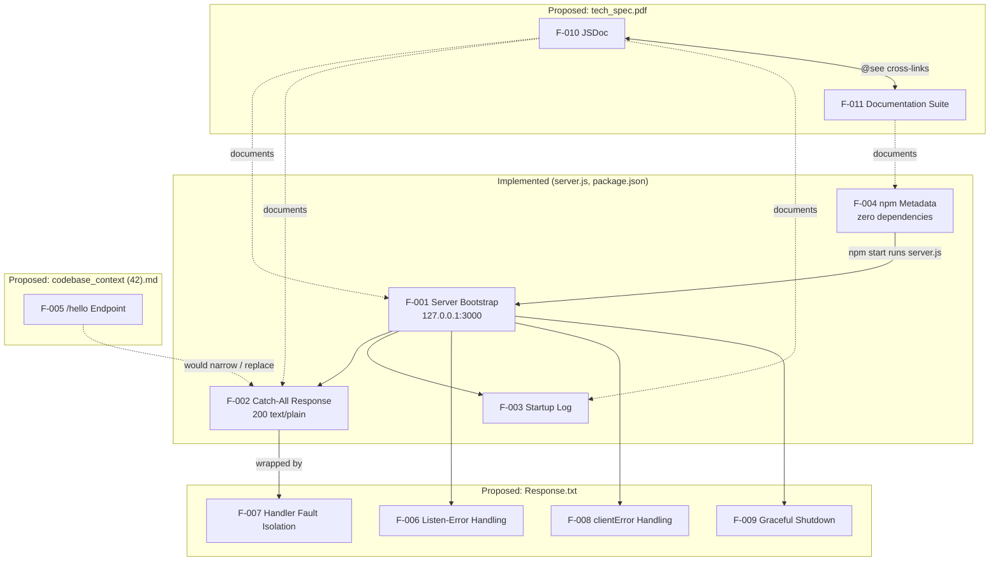

Solid arrows mean "is required by" (runtime prerequisite). Dashed arrows mean the proposed feature modifies or documents the target feature.

| Feature | Requires | Required By |
|---|---|---|
| F-001 | None | F-002, F-003, F-005, F-006, F-008, F-009 |
| F-002 | F-001 | F-007, and F-005 (which would modify it) |
| F-003 | F-001 | None |
| F-004 | None | F-001 is started by `npm start` |
| F-005 | F-001, F-002 | None |
| F-006 / F-008 / F-009 | F-001 | None |
| F-007 | F-002 | None |
| F-010 | F-001 – F-003 | Cross-linked with F-011 |
| F-011 | F-001 – F-004 | Cross-linked with F-010 |

### 2.3.2 Integration Points

The diagram shows where each feature attaches during the life of the process. Dashed nodes are proposed and not implemented.

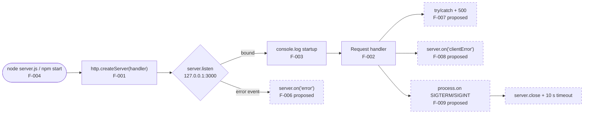

| Integration Point | Mechanism | Features |
|---|---|---|
| Request callback | The arrow function passed to `http.createServer` (`server.js` line 6) | F-002, F-005, F-007 |
| Listen callback | The third argument of `server.listen` (`server.js` line 12) | F-001, F-003 |
| Server events | `'error'` and `'clientError'` listeners on the `server` object | F-006, F-008 |
| Process signals | `process.on('SIGTERM' / 'SIGINT')` → `server.close()` → `process.exit` | F-009 |
| npm launcher | npm's default `start` script runs `node server.js` | F-004 → F-001 |
| Documentation links | JSDoc `@see` tags that point to README sections | F-010, F-011 |

### 2.3.3 Shared Components

| Shared Component | Location | Used By |
|---|---|---|
| `server` (`http.Server` instance) | `server.js` line 6 | F-001, F-003, F-006, F-008, F-009 |
| `hostname` / `port` constants | `server.js` lines 3–4 | F-001, F-003 (log URL), F-006 (error message), F-010 (`@constant`), F-011 (Configuration section) |
| `res` (`http.ServerResponse`) | Request handler | F-002, F-007 (`headersSent` check, 500 path) |
| Fixed response payload `Hello, World!\n` | `server.js` line 9 | F-002; the target of the F-005 change; documented by F-011 |

### 2.3.4 Common Services

All features use only built-in Node.js facilities. There is no application-level logging, configuration or error service.

| Service | Purpose | Features |
|---|---|---|
| `http` module | Server creation and the request/response objects | F-001, F-002, F-005, F-007, F-008 |
| `console` (stdout/stderr) | Startup, error and shutdown messages | F-003, F-006, F-007, F-009 |
| `process` (signals, `exit`) | Lifecycle control and exit codes | F-006, F-009 |
| Timers (`setTimeout`) | The 10 s forced-shutdown limit | F-009 |

### 2.3.5 Cross-Feature Conflicts

| Conflict | Features | Evidence |
|---|---|---|
| The `/hello` → `Hello world` contract contradicts the rules that forbid new routes and a changed response text | F-005 vs F-002 | `codebase_context (42).md`; `Response.txt` 0.5; `tech_spec.pdf` 0.8 |
| The documentation plan excludes "error handling additions" and lists "no bug fixes (none identified)", while the hardening plan adds error handling | F-006 – F-009 vs F-010, F-011 | `tech_spec.pdf` 0.8; `Response.txt` 0.1–0.4 |
| The README Configuration section is asked to cover environment variables, but the server reads none | F-011 vs F-001 | `tech_spec.pdf` quality checklist; `server.js` lines 3–4 |
| The claim that malformed requests crash the server is contradicted by a runtime check | F-008 premise vs current runtime | `Response.txt` 0.1–0.2; runtime check (Node.js's default `400`, server stays up) |

The repository does not say in what order the two plans should be applied (see Section 1.3.3).

## 2.4 Implementation Considerations

The considerations below come from the code, the planning artifacts, and runtime checks on Node.js v22.23.3. Where a planning artifact constrains how a feature may be built, the artifact is named.

### 2.4.1 F-001 HTTP Server Bootstrap and Loopback Binding

| Aspect | Consideration |
|---|---|
| Technical Constraints | `hostname` and `port` are hard-coded, so changing them means editing `server.js`. Environment-variable configuration is out of scope (`Response.txt` 0.5). There is no `engines` field: checks here ran on Node.js v22.23.3, `tech_spec.pdf` recorded v20.19.5, and it recommends documenting support for 12.x and later |
| Performance Requirements | None defined. The keep-alive timeout is Node.js's default of 5 s; no other server timeouts are set |
| Scalability Considerations | One process on one event loop. A second instance on the same host fails on the fixed port. Clustering and load balancing are out of scope (`Response.txt` 0.5) |
| Security Implications | Binding to loopback keeps the server off the network. Port 3000 needs no elevated privileges. There is no TLS or authentication, by scope |
| Maintenance Requirements | Any edit must keep the `127.0.0.1:3000` contract that both plans require |

### 2.4.2 F-002 Catch-All Plain-Text Response

| Aspect | Consideration |
|---|---|
| Technical Constraints | The handler is an anonymous inline function and is not exported, so it cannot be unit-tested on its own. Refactoring or renaming it is out of scope (`Response.txt` 0.5) |
| Performance Requirements | Measured: about 0.5 ms for a single request; 1,000 requests over 100 keep-alive sockets in 84 ms with 0 errors. That satisfies the proposed targets of under 50 ms and 100 or more concurrent connections. The client-side p50 of 52 ms in the bulk run includes queueing in the load generator |
| Scalability Considerations | Each request does constant, trivial work, so throughput is limited only by the event loop |
| Security Implications | No request content is parsed. Beyond Node.js's defaults, no response headers are set: no security headers and no CORS headers |
| Maintenance Requirements | Consumers match the 14-byte body exactly. Changing it is a breaking change for those consumers |

### 2.4.3 F-003 Startup Notification Logging

| Aspect | Consideration |
|---|---|
| Technical Constraints | One plain `console.log` line with no timestamp, level or structure. Logging libraries are out of scope (`Response.txt` 0.5) |
| Performance Requirements | Negligible: one line per process |
| Scalability Considerations | Not applicable |
| Security Implications | Reveals only the loopback URL |
| Maintenance Requirements | Operators and wrappers depend on the exact text, so it must stay unchanged (`Response.txt` 0.6) |

### 2.4.4 F-004 Zero-Dependency npm Package Metadata

| Aspect | Consideration |
|---|---|
| Technical Constraints | `main: index.js` does not resolve, so `require('hello_world')` fails. `npm test` always exits 1, so any CI step that calls it fails. `npm start` works only because of npm's default `server.js` rule. Lockfile v3 needs npm 7 or later |
| Performance Requirements | No install step |
| Scalability Considerations | Not applicable |
| Security Implications | With no third-party packages, `npm audit` has nothing to check |
| Maintenance Requirements | `Response.txt` 0.5 forbids changing the manifest or lockfile. `tech_spec.pdf` 0.8 forbids changing the name or version and adding scripts. Known defects are therefore documented, not fixed |

### 2.4.5 F-005 Tutorial `/hello` Endpoint Contract

| Aspect | Consideration |
|---|---|
| Technical Constraints | The handler would need to read `req.url`. The request does not say how other paths, other methods or query strings are handled. The new body `Hello world` would differ from the current `Hello, World!\n` |
| Performance Requirements | Not specified |
| Scalability Considerations | Not applicable |
| Security Implications | Not specified |
| Maintenance Requirements | A decision that settles the conflict with both plans' preservation rules is needed first (Section 2.3.5) |

### 2.4.6 F-006 Server Listen-Error Handling

| Aspect | Consideration |
|---|---|
| Technical Constraints | Today's exit code for a port conflict (1) stays the same; only the message changes. Port 3000 needs no privileges, so testing `EACCES` needs a restricted environment |
| Performance Requirements | Not applicable (startup path only) |
| Scalability Considerations | Makes it clear why a second instance on the same host fails |
| Security Implications | Replaces the internal stack trace with a short message |
| Maintenance Requirements | `Response.txt` 0.7 expects all the hardening work together to grow `server.js` from about 342 bytes and 15 lines to about 2,100 bytes and 75 lines |

### 2.4.7 F-007 Request Handler Fault Isolation

| Aspect | Consideration |
|---|---|
| Technical Constraints | Node.js always passes `req` and `res`, and the current handler only writes constants. Neither guard can therefore be triggered over HTTP; verifying them needs fault injection |
| Performance Requirements | `try/catch` adds negligible cost, and the F-002 targets still apply |
| Scalability Considerations | A fault in one request stays contained in that request |
| Security Implications | The `500` body is generic, and `error.message` goes to the server console only |
| Maintenance Requirements | The success path must stay byte-identical to F-002 |

### 2.4.8 F-008 Malformed Client Request Handling

| Aspect | Consideration |
|---|---|
| Technical Constraints | With no listener, Node.js already answers malformed requests with `400` and answers oversized headers (a 20,000-byte header in testing) with `431 Request Header Fields Too Large`. The proposed listener always writes `400`, so it would remove the `431` distinction |
| Performance Requirements | Not specified |
| Scalability Considerations | Not applicable |
| Security Implications | Never echoes malformed input. The `socket.writable` check avoids writing to closed sockets |
| Maintenance Requirements | Adds little over the default behavior. Its premise ("crashes") is not borne out by the runtime check |

### 2.4.9 F-009 Graceful Shutdown on SIGTERM/SIGINT

| Aspect | Consideration |
|---|---|
| Technical Constraints | Today `SIGTERM` gives exit code 143 and `SIGINT` gives 130. The proposed exit codes are 0 when drained and 1 when forced after 10 s. On Node.js v22.23.3, `server.close()` closed an idle keep-alive connection within 1 ms in a scratch test, so idle keep-alive connections do not hold shutdown up to the timeout |
| Performance Requirements | Shutdown is limited to 10,000 ms |
| Scalability Considerations | Supports restarts by process supervisors (`Response.txt` names Docker and Kubernetes) |
| Security Implications | None identified |
| Maintenance Requirements | The test files `Response.txt` cites (`test_server.js`, `server_fixed.js`, `test_fixes.js`) are not in the repository, so verification must be rebuilt. Rollback is done from `server.js.backup` (`Response.txt` 0.7) |

### 2.4.10 F-010 Source Code JSDoc Documentation

| Aspect | Consideration |
|---|---|
| Technical Constraints | Comments only. The 7-element inventory describes the current 15-line `server.js` and would change if F-006 – F-009 were applied first |
| Performance Requirements | No runtime impact |
| Scalability Considerations | Not applicable |
| Security Implications | None |
| Maintenance Requirements | The JSDoc must stay in step with the code. `jsdoc` 4.0.2 is optional and must not become a declared dependency (no new dependencies) |

### 2.4.11 F-011 Project Documentation Suite

| Aspect | Consideration |
|---|---|
| Technical Constraints | `tech_spec.pdf` gives two different minimum example counts (8 and 5). The Configuration section cannot honestly describe environment variables. There are no deployment manifests (no Dockerfile or PM2 config), so deployment guides are text only |
| Performance Requirements | Not applicable |
| Scalability Considerations | The structure must allow growth: new endpoints in the API section and new platforms in the Deployment section (`tech_spec.pdf` "Template Compatibility") |
| Security Implications | Container and cloud guides must say that the server binds to `127.0.0.1`. Inside a container it is not reachable through published ports unless the code is changed, and code changes are out of scope |
| Maintenance Requirements | The README must be updated whenever runtime behavior changes, for example if F-005 or F-006 – F-009 are adopted |

## 2.5 Traceability Matrix

### 2.5.1 Requirements Traceability Matrix

Verification status meanings:

- **Pass (runtime):** a live check on Node.js v22.23.3 / npm 11.18.0 met the acceptance criterion.
- **Pass (inspection):** reading the code or manifest confirms the criterion.
- **Fail:** the current code contradicts the criterion.
- **Not Implemented:** the proposed code is absent.

| Requirement ID | Source | Implementation Evidence | Verification Status |
|---|---|---|---|
| F-001-RQ-001 | `server.js` | Line 1 `require('http')`; `node --check` exits 0 | Pass (inspection) |
| F-001-RQ-002 | `server.js` | Lines 3, 12 | Pass (runtime) |
| F-001-RQ-003 | `server.js` | Lines 4, 12 | Pass (runtime) |
| F-001-RQ-004 | `server.js`, npm default `start` | `node server.js` and `npm start` both print the startup log | Pass (runtime) |
| F-002-RQ-001 | `server.js` | Line 7; `GET`/`POST`/`PUT`/`DELETE`/`HEAD` all return 200 | Pass (runtime) |
| F-002-RQ-002 | `server.js` | Line 8 | Pass (runtime) |
| F-002-RQ-003 | `server.js` | Line 9; `Content-Length: 14` | Pass (runtime) |
| F-002-RQ-004 | `server.js` | Lines 6–10 never read `req`; `POST /api` with JSON gives the same reply | Pass (runtime) |
| F-002-RQ-005 – RQ-006 | Node.js `http` defaults | `HEAD` has no body; `Keep-Alive: timeout=5` | Pass (runtime) |
| F-003-RQ-001 | `server.js` | Line 13 | Pass (runtime) |
| F-003-RQ-002 | `server.js` | Line 13 template literal | Pass (inspection) |
| F-003-RQ-003 | `server.js` | Lines 12–14; a second instance prints only the `EADDRINUSE` trace | Pass (runtime) |
| F-004-RQ-001 – RQ-003 | `package.json`, `package-lock.json` | No dependency keys; lockfile v3 with root only | Pass (inspection) |
| F-004-RQ-004 | npm default `start` | `> node server.js` banner, then the startup log | Pass (runtime) |
| F-005-RQ-001 | `codebase_context (42).md` | Body is `Hello, World!\n`, not `Hello world` | Fail |
| F-005-RQ-002 | `codebase_context (42).md` | Every path returns the payload | Fail |
| F-006-RQ-001 – RQ-004 | `Response.txt` 0.4 | No `'error'` listener; uncaught `EADDRINUSE`, exit 1 | Not Implemented |
| F-007-RQ-001 – RQ-005 | `Response.txt` 0.4 | No guard and no `try/catch` | Not Implemented |
| F-008-RQ-001, RQ-003 | `Response.txt` 0.4 | No `clientError` listener | Not Implemented |
| F-008-RQ-002, RQ-004 | `Response.txt` 0.4 | Met by Node.js default: `400`, and the server stays up | Pass (runtime, default behavior) |
| F-009-RQ-001 – RQ-005 | `Response.txt` 0.4, 0.6 | No signal handlers; `SIGTERM` gives 143, `SIGINT` gives 130 | Not Implemented |
| F-010-RQ-001 – RQ-007 | `tech_spec.pdf` 0.7 | `server.js` has no comments (0 of 7 elements) | Not Implemented |
| F-011-RQ-001 – RQ-010 | `tech_spec.pdf` 0.7, quality checklist | `README.md` is 2 lines (1 of 17 sections) | Not Implemented |

### 2.5.2 Non-Functional Targets

The targets come from `Response.txt` 0.6 and 0.4. The repository has no tooling to measure them. The observed values come from the checks described in Section 2.5.1.

| Target | Threshold | Observed (Current Code) | Status |
|---|---|---|---|
| Local response time | < 50 ms | About 0.5 ms for a single request | Met |
| Concurrency and error rate | 100+ connections, 0% errors | 1,000 requests over 100 sockets, 0 errors, 84 ms total | Met |
| Memory footprint | < 50 MB RSS | About 57.9 MB RSS after 200 requests (Node.js v22.23.3) | Not met in this environment |
| Exit code after `SIGTERM` | 0 after draining | 143 (default termination by signal) | Not met (needs F-009) |
| Port-conflict reporting | Message logged, exit 1 | Uncaught stack trace, exit 1 | Partial (needs F-006) |

### 2.5.3 Feature-to-Specification Cross-Reference

| Feature | Related Spec Sections | Related Process Flowcharts |
|---|---|---|
| F-001, F-003 | 1.2.2 Major System Components; 1.3.1 Key Technical Requirements; 1.3.2 System Boundaries | 1.2.2 component flowchart and startup sequence; 1.3.1 workflow (bind decision); 1.3.2 boundary diagram |
| F-002 | 1.1.4 Value Proposition; 1.2.3 Measurable Objectives | 1.2.2 startup sequence; 1.3.1 workflow (request loop) |
| F-004 | 1.1.1 Project Overview; 1.3.1 Essential Integrations | 2.3.2 lifecycle diagram (npm launcher) |
| F-005 | 1.1.2 Core Business Problem; 1.3.3 Future Phase Considerations | 2.3.1 dependency map |
| F-006 – F-009 | 1.2.1 Current System Limitations; 1.2.3 KPIs; 1.3.3 Future Phase Considerations | 1.3.1 workflow (the `EADDRINUSE` and termination branches as they behave today); 2.3.2 lifecycle diagram |
| F-010, F-011 | 1.2.3 KPIs; 1.3.3 Future Phase Considerations | 2.3.1 dependency map |

### 2.5.4 Assumptions and Constraints

**Assumptions**

| ID | Assumption |
|---|---|
| A-1 | The baseline is the code at commit `3976c7d` ("Add files via upload"), the only commit in the repository |
| A-2 | The planning artifacts are proposals. None records approval, so F-005 – F-011 are marked *Proposed* |
| A-3 | Runtime results depend on the environment (Node.js v22.23.3, npm 11.18.0). `tech_spec.pdf` analyzed Node.js v20.19.5 and npm 10.8.2 |
| A-4 | The "backprop integration" named in `README.md` has no definition in the repository, so no requirements are derived from it |
| A-5 | `phonenumber.csv`, `defect_for_task_1.docx`, `s1.png` and `20250304165759.mp4` have no consuming code, so no requirements are derived from them |

**Constraints**

| ID | Constraint | Source |
|---|---|---|
| C-1 | No third-party dependencies, frameworks or logging libraries | `Response.txt` 0.5; `tech_spec.pdf` 0.8 |
| C-2 | Keep `127.0.0.1:3000`, the `Hello, World!\n` body, `text/plain`, the startup log, and the `require()` style | `Response.txt` 0.5–0.6; `tech_spec.pdf` 0.8 |
| C-3 | The hardening plan changes only `server.js`; the documentation plan changes only comments and documentation | `Response.txt` 0.5; `tech_spec.pdf` 0.8 |
| C-4 | No test files or CI may be added, so acceptance criteria are run manually or with scripts kept outside the repository | `Response.txt` 0.5; `tech_spec.pdf` 0.8; `package.json` `scripts.test` |
| C-5 | Exposed on loopback only; no TLS, authentication, clustering or health endpoints | `server.js` line 3; `Response.txt` 0.5 |

### 2.5.5 Requirement Versions

The repository keeps no requirement history. All requirements in this section are at version 1.0, traced to the source artifacts below.

| Source Artifact | Artifact Version / Date | Requirements Derived | Requirement Version |
|---|---|---|---|
| `server.js`, `package.json`, `package-lock.json` | Package `1.0.0`; commit `3976c7d` | F-001 – F-004 (as built) | 1.0 |
| `codebase_context (42).md` | Undated; commit `3976c7d` | F-005 | 1.0 |
| `Response.txt` | Undated; "0. Agent Action Plan" | F-006 – F-009 and the non-functional targets | 1.0 |
| `tech_spec.pdf` | Generated 2025-11-25 (project `existing_project_2511_lakshya_github_5`) | F-010 – F-011 | 1.0 |

A requirement gets a new version when its source artifact changes or when a conflict in Section 2.3.5 is resolved.

## 2.6 References

- `server.js` - The source of F-001 – F-003: the `http` import (line 1), the `127.0.0.1:3000` constants (lines 3–4), the catch-all `200 text/plain` `Hello, World!\n` handler (lines 6–10), and `server.listen` with the startup log (lines 12–14). It has no error, `clientError` or signal handlers.
- `package.json` - The source of F-004: `hello_world` 1.0.0, MIT, author `hxu`, `main: index.js` (missing file), a placeholder `test` script that fails, and no dependencies, `start` script or `engines` field.
- `package-lock.json` - `lockfileVersion` 3 with only the root package, which confirms there are no third-party dependencies (F-004-RQ-001, RQ-003).
- `README.md` - The current two-line README (title `hao-backprop-test`, "test project for backprop integration"): the baseline for F-011 and assumption A-4.
- `codebase_context (42).md` - The tutorial request for one `/hello` endpoint that returns "Hello world" (F-005).
- `Response.txt` - The production-hardening action plan: root causes (0.2), proposed listeners, guards and `gracefulShutdown` (0.4), scope exclusions (0.5), verification and performance targets (0.6), file-growth and rollback notes (0.7). Source of F-006 – F-009, constraints C-1 – C-5, and the non-functional targets.
- `tech_spec.pdf` - The documentation action plan (2025-11-25): the JSDoc tag requirements, the 17-section README specification, the minimum diagram and example counts (8 versus 5), the deployment scenarios, and the out-of-scope rules (0.8). Source of F-010 and F-011.
- `phonenumber.csv`, `defect_for_task_1.docx`, `s1.png`, `20250304165759.mp4` - Artifacts that no code reads. They were checked and no requirements are derived from them (A-5).
- `/` (repository root) - A flat layout with no subfolders, no `.blitzyignore` file, no tests, no CI, no `LICENSE` file, and a single commit `3976c7d`.
- Runtime checks of `server.js` (Node.js v22.23.3, npm 11.18.0) - Every method and path returns 200 with 14 bytes; `HEAD` has no body; a malformed request gets `400` and an oversized header gets `431`, with the server staying up; a second instance hits an uncaught `EADDRINUSE` and exits with 1; `SIGTERM` gives 143 and `SIGINT` gives 130; `npm start` runs `node server.js`; 1,000 requests over 100 sockets in 84 ms with 0 errors; RSS about 57.9 MB; in a scratch test, `server.close()` closes idle keep-alive connections within 1 ms.
- Technical Specification Sections 1.1 Executive Summary, 1.2 System Overview, 1.3 Scope, 1.4 References - The cross-referenced component, workflow and boundary diagrams and the scope boundaries. Section 1.3.3's statement that `npm start` is unsupported conflicts with the runtime check (Section 2.1.2.4).

# 3. Technology Stack

## 3.1 Programming Languages

The technology stack is one JavaScript file, `server.js`, run by the Node.js runtime with its built-in `http` module. The repository has no third-party packages, build step, container definition, CI pipeline, database or external service (`server.js`, `package.json`, `package-lock.json`). Both planning artifacts keep it that way: `Response.txt` section 0.5 and `tech_spec.pdf` section 0.8 forbid new dependencies, frameworks and tooling. The default technology stack for this specification is therefore recorded only where the repository shows it. Each sub-section below lists the default items that are not adopted and why.

### 3.1.1 Languages by Component

| Component | Language / Format | Files | Role |
|---|---|---|---|
| HTTP server runtime | JavaScript (ES2015 syntax, CommonJS modules) | `server.js` | The only executable code (14 lines) |
| Package metadata | JSON | `package.json`, `package-lock.json` | npm identity, the placeholder test script, lockfile |
| Project documentation | Markdown | `README.md`, `codebase_context (42).md` | Repository title and the tutorial request |
| Planning documents | JSON that wraps Markdown (`Response.txt`); PDF (`tech_spec.pdf`) | `Response.txt`, `tech_spec.pdf` | Proposed hardening and documentation work; not executed |
| Sample data | CSV (header `message,phonenumber`) | `phonenumber.csv` | 15 rows; no code reads it |
| Proposed annotations and diagrams | JSDoc comments; Mermaid in Markdown | Planned for `server.js` and `README.md` (`tech_spec.pdf`) | Not present yet (features F-010, F-011) |

### 3.1.2 Selection Rationale

- **JavaScript on Node.js is the project's defining choice.** `package.json` describes the package as "Hello world in Node.js", and `codebase_context (42).md` asks for a "nodejs tutorial project".
- **There is no compilation step.** Node.js runs the source file directly, so no build toolchain is needed, and the reviewed file is exactly the code that runs.
- **One language keeps the project small.** That suits its roles as a tutorial sample and a fixed integration-test target (`README.md`: "test project for backprop integration").
- **The language choice is locked.** `Response.txt` 0.5 excludes TypeScript conversion. Both `Response.txt` 0.5 and `tech_spec.pdf` 0.8 require the `require()` style to be kept.

**Default stack languages not adopted:** Python (backend), TypeScript (web and mobile), Swift (iOS), Kotlin (Android) and Objective-C (macOS). The repository has none of the components these would serve: there is no backend beyond `server.js`, and there is no web frontend, mobile app or desktop client.

### 3.1.3 Language Constraints and Dependencies

| Constraint | Detail | Evidence |
|---|---|---|
| Module system | CommonJS. `package.json` has no `type` field, so Node.js loads `.js` files as CommonJS and `require('http')` works. Setting `"type": "module"` would break `require`, and changing `package.json` is out of scope | `package.json`; `server.js` line 1; `Response.txt` 0.5 |
| Syntax level | Uses only `const`, an arrow function and a template literal (ES2015). No classes, `async`/`await` or newer syntax, so every Node.js line the planning artifacts mention (12.x and later) can parse it | `server.js` lines 1–14; `tech_spec.pdf` (recommends 12.x+) |
| Type checking | None. The JSDoc types proposed for the handler (`{http.IncomingMessage}`, `{http.ServerResponse}`) would give editor hints only and would not be enforced | `tech_spec.pdf` (JSDoc requirements) |
| Code quality tooling | No `'use strict'` directive, linter or formatter. `tech_spec.pdf` 0.8 excludes linter and formatter configuration | `server.js`; `tech_spec.pdf` |
| Syntax validation | `node --check server.js` is the only static check either plan defines | `Response.txt` 0.7 |

**Security implications.** With no transpilation and no dependency code, the attack surface is `server.js` plus the Node.js runtime. Without a linter or type checking, review is the only safeguard against unsafe changes, so the code must stay small enough to review in full. The planned growth to about 70–75 lines (Section 1.2.3) keeps it there.

## 3.2 Frameworks & Libraries

The system uses no application framework and no library. All of its behavior comes from the Node.js runtime and the runtime components bundled with it.

### 3.2.1 Core Runtime Platform

| Component | Version | Role in This System | Evidence |
|---|---|---|---|
| Node.js runtime | Not pinned (`package.json` has no `engines` field). Verified on v22.23.3 (LTS "Jod"); `tech_spec.pdf` recorded v20.19.5 | Runs `server.js` as a single process | `package.json`; runtime check; `tech_spec.pdf` "Documentation Tool Dependencies" |
| Built-in `http` module | Ships with the runtime | `http.createServer`, `server.listen`, `res.statusCode`, `res.setHeader`, `res.end` | `server.js` lines 1, 6–14 |
| llhttp (bundled HTTP parser) | 9.4.3 in v22.23.3 | Parses HTTP/1.1 requests. Sends the default `400 Bad Request` for malformed input and `431 Request Header Fields Too Large` for oversized headers | Runtime check (Section 2.4.8) |
| libuv (bundled) | 1.51.0 in v22.23.3 | Event loop and the TCP listener on `127.0.0.1:3000` | Runtime check |
| V8 (bundled) | 12.4.254.21-node.57 in v22.23.3 | JavaScript engine | Runtime check |
| `console` global | Ships with the runtime | The startup line `Server running at http://127.0.0.1:3000/` | `server.js` line 13 |

The runtime also supplies these HTTP defaults, which `server.js` does not set itself: `Content-Length: 14`, `Connection: keep-alive` and `Keep-Alive: timeout=5` (Section 1.2.2).

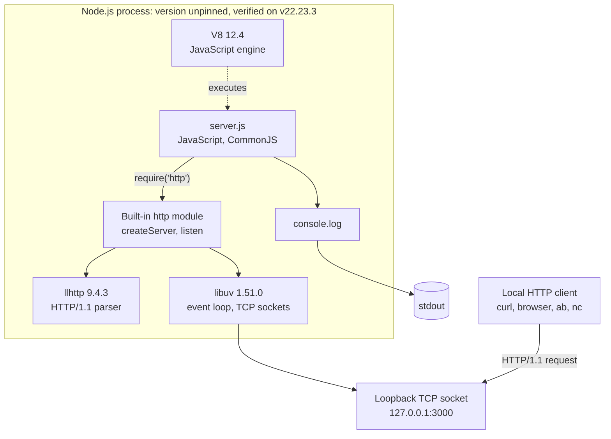

### 3.2.2 Framework Selection Justification

| Decision | Justification | Trade-off |
|---|---|---|
| No web framework such as Express | A single fixed response needs no routing or middleware. `Response.txt` 0.5 forbids "Express or frameworks", and `tech_spec.pdf` 0.8 forbids new dependencies | Any routing, such as the `/hello` contract (F-005), has to be written by hand against `req.url` |
| No logging library (winston, morgan) | Excluded by `Response.txt` 0.5. One `console.log` line meets the need | No timestamps, log levels or structured output |
| No request-parsing middleware | Excluded by `Response.txt` 0.5. The handler never reads the request | Request bodies, query strings and headers are ignored |
| No test framework | Unit tests and test frameworks are excluded (`Response.txt` 0.5; `tech_spec.pdf` 0.8) | `npm test` is a placeholder that always fails |
| Plain `http` instead of `https` or `http2` | HTTPS/TLS is excluded (`Response.txt` 0.5). Binding to loopback keeps traffic on the host | Traffic is plaintext. The bundled OpenSSL 3.5.8 goes unused |

**Default stack frameworks not adopted:** Flask, LangChain, React, TailwindCSS, React Native and ElectronJS. The system has no Python service, no AI features, no user interface and no client application, and the planning artifacts add none.

### 3.2.3 Compatibility Requirements

The `http` calls in `server.js` behave the same on every release line below, so the code does not depend on a particular Node.js version. The observable defaults (the 5-second keep-alive timeout, `400`/`431` handling and the `EADDRINUSE` error text) were verified on v22.23.3 only.

| Release Line | Latest Release | Support Status on 2026-10-06 | Relevance |
|---|---|---|---|
| 12.x (Erbium) | — | End-of-life since 2022-04-30 | Minimum that `tech_spec.pdf` recommends documenting |
| 20.x (Iron) | v20.20.2 (2026-03-24) | End-of-life since 2026-04-30 | `tech_spec.pdf` analysis environment (v20.19.5, npm 10.8.2), which recommends "LTS 20.x" |
| 22.x (Jod) | v22.23.3 (2026-09-23) | Maintenance LTS until 2027-04-30 | Runtime used to verify this specification |
| 24.x (Krypton) | v24.21.0 (2026-09-07) | Active LTS; maintenance from 2026-10-20; end-of-life 2028-04-30 | Supported LTS option |
| 26.x | v26.10.0 (2026-09-21) | Current; LTS from 2026-10-28; end-of-life 2029-04-30 | Next LTS line |

**Security implications.** Both version recommendations in `tech_spec.pdf` (12.x+ and LTS 20.x) now point to end-of-life lines that no longer get security fixes. Because the whole stack is the runtime, runtime currency is the main security control. Documentation should name a supported LTS line (22.x or 24.x). The version cannot be pinned in the repository: an `engines` field would change `package.json`, and a `.nvmrc` file would add tooling, both of which the plans exclude. Choosing the runtime version is therefore the operator's job.

| Integration Interface | Requirement | Evidence |
|---|---|---|
| `server.js` ↔ Node.js | CommonJS loader and the built-in `http` module; nothing to install | `server.js` line 1; `package-lock.json` |
| npm ↔ `package.json` | npm 7 or later to read lockfile v3. `npm start` falls back to `node server.js`. `main: index.js` does not resolve | `package.json`; runtime check (Section 2.4.4) |
| Client ↔ server | Plaintext HTTP/1.1 over TCP on `127.0.0.1:3000`, from the same host only | `server.js` lines 3–4, 12 |
| Operator ↔ process | One startup line on stdout. `SIGINT` and `SIGTERM` terminate with the defaults, exit codes 130 and 143 | `server.js` line 13; runtime check (Section 2.4.9) |

### 3.2.4 Supporting and Proposed Libraries

| Library | Version | Status | Notes |
|---|---|---|---|
| `jsdoc` | 4.0.2 named in `tech_spec.pdf`; 4.0.5 is the latest on the npm registry | Optional; not installed | Would generate HTML API docs from the JSDoc planned in F-010. `tech_spec.pdf` lists `npm install --save-dev jsdoc` for the future only. Declaring it would break the no-new-dependencies rule (Section 2.4.10). The version number in the plan is out of date |
| Express, winston, morgan | — | Explicitly excluded | Named in `Response.txt` 0.5 as frameworks and logging libraries not to add |

## 3.3 Open Source Dependencies

The project declares no open-source dependencies. The only third-party code that runs is the Node.js runtime, which is MIT-licensed and bundles its own components.

### 3.3.1 Declared Package Dependencies

| Manifest Element | Value | Evidence |
|---|---|---|
| `dependencies` | None declared | `package.json` |
| `devDependencies` | None declared | `package.json` |
| Lockfile packages | Only the root entry `""` (`hello_world` 1.0.0, MIT) | `package-lock.json` (`lockfileVersion` 3, `requires: true`) |
| Resolved dependency tree | `npm ls --all` prints `(empty)` | Runtime check |
| Vulnerability scan | `npm audit` reports `found 0 vulnerabilities` | Runtime check |
| Runtime imports | Only the built-in `http` module | `server.js` line 1 |

### 3.3.2 Package Manager and Registry

| Item | Value | Evidence |
|---|---|---|
| Package manager | npm. `tech_spec.pdf` recorded 10.8.2; this specification was verified with 11.18.0 | `tech_spec.pdf`; runtime check |
| Lockfile format | `lockfileVersion` 3, written by npm 9 or later and readable by npm 7 or later | `package-lock.json` |
| Registry | The public npm registry, `https://registry.npmjs.org/` (npm's default; the repository has no `.npmrc`) | npm configuration; repository root |
| Package identity | `hello_world` 1.0.0, author `hxu`, MIT license | `package.json` |
| Publishing configuration | None. There is no `private: true`, no `publishConfig` and no `files` list | `package.json` |

**Registry name collision.** Another party has already published the name `hello_world` on the public registry (version 0.0.3 at the time of checking). This has two consequences:

- `npm publish` from this repository would be rejected, because the project does not own the name.
- `npm install hello_world` installs that unrelated package, not this project. Consumers must use the repository directly. Even then, `main: index.js` does not resolve, so `require('hello_world')` fails (Section 2.4.4).

### 3.3.3 Open-Source Components Bundled with the Runtime

| Component | Version (Node.js v22.23.3) | Used by `server.js` |
|---|---|---|
| V8 JavaScript engine | 12.4.254.21-node.57 | Yes: runs the script |
| libuv | 1.51.0 | Yes: event loop and TCP listener |
| llhttp | 9.4.3 | Yes: HTTP/1.1 parsing |
| OpenSSL | 3.5.8 | No: there is no TLS or crypto use |

### 3.3.4 Supply-Chain Security Implications

- **No third-party package risk.** With no packages there are no transitive vulnerabilities, no typosquatting, no malicious install scripts and no lockfile drift. The supply-chain risk comes down to where the Node.js binary is obtained.
- **Patching means upgrading the runtime.** Security fixes come only from Node.js releases. Running a supported release line is required (Section 3.2.3).
- **The posture is protected by scope.** `Response.txt` 0.5 and `tech_spec.pdf` 0.8 forbid new dependencies. `tech_spec.pdf` also excludes security audits and vulnerability scanning from its own work, which is consistent with having no packages to scan.

## 3.4 Third-Party Services

The system uses no third-party services. `server.js` opens no outbound connections, reads no environment variables or credentials, and accepts connections only on `127.0.0.1`. The tracked text files contain no API keys, tokens or passwords.

| Service Category | Status | Evidence and Basis |
|---|---|---|
| External APIs and integrations | None | `server.js` only listens for inbound connections. The "backprop integration" in `README.md` has no client, contract or configuration |
| Authentication services | None. Auth0 (default stack) is not adopted | Every request gets the same response. Authentication and authorization are excluded (`Response.txt` 0.5) |
| Monitoring and observability | None beyond the stdout startup line | Health-check endpoints, metrics and monitoring instrumentation are excluded (`Response.txt` 0.5) |
| Cloud services | None. AWS (default stack) is not adopted | The repository has no cloud manifest, SDK or credentials. `tech_spec.pdf` names Heroku, AWS EC2, Azure and DigitalOcean App Platform only as deployment-guide topics (Section 3.6.5) |
| Messaging / SMS | None | `phonenumber.csv` looks like a message-dispatch dataset, but no code reads it and no provider is configured |

**Security implications.** With no external services, there are no secrets to store or rotate, no outbound traffic to control and no personal data shared with third parties. Adding any service would add credential handling and network egress, which the scope exclusions in both planning artifacts rule out.

## 3.5 Databases & Storage

The system is stateless and has no persistence layer. The only state at runtime is the two constants `hostname` and `port` and the server object, all in process memory (`server.js` lines 3–6). `server.js` imports only `http`, not `fs`, and connects to no database or network store.

| Concern | Status | Evidence and Basis |
|---|---|---|
| Primary database | None. MongoDB (default stack) is not adopted | Databases are excluded (`Response.txt` 0.5; `tech_spec.pdf` 0.8) |
| Secondary or analytical store | None | No client libraries or connection settings exist |
| Caching | None. Nothing is cached in the application, and `server.js` sets no `Cache-Control` or `ETag` headers | `server.js` lines 6–10 set only the status and `Content-Type` |
| File and object storage | None. No file is read or written while the server runs | `server.js` line 1 imports only `http` |
| Log persistence | Logs go to stdout only. Whether they are kept depends on the operator's terminal or process supervisor | `server.js` line 13 |
| Static data files in the repository | `phonenumber.csv` (621 bytes, 15 rows of synthetic `+111111112xx` numbers). It is version-controlled but no code reads it | `phonenumber.csv`; Section 1.3.2 |

**Persistence strategy.** The server keeps nothing between requests. Each response is the literal `Hello, World!\n` written by `res.end`, so a restart loses no data and needs no migration, backup or recovery. The server processes no user or personal data (Section 1.3.2). Running more instances would need no shared state, but the hard-coded port allows only one instance per host (Section 2.4.1).

## 3.6 Development & Deployment

The toolchain is the Node.js and npm command-line tools plus standard shell utilities. The repository has no build system, container definition, CI/CD pipeline or infrastructure-as-code. It contains no Dockerfile, `.dockerignore`, Compose file, `.github/` workflow, Terraform file, Procfile, PM2 ecosystem file, `.nvmrc`, `.editorconfig`, `.gitignore` or `.npmrc`.

### 3.6.1 Development Tools

| Tool | Version | Purpose | Evidence |
|---|---|---|---|
| Node.js CLI | Not pinned; v22.23.3 verified | `node server.js` starts the server; `node --check server.js` checks syntax | `Response.txt` 0.6, 0.7 |
| npm CLI | 10.8.2 (`tech_spec.pdf`); 11.18.0 verified | `npm start` runs `node server.js` through npm's default even though no `start` script exists; `npm test` exits 1 | `package.json`; runtime check |
| Git | — | Version control. History is one commit, `3976c7d`, "Add files via upload" (GitHub's default message for web uploads), with 11 tracked files | Repository history |
| curl | — | Endpoint checks and body comparison | `Response.txt` 0.1, 0.6 |
| netcat (`nc`) | — | Sends `INVALID HTTP\r\n\r\n` to reproduce malformed-request handling | `Response.txt` 0.1 |
| ApacheBench (`ab`) | — | Concurrency target `ab -n 1000 -c 100` | `Response.txt` 0.6 |
| `kill` / `pkill` | — | Signal and shutdown scenarios | `Response.txt` 0.1, 0.6 |
| `jsdoc` | 4.0.2 (`tech_spec.pdf`); 4.0.5 latest | Optional HTML generation from planned JSDoc; not installed | `tech_spec.pdf` |
| Markdown (GFM) and Mermaid | Rendered natively by GitHub/GitLab | README and diagram authoring with no tooling to install | `tech_spec.pdf` |

The repository does not declare curl, `nc` or `ab`. The verification procedures assume they are installed on the host. Linters, formatters, pre-commit hooks and new npm scripts (`start`, `dev`, `docs`) are excluded (`tech_spec.pdf` 0.8).

**Conflicting evidence on `npm start`.** Sections 1.3.1 and 1.3.3 say to start the server with `node server.js` only and list `npm start` as unsupported, because `package.json` has no `start` script. A runtime check shows that `npm start` works: npm's default runs `node server.js` when that file is in the package root (Section 2.4.4). Both commands start the same process.

### 3.6.2 Build System

There is no build system. Nothing is compiled, transpiled, bundled or minified, and there are no packages to install. The deployable artifact is `server.js` itself. The only pre-run check either plan defines is `node --check server.js` (`Response.txt` 0.7). Rollback is a file copy from `server.js.backup` (`Response.txt` 0.7), and there are no build outputs to invalidate. `tech_spec.pdf` 0.8 rules out adding a build process.

### 3.6.3 Containerization

There is no container definition, so Docker from the default stack is not adopted in the repository. `tech_spec.pdf` proposes only a Dockerfile example inside the README, "based on Node.js official images", and explicitly rules out Docker Compose. Any container use must handle three constraints:

| Constraint | Effect | Basis |
|---|---|---|
| Loopback binding | `hostname` is `127.0.0.1`, so a published container port cannot reach the server. Fixing this means binding to `0.0.0.0` or reading `HOSTNAME`, which are code and configuration changes that both plans exclude | `server.js` line 3; `Response.txt` 0.5; Section 2.4.11 |
| Signal handling | `docker stop` sends `SIGTERM`. Today the process ends at once without draining. When `node` is PID 1, the kernel applies no default action to `SIGTERM`, so the stop waits for the runtime's timeout and ends in `SIGKILL`. An init process (`docker run --init`) or the proposed graceful shutdown (F-009, 10-second forced exit) avoids this | `Response.txt` 0.1 names Docker and Kubernetes as `SIGTERM` sources |
| No health check | There is no health endpoint for container health probes, and health checks are excluded | `Response.txt` 0.5 |

### 3.6.4 CI/CD

There is no CI/CD pipeline, and no infrastructure-as-code. GitHub Actions and Terraform from the default stack are not adopted. Unit tests, test frameworks and CI/CD pipelines are excluded (`Response.txt` 0.5; `tech_spec.pdf` 0.8). Any future pipeline faces two constraints:

- `npm test` runs `echo "Error: no test specified" && exit 1`, so a pipeline that calls it fails until a real test exists.
- Verification is manual for now: start the server in the background, request it with curl, compare the body, then send `kill` (`Response.txt` 0.6; Section 1.3.1). The test files cited in `Response.txt` (`test_server.js`, `server_fixed.js`, `test_fixes.js`) are not in the repository.

### 3.6.5 Deployment Targets

Only local execution is implemented. `tech_spec.pdf` lists the other targets as README guide topics, and the repository contains none of their manifests.

| Target | Status | Compatibility with the Current Code |
|---|---|---|
| Local development (`node server.js`) | Implemented | Fully compatible |
| Docker (official Node.js image) | Documentation only | Not reachable through published ports while bound to loopback (Section 3.6.3) |
| Heroku (Procfile), DigitalOcean App Platform, Azure | Documentation only | These platforms send traffic to an interface and port they assign, so hard-coded `127.0.0.1:3000` blocks routing |
| AWS EC2 | Documentation only | Runs, but other hosts cannot reach it unless a reverse proxy runs on the same instance |
| PM2 or systemd | Documentation only | Compatible. They supervise the process with no code change |
| nginx or Apache reverse proxy | Documentation only | Compatible when on the same host. This is the only proposed internet-facing setup that works without a code change, because the proxy can forward to `127.0.0.1:3000` |

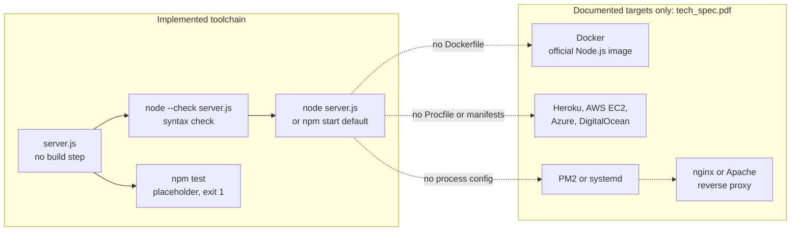

## 3.7 References

**Repository files and folders**

- `server.js` - CommonJS `require('http')`, ES2015 syntax, the `http` API surface used, the `127.0.0.1:3000` binding, the stdout startup log, and no `fs` use, persistence or outbound calls
- `package.json` - Package identity (`hello_world` 1.0.0, MIT, author `hxu`); no `type`, `engines`, `dependencies` or `devDependencies`; the placeholder `test` script; the unresolvable `main: index.js`; no publishing configuration
- `package-lock.json` - `lockfileVersion` 3 with only the root package, confirming zero third-party packages
- `README.md` - Repository title `hao-backprop-test` and the "backprop integration" purpose, with no integration code
- `codebase_context (42).md` - The "nodejs tutorial project" request behind the language choice
- `Response.txt` - Scope exclusions in section 0.5 (frameworks, Express, winston, morgan, TypeScript, databases, authentication, HTTPS/TLS, monitoring, health checks, environment variables, tests, CI/CD); verification tools (curl, `nc`, `ab`, `pkill`, `node --check`); Docker and Kubernetes `SIGTERM` context; `server.js.backup` rollback
- `tech_spec.pdf` - "Documentation Tool Dependencies" (jsdoc 4.0.2, Node.js 20.19.5, npm 10.8.2, Markdown/GFM, Mermaid); the Node.js 12.x+ and LTS 20.x recommendations; deployment-guide targets (Docker official image, Heroku, AWS EC2, Azure, DigitalOcean, PM2, systemd, nginx/Apache); exclusions in section 0.8 (new dependencies, npm scripts, build process, linters, pre-commit hooks, Docker Compose, CI)
- `phonenumber.csv` - A static sample-data file that no code reads
- Repository root (`""`) - A flat layout with no subfolders, and no container, CI, IaC, version-manager or npm-configuration files; one commit `3976c7d` with 11 tracked files

**Related specification sections**

- Section 1.2 System Overview - Runtime component diagram, the unpinned runtime, lockfile compatibility
- Section 1.3 Scope - Exclusions, the startup workflow, and the `npm start` claim reported as conflicting evidence in Section 3.6.1
- Section 2.4 Implementation Considerations - Runtime defaults (`400`/`431`, exit codes 130/143), the container-binding caveat, and jsdoc dependency constraints

**External sources**

- [web] Node.js distribution index (`https://nodejs.org/dist/index.json`) - Latest releases: v26.10.0, v24.21.0, v22.23.3, v20.20.2, with their bundled npm versions and LTS codenames
- [web] Node.js Release Working Group schedule (`nodejs/Release` `schedule.json`) - End-of-life dates for 12.x (2022-04-30) and 20.x (2026-04-30); the 22.x, 24.x and 26.x maintenance and end-of-life dates
- [web] Public npm registry (`https://registry.npmjs.org/`) - Latest `jsdoc` is 4.0.5; the name `hello_world` is published by another party (version 0.0.3)

# 4. Process Flowchart

## 4.1 System Workflows

This section models every process the repository executes, plus the processes its planning artifacts propose. The only executable code is the 14-line `server.js` at commit `3976c7d`. Its request handler (lines 6–10) has no branches, so every decision point in the current system belongs to the Node.js runtime, not to application code. Runtime behavior shown here was checked on Node.js v22.23.3 and npm 11.18.0.

Diagram conventions in Section 4:

- **Solid** nodes and edges: implemented behavior (`server.js`, `package.json`, or Node.js defaults the code relies on).
- **Dashed** nodes and edges, or anything labelled *proposed*: behavior specified in `Response.txt` (F-006 – F-009) or `codebase_context (42).md` (F-005) and absent from `server.js`.

Feature IDs (F-XXX) and requirement IDs (F-XXX-RQ-YYY) refer to Sections 2.1 and 2.2.

### 4.1.1 High-Level System Workflow

The diagram covers the whole life of the process, from launch to exit, as four swim lanes.

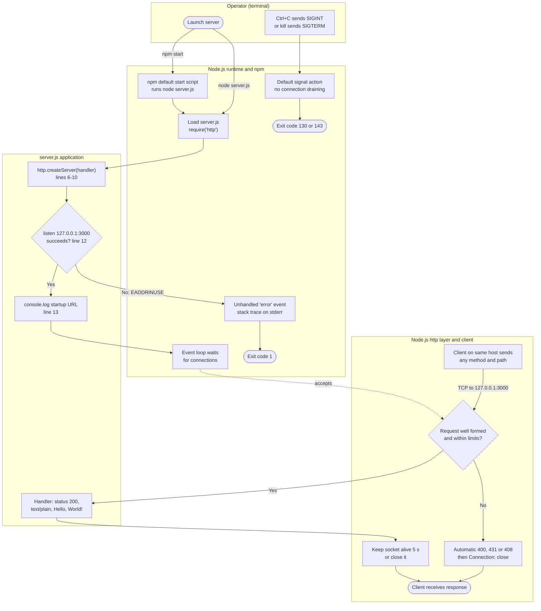

| Stage | Implemented By | Outcome |
|---|---|---|
| Launch | `node server.js`, or `npm start` through npm's default `start` (no script is declared in `package.json`) | `server.js` is loaded |
| Bootstrap | `server.js` lines 1–12 (F-001) | A listening socket on `127.0.0.1:3000`, or an uncaught `EADDRINUSE` and exit code 1 |
| Startup notification | `server.js` line 13 (F-003) | One stdout line: `Server running at http://127.0.0.1:3000/` |
| Serve | `server.js` lines 6–10 (F-002), Node.js `http` | `200 text/plain` with body `Hello, World!\n` for every well-formed request |
| Protocol rejection | Node.js `http` defaults | `400`, `431` or `408`, then the connection closes; the process keeps running |
| Termination | Node.js default signal handling | Immediate exit: code 130 (`SIGINT`) or 143 (`SIGTERM`), with no shutdown log |

### 4.1.2 Core Business Processes

#### Process Catalog

| ID | Process (Trigger) | Outcome | Status / Features |
|---|---|---|---|
| P-01 | Server startup (`node server.js` or `npm start`) | Socket bound on loopback; startup line logged | Implemented: F-001, F-003, F-004 |
| P-02 | Request/response (any HTTP request) | `200`, `Content-Type: text/plain`, `Content-Length: 14`, `Hello, World!\n` | Implemented: F-002 |
| P-03 | Protocol rejection (malformed, oversized or slow request) | `400`, `431` or `408` from Node.js; connection closed | Node.js default |
| P-04 | Startup failure (port 3000 already bound) | Uncaught `EADDRINUSE` stack trace; exit code 1 | Implemented by omission (no `'error'` listener) |
| P-05 | Termination (`SIGINT` / `SIGTERM`) | Immediate exit, code 130 / 143 | Node.js default |
| P-06 | Package test (`npm test`) | Prints `Error: no test specified`; exit code 1 | Implemented: `package.json` line 7 |
| P-07 | Automated verification (script outside the repository) | Start in background, request, compare body, `kill` | Pattern from `Response.txt` 0.6 |
| P-08 | Tutorial `/hello` request | `Hello world` on `/hello` only | Proposed: F-005 |
| P-09 – P-12 | Hardened startup error, handler fault isolation, malformed-request listener, graceful shutdown | See Section 4.2.5 | Proposed: F-006 – F-009 |

#### End-to-End User Journeys

| Actor | Journey | Touchpoints |
|---|---|---|
| Developer or tutorial learner | Clone, run `node server.js`, see the startup line, open `http://127.0.0.1:3000/` in a browser or `curl`, read `Hello, World!`, stop with Ctrl+C | Terminal stdout; HTTP response body |
| Integration test harness ("backprop integration", `README.md` line 2) | Start the server in the background, wait about 1 s, send a request, compare the body with the known 14-byte payload, send `kill` | Process ID, HTTP status and body, exit code |
| Operator starting a second instance | Run `node server.js` while port 3000 is taken; read the stack trace on stderr; the process exits with code 1 | stderr, exit code |
| CI or package tooling | Run `npm test`; the step always fails with exit code 1 | stdout, exit code |

No journey involves sign-in, data entry, multiple steps inside the application, or saved state. Each HTTP exchange is complete in itself.

#### Decision Points

`server.js` contains no `if`, `switch` or `try` statements. Every decision in the current system is made by the Node.js runtime:

| Decision | Made By | Outcomes |
|---|---|---|
| Is port 3000 on `127.0.0.1` free? | `server.listen` (`server.js` line 12) | Listening and startup log, or an `'error'` event with no listener, so an uncaught exception and exit code 1 |
| Does the request line parse? | Node.js HTTP parser (llhttp) | Handler runs, or `400 Bad Request` with `Connection: close` |
| Are the headers within 16,384 bytes (`http.maxHeaderSize`)? | Node.js HTTP parser | Continue, or `431 Request Header Fields Too Large` with `Connection: close` |
| Do the headers arrive within `headersTimeout` (60,000 ms)? | `http.Server` connection checker | Continue, or `408 Request Timeout` with `Connection: close` |
| Does an HTTP/1.1 request carry a `Host` header? | Node.js `http` (`requireHostHeader` default) | Continue, or `400 Bad Request` |
| Is the method `HEAD`? | `http.ServerResponse` | The body is suppressed and only headers are sent |
| Keep the connection open? | `http.ServerResponse` | HTTP/1.1: `Connection: keep-alive`, `Keep-Alive: timeout=5`. HTTP/1.0 or `Connection: close`: the socket closes after the response |

The request method, path, query string, headers and body never influence the response (F-002-RQ-004). Section 4.3 lists the corresponding validation rules.

#### Error Handling Paths (Summary)

| Error | Current Path | Recovery |
|---|---|---|
| `EADDRINUSE` at startup | Uncaught exception, stack trace, exit code 1 | Manual: free the port, then restart |
| Malformed, oversized or slow request | Node.js writes `400` / `431` / `408` and closes the socket | Automatic: the server keeps serving other clients |
| Exception inside the handler | Uncaught exception; the process exits with code 1; the client gets an empty reply | None in code; restart manually |
| `SIGINT` / `SIGTERM` | Default termination with no draining | Manual restart |

Section 4.5 gives the full error-handling flows, current and proposed.

### 4.1.3 Integration Workflows

#### Data Flow Between Systems

The server talks to exactly two external parties: HTTP clients on the same host, and the parent process or terminal that launched it. It makes no outbound calls and reads or writes no files, databases or caches (Section 1.3.2).

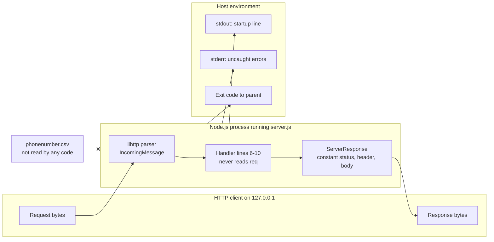

| Flow | Direction | Payload | Evidence |
|---|---|---|---|
| HTTP request | Client to server | Any method, path, headers and body; parsed by Node.js and then ignored | `server.js` lines 6–10 |
| HTTP response | Server to client | `HTTP/1.1 200 OK`, `Content-Type: text/plain`, `Content-Length: 14`, `Date`, `Connection`, `Keep-Alive`; body `Hello, World!\n` | `server.js` lines 7–9; runtime check |
| Startup log | Process to stdout | `Server running at http://127.0.0.1:3000/` | `server.js` line 13 |
| Failure diagnostics | Process to stderr | Node.js stack trace (for example `Error: listen EADDRINUSE: address already in use 127.0.0.1:3000`) | Runtime check |
| Exit status | Process to parent | 1 (uncaught error), 130 (`SIGINT`), 143 (`SIGTERM`) | Runtime check |

#### API Interactions

The server exposes one implicit catch-all endpoint and no routing.

| Aspect | Contract |
|---|---|
| Base URL | `http://127.0.0.1:3000/`, reachable from the same host only |
| Paths and methods | All of them. `GET`, `POST`, `PUT`, `DELETE`, `OPTIONS` and `HEAD` on `/`, `/hello` or any other path return `200` |
| Request format | None required. Bodies, query strings and headers are not read |
| Response | `200`, `text/plain`, 14-byte body `Hello, World!\n` (headers only for `HEAD`) |
| Authentication | None (out of scope per `Response.txt` 0.5) |
| Versioning, pagination, rate limiting | None |

The tutorial request in `codebase_context (42).md` asks for a single `/hello` endpoint that returns `Hello world`. The current server returns `Hello, World!\n` on every path, so that contract is not met (F-005-RQ-001 and F-005-RQ-002 fail; Section 2.5.1).

#### Event Processing Flows

The server is event-driven through Node.js's `EventEmitter` model. The table lists every event involved and whether `server.js` handles it.

| Event | Emitter | Listener in `server.js` | Behavior |
|---|---|---|---|
| `'listening'` | `http.Server` | Yes: the `server.listen` callback (line 12) | Logs the startup line (F-003) |
| `'request'` | `http.Server` | Yes: the `createServer` callback (line 6) | Writes the fixed response (F-002) |
| `'connection'` | `http.Server` | No | Node.js default: socket accepted and parsing starts |
| `'clientError'` | `http.Server` | No | Node.js default: writes `400` / `431` / `408` and closes the socket |
| `'error'` | `http.Server` | No | Thrown as an uncaught exception; the process exits with code 1 |
| `SIGINT`, `SIGTERM` | `process` | No | Default termination, exit 130 / 143 |
| `'clientError'`, `'error'`, `SIGINT`, `SIGTERM` | — | Proposed in `Response.txt` 0.4 | Section 4.2.5 (F-006, F-008, F-009) |

#### Batch Processing Sequences

None. The repository has no scheduled jobs, queues, workers, cron definitions or file-processing scripts. `phonenumber.csv` (header `message,phonenumber`, 15 rows) looks like the input of a message-dispatch batch, but no code reads it and the repository has no messaging integration (Section 1.3.3).

## 4.2 Detailed Process Flows

Each flow below shows its start and end points, process steps, decision diamonds, system boundaries (swim lanes) and error exits. Flows 4.2.1 – 4.2.3 describe implemented behavior. Flows 4.2.4 – 4.2.5 describe proposed behavior that is not in `server.js`.

### 4.2.1 Server Bootstrap and Startup Notification (P-01, P-04; F-001, F-003, F-004)

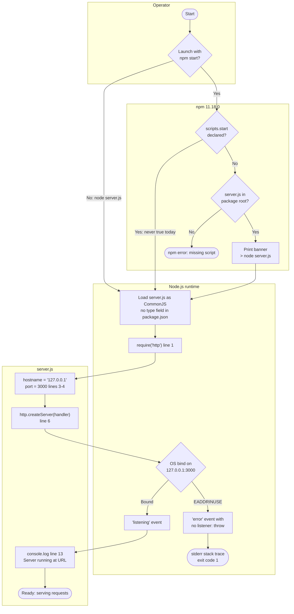

| Step | Location | Detail | Requirement |
|---|---|---|---|
| Launch | Operator, npm | `package.json` declares no `start` script. npm falls back to `node server.js` because `server.js` is in the package root, and prints `> hello_world@1.0.0 start` / `> node server.js` | F-001-RQ-004, F-004-RQ-004 |
| Module load | `server.js` line 1 | CommonJS `require('http')`; no third-party modules and no install step (`npm install` reports "up to date") | F-001-RQ-001, F-004-RQ-001 |
| Configuration | `server.js` lines 3–4 | Hard-coded constants; no environment variables, arguments or config files | F-001-RQ-002, F-001-RQ-003 |
| Server creation | `server.js` line 6 | The handler is registered as the `'request'` listener | F-002 |
| Bind | `server.js` line 12 | Asynchronous `server.listen(port, hostname, cb)` | F-001 |
| Bind failure | Node.js | No `'error'` listener, so the error is thrown: `Error: listen EADDRINUSE: address already in use 127.0.0.1:3000`, exit code 1, no startup line | F-003-RQ-003 |
| Notification | `server.js` line 13 | Template literal built from `hostname` and `port`; printed once per process | F-003-RQ-001, F-003-RQ-002 |

`EACCES` is not reachable on this path: port 3000 is above 1023 and needs no privileges (Section 2.4.6).

Section 1.3 states that `npm start` is unsupported because no `start` script exists. Runtime checks contradict this: `npm start` launches the server through npm's default, and Sections 2.2 (F-004-RQ-004) and 2.5.1 record that requirement as passing. This section follows the runtime result.

### 4.2.2 Request/Response Handling (P-02, P-03; F-002)

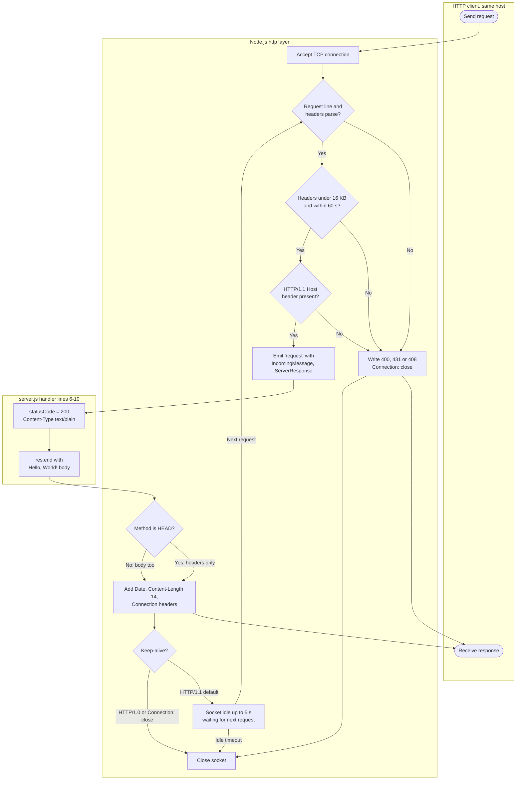

| Step | Behavior | Evidence |
|---|---|---|
| Parse | llhttp validates the request line and headers before application code runs | Runtime: `INVALID HTTP` gives `400`, a 20,000-byte header gives `431`, incomplete headers give `408` |
| Dispatch | Exactly one listener handles `'request'`; there is no routing table | `server.js` line 6 |
| Status and header | `res.statusCode = 200`; `res.setHeader('Content-Type', 'text/plain')` | Lines 7–8 |
| Body | `res.end('Hello, World!\n')` ends the response in a single write | Line 9 |
| Request body | Never read by the handler. Node.js discards it, so `POST` with a JSON body still returns the 14-byte reply | Runtime check |
| Framing | HTTP/1.1: `Content-Length: 14`, `Connection: keep-alive`, `Keep-Alive: timeout=5`. HTTP/1.0: `Connection: close` and the body ends when the connection closes | Runtime check |
| Pipelining | Two pipelined requests on one socket get two responses, in order | Runtime check |
| Logging | None per request; stdout holds only the startup line | Runtime check |

### 4.2.3 npm Package Lifecycle (P-06; F-004)

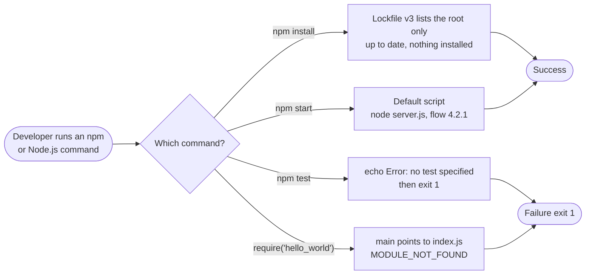

| Command | Outcome | Source |
|---|---|---|
| `npm install` | Nothing to install; reports "up to date" | `package-lock.json` lines 6–12 |
| `npm start` | Runs `node server.js` | npm default; `package.json` has no `start` |
| `npm test` | Prints `Error: no test specified`, exit 1. Any CI step that calls it fails | `package.json` line 7 |
| `require()` of the package | `Cannot find module '.../index.js'. Please verify that the package.json has a valid "main" entry` | `package.json` line 5 |

### 4.2.4 Proposed Tutorial `/hello` Flow (P-08; F-005)

`codebase_context (42).md` asks for one endpoint, `/hello`, that returns `Hello world`. The request leaves the behavior for other paths and methods undefined, and it conflicts with the rules against new routes and a changed response (Section 2.3.5).

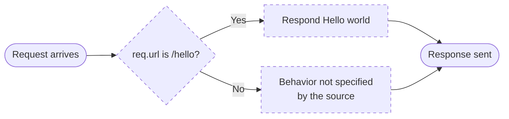

Today every path, including `/hello`, returns `Hello, World!\n`, so F-005-RQ-001 and F-005-RQ-002 fail.

### 4.2.5 Proposed Hardening Flows (P-09 – P-12; F-006 – F-009)

`Response.txt` 0.4 specifies five changes to `server.js` and expects the file to grow from about 15 to about 75 lines. None of them is present. The table gives each flow in sequence; Section 4.5 holds the error-handling flowcharts and Section 4.4.3 the shutdown state machine.

| Flow | Trigger | Steps (as specified) | End State |
|---|---|---|---|
| P-09 Startup error (F-006) | `'error'` on `server` | Log `Server error: <message>`. If `EADDRINUSE`, log `Port 3000 is already in use`; if `EACCES`, log `Permission denied to bind to port 3000`. Then `process.exit(1)` | Exit 1, no stack trace |
| P-10 Handler fault isolation (F-007) | Every request | If `!req \|\| !res`, log `Invalid request or response object` and return. Otherwise `try` the F-002 response. On `catch`, log `Error handling request: <message>`; if `!res.headersSent`, send `500`, `text/plain`, `Internal Server Error\n` | `200` normally, `500` on a fault; the process survives |
| P-11 Malformed request (F-008) | `'clientError'` on `server` | Log `Client error: <message>`. If `socket.writable`, `socket.end('HTTP/1.1 400 Bad Request\r\n\r\n')` | `400`, then the connection closes |
| P-12 Graceful shutdown (F-009) | `SIGTERM` or `SIGINT` | Log `<SIGNAL> received. Starting graceful shutdown...`; `server.close(cb)`; arm a 10,000 ms timer. When `close` completes, log `Server closed. All connections finished.` and exit 0. If the timer fires first, log `Forced shutdown - connections did not close in time` and exit 1 | Exit 0 when drained, exit 1 when forced |

What these flows change, compared with today:

- **P-09:** the exit code for a port conflict stays 1. Only the message changes.
- **P-10:** a handler exception, which today ends the process, becomes a `500`. Neither guard can be triggered by a normal request (Section 2.4.7).
- **P-11:** the listener writes `400` for every client error. That would replace the `431` and `408` responses Node.js sends today (Section 2.4.8).
- **P-12:** exit codes become 0 or 1 instead of 130 or 143. The specified `gracefulShutdown` has no guard against being entered twice: a second signal calls `server.close` again and arms a second 10 s timer.

### 4.2.6 Timing and SLA Considerations

The repository defines no SLA, no monitoring and no timeout configuration. Every timing below is either a Node.js default that `server.js` inherits, a target from `Response.txt`, or a measured value.

| Parameter | Value | Source | Effect |
|---|---|---|---|
| `keepAliveTimeout` | 5,000 ms | Node.js default | `Keep-Alive: timeout=5` is advertised. An idle socket was closed about 6.0 s after the last response |
| `headersTimeout` | 60,000 ms | Node.js default | Incomplete headers get `408 Request Timeout`. Observed at 89.1 s, because the check runs every 30,000 ms (`connectionsCheckingInterval`) |
| `requestTimeout` | 300,000 ms | Node.js default | Upper bound on receiving a whole request |
| `server.timeout` | 0 (disabled) | Node.js default | No socket inactivity timeout beyond the limits above |
| `maxRequestsPerSocket` | 0 (unlimited) | Node.js default | A keep-alive socket can carry any number of requests |
| `maxHeaderSize` | 16,384 bytes | Node.js default | Larger headers get `431` |
| Forced-shutdown limit | 10,000 ms | `Response.txt` 0.4 (proposed) | Bounds F-009 shutdown |
| Startup wait in verification scripts | `sleep 1`; harness `timeout 15` | `Response.txt` 0.4, 0.6 | Scripts assume binding finishes within 1 s |

| Target (`Response.txt` 0.6) | Observed on Current Code | Status (Section 2.5.2) |
|---|---|---|
| Local response time under 50 ms | About 0.4–0.5 ms per single request | Met |
| 100+ concurrent connections, 0% errors | 1,000 requests over 100 keep-alive sockets in 84 ms, 0 errors | Met |
| Memory under 50 MB RSS | About 57.9 MB RSS (Node.js v22.23.3) | Not met in this environment |
| Exit code 0 after `SIGTERM` | 143 | Not met (needs F-009) |

## 4.3 Validation Rules

`server.js` performs no validation of its own. Every check a request passes through today belongs to the network binding or to Node.js's `http` layer. The proposed hardening adds four application-level checks (F-006 – F-008).

### 4.3.1 Validation Checkpoint Flow

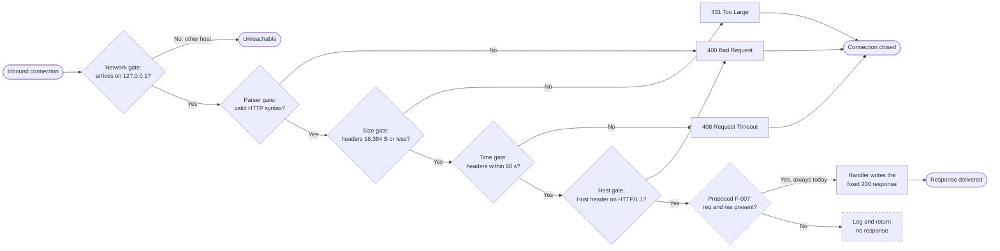

Gates V1 – V5 are active today; V6 exists only in `Response.txt` 0.4. No gate inspects method, path, query, content type or body.

### 4.3.2 Business Rules at Each Step

| Step | Business Rule | Enforced By | Source |
|---|---|---|---|
| Bootstrap | Bind to `127.0.0.1:3000` only; do not change port or hostname | Constants on `server.js` lines 3–4 | `Response.txt` 0.5; `tech_spec.pdf` 0.8; constraint C-2 |
| Bootstrap | No configuration from environment variables or files | Absence of any `process.env` read | `Response.txt` 0.5 |
| Bootstrap | Run without third-party packages | `package.json` declares no dependencies | Constraint C-1 |
| Startup log | Keep the text `Server running at http://127.0.0.1:3000/` unchanged | `server.js` line 13 | `Response.txt` 0.6 |
| Response | Every request gets status `200`, `text/plain` and `Hello, World!\n` | `server.js` lines 7–9 | F-002-RQ-001 – RQ-004 |
| Response | Response text, status and content type must stay unchanged | Review only | `Response.txt` 0.5–0.6; `tech_spec.pdf` 0.8 |
| Routing | No additional routes or endpoints | Review only | `Response.txt` 0.5; `tech_spec.pdf` 0.8 |
| Routing (proposed) | Serve `Hello world` on `/hello` only | Not enforced | `codebase_context (42).md`; conflicts with the two rows above |
| Change control | The hardening plan changes `server.js` only; the documentation plan changes comments and documentation only | Review only | Constraint C-3 |

### 4.3.3 Data Validation Requirements

| Data | Current Validation | Proposed Validation |
|---|---|---|
| Request line and headers | Node.js parser (llhttp): syntax → `400`; headers over 16,384 bytes → `431`; missing `Host` on HTTP/1.1 → `400` | F-008 listener writes `400` for every client error, which would drop the `431`/`408` distinction |
| Request timing | `headersTimeout` 60,000 ms → `408`; `requestTimeout` 300,000 ms | Unchanged |
| Method, path, query, body | None; never read | F-005 would compare `req.url` with `/hello` |
| `req` / `res` objects | None; Node.js always supplies both | F-007: `if (!req \|\| !res)` → log and return |
| Response state | None needed; a single `res.end` | F-007: check `res.headersSent` before writing a `500` |
| Server error | None; any `'error'` is thrown | F-006: classify `error.code` as `EADDRINUSE`, `EACCES` or other |
| Client socket | Node.js default handling | F-008: write only if `socket.writable` |
| Configuration | Literal constants; nothing to validate | Unchanged (environment configuration is out of scope) |

### 4.3.4 Authorization Checkpoints

There are none at the application level: no authentication, sessions, tokens, API keys or role checks. `Response.txt` 0.5 lists authentication and authorization as out of scope.

The only access control is the network binding. `hostname = '127.0.0.1'` (line 3) makes the server reachable only from the same host. Any local user or process can call it, and no CORS or security headers are set. Inside a container the loopback binding also makes the server unreachable through published ports (Section 2.4.11).

### 4.3.5 Regulatory Compliance Checks

No regulatory requirement applies, and the code performs no compliance checks.

| Area | Status | Evidence |
|---|---|---|
| Personal data | The runtime processes and stores none. Request data is never read or logged | `server.js` lines 6–10, 13 |
| Phone-number dataset | `phonenumber.csv` holds 15 plus-prefixed numbers from `+11111111201` to `+11111111223` that look synthetic. No code reads them | Section 1.3.2 |
| Transport security | No TLS; loopback only. HTTPS is out of scope | `Response.txt` 0.5 |
| Licensing | MIT is declared; the repository has no `LICENSE` file | `package.json` line 10 |
| Audit logging | None; the only log line is the startup line | `server.js` line 13 |

## 4.4 State Management

The application holds no business state. The only state is the lifecycle of the process, of the `http.Server` and of each TCP connection, all of it held in memory by Node.js. Nothing survives a restart.

### 4.4.1 Process Lifecycle (Current)

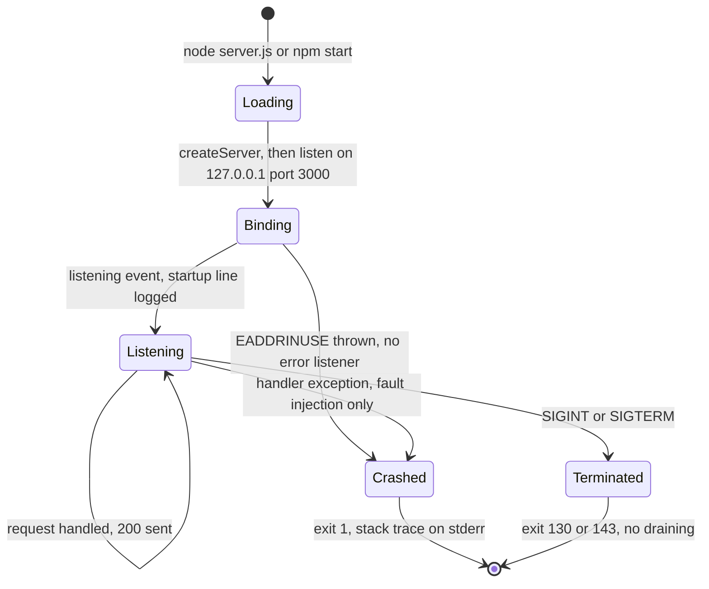

| State | Entered When | Observable Signal |
|---|---|---|
| Loading | Node.js starts executing `server.js` | None |
| Binding | `server.listen` is called (line 12) | None |
| Listening | The `'listening'` event fires | stdout: `Server running at http://127.0.0.1:3000/` |
| Crashed | An uncaught exception: `EADDRINUSE` at bind, or a thrown handler error (shown only with an injected `throw`; the client got an empty reply) | stderr stack trace; exit code 1 |
| Terminated | Default `SIGINT` / `SIGTERM` action | Exit code 130 / 143; nothing logged |

### 4.4.2 Connection Lifecycle (Node.js Defaults)

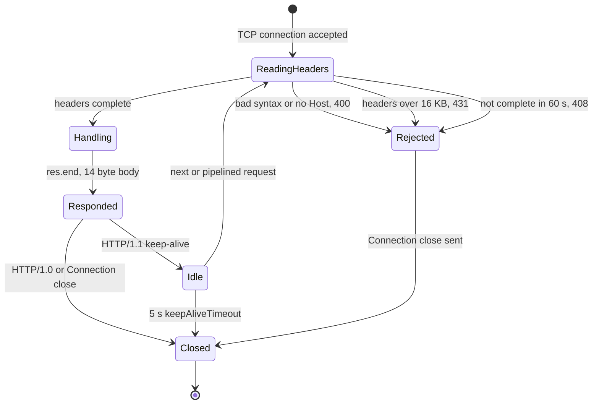

A connection never waits on the application. The `Handling` state completes synchronously in one `res.end` call. `maxRequestsPerSocket` is 0, so a keep-alive socket can loop through `Idle` → `ReadingHeaders` any number of times.

### 4.4.3 Proposed Process Lifecycle with Graceful Shutdown (F-006, F-009)

This state machine follows `Response.txt` 0.4 and is not implemented.

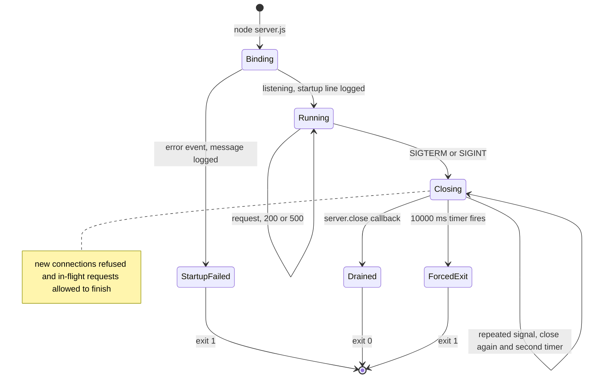

| Transition | Log Line (as specified) | Exit Code |
|---|---|---|
| Binding → StartupFailed | `Server error: <message>`, then `Port 3000 is already in use` or `Permission denied to bind to port 3000` | 1 |
| Running → Closing | `<SIGNAL> received. Starting graceful shutdown...` | — |
| Closing → Drained | `Server closed. All connections finished.` | 0 |
| Closing → ForcedExit | `Forced shutdown - connections did not close in time` | 1 |

On Node.js v22.23.3, `server.close()` closed an idle keep-alive socket within 1 ms in a scratch test (Section 2.4.9). Idle connections therefore do not drive the process into `ForcedExit`; only requests still in flight after 10 s would.

### 4.4.4 Data Persistence Points

There are none. The repository has no database, file writes, session store or queue (Section 1.3.2).

| State Holder | Lifetime | Mutability | Location |
|---|---|---|---|
| `hostname`, `port` constants | Process | Immutable (`const`) | `server.js` lines 3–4 |
| `server` (`http.Server`) | Process | Managed by Node.js | `server.js` line 6 |
| Per-connection parser and socket state | Connection | Managed by Node.js | Node.js `http` |
| `req` / `res` | One request | `res` is written once | Handler, lines 6–10 |
| Startup log line | Written once to stdout | Not stored by the application | `server.js` line 13 |

`phonenumber.csv` is the only data file in the repository, and the runtime neither reads nor writes it.

### 4.4.5 Caching Requirements

None are defined and none are implemented. The application keeps no in-memory cache, and the response sets no `Cache-Control`, `ETag` or `Last-Modified` headers. The observed headers are only `Content-Type`, `Date`, `Connection`, `Keep-Alive` and `Content-Length`. Because the body is a constant, a client or proxy could cache it safely, but nothing in the repository asks for that.

### 4.4.6 Transaction Boundaries

| Boundary | Scope | Atomicity |
|---|---|---|
| HTTP exchange | One request and one response | Status, header and body are set synchronously and sent by a single `res.end` call. The current handler has no partial-response state |
| Connection | Zero or more exchanges on one socket | Each exchange is independent; no state is carried across requests |
| Process | Startup to exit | Nothing is committed, so a crash or signal loses no data. Only in-flight responses are lost |
| Proposed fault path (F-007) | One request | The `res.headersSent` check stops a `500` from being written after headers have gone out, so a failed exchange is not written twice |

There are no distributed transactions, rollbacks or compensating actions. The only rollback in the repository is a deployment step: restore `server.js` from `server.js.backup` (`Response.txt` 0.7).

## 4.5 Error Handling

`server.js` contains no error-handling code: no `try/catch`, no `'error'` or `'clientError'` listener, and no signal handler. Errors are handled by Node.js defaults or end the process. `Response.txt` 0.4 proposes the missing handlers (F-006 – F-009).

### 4.5.1 Error Catalog

| Error (Trigger) | Current Handling | Proposed Handling | Feature |
|---|---|---|---|
| `EADDRINUSE` (port 3000 already bound) | Uncaught `'error'`; stack trace; exit 1 | Log `Port 3000 is already in use`; exit 1 | F-006 |
| `EACCES` (bind permission denied) | Would also be uncaught. Not reproducible on port 3000, which needs no privileges | Log `Permission denied to bind to port 3000`; exit 1 | F-006 |
| Other server error | Uncaught; exit 1 | Log `Server error: <message>`; exit 1 | F-006 |
| Exception in the request handler | Uncaught; the process exits with code 1 and the client gets an empty reply (fault injection on a scratch copy) | Log `Error handling request: <message>`; `500 Internal Server Error\n` if headers are not yet sent; the process survives | F-007 |
| Malformed request line or headers | Node.js `400 Bad Request` with `Connection: close`; the server stays up | Log `Client error: <message>`; raw `400` if `socket.writable` | F-008 |
| Headers over 16,384 bytes | Node.js `431`; the server stays up | Would become `400` | F-008 |
| Headers not complete within 60 s | Node.js `408` (observed at 89.1 s); the server stays up | Would become `400` | F-008 |
| HTTP/1.1 request with no `Host` | Node.js `400`; the server stays up | Not addressed by the plan | — |
| `SIGINT` / `SIGTERM` | Immediate exit 130 / 143; in-flight requests dropped | Graceful drain, exit 0, or forced exit 1 after 10 s | F-009 |
| `npm test` | Always exits 1 | Unchanged (tests are out of scope) | F-004 |
| `require('hello_world')` | `MODULE_NOT_FOUND` for `index.js` | Unchanged (manifest edits are out of scope) | F-004 |

`Response.txt` 0.1–0.3 states that an unhandled `clientError` "crashes" the server. The runtime check contradicts this: with no listener, Node.js answers `400` and the process keeps serving (Section 2.3.5).

### 4.5.2 Current Error-Handling Flow

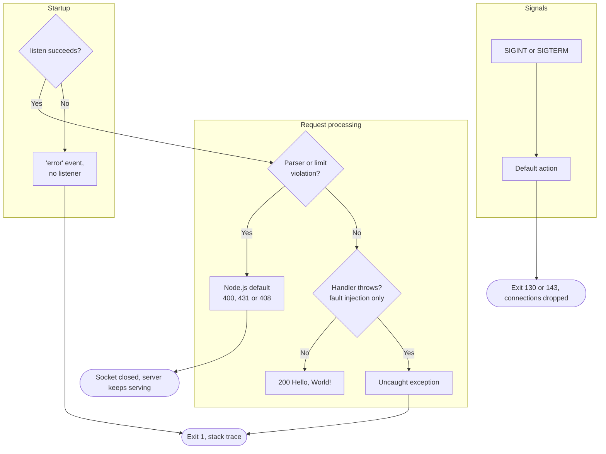

Only protocol-level errors are recovered automatically. Every other error ends the process.

### 4.5.3 Proposed Error-Handling Flow (F-006 – F-008)

```mermaid
flowchart TB
    subgraph ServerEvents["server.on('error') F-006"]
        P1["Log Server error: message"]
        P2{"error.code?"}
        P3["Log Port 3000 is already in use"]
        P4["Log Permission denied to bind to port 3000"]
        P5(["process.exit(1)"])
    end
    subgraph HandlerGuard["Request handler F-007"]
        H1{"req and res present?"}
        H2["Log Invalid request or<br/>response object, return"]
        H3["try: 200 Hello, World!"]
        H4{"Exception thrown?"}
        H5["Log Error handling request"]
        H6{"res.headersSent?"}
        H7["500 text/plain<br/>Internal Server Error"]
        H8(["Request finished,<br/>process keeps running"])
    end
    subgraph ClientErr["server.on('clientError') F-008"]
        C1["Log Client error: message"]
        C2{"socket.writable?"}
        C3["socket.end raw<br/>HTTP/1.1 400 Bad Request"]
        C4(["Socket discarded"])
    end
    P1 --> P2
    P2 -->|"EADDRINUSE"| P3
    P2 -->|"EACCES"| P4
    P2 -->|"Other"| P5
    P3 --> P5
    P4 --> P5
    H1 -->|"No"| H2
    H1 -->|"Yes"| H3
    H3 --> H4
    H4 -->|"No"| H8
    H4 -->|"Yes"| H5
    H5 --> H6
    H6 -->|"No"| H7
    H6 -->|"Yes: no second write"| H8
    H7 --> H8
    H2 --> H8
    C1 --> C2
    C2 -->|"Yes"| C3
    C2 -->|"No"| C4
    C3 --> C4
```

The graceful-shutdown path (F-009) is shown as a state machine in Section 4.4.3 and as a sequence in Section 4.6.4.

### 4.5.4 Retry Mechanisms

There are none, in the application or in either plan.

- The server retries nothing: there are no outbound calls, and a failed bind is not retried on another port or after a delay.
- Clients must retry themselves. The response has no `Retry-After` header and no idempotency handling, which the constant response does not need.
- No process supervisor is configured (no PM2, systemd, Docker or Kubernetes manifests; Section 1.3.3). Restart after a crash is manual. `Response.txt` 0.1 names Docker and Kubernetes only as sources of `SIGTERM`.
- The verification scripts in `Response.txt` 0.6–0.7 wait a fixed `sleep 1` after start instead of polling until the port is ready.

### 4.5.5 Fallback Processes

| Situation | Fallback | Status |
|---|---|---|
| Unparseable or oversized request | Node.js default `400` / `431` / `408` responses | Implemented (Node.js default) |
| Handler fault before headers are sent | Generic `500 Internal Server Error\n`, with details on the server console only | Proposed (F-007) |
| Handler fault after headers are sent | No second write, to avoid a "Cannot set headers" error | Proposed (F-007) |
| Graceful drain does not finish | Forced `process.exit(1)` after 10,000 ms | Proposed (F-009) |
| `npm start` with no `start` script | npm's default `node server.js` | Implemented (npm default) |

### 4.5.6 Error Notification Flows

There is no alerting, metrics or monitoring channel; these are out of scope under `Response.txt` 0.5. Errors are reported only through the process's standard streams and exit code, which the launching terminal or parent process must watch.

```mermaid
flowchart LR
    ErrSrc["Error occurs<br/>in Node.js process"] --> Kind{"Handled?"}
    Kind -->|"Current: no"| Trace["Stack trace on stderr"]
    Kind -->|"Proposed: yes"| Msg["console.error one-line message"]
    Trace --> Code["Exit code to parent<br/>1, 130 or 143"]
    Msg --> Code2["Exit code to parent<br/>0 or 1"]
    Code --> Watcher(["Operator terminal or<br/>verification script"])
    Code2 --> Watcher
```

| Signal to the Operator | Channel | Produced By |
|---|---|---|
| `Server running at http://127.0.0.1:3000/` | stdout | `server.js` line 13 (success only) |
| Node.js stack trace | stderr | Runtime, on an uncaught error |
| Proposed one-line messages (Section 4.2.5) | stdout (shutdown start and completion), stderr (errors, forced shutdown) | `console.log` / `console.error` per `Response.txt` 0.4 |
| Exit code | Parent process | 1 crash; 130 `SIGINT`; 143 `SIGTERM`; proposed 0 drained, 1 forced or startup error |

Verification scripts read these channels directly. For example, `node server.js 2>&1 | grep -q "already in use"` (`Response.txt` 0.6) only passes once F-006 is applied, because today's stack trace reads `address already in use`, and that text does match the pattern. The proposed check therefore cannot tell the current code from the hardened code.

### 4.5.7 Recovery Procedures

| Failure | Recovery Procedure | Verification |
|---|---|---|
| Port conflict at startup | Stop the process holding `127.0.0.1:3000`, then run `node server.js` again. The port cannot be changed without editing lines 3–4 | Startup line appears; `curl http://127.0.0.1:3000/` returns `Hello, World!` |
| Process crash (uncaught exception) | Restart manually; there is no supervisor | Same as above |
| Termination by signal | Restart manually; requests that were in flight are lost and must be retried by clients | Same as above |
| Hardening change misbehaves | `cp server.js.backup server.js`, then `diff server.js.backup server.js` must show no differences. The backup is made by `cp server.js server.js.backup` before the change | `node --check server.js` exits 0; the unchanged-behavior checks in `Response.txt` 0.6 pass |
| `npm test` fails in CI | None: the failure is by design, and test files are out of scope (constraint C-4) | — |

## 4.6 Integration Sequence Diagrams

The sequences below show the message exchanges between the operator, npm, the Node.js runtime, `server.js` and HTTP clients. Sections 4.6.1 – 4.6.3 describe current behavior; Sections 4.6.4 – 4.6.5 describe proposed behavior and its verification.

### 4.6.1 Startup Sequence (P-01, P-04)

```mermaid
sequenceDiagram
    autonumber
    actor Op as Operator
    participant Npm as npm
    participant Node as Node.js runtime
    participant App as server.js
    participant OS as OS network stack
    alt npm start
        Op->>Npm: npm start
        Npm->>Npm: no scripts.start, server.js found
        Npm->>Node: node server.js
    else direct launch
        Op->>Node: node server.js
    end
    Node->>App: load module, require http
    App->>Node: http.createServer(handler)
    App->>Node: server.listen(3000, 127.0.0.1, callback)
    Node->>OS: bind and listen on 127.0.0.1 port 3000
    alt port free
        OS-->>Node: bound
        Node->>App: listening callback
        App-->>Op: stdout Server running at http://127.0.0.1:3000/
    else port in use
        OS-->>Node: EADDRINUSE
        Node-->>Op: stderr unhandled error event stack trace
        Node-->>Op: exit code 1
    end
```

### 4.6.2 Request/Response Sequence (P-02)

```mermaid
sequenceDiagram
    autonumber
    participant Cl as HTTP client on 127.0.0.1
    participant Http as Node.js http layer
    participant H as Handler lines 6-10
    Cl->>Http: TCP connect to port 3000
    loop each request on the keep-alive socket
        Cl->>Http: any method and path, optional body
        Http->>Http: parse request line and headers
        Http->>H: request event with req and res
        H->>H: statusCode 200, Content-Type text/plain
        H->>Http: res.end with Hello, World! body
        alt HEAD request
            Http-->>Cl: 200 headers only
        else any other method
            Http-->>Cl: 200, Content-Length 14, Keep-Alive timeout=5, body
        end
    end
    Note over Cl,Http: about 0.4 to 0.5 ms per local request
    alt client idle for 5 s
        Http-->>Cl: server closes socket
    else HTTP/1.0 or Connection close
        Http-->>Cl: socket closed after response
    end
```

### 4.6.3 Protocol Rejection Sequence (P-03)

```mermaid
sequenceDiagram
    autonumber
    participant Cl as HTTP client
    participant Http as Node.js http layer
    participant H as Handler lines 6-10
    Cl->>Http: bytes on port 3000
    alt invalid syntax or HTTP/1.1 without Host
        Http-->>Cl: 400 Bad Request, Connection close
    else headers larger than 16,384 bytes
        Http-->>Cl: 431 Request Header Fields Too Large, Connection close
    else headers incomplete after headersTimeout
        Note over Http: 60 s limit, checked every 30 s, observed 89.1 s
        Http-->>Cl: 408 Request Timeout, Connection close
    end
    Note over H: handler is never invoked
    Note over Http: process keeps serving other connections
```

### 4.6.4 Proposed Graceful Shutdown Sequence (P-12; F-009)

This follows `Response.txt` 0.4 and is not implemented. Today the same signal ends the process immediately with exit code 130 or 143.

```mermaid
sequenceDiagram
    autonumber
    actor Sup as Operator or orchestrator
    participant Proc as process
    participant App as gracefulShutdown
    participant Srv as http.Server
    participant Cl as Connected clients
    participant Tmr as 10 s timer
    Sup->>Proc: SIGTERM or SIGINT
    Proc->>App: gracefulShutdown(signal)
    App-->>Sup: log signal received, starting graceful shutdown
    App->>Srv: server.close(callback)
    App->>Tmr: setTimeout 10000 ms
    Srv->>Cl: refuse new connections, close idle keep-alive sockets
    Cl-->>Srv: in-flight requests complete
    alt all connections closed first
        Srv->>App: close callback
        App-->>Sup: log Server closed. All connections finished.
        App->>Proc: process.exit(0)
    else timer fires first
        Tmr->>App: timeout
        App-->>Sup: log Forced shutdown - connections did not close in time
        App->>Proc: process.exit(1)
    end
```

### 4.6.5 Automated Verification Sequence (P-07)

`Response.txt` 0.6–0.7 defines shell-based checks. No test files exist in the repository, and the harness it cites (`test_fixes.js`) is absent, so the checks must be run by hand or from scripts kept outside the repository (constraint C-4).

```mermaid
sequenceDiagram
    autonumber
    participant Sh as Verification shell script
    participant S1 as Server instance 1
    participant S2 as Server instance 2
    Sh->>S1: node server.js in background, capture PID
    Sh->>Sh: sleep 1
    Sh->>S1: curl http://127.0.0.1:3000/
    S1-->>Sh: Hello, World!
    Sh->>S2: node server.js while instance 1 holds the port
    S2-->>Sh: stderr piped to grep already in use, exit 1
    Sh->>S1: kill -TERM PID
    S1-->>Sh: exit code via wait
    Note over Sh,S1: expected 0 after F-009, observed 143 today
```

| Check | Expected after Hardening | Result on Current Code |
|---|---|---|
| Body comparison | `Hello, World!` | Passes (F-002) |
| `SIGTERM` exit code | 0 | 143, fails until F-009 |
| `grep -q "already in use"` on the second instance | Matches `Port 3000 is already in use` | Also passes, because Node.js's own trace contains `address already in use` |
| Malformed request returns `400` | `400` and a `Client error:` log line | `400` returned without a log line |

The `grep` check cannot tell the current code from the hardened code. Section 4.5.6 wrongly says it passes only after F-006; as the table shows, it passes today too. To confirm F-006, match the full message `Port 3000 is already in use`, or check that stderr contains no stack trace.

## 4.7 References

#### Repository Files and Folders

- `` (repository root) - Flat layout with no subfolders. The only executable flow is `server.js`
- `server.js` - Lines 1–14: `require('http')`, the `127.0.0.1` / `3000` constants, the branch-free request handler (lines 6–10), `server.listen` and the startup log (lines 12–13). It has no error, `clientError` or signal listeners
- `package.json` - No `start` script (npm default applies), the placeholder `test` script that exits 1 (line 7), `main: index.js` pointing to a missing file (line 5), no dependencies, MIT license (line 10)
- `package-lock.json` - Lockfile v3 listing only the root package, so there is nothing to install
- `README.md` - The "backprop integration" purpose statement behind the test-harness journey
- `codebase_context (42).md` - The proposed `/hello` → `Hello world` contract (F-005)
- `Response.txt` - The proposed hardening flows (0.4): `'error'`, `'clientError'`, `try/catch` with `500`, `gracefulShutdown` with a 10,000 ms forced exit, `SIGTERM` / `SIGINT` handlers; the claimed failure chains (0.3); the verification scripts and performance targets (0.6); the backup and rollback commands (0.7); scope exclusions (0.5)
- `phonenumber.csv` - Data file that no process reads; the reason no batch workflow exists

#### Related Technical Specification Sections

- Section 1.3 Scope - System boundaries, out-of-scope integrations, and the statement that `npm start` is unsupported (contradicted by the runtime check)
- Section 2.1 Feature Catalog / 2.2 Functional Requirements - Feature IDs F-001 – F-011 and requirement IDs used in the flows
- Section 2.3 Feature Relationships - Integration points and cross-feature conflicts (2.3.5)
- Section 2.4 Implementation Considerations - The `431` impact of F-008, the `server.close` idle-socket test, and the container binding limitation
- Section 2.5 Traceability Matrix - Verification status and non-functional target results

#### Runtime Verification

- Node.js v22.23.3 and npm 11.18.0, run against the unmodified repository. Covered: HTTP status and headers for all methods and paths; the `HEAD`, HTTP/1.0 and pipelining behavior; keep-alive idle close at about 6 s; `400`, `431` and `408` (at 89.1 s) rejections; the `EADDRINUSE` crash with exit 1; `SIGINT` / `SIGTERM` exit codes 130 / 143; a handler exception on a scratch copy (exit 1, empty reply); `npm start`, `npm test`, `npm install` and `require()` of the package; Node.js `http.Server` default timeouts and limits

# 5. System Architecture

## 5.1 High-Level Architecture

The runtime system is one 14-line file, `server.js`, executed by Node.js. Its architecture is therefore the composition of a small application layer and the Node.js platform services it delegates to. The descriptions below separate what is **implemented** (baseline commit `3976c7d`) from what is **proposed** in the planning artifacts `Response.txt` and `tech_spec.pdf` (features F-005 – F-011, Section 2.1).

### 5.1.1 System Overview

#### Architecture Style and Rationale

The system is a **single-process, single-file, event-driven monolith** built directly on Node.js's built-in `http` module, with no framework, router or third-party package (`server.js` line 1; `package-lock.json` lists only the root package).

| Style Attribute | Implementation | Evidence |
|---|---|---|
| Deployment unit | One OS process started by `node server.js` (or npm's default `npm start`) | `server.js`; Section 3.6.1 |
| Concurrency model | One JavaScript thread on the libuv event loop; non-blocking socket I/O. The process showed 7 OS threads at runtime (event-loop thread plus V8/libuv helpers) | Runtime check, Node.js v22.23.3 |
| Request handling | One catch-all callback for every method and path; no routing | `server.js` lines 6–10 |
| State | Stateless; nothing survives a request or a restart | `server.js`; Section 3.5 |
| Configuration | Compile-time constants `hostname = '127.0.0.1'`, `port = 3000` | `server.js` lines 3–4 |

The rationale follows from the system's purpose. It is a test target ("test project for backprop integration", `README.md`) and a tutorial sample (`codebase_context (42).md`). A constant response with zero dependencies gives integration checks a deterministic, byte-exact contract (`Hello, World!\n`, 14 bytes) and nothing to install. Both planning artifacts lock this style in place: `Response.txt` 0.5 forbids frameworks, new dependencies, clustering, configuration management and changes to the port, hostname or response, and `tech_spec.pdf` 0.8 forbids functional changes.

#### Key Architectural Principles and Patterns

- **Reactor / event-loop pattern.** libuv accepts connections and the HTTP parser (llhttp 9.4.3 in the verified runtime) emits a `request` event; the application only registers callbacks (`http.createServer(handler)`, `server.listen(..., callback)`).
- **Callback-based inversion of control.** `server.js` defines no named functions, exports nothing and calls no application code itself; the runtime drives both callbacks.
- **Stateless constant responder.** The handler reads nothing from `req` and writes three constants to `res` (`server.js` lines 7–9), so any request is independent of every other.
- **Delegation to platform defaults.** Framing headers (`Date`, `Content-Length`, `Connection`, `Keep-Alive`), keep-alive management and protocol rejections (`400`, `431`, `408`) all come from Node.js defaults, not application code (Section 4.6.3).
- **Configuration as code.** Address and port are literals; no environment variable, file or flag is read.
- **Fail-fast without supervision.** No error, `clientError` or signal listener exists, so non-protocol faults end the process (Section 4.5.2) and no supervisor restarts it.
- **Loopback isolation as the security perimeter.** Binding to `127.0.0.1` keeps the listener off every external interface; a request to the host's external interface address on port 3000 was refused at runtime.

#### System Boundaries and Major Interfaces

The system boundary is the Node.js process. Its only network surface is one inbound TCP listener on the loopback interface; it opens no outbound connections and reads or writes no files.

| Interface | Direction | Contract | Evidence |
|---|---|---|---|
| HTTP/1.1 on `127.0.0.1:3000` | Inbound | Any method and path → `200`, `Content-Type: text/plain`, body `Hello, World!\n` | `server.js` lines 3–4, 6–10; runtime check |
| Standard output | Outbound | One line: `Server running at http://127.0.0.1:3000/` | `server.js` line 13 |
| Standard error | Outbound | Node.js stack trace on an uncaught error | Runtime check (`EADDRINUSE`) |
| Process exit code | Outbound | `1` crash; `130` `SIGINT`; `143` `SIGTERM` | Runtime check |
| OS signals | Inbound | Default actions only; no handlers registered | `server.js` (no `process.on`) |
| Launch command | Inbound | `node server.js`, or `npm start` via npm's default | Section 3.6.1 |

#### Architectural Assumptions

| ID | Assumption | Basis |
|---|---|---|
| AA-1 | Every client runs on the same host as the server | Loopback binding, `server.js` line 3 |
| AA-2 | The host supplies a compatible Node.js runtime; no version is pinned | No `engines` field in `package.json`; verified on v22.23.3, `tech_spec.pdf` recorded v20.19.5 |
| AA-3 | At most one instance runs per host | Fixed port 3000; a second instance fails with `EADDRINUSE` |
| AA-4 | An operator or parent process watches stdout, stderr and the exit code | No logging sink, metrics or supervisor exist (Section 4.5.6) |
| AA-5 | Clients tolerate a constant response for every path and method | `server.js` lines 6–10 |

### 5.1.2 Core Components Table

The column set is split across two tables to respect the four-column limit; rows correspond one-to-one.

#### Responsibilities and Dependencies

| Component Name | Primary Responsibility | Key Dependencies |
|---|---|---|
| C-1 Node.js Runtime Host | Process lifecycle, event loop, TCP accept, HTTP parsing and serialization, default protocol errors | Host OS; V8 12.4, libuv 1.51.0, llhttp 9.4.3 in the verified v22.23.3 runtime |
| C-2 HTTP Module Binding (`server.js` line 1) | Loads `http` with CommonJS `require` | C-1 built-in module loader |
| C-3 Network Configuration (lines 3–4) | Holds `hostname = '127.0.0.1'` and `port = 3000` | None |
| C-4 HTTP Server Instance (line 6) | Owns the listening socket, connections, keep-alive and timeouts | C-1, C-2 |
| C-5 Request Handler (lines 6–10) | Writes status `200`, `Content-Type: text/plain` and `Hello, World!\n` for every request | C-4 (`req`, `res` objects) |
| C-6 Listener Bootstrap and Startup Logger (lines 12–14) | Binds C-4 to C-3 and logs the URL once listening | C-3, C-4, `console` |
| C-7 Package Manifest and Lockfile | npm identity (`hello_world` 1.0.0, MIT), `npm test` placeholder, `npm start` default | npm 7+ for lockfile v3 |
| C-8 Planning Artifacts | Define proposed behavior (F-005 – F-011); never executed | None at runtime |

#### Integration Points and Critical Considerations

| Component Name | Integration Points | Critical Considerations |
|---|---|---|
| C-1 Node.js Runtime Host | Loopback TCP socket; stdout/stderr; signals; exit code | Unpinned version; defaults (`keepAliveTimeout` 5,000 ms, `headersTimeout` 60,000 ms, `requestTimeout` 300,000 ms, header limit 16,384 bytes) are the only limits in force |
| C-2 HTTP Module Binding | Provides `http.createServer` to C-4 | `require()` style must not change (`Response.txt` 0.5) |
| C-3 Network Configuration | Read by C-6 for `listen` and the log template | Hard-coded; loopback blocks container and PaaS routing (Section 3.6.5) |
| C-4 HTTP Server Instance | `request` event to C-5; bind via C-6 | No `error` or `clientError` listener; `maxConnections` unset (unlimited) |
| C-5 Request Handler | Receives `req`/`res` from C-4 | Ignores `req.url`, `req.method` and body; anonymous and unexported, so not unit-testable; no `try/catch` |
| C-6 Listener Bootstrap and Startup Logger | `server.listen(port, hostname, cb)`; `console.log` to stdout | Startup line is an operator contract; bind failure is uncaught (exit 1) |
| C-7 Package Manifest and Lockfile | npm CLI | `main: index.js` does not exist; `npm test` always exits 1 |
| C-8 Planning Artifacts | Read by humans and agents only | Conflicting directions: `/hello` → `Hello world` vs. preserve `Hello, World!\n`; hardening vs. documentation-only (Section 2.3.5) |

#### Proposed Components (Not Implemented)

| Component | Source | Planned Responsibility |
|---|---|---|
| P-C1 Server Error Listener (F-006) | `Response.txt` 0.4 Change #2 | `server.on('error')`: one-line message for `EADDRINUSE`/`EACCES`, then `process.exit(1)` |
| P-C2 Handler Guard (F-007) | `Response.txt` 0.4 Change #1 | `req`/`res` presence check plus `try/catch` returning `500 Internal Server Error\n` if headers are unsent |
| P-C3 Client Error Listener (F-008) | `Response.txt` 0.4 Change #3 | `server.on('clientError')`: raw `400` when `socket.writable` |
| P-C4 Graceful Shutdown Controller (F-009) | `Response.txt` 0.4 Changes #4–#5 | `SIGTERM`/`SIGINT` → `server.close()`, exit 0; forced exit 1 after 10,000 ms |
| P-C5 `/hello` Route (F-005) | `codebase_context (42).md` | Return `Hello world` on `/hello` |

### 5.1.3 Data Flow Description

#### Primary Data Flows

**Inbound request flow (runtime data plane).** A client on the same host opens a TCP connection to `127.0.0.1:3000`. libuv accepts it and the HTTP parser converts the request bytes into an `http.IncomingMessage`. C-4 emits `request`, and C-5 runs with `req` and `res`. The handler never reads the request line, headers or body; it sets `res.statusCode = 200`, sets `Content-Type: text/plain` and calls `res.end('Hello, World!\n')`. Node.js serializes the status line and headers, adds framing headers, writes the response and keeps the socket open for further requests until it has been idle for 5 seconds.

**Startup flow (control plane).** C-6 passes C-3's constants to `server.listen`. On a successful bind, the listening callback interpolates the same constants into a template literal and writes the startup line to stdout. On failure, the `error` event has no listener, so the stack trace goes to stderr and the process exits with code 1.

**Fault and termination flow.** Uncaught errors and default signal actions surface only as stderr text and an exit code to the parent process (Section 4.5.6).

| Flow | Source → Target | Protocol / Format | Evidence |
|---|---|---|---|
| Request | Local client → C-1 → C-4 → C-5 | HTTP/1.1 (or 1.0) over loopback TCP | `server.js` lines 6–10 |
| Response | C-5 → C-1 → client | `200`, `text/plain`, 14-byte body | Runtime check |
| Startup notification | C-6 → stdout | Plain-text line | `server.js` line 13 |
| Fault report | C-1 → stderr, exit code | Stack trace; POSIX exit status | Runtime check |
| Launch | Operator or npm → C-1 | CLI command | Section 4.6.1 |

#### Integration Patterns and Protocols

- **Synchronous request/response** over HTTP/1.1; the client waits for each reply. There is no asynchronous messaging, queue, webhook or streaming.
- **Persistent connections.** Responses carry `Connection: keep-alive` and `Keep-Alive: timeout=5`; pipelined requests on one socket are answered in order (Section 4.6.2). HTTP/1.0 requests receive `Connection: close`.
- **One-way stream output** to stdout/stderr and **signal-based control** from the OS. These are the only non-HTTP interfaces.
- **No outbound integration.** `server.js` imports only `http` and creates no client requests, so there is no service-to-service traffic.

#### Data Transformation Points

| Point | Transformation | Owner |
|---|---|---|
| T-1 Parse | Request bytes → `IncomingMessage` (method, URL, headers); invalid or oversized input → `400`/`431`/`408` without reaching C-5 | Node.js HTTP parser (C-1) |
| T-2 Compose | Constants → `ServerResponse` status, one header and body | C-5, lines 7–9 |
| T-3 Frame | Node.js adds `Date`, `Content-Length: 14`, `Connection`, `Keep-Alive`; strips the body for `HEAD`; omits `Content-Length` for HTTP/1.0 | C-1 |
| T-4 Log | `hostname` and `port` → `Server running at http://127.0.0.1:3000/` | C-6, line 13 |

The request body, query string and path are never transformed because they are never read.

#### Key Data Stores and Caches

None. The system has no database, cache, file I/O or session store (Section 3.5). Runtime state is limited to the two constants, the server object and per-socket connection state held by Node.js in process memory, all of which disappear when the process exits. No `Cache-Control` or `ETag` header is set, so no HTTP caching is directed by the server. `phonenumber.csv` is version-controlled but read by no code.

### 5.1.4 External Integration Points

All integrations are local to the host. No third-party API, database, message broker, identity provider or telemetry backend is integrated (Section 1.2.1). The five requested columns are split into two tables.

#### Integration Characteristics

| System Name | Integration Type | Data Exchange Pattern | Protocol / Format |
|---|---|---|---|
| Local HTTP clients (curl, browser, `nc`, `ab`, test harness) | Inbound HTTP API | Synchronous request/response; keep-alive | HTTP/1.1 over TCP on `127.0.0.1:3000`; `text/plain` response |
| Operator terminal or parent process | Process I/O | One-way output stream plus exit status | Plain-text stdout/stderr; POSIX exit code |
| OS or orchestrator (`kill`, Ctrl+C, Docker, Kubernetes) | Process control | Asynchronous signal | `SIGTERM`, `SIGINT` (`Response.txt` 0.1) |
| npm CLI | Launch and package tooling | On-demand command | `package.json` (JSON); `npm start` default, `npm test` placeholder |
| "backprop integration" | Named only | Undefined | No code, configuration or interface in the repository (`README.md`) |
| Reverse proxy (nginx/Apache), PM2/systemd, Docker, PaaS | Proposed hosting (`tech_spec.pdf`) | HTTP forwarding or process supervision | Only a same-host proxy forwarding to `127.0.0.1:3000` works without code changes (Section 3.6.5) |

#### SLA Requirements

The repository defines no SLA and has no tooling to measure one. The only targets are proposals in `Response.txt` 0.4–0.6.

| System Name | SLA Requirement | Status |
|---|---|---|
| Local HTTP clients | Response time < 50 ms; 100+ concurrent connections; 0% error rate under normal load | Met: ~0.47 ms per request; 2,000 requests over 100 keep-alive sockets in 130 ms with 0 errors |
| Operator terminal or parent process | One-line messages instead of stack traces; exit 1 on startup errors | Not met: stack trace today (F-006 proposed) |
| OS or orchestrator | Drain and exit 0 on `SIGTERM`; forced exit 1 within 10,000 ms | Not met: exit 143 immediately (F-009 proposed) |
| npm CLI | None | — |
| "backprop integration" | None defined | — |
| Proposed hosting | None defined | — |

## 5.2 Component Details

Component IDs (C-1 – C-8, P-C1 – P-C5) follow Section 5.1.2. C-8 (planning artifacts) has no runtime behavior and is covered in Sections 2.1 and 2.3.5.

### 5.2.1 C-1 Node.js Runtime Host and C-2 HTTP Module Binding

| Aspect | Detail |
|---|---|
| Purpose and responsibilities | Provides the process, the event loop, TCP accept on the loopback interface, HTTP parsing, response framing, keep-alive and timeout enforcement, and default protocol error replies. `server.js` line 1 (`const http = require('http');`) binds the application to the built-in module |
| Technologies | Node.js, unpinned (no `engines` field). Verified on v22.23.3 LTS with V8 12.4.254.21, libuv 1.51.0 and llhttp 9.4.3; `tech_spec.pdf` recorded v20.19.5. CommonJS module system (no `"type"` field in `package.json`) |
| Key interfaces | `http.createServer`, `server.listen`, `IncomingMessage`, `ServerResponse`; stdout/stderr; process exit status; POSIX signals |
| Data persistence | None; all state is in process memory |
| Scaling considerations | One JavaScript thread executes all callbacks. Effective defaults: `keepAliveTimeout` 5,000 ms, `headersTimeout` 60,000 ms, `requestTimeout` 300,000 ms, `timeout` 0, `maxRequestsPerSocket` 0 (unlimited), `maxHeaderSize` 16,384 bytes, `maxConnections` unset (unlimited). Concurrency is therefore bounded by the host, not by application settings |

### 5.2.2 C-3 Network Configuration

| Aspect | Detail |
|---|---|
| Purpose and responsibilities | Defines the listen address and port as module-level constants: `hostname = '127.0.0.1'` (line 3), `port = 3000` (line 4) |
| Technologies | JavaScript `const` literals |
| Key interfaces | Consumed by `server.listen(port, hostname, ...)` (line 12) and the startup log template (line 13) |
| Data persistence | None; values are compiled into the source |
| Scaling considerations | The fixed port allows one instance per host (assumption AA-3). Loopback-only binding prevents direct use behind container port publishing or PaaS routers (Section 3.6.5). `tech_spec.pdf` suggests documenting `0.0.0.0`, `process.env.HOSTNAME` and `process.env.PORT` as alternatives, but `Response.txt` 0.5 excludes configuration changes |

### 5.2.3 C-4 HTTP Server Instance

| Aspect | Detail |
|---|---|
| Purpose and responsibilities | Created by `http.createServer(handler)` (line 6). Owns the listening socket, accepts connections, parses requests, dispatches the `request` event to C-5 and manages persistent connections |
| Technologies | `http.Server` (Node.js built-in) |
| Key interfaces | Events used: `request` (implicit through the constructor argument) and `listening` (through the `listen` callback). Events with no listener: `error`, `clientError`, `close` |
| Data persistence | Per-socket parser and keep-alive state only, discarded on socket close |
| Scaling considerations | Accepts unlimited concurrent connections. Measured: 2,000 requests over 100 keep-alive sockets in 130 ms with 0 errors. Idle sockets close after about 5 s. Pipelined requests are answered in order |

### 5.2.4 C-5 Request Handler

| Aspect | Detail |
|---|---|
| Purpose and responsibilities | Returns the fixed response for every request: `res.statusCode = 200` (line 7), `res.setHeader('Content-Type', 'text/plain')` (line 8), `res.end('Hello, World!\n')` (line 9) |
| Technologies | Anonymous arrow function; ES2015 syntax only |
| Key interfaces | Input `(req: IncomingMessage, res: ServerResponse)`. Output contract in the table below |
| Data persistence | None |
| Scaling considerations | Constant-time, allocation-light work with no I/O, so throughput is bound by the event loop. Not exported, so it cannot be unit-tested or reused. Any exception would be uncaught and end the process (Section 4.5.1) |

| Request | Response | Evidence |
|---|---|---|
| Any method (`GET`, `POST`, `PUT`, `DELETE`, `OPTIONS`) on any path | `200`, `Content-Type: text/plain`, `Content-Length: 14`, `Hello, World!\n` | Runtime check |
| `HEAD` | `200`, headers only | Runtime check |
| HTTP/1.0 | `200`, `Connection: close`, no `Content-Length` | Runtime check |
| Body present | Ignored; same response | Runtime check |
| `/hello` (F-005 request) | Same catch-all response, not `Hello world` | `codebase_context (42).md`; runtime check |

### 5.2.5 C-6 Listener Bootstrap and Startup Logger

| Aspect | Detail |
|---|---|
| Purpose and responsibilities | `server.listen(port, hostname, callback)` (line 12) binds C-4 to C-3. The callback logs `Server running at http://${hostname}:${port}/` (line 13) once the socket is listening |
| Technologies | `server.listen`; `console.log`; template literal |
| Key interfaces | stdout (success line); the `listening` event; on failure, the unhandled `error` event surfaces on stderr |
| Data persistence | None; log persistence depends on whoever captures stdout |
| Scaling considerations | Runs once per process. A second instance gets `EADDRINUSE` and exits 1 |

### 5.2.6 C-7 Package Manifest and Lockfile

| Aspect | Detail |
|---|---|
| Purpose and responsibilities | `package.json` names the package `hello_world` 1.0.0 (MIT, author `hxu`) and defines only `scripts.test`. `package-lock.json` (lockfile v3) records the root package and nothing else |
| Technologies | npm; lockfile v3 (written by npm 9+, readable by npm 7+) |
| Key interfaces | `npm start` runs `node server.js` through npm's default because no `start` script exists; `npm test` prints `Error: no test specified` and exits 1; `require('hello_world')` fails because `main: index.js` does not exist |
| Data persistence | Version-controlled files only |
| Scaling considerations | Not applicable; there is nothing to install (`npm install --dry-run` reports "up to date") |

### 5.2.7 Proposed Hardening Components (P-C1 – P-C4)

These come from `Response.txt` 0.4 and are not in `server.js`. `Response.txt` 0.7 expects them to grow the file from about 342 bytes and 15 lines to about 2,100 bytes and 75 lines while keeping C-3 and C-5's success path unchanged.

| Component | Interface Added | Behavior |
|---|---|---|
| P-C1 Server Error Listener | `server.on('error', ...)` | Logs `Server error: <message>`; `EADDRINUSE` → `Port 3000 is already in use`; `EACCES` → `Permission denied to bind to port 3000`; `process.exit(1)` |
| P-C2 Handler Guard | `if (!req \|\| !res)` check plus `try/catch` in C-5 | Logs `Error handling request: <message>`; sends `500 Internal Server Error\n` only if `!res.headersSent` |
| P-C3 Client Error Listener | `server.on('clientError', ...)` | Logs `Client error: <message>`; `socket.end('HTTP/1.1 400 Bad Request\r\n\r\n')` if `socket.writable`. Replaces Node.js's `431` and `408` replies with `400` (Section 2.4.8) |
| P-C4 Graceful Shutdown Controller | `process.on('SIGTERM' / 'SIGINT')` → `gracefulShutdown(signal)` | `server.close()` then exit 0; a 10,000 ms timer forces exit 1. No re-entrancy guard: a repeated signal calls `server.close()` again and starts a second timer |

### 5.2.8 Component Interaction Diagram

Solid edges are implemented; dashed edges are proposed in `Response.txt` 0.4.

```mermaid
flowchart LR
    Client["Local HTTP client<br/>same host"]
    Operator["Operator, npm or<br/>parent process"]
    Stdout[("stdout")]
    Stderr[("stderr and exit code")]
    subgraph NodeProc["Node.js process"]
        subgraph Platform["C-1 Node.js runtime host"]
            Tcp["libuv TCP listener<br/>127.0.0.1:3000"]
            Parser["llhttp parser and<br/>response framing"]
            Defaults["Default protocol replies<br/>400, 431, 408"]
        end
        subgraph AppCode["server.js application layer"]
            Bind["C-2 require http<br/>line 1"]
            Cfg["C-3 hostname and port<br/>lines 3-4"]
            Srv["C-4 http.Server<br/>line 6"]
            Hdl["C-5 request handler<br/>lines 6-10"]
            Boot["C-6 listen and startup log<br/>lines 12-14"]
        end
        subgraph Proposed["Proposed, not implemented"]
            ErrL["P-C1 error listener"]
            Guard["P-C2 handler guard"]
            CliErr["P-C3 clientError listener"]
            Shut["P-C4 graceful shutdown"]
        end
    end
    Operator -->|"node server.js"| Bind
    Bind --> Srv
    Cfg --> Boot
    Boot -->|"server.listen"| Tcp
    Boot -->|"startup line"| Stdout
    Client -->|"HTTP request"| Tcp
    Tcp --> Parser
    Parser -->|"valid request event"| Srv
    Parser -->|"invalid input"| Defaults
    Srv -->|"req, res"| Hdl
    Hdl -->|"200 Hello, World!"| Parser
    Parser -->|"framed response"| Client
    Defaults -->|"error reply"| Client
    Platform -->|"uncaught error or signal"| Stderr
    Srv -.-> ErrL
    Hdl -.-> Guard
    Parser -.-> CliErr
    Operator -.->|"SIGTERM or SIGINT"| Shut
    Shut -.->|"server.close"| Srv
```

### 5.2.9 State Transition Diagrams

#### Server Process Lifecycle (Current)

```mermaid
stateDiagram-v2
    [*] --> Loading : node server.js or npm start
    Loading --> Binding : http.createServer and server.listen
    Binding --> Listening : bind succeeds, startup line on stdout
    Binding --> CrashedExit1 : EADDRINUSE or EACCES, no error listener
    Listening --> Listening : serve requests and protocol rejections
    Listening --> CrashedExit1 : uncaught exception in handler
    Listening --> SignalledExit : SIGINT exit 130 or SIGTERM exit 143
    CrashedExit1 --> [*]
    SignalledExit --> [*]
```

No state is restored after an exit; a restart re-enters `Loading` with identical configuration. The proposed lifecycle adds a `ShuttingDown` state between `Listening` and exit (Section 4.4.3).

#### Client Connection Lifecycle (Node.js Defaults)

```mermaid
stateDiagram-v2
    [*] --> Accepted : TCP connect to 127.0.0.1:3000
    Accepted --> ReadingHeaders
    ReadingHeaders --> Handling : headers valid
    ReadingHeaders --> Rejected : invalid syntax or no Host gives 400
    ReadingHeaders --> Rejected : headers over 16384 bytes give 431
    ReadingHeaders --> Rejected : headersTimeout 60 s gives 408
    Handling --> ResponseSent : C-5 calls res.end
    ResponseSent --> IdleKeepAlive : HTTP/1.1 keep-alive
    ResponseSent --> Closed : HTTP/1.0 or Connection close
    IdleKeepAlive --> ReadingHeaders : next request on same socket
    IdleKeepAlive --> Closed : idle for keepAliveTimeout 5 s
    Rejected --> Closed : Connection close
    Closed --> [*]
```

`Rejected` never reaches C-5, and the process keeps serving other connections. The observed `408` arrived after 89.1 s because the 60 s limit is checked every 30 s (Section 4.6.3).

### 5.2.10 Sequence Diagrams for Key Flows

Startup (Section 4.6.1), protocol rejection (Section 4.6.3) and proposed graceful shutdown (Section 4.6.4) are documented in Section 4.6. The sequences below add the layer-by-layer request path and the proposed fault-isolation path.

#### Request Path Across Runtime Layers (Current)

```mermaid
sequenceDiagram
    autonumber
    participant Cl as Local client
    participant OS as Loopback TCP stack
    participant Uv as libuv event loop
    participant Hp as llhttp and http.Server
    participant H as C-5 handler
    Cl->>OS: connect 127.0.0.1:3000
    OS->>Uv: connection ready
    Uv->>Hp: accept socket
    Cl->>Hp: request bytes, any method and path
    Hp->>Hp: T-1 parse into IncomingMessage
    Hp->>H: request event with req and res
    H->>H: T-2 statusCode 200, Content-Type text/plain
    H->>Hp: res.end Hello, World!
    Hp->>Hp: T-3 add Date, Content-Length 14, Keep-Alive
    Hp-->>Cl: HTTP/1.1 200 OK
    Note over Cl,H: about 0.47 ms end to end locally
```

#### Proposed Handler Fault Isolation (P-C2, F-007)

```mermaid
sequenceDiagram
    autonumber
    participant Cl as Local client
    participant Hp as http.Server
    participant G as P-C2 guarded handler
    participant Log as stderr
    Cl->>Hp: HTTP request
    Hp->>G: request event with req and res
    alt req or res missing
        G->>Log: Invalid request or response object
        G-->>Hp: return without writing
    else normal path
        G->>Hp: 200 Hello, World!
        Hp-->>Cl: 200 OK
    else exception thrown
        G->>Log: Error handling request message
        alt headers not yet sent
            G->>Hp: 500 Internal Server Error
            Hp-->>Cl: 500 text/plain
        else headers already sent
            G-->>Hp: no second write
        end
    end
    Note over Hp,G: process keeps running in every branch
```

Today the exception branch ends the process with exit code 1 and the client receives an empty reply (fault injection on a scratch copy, Section 4.5.1).

## 5.3 Technical Decisions

The repository contains no decision log; the decisions below are inferred from the code and from the constraints the two planning artifacts impose. "Implemented" means visible in `server.js` or the manifests; "Proposed" means stated only in `Response.txt` or `tech_spec.pdf`.

### 5.3.1 Architecture Style Decisions and Tradeoffs

| Decision | Choice Made | Alternative and Its Status | Tradeoff |
|---|---|---|---|
| Server foundation | Built-in `http` module (`server.js` line 1) | Express or other frameworks: excluded (`Response.txt` 0.5) | Zero dependencies and no install step, at the cost of hand-writing any routing, parsing or middleware |
| Code organization | One file, no modules, no exports | Modular layout: not required; refactoring and renaming excluded (`Response.txt` 0.5) | Trivial to read and deploy; the handler cannot be unit-tested or reused |
| Process model | Single process, single event loop | Clustering or load balancing: excluded (`Response.txt` 0.5) | Simple lifecycle; uses one CPU core and one instance per host |
| Request dispatch | Catch-all handler, no routing | `/hello` route (F-005, `codebase_context (42).md`): unresolved conflict | Deterministic contract for every path; cannot meet the tutorial `/hello` → `Hello world` request as written |
| Configuration | Literal constants (lines 3–4) | Environment variables or config files: excluded (`Response.txt` 0.5); only documented as an option in `tech_spec.pdf` | No configuration surface to misconfigure; changing the address requires a code edit |
| Language and build | Plain JavaScript (CommonJS, ES2015), no build | TypeScript: excluded (`Response.txt` 0.5); build process: excluded (`tech_spec.pdf` 0.8) | The source file is the deployable artifact; no type checking |
| Evolution path | Unresolved between two plans | Hardening (`Response.txt`) vs. documentation-only (`tech_spec.pdf`, which excludes error-handling additions) | See ADR-007 and ADR-008 |

### 5.3.2 Communication Pattern Choices

| Channel | Pattern Chosen | Rationale | Excluded Alternatives |
|---|---|---|---|
| Client ↔ server | Synchronous HTTP/1.1 request/response with Node.js default keep-alive (5 s) | Simplest contract for curl, browsers and integration harnesses | HTTPS/TLS, protocol upgrade, request-parsing middleware (`Response.txt` 0.5) |
| Server → operator | Plain-text stdout line at startup; runtime stack traces on stderr | Visible in any terminal or process supervisor without tooling | Logging libraries such as winston or morgan (`Response.txt` 0.5) |
| Operator → server | Launch command and POSIX signals | Native process control; Docker and Kubernetes send `SIGTERM` (`Response.txt` 0.1) | Admin or health endpoints (`Response.txt` 0.5) |
| Server → supervisor | Exit status | The only machine-readable outcome signal | Metrics or monitoring endpoints (`Response.txt` 0.5) |
| Server → other services | None | No dependency exists to call | Database connections, external integrations (`Response.txt` 0.5; `tech_spec.pdf` 0.8) |

No asynchronous messaging, event bus or streaming interface is used or proposed.

### 5.3.3 Data Storage Solution Rationale

No storage solution is adopted, and none is proposed. The response is a constant, so there is no data to create, read, update or delete. Database connections are excluded by `Response.txt` 0.5 and databases and external integrations by `tech_spec.pdf` 0.8. Consequences:

- A restart loses nothing and needs no migration, backup or schema management.
- Horizontal replicas would need no shared state, although the fixed port limits one instance per host.
- `phonenumber.csv` is a static, unreferenced data file and is not a data store for the server (Section 3.5).

### 5.3.4 Caching Strategy Justification

No cache exists at any layer, and none is needed.

| Layer | Decision | Justification |
|---|---|---|
| Application (in-memory) | No cache | The response is a 14-byte literal built in constant time; a cache would cost more than it saves |
| HTTP caching directives | None sent (no `Cache-Control`, `ETag` or `Last-Modified`) | `server.js` lines 7–8 set only the status and `Content-Type`; freshness is left to the client or any intermediary |
| Reverse-proxy cache | Not configured | No proxy exists in the repository; a same-host proxy is only a documented option (`tech_spec.pdf`) |

### 5.3.5 Security Mechanism Selection

The security posture rests on network isolation and a minimal attack surface rather than on application-level controls. TLS, authentication and authorization are explicitly excluded (`Response.txt` 0.5).

| Mechanism | Status | Effect | Evidence |
|---|---|---|---|
| Loopback-only binding | Implemented | No external host can connect; refused at runtime on the host interface | `server.js` line 3 |
| Unprivileged port | Implemented | Port 3000 needs no root privileges | `server.js` line 4 |
| No request parsing in application code | Implemented | Path, query, headers and body are never read, so there is no injection surface in the handler | `server.js` lines 6–10 |
| Zero third-party dependencies | Implemented | No supply-chain exposure; `npm audit` reports 0 vulnerabilities | `package-lock.json` |
| Runtime request limits | Node.js defaults | 16,384-byte header limit (`431`), 60 s header timeout (`408`), 300 s request timeout, 5 s idle keep-alive limit | Runtime check |
| No version disclosure | Node.js default | No `Server` or `X-Powered-By` header is sent | Runtime check |
| Security headers, CORS, rate limiting | Absent | Not set; rate limiting and HTTPS are out of scope (`tech_spec.pdf` 0.8) | `server.js` lines 7–8 |
| TLS, authentication, authorization | Excluded | All traffic is cleartext loopback HTTP; every caller is trusted | `Response.txt` 0.5 |

Two proposed changes affect this posture: P-C1 would replace internal stack traces with one-line messages (less internal detail), and P-C3 would collapse `431` and `408` into `400` (Section 2.4.8).

### 5.3.6 Decision Tree Diagrams

#### Exposure and Deployment Decision Tree

The tree reflects the constraints in Section 3.6.5: only options that keep `127.0.0.1:3000` intact are compatible with both plans.

```mermaid
flowchart TB
    Q1{"Must clients on other<br/>hosts reach the server?"}
    Q2{"Can a reverse proxy run<br/>on the same host?"}
    Q3{"Is changing hostname<br/>or port allowed?"}
    Q4{"Need restart on crash?"}
    A1["Run node server.js locally<br/>loopback only, as implemented"]
    A2["nginx or Apache forwards<br/>to 127.0.0.1:3000, no code change"]
    A3["Bind 0.0.0.0 or read HOSTNAME and PORT<br/>excluded by Response.txt 0.5"]
    A4["Not deployable externally<br/>under current constraints"]
    A5["Supervise with PM2 or systemd<br/>documentation only"]
    A6["Manual restart<br/>current state"]
    Q1 -->|"No"| A1
    Q1 -->|"Yes"| Q2
    Q2 -->|"Yes"| A2
    Q2 -->|"No: container or PaaS"| Q3
    Q3 -->|"Yes"| A3
    Q3 -->|"No"| A4
    A1 --> Q4
    A2 --> Q4
    Q4 -->|"Yes"| A5
    Q4 -->|"No"| A6
```

#### Change Governance Decision Tree

The tree applies the preservation and exclusion rules of `Response.txt` 0.5 and `tech_spec.pdf` 0.8 to a proposed change.

```mermaid
flowchart TB
    G1{"Does the change alter the<br/>200 Hello, World! response,<br/>port, hostname or require style?"}
    G2{"Does it add a dependency,<br/>framework, route, database,<br/>TLS, auth or config?"}
    G3{"Is it comments or<br/>documentation only?"}
    G4{"Is it error handling,<br/>clientError or shutdown?"}
    R1["Rejected by both plans"]
    R2["Allowed by tech_spec.pdf<br/>F-010, F-011"]
    R3["Allowed by Response.txt<br/>F-006 to F-009; excluded by<br/>tech_spec.pdf 0.8"]
    R4["Outside both plans:<br/>needs a new decision"]
    G1 -->|"Yes"| R1
    G1 -->|"No"| G2
    G2 -->|"Yes"| R1
    G2 -->|"No"| G3
    G3 -->|"Yes"| R2
    G3 -->|"No"| G4
    G4 -->|"Yes"| R3
    G4 -->|"No"| R4
```

F-005 (`/hello` → `Hello world`) falls into `R1` under both plans' rules, which is the conflict recorded in Section 2.3.5.

### 5.3.7 Architecture Decision Records

#### ADR Summary

| ADR | Context and Decision | Status | Consequences |
|---|---|---|---|
| ADR-001 | A minimal tutorial and test server is needed. **Use the built-in `http` module with no framework.** | Accepted (implemented, `server.js` line 1) | No dependencies; any routing or parsing must be hand-written |
| ADR-002 | Integration checks need a deterministic reply. **Serve one constant `200 text/plain` response for every request.** | Accepted (lines 6–10); contested by F-005 | Byte-exact contract (14 bytes); `/hello` → `Hello world` is not met |
| ADR-003 | The server is for local use only. **Bind to `127.0.0.1:3000` using literal constants.** | Accepted (lines 3–4) | Secure by isolation; incompatible with container publishing and PaaS routing |
| ADR-004 | There is no data to keep. **Remain stateless with no storage or caching.** | Accepted | Restarts are lossless; no backup or migration concerns |
| ADR-005 | Operators need a startup signal. **Use `console` output as the only logging channel.** | Accepted (line 13); reaffirmed in `Response.txt` 0.5 | No timestamps, levels or log persistence |
| ADR-006 | Protocol handling is a solved platform concern. **Rely on Node.js defaults for parsing, limits, keep-alive and protocol errors.** | Accepted (implicit) | `400`/`431`/`408` replies without code; P-C3 would override them |
| ADR-007 | `Response.txt` reports production-readiness gaps. **Add error, handler-guard, `clientError` and graceful-shutdown handling with no new dependencies.** | Proposed (`Response.txt` 0.4) | Exit 0 on drained shutdown; the "crash" premise for `clientError` is contradicted at runtime |
| ADR-008 | `tech_spec.pdf` reports documentation gaps. **Add JSDoc and a 17-section README with no functional change.** | Proposed (`tech_spec.pdf` 0.1–0.10) | Excludes ADR-007's error-handling additions; JSDoc inventory changes if ADR-007 lands first |
| ADR-009 | Tests and CI are out of scope in both plans. **Keep the `npm test` placeholder and add no pipeline.** | Accepted | `npm test` always exits 1; verification is manual (Section 4.6.5) |

#### ADR Relationship Diagram

```mermaid
flowchart LR
    subgraph Accepted["Accepted and implemented"]
        D1["ADR-001<br/>built-in http"]
        D2["ADR-002<br/>constant response"]
        D3["ADR-003<br/>loopback 127.0.0.1:3000"]
        D4["ADR-004<br/>stateless, no cache"]
        D5["ADR-005<br/>console logging"]
        D6["ADR-006<br/>Node.js defaults"]
        D9["ADR-009<br/>no tests or CI"]
    end
    subgraph Pending["Proposed"]
        D7["ADR-007<br/>runtime hardening"]
        D8["ADR-008<br/>documentation only"]
    end
    F5["F-005 /hello request"]
    D1 --> D2
    D1 --> D6
    D2 --> D4
    D3 --> D5
    D7 -->|"builds on, keeps"| D2
    D7 -->|"overrides 400, 431, 408"| D6
    D8 -->|"documents"| D2
    D8 -.->|"excludes"| D7
    F5 -.->|"conflicts with"| D2
```

## 5.4 Cross-Cutting Concerns

`server.js` implements no cross-cutting infrastructure: no logger, metrics, tracing, authentication, error middleware or supervisor. Each concern below is therefore described by what the Node.js runtime provides by default, what the operator must supply, and what the planning artifacts propose or exclude.

### 5.4.1 Monitoring and Observability Approach

Monitoring instrumentation, health-check endpoints and metrics collection are excluded (`Response.txt` 0.5: observability "beyond error logging is out of scope"). The observable signals are:

| Signal | Source | What It Indicates | Limitation |
|---|---|---|---|
| `Server running at http://127.0.0.1:3000/` on stdout | `server.js` line 13 | Bind succeeded; process is ready | Emitted once; no later heartbeat |
| HTTP probe, e.g. `curl http://127.0.0.1:3000/` | Any path returns `200` | Event loop is alive and the handler runs | Proves liveness only; there is no dependency to check for readiness |
| Stack trace on stderr | Node.js runtime | Uncaught error (for example `EADDRINUSE`) | Multi-line, unstructured |
| Exit code | Process | `1` crash; `130` `SIGINT`; `143` `SIGTERM` | Only seen by the parent process |
| OS process and socket tables | Host | Process running; `127.0.0.1:3000` in `LISTEN` state | Requires host access |

Because every path answers `200`, any request works as an implicit liveness probe, but no container `HEALTHCHECK` or orchestrator probe is defined (Section 3.6.3).

### 5.4.2 Logging and Tracing Strategy

Logging is console-only, unstructured and minimal; `Response.txt` 0.5 deems "Console logging is sufficient" and excludes winston and morgan. No request is logged: a runtime log after many requests contained only the startup line.

| Event | Current Output | Proposed Output (`Response.txt` 0.4) | Stream |
|---|---|---|---|
| Startup | `Server running at http://127.0.0.1:3000/` | Unchanged | stdout |
| Request served | None | None | — |
| Bind failure | Node.js stack trace | `Server error: <message>` plus `Port 3000 is already in use` or `Permission denied to bind to port 3000` | stderr |
| Handler exception | Stack trace, then crash | `Error handling request: <message>` | stderr |
| Malformed request | None | `Client error: <message>` | stderr |
| Shutdown start | None | `<SIGNAL> received. Starting graceful shutdown...` | stdout |
| Shutdown complete or forced | None | `Server closed. All connections finished.` or `Forced shutdown - connections did not close in time` | stdout / stderr |

Log lines carry no timestamp, level, request ID or structure, and log retention depends on whatever captures the process streams (Section 3.5). There is no distributed tracing and no correlation identifier. Tracing is unnecessary within the process because each request passes through exactly one synchronous callback with no downstream calls.

### 5.4.3 Error Handling Patterns

| Pattern | Applies To | Status |
|---|---|---|
| Platform-default protocol rejection | Malformed request (`400`), HTTP/1.1 with no `Host` (`400`), oversized headers (`431`), header timeout (`408`); the server keeps serving | Implemented (Node.js default) |
| Fail-fast process termination | Bind errors and handler exceptions, which have no listener or `try/catch` | Implemented by omission |
| Default signal action | `SIGINT`/`SIGTERM` end the process immediately and drop in-flight requests | Implemented by omission |
| Event-listener interception | `server.on('error')` and `server.on('clientError')` (P-C1, P-C3) | Proposed |
| Guard clause plus `try/catch` with `res.headersSent` check | Request handler (P-C2) | Proposed |
| Timer-bounded graceful drain | `server.close()` with a 10,000 ms forced exit (P-C4) | Proposed |
| Retry or circuit breaker | None; there are no outbound calls, and bind failure is not retried | Not applicable (Section 4.5.4) |

The full error catalog is in Section 4.5.1 and per-phase flows are in Sections 4.5.2–4.5.3. The diagram below routes each error by originating layer to its current and proposed outcome.

#### Error Handling Flow by Originating Layer

```mermaid
flowchart TB
    subgraph Origins["Error origin"]
        O1["OS bind<br/>EADDRINUSE, EACCES"]
        O2["HTTP parser<br/>syntax, size, timeout"]
        O3["C-5 handler<br/>exception"]
        O4["OS signal<br/>SIGINT, SIGTERM"]
    end
    subgraph Current["Current outcome"]
        N1(["Stack trace, exit 1"])
        N2(["400, 431 or 408,<br/>connection closed,<br/>server keeps serving"])
        N3(["Empty reply,<br/>stack trace, exit 1"])
        N4(["Exit 130 or 143,<br/>in-flight requests lost"])
    end
    subgraph Hardened["Proposed outcome, Response.txt 0.4"]
        H1(["One-line message,<br/>exit 1"])
        H2(["Client error logged,<br/>raw 400 if socket writable"])
        H3{"Headers already sent?"}
        H3N(["500 Internal Server Error,<br/>process survives"])
        H3Y(["No second write,<br/>process survives"])
        H4{"Drained within<br/>10,000 ms?"}
        H4Y(["Exit 0"])
        H4N(["Forced exit 1"])
    end
    O1 --> N1
    O1 -.-> H1
    O2 --> N2
    O2 -.-> H2
    O3 --> N3
    O3 -.-> H3
    H3 -.->|"No"| H3N
    H3 -.->|"Yes"| H3Y
    O4 --> N4
    O4 -.-> H4
    H4 -.->|"Yes"| H4Y
    H4 -.->|"No"| H4N
```

Solid edges show current behavior; dashed edges show the proposed hardening. Only parser-level errors are recovered today.

### 5.4.4 Authentication and Authorization Framework

There is none, by design: authentication, authorization and HTTPS/TLS are excluded (`Response.txt` 0.5). The trust boundary is the host.

| Concern | Current State | Implication |
|---|---|---|
| Caller identity | Not established; no credentials, tokens or sessions are read | Any local user or process can call the server |
| Authorization | None; every caller gets the same public constant | Nothing is protected, and no data is sensitive |
| Transport security | Cleartext HTTP on loopback | Traffic never leaves the host |
| Network access control | Loopback binding (ADR-003) | The only access control in force |
| Proxied deployment | Same-host nginx or Apache (Section 3.6.5) | Any authentication, TLS termination or rate limiting would have to live in the proxy |

### 5.4.5 Performance Requirements and SLAs

No SLA is defined in the repository. The targets come from `Response.txt` 0.4–0.6; measurements were taken locally on Node.js v22.23.3 (`tech_spec.pdf` recorded v20.19.5, so memory figures may differ by version).

| Metric | Target | Measured | Status |
|---|---|---|---|
| Local response time | < 50 ms | 0.47 ms single request (about 0.4–0.5 ms across runs) | Met |
| Concurrency | 100+ connections (`ab -n 1000 -c 100`) | 2,000 requests over 100 keep-alive sockets in 130 ms; 1,000 in 84 ms in an earlier run | Met |
| Error rate under normal load | 0% | 0 errors in both runs | Met |
| Memory | < 50 MB RSS | 49.5 MB idle after startup; 57.9 MB after 200 requests; 61.9 MB after 2,000 requests | Met idle only; not met under load |
| Graceful shutdown bound | ≤ 10,000 ms, exit 0 | Immediate exit 143 | Not applicable until F-009 |

Runtime limits that shape performance are Node.js defaults: `keepAliveTimeout` 5,000 ms, `headersTimeout` 60,000 ms (enforced on a 30,000 ms check interval), `requestTimeout` 300,000 ms, and unlimited connections and requests per socket.

**Scalability implications.** The handler does constant work with no I/O, so throughput is bounded by one event-loop thread on one CPU core. Statelessness would allow replicas without coordination, but the fixed port permits one instance per host, and clustering and load balancing are excluded (`Response.txt` 0.5). Scaling beyond one process therefore requires a decision outside both plans.

### 5.4.6 Disaster Recovery Procedures

With no persistent state (ADR-004), recovery means restoring code and restarting the process. The recovery point objective is not applicable because there is no data. Recovery time is the time an operator takes to restart, because no supervisor restarts the process automatically (Section 4.5.4).

| Scenario | Procedure | Data Impact | Evidence |
|---|---|---|---|
| Process crash (uncaught error) | Run `node server.js` again; confirm the startup line and `curl` returns `Hello, World!` | None; in-flight requests fail and clients must retry | Section 4.5.7 |
| Port conflict at startup | Stop the process holding `127.0.0.1:3000`, then restart; the port cannot change without editing lines 3–4 | None | Section 4.5.7 |
| Termination by signal | Restart manually | In-flight requests dropped (exit 130/143) | Runtime check |
| Faulty hardening change | `cp server.js.backup server.js`, then confirm `diff server.js.backup server.js` shows no differences and `node --check server.js` exits 0 | None | `Response.txt` 0.7 |
| Host loss or corrupted checkout | Re-clone the repository (single commit `3976c7d`), install a Node.js runtime and run `node server.js`; there are no packages to install | None | Section 3.6.2 |
| Unattended recovery | Not available. PM2 or systemd supervision appears only as a documentation topic in `tech_spec.pdf` | — | Section 3.6.5 |

The rollback procedure depends on `server.js.backup` being created before the change (`cp server.js server.js.backup`, `Response.txt` 0.7). The file does not exist in the repository today; Git history is the alternative restore source.

## 5.5 References

#### Repository Files and Folders

- `` (repository root) - Flat layout with no subfolders; established the single-file runtime and the full artifact inventory
- `server.js` - Sole runtime component: `require('http')` (line 1), `hostname`/`port` constants (lines 3–4), catch-all handler (lines 6–10), `listen` and startup log (lines 12–14); absence of error, `clientError` and signal listeners
- `package.json` - Package identity `hello_world` 1.0.0, MIT, `main: index.js` (missing file), placeholder `scripts.test`, no `start` script, no `engines`, no dependencies
- `package-lock.json` - Lockfile v3 with only the root package; zero third-party dependencies
- `README.md` - Project purpose "test project for backprop integration"; the named integration has no interface
- `codebase_context (42).md` - Tutorial request for a `/hello` endpoint returning `Hello world` (F-005, conflicting with ADR-002)
- `Response.txt` - Proposed hardening components P-C1 – P-C4 (0.4), scope exclusions for frameworks, logging libraries, monitoring, configuration, TLS, auth, clustering and databases (0.5), performance targets and verification (0.6), rollback via `server.js.backup` (0.7)
- `tech_spec.pdf` - Documentation-only plan (ADR-008): planned architecture, sequence and deployment diagrams; deployment options (Docker, Heroku/AWS/Azure/DigitalOcean, PM2, nginx/Apache); `0.0.0.0`/`process.env.HOSTNAME`/`process.env.PORT` as documented alternatives; exclusions of error-handling additions, HTTPS and rate limiting (0.8)
- `phonenumber.csv` - Static data file read by no code; confirms no data store is in use

#### Runtime Verification (Node.js v22.23.3, npm 11.18.0)

- Response contract for all methods and paths, `HEAD`, HTTP/1.0 and request bodies; latency about 0.47 ms
- Listener bound to `127.0.0.1:3000` only; connection to the host's external interface refused
- 2,000 requests over 100 keep-alive sockets in 130 ms with 0 errors; RSS 49.5 MB idle and 61.9 MB after load; 7 OS threads
- `http.Server` defaults: `keepAliveTimeout` 5,000 ms, `headersTimeout` 60,000 ms, `requestTimeout` 300,000 ms, `maxHeaderSize` 16,384 bytes, `maxConnections` unset; no `Server` or `X-Powered-By` header

#### Cross-Referenced Specification Sections

- Section 1.2 System Overview - Component inventory, limitations and proposed KPIs
- Section 2.1 Feature Catalog and Section 2.3.5 - Feature IDs F-001 – F-011 and plan conflicts
- Section 2.4 Implementation Considerations - Scalability, security and container-binding constraints
- Section 3.5 Databases & Storage - Stateless design, no persistence or caching
- Section 3.6 Development & Deployment - Toolchain, container constraints and deployment-target compatibility
- Section 4.4.3 - Proposed graceful-shutdown state machine
- Section 4.5 Error Handling - Error catalog, retry, notification and recovery procedures
- Section 4.6 Integration Sequence Diagrams - Startup, request, protocol rejection, shutdown and verification sequences

No web sources were used.

# 6. SYSTEM COMPONENTS DESIGN

## 6.1 Core Services Architecture

### 6.1.1 Applicability Assessment

**Core Services Architecture is not applicable for this system.**

The system is one Node.js process running one 14-line file, `server.js`. There is no second service to split off, call, discover or balance traffic across. None of the conditions that call for a services architecture exist at baseline commit `3976c7d`, and both planning artifacts (`Response.txt`, `tech_spec.pdf`) leave them out. The design is intentional. The repository is a "test project for backprop integration" (`README.md`) and a tutorial sample (`codebase_context (42).md`), and both needs are met by one deterministic constant response (ADR-001 – ADR-004, Section 5.3.7).

#### Applicability Criteria

| Criterion | Observed in Repository | Evidence |
|---|---|---|
| More than one deployable service | No. One process, started by `node server.js` or npm's default `npm start`; no other entry point exists (`main: index.js` does not exist) | `server.js`; `package.json`; Section 3.6.1 |
| Network calls between components | No. `server.js` imports only `http` and contains no `http.request`, `http.get`, `fetch`, `net`, `dns`, `child_process`, `cluster` or `worker_threads` usage | `server.js` line 1; Section 5.1.3 |
| Multiple runtime instances | No. A second instance fails with `Error: listen EADDRINUSE: address already in use 127.0.0.1:3000` and exits with code 1 | `server.js` lines 3–4, 12; runtime check |
| Shared or distributed data | No. No database, cache, queue, session store or file I/O | Section 3.5; ADR-004 |
| Third-party runtime dependencies | None. The lockfile lists only the root package | `package-lock.json` lines 6–12 |
| Deployment or orchestration manifests | None. The 11 tracked files include no Dockerfile, Compose file, Kubernetes manifest, Procfile, PM2 ecosystem file, reverse-proxy configuration or CI workflow | Repository root; Section 3.6 |
| Planned move to a distributed design | No. "Clustering or load balancing" is listed as out of scope, along with frameworks, database connections, health-check endpoints and metrics | `Response.txt` 0.5 |
| Planned scaling documentation | Documentation only. `tech_spec.pdf` lists the lack of "horizontal scaling or load balancing" documentation as a gap and plans Docker, PM2 and reverse-proxy guides with no functional change | `tech_spec.pdf` (gap analysis, deployment plan) |

#### Actual Runtime Topology

**Figure 6.1-1 — Runtime topology: one service, no peers**

```mermaid
flowchart LR
    subgraph HostBox["Single host"]
        Client["Local HTTP client<br/>curl, browser, test harness"]
        subgraph Proc["Node.js process: node server.js"]
            Listener["Listener 127.0.0.1:3000<br/>server.js lines 3-4, 12"]
            Loop["Event loop<br/>one JavaScript thread"]
            Handler["Catch-all handler<br/>server.js lines 6-10"]
        end
        Streams["stdout, stderr, exit code"]
        Operator["Operator or parent process"]
    end
    Remote["Client on another host"]
    NoPeer["Downstream services<br/>none exist"]
    Client -->|"HTTP/1.1 over loopback"| Listener
    Listener --> Loop
    Loop --> Handler
    Handler -->|"200 text/plain Hello, World!"| Client
    Loop -->|"startup line, stack traces"| Streams
    Streams --> Operator
    Remote -.->|"refused: not bound"| Listener
    Handler -.->|"no outbound calls"| NoPeer
```

The whole system fits inside one process boundary. The only network edge is the inbound loopback listener. A request to the host's external interface on port 3000 was refused at runtime.

#### How Sub-Sections 6.1.2 – 6.1.4 Are Organized

Sections 6.1.2 – 6.1.4 take each pattern the section template asks about and record its status explicitly, so readers do not have to infer the absence of a pattern. The status values are:

| Status | Meaning |
|---|---|
| Absent | Not implemented and not proposed |
| Not applicable | The precondition for the pattern, such as a downstream dependency, does not exist |
| Platform default | Supplied by Node.js without application code |
| Proposed | Specified in `Response.txt` 0.4 but not present in `server.js` |
| Documentation only | Described in `tech_spec.pdf` as a README topic, with no configuration in the repository |

#### Conditions That Would Make This Section Applicable

| Trigger | Constraint Blocking It Today | Reference |
|---|---|---|
| Running more than one instance (replicas or cluster workers) | Fixed port 3000 and loopback host; clustering is excluded | `Response.txt` 0.5; Sections 5.3.1, 6.1.3 |
| Calling a downstream service or datastore | Database connections and external integrations are excluded | `Response.txt` 0.5; `tech_spec.pdf` 0.8; Section 5.3.2 |
| Exposing replicas through containers or PaaS routing | Loopback binding; configuration and environment-variable support are excluded | Sections 3.6.3, 3.6.5 |
| Adding a reverse proxy or supervisor as a separate component | Compatible without code changes, but documentation only | `tech_spec.pdf`; Section 3.6.5 |


### 6.1.2 Service Components

#### Service Boundaries and Responsibilities

The system has one service boundary: the Node.js process. The internal components C-1 – C-6 (Section 5.1.2) are callbacks and runtime facilities. They share one event loop and one address space, and none of them can be deployed, scaled or fail on its own.

| Unit | Responsibility | Boundary Type | Evidence |
|---|---|---|---|
| Node.js process (`node server.js`) | Accept loopback TCP, parse HTTP, run the handler, write the response | Deployment and failure boundary; at most one per host | `server.js`; Section 5.1.1 (AA-3) |
| Request handler (C-5) | Set status `200`, `Content-Type: text/plain` and body `Hello, World!\n` for every method and path | In-process callback | `server.js` lines 6–10 |
| Listener bootstrap and startup logger (C-6) | Bind to `127.0.0.1:3000`; log `Server running at http://127.0.0.1:3000/` | In-process callback | `server.js` lines 12–14 |
| Node.js runtime host (C-1) | Keep-alive, timeouts, framing headers, protocol rejections | Platform, same process | Section 5.1.2 |
| Operator or parent process | Launch, send signals, read stdout, stderr and exit code | External actor, not a service | Section 5.1.4 |

The proposed hardening in `Response.txt` 0.4 (P-C1 – P-C4: `error` listener, handler guard, `clientError` listener, graceful-shutdown controller) adds listeners inside the same process. None of it creates a new service boundary.

#### Pattern Status

| Pattern | Status | Implementation Detail | Evidence |
|---|---|---|---|
| Inter-service communication | Absent | Only inbound, synchronous HTTP/1.1 from local clients. No outbound HTTP client, RPC, message broker, event bus or streaming interface | `server.js` line 1; Section 5.3.2 |
| Service discovery | Absent | The address is two literals (`hostname = '127.0.0.1'`, `port = 3000`). No DNS lookup, registry, environment variable or configuration file is read, so clients must already know `http://127.0.0.1:3000/` | `server.js` lines 3–4 |
| Load balancing | Absent | One instance with zero child processes; the OS hands every accepted connection to the single event loop. Clustering and load balancing are excluded | Runtime check; `Response.txt` 0.5 |
| Circuit breaker | Not applicable | There is no downstream dependency whose failure could cascade | Section 5.4.3 |
| Retry | Absent | A bind failure is not retried (exit 1). The handler does no I/O that could be retried. Clients must retry on connection refusal or an empty reply | Section 4.5.4 |
| Fallback | Platform default | Node.js answers malformed, oversized or slow requests with `400`, `431` or `408` and never calls the handler. The application defines no fallback response | Section 4.6.3; ADR-006 |
| Fallback for handler exceptions | Proposed | `try/catch` returns `500 Internal Server Error\n` when `res.headersSent` is false (P-C2, F-007) | `Response.txt` 0.4 Change #1 |

#### Communication Channels

The complete interface inventory is in Section 5.1.1 (System Boundaries and Major Interfaces). In summary, the process has one inbound HTTP listener on loopback, one-way output on stdout and stderr, a process exit code, and OS signals handled by their default actions. No channel connects two services.

#### Service Interaction Diagram

**Figure 6.1-2 — Request interaction: the only service exchange in the system**

```mermaid
sequenceDiagram
    autonumber
    participant C as Local client
    participant K as OS loopback TCP
    participant N as Node.js runtime C-1
    participant H as Request handler C-5
    participant D as Downstream service
    Note over D: Does not exist. No outbound call, registry or balancer
    C->>K: Connect to 127.0.0.1:3000, address known in advance
    K->>N: Accept on the single listener
    C->>N: HTTP/1.1 request, any method and path
    alt Malformed, oversized or slow headers
        N-->>C: 400, 431 or 408 with Connection close
    else Valid request
        N->>H: request event with req and res
        H-->>N: status 200, text/plain, Hello, World!
        N-->>C: Response with Content-Length 14 and Keep-Alive timeout=5
    end
    Note over C,N: Any retry is the client's responsibility
```

The `Downstream service` participant marks where a services architecture would put its dependencies. In this system it receives no messages.


### 6.1.3 Scalability Design

No scalability design exists. Throughput is limited to one event-loop thread on one CPU core, and capacity is fixed at one instance per host. Both limits follow from the code (`server.js` lines 3–4) and from the exclusion of clustering and load balancing in `Response.txt` 0.5. Section 5.4.5 summarizes the same implications. This section adds measured capacity figures and the specific constraints that block each scaling path.

#### Horizontal and Vertical Scaling Approach

| Dimension | Status | Limiting Factor | Evidence |
|---|---|---|---|
| Horizontal, same host | Not supported | Fixed `port = 3000`. A second instance fails with `EADDRINUSE` and exits with code 1 | `server.js` lines 4, 12; runtime check |
| Horizontal, across hosts | Not supported | The `127.0.0.1` binding refuses connections on the host's external interface, and container port publishing and PaaS routing cannot reach the server | `server.js` line 3; Sections 3.6.3, 3.6.5 |
| In-process parallelism | Not used | No `cluster` or `worker_threads`; one JavaScript thread. Clustering is excluded | `server.js`; `Response.txt` 0.5 |
| Vertical, CPU | Effective up to one core | At saturation the process used 100% of one core on a 44-core host | Runtime check |
| Vertical, memory | Effective | No heap or container limit is set. RSS ranged from 48.0 MB idle to a 96.1 MB peak under sustained load | Runtime check |

Because the server is stateless (ADR-004), replicas would need no coordination or shared storage if the binding constraints were lifted (Section 5.3.3).

#### Auto-Scaling Triggers and Rules

There are none. Auto-scaling needs three things the repository lacks:

- **Multiple instances.** These are blocked by the fixed address (see the table above).
- **A scaling signal.** There is no metrics endpoint, and health checks and metrics collection are excluded (`Response.txt` 0.5). The only signals are the one-time startup line, stderr stack traces and the exit code (Section 5.4.1).
- **An orchestrator.** There is no Kubernetes, Compose, PaaS or PM2 configuration (Section 3.6).

#### Resource Allocation Strategy

No resource is allocated explicitly. Every limit below is a Node.js default observed on v22.23.3.

| Resource | Allocation | Source |
|---|---|---|
| CPU | One event-loop thread; 7 OS threads in total, including V8 and libuv helpers. The handler does no file or DNS work that would use the libuv thread pool | Runtime check |
| Memory | No `--max-old-space-size` flag and no container memory limit | `package.json` (no scripts or flags); Section 3.6 |
| Connections | `maxConnections` unset (unlimited) and `maxRequestsPerSocket` 0 (unlimited); bounded only by OS limits | Runtime defaults |
| Time limits | `keepAliveTimeout` 5,000 ms; `headersTimeout` 60,000 ms; `requestTimeout` 300,000 ms | Runtime defaults |
| Network | One TCP port, 3000, on the loopback interface only | `server.js` lines 3–4 |

#### Performance Optimization Techniques

The server's performance comes from its minimal design rather than from tuning:

- **Constant-work handler.** The handler reads nothing from `req`, does no I/O and writes a 14-byte literal (`server.js` lines 7–9).
- **Connection reuse.** Node.js default keep-alive (5 s) and `Content-Length` framing let clients reuse sockets, and pipelined requests are answered in order (Section 4.6.2).
- **Zero dependencies.** No module loading beyond `http`, so startup is short and the memory footprint small (`package-lock.json`).
- **No cache layer.** A cache would cost more than it saves on a constant response (Section 5.3.4).

Compression, HTTP caching headers, connection limits and clustering are not implemented. The first three bring no benefit for a 14-byte body, and clustering is excluded.

#### Measured Capacity

| Measurement | Result | Test Conditions |
|---|---|---|
| Single-request latency | 0.459 ms | curl over loopback |
| Burst | 2,000 requests in 128 ms with 0 errors (about 15,600 req/s). Client-observed p50 77.7 ms and p99 96.1 ms, including queueing in the client | One client process, 100 keep-alive sockets |
| Sustained saturation | 305,675 responses in 4 s with 0 errors (about 76,000 req/s); server CPU at 100% of one core | 4 client processes × 50 keep-alive sockets (200 connections) on the same host |
| Memory (RSS) | 48.0 MB idle; 59.5 MB after the burst; 96.1 MB peak (VmHWM) under sustained load | Same runs |
| OS threads | 7 throughout | Same runs |

These figures come from Node.js v22.23.3 on a 44-core host, with the load generator on the same host competing for CPU. They are indicative and are not an SLA. `tech_spec.pdf` recorded Node.js v20.19.5, so results may differ on that version.

#### Capacity Planning Guidelines

| Guideline | Basis |
|---|---|
| Size capacity per host as one CPU core. More cores do not raise throughput | 100% of one core at saturation; no clustering |
| Budget at least 100 MB RSS for sustained load. The `Response.txt` 0.6 target of < 50 MB RSS is met only at idle | 48.0 MB idle; 96.1 MB peak |
| The < 50 ms response-time and 100+ concurrent-connection targets are met. Latency grows with queue depth under overload because there is no admission control | `Response.txt` 0.6; measured results above; unlimited `maxConnections` |
| Capacity beyond one core or one host requires a decision outside both plans | `Response.txt` 0.5; `tech_spec.pdf` 0.8; Section 5.4.5 |
| No traffic forecast, SLA or monitoring data exists in the repository to base planning on | Sections 5.1.4, 5.4.1 |

#### Scalability Architecture

**Figure 6.1-3 — Scalability architecture: the implemented single instance and blocked scale-out paths**

```mermaid
flowchart TB
    subgraph Implemented["Implemented: one instance per host"]
        LC["Local clients"]
        P1["node server.js<br/>127.0.0.1:3000"]
        Core1["CPU core 1<br/>100% at saturation"]
        CoreN["Remaining cores<br/>unused by this process"]
        LC -->|"HTTP/1.1 keep-alive"| P1
        P1 -->|"single event loop"| Core1
        P1 -.->|"not used"| CoreN
    end
    subgraph Gated["Scale-out paths and blocking constraint"]
        G1["Second instance on same host<br/>blocked by code: EADDRINUSE, exit 1"]
        G2["cluster module or PM2 cluster mode<br/>excluded by policy: Response.txt 0.5"]
        G3["Container or PaaS replicas<br/>blocked by code: loopback binding"]
        G4["Load balancer across hosts<br/>blocked by code: no external interface"]
        G5["Auto-scaler<br/>absent: no orchestrator, metrics or health check"]
    end
    P1 -.-> G1
    P1 -.-> G2
    P1 -.-> G3
    G3 -.-> G4
    G4 -.-> G5
```

Solid edges show implemented behavior. Dashed edges to the `Gated` group show scale-out paths with the reason each is unavailable. A same-host nginx or Apache reverse proxy can front the single instance without code changes (Section 3.6.5). It adds a network hop but no capacity, because no second upstream instance can bind.


### 6.1.4 Resilience Patterns

Resilience is limited to Node.js protocol defaults. `server.js` registers no `error`, `clientError` or signal listener, so any non-protocol fault ends the process, and nothing restarts it (Sections 4.5.2, 4.5.4). The proposed hardening in `Response.txt` 0.4 (F-006 – F-009) would improve fault handling inside the one process. It adds no redundancy or failover.

#### Fault Tolerance Mechanisms

| Fault | Current Behavior | Proposed Behavior (`Response.txt` 0.4) | Evidence |
|---|---|---|---|
| Malformed request line or headers | Platform default: `400 Bad Request`, connection closed, server keeps serving | `clientError` listener logs `Client error: <message>` and writes a raw `400` if `socket.writable` (P-C3) | Section 4.6.3; runtime check |
| Oversized headers (> 16,384 bytes) or slow headers | Platform default: `431` or `408` (after `headersTimeout` 60 s, checked every 30 s); server survives | The same P-C3 listener would answer `400` instead, losing the `431`/`408` distinction | Section 2.4.8; runtime check |
| Idle keep-alive connection | Closed after 5 s by `keepAliveTimeout` | Unchanged | Runtime defaults |
| Exception thrown in the handler | Client gets an empty reply; the process crashes with exit code 1 | `try/catch` returns `500 Internal Server Error\n` if headers are unsent, and the process survives (P-C2) | Section 4.5.1 |
| Port in use or permission denied at bind | Unhandled `error` event, stack trace on stderr, exit code 1 | One-line `Port 3000 is already in use` or `Permission denied to bind to port 3000`, then exit 1 (P-C1) | Runtime check; `Response.txt` 0.4 Change #2 |
| `SIGTERM` or `SIGINT` | Immediate exit with code 143 or 130; in-flight requests are dropped and nothing is logged | `server.close()` drains connections and exits 0; forced exit 1 after 10,000 ms (P-C4) | Runtime check; Section 4.4.3 |
| Container stop with `node` as PID 1 | `SIGTERM` has no default action, so the stop ends in `SIGKILL` after the runtime's timeout | The P-C4 `SIGTERM` handler starts the drain | Section 3.6.3 |

Two caveats apply to the proposal. First, `Response.txt` claims malformed requests crash the server, but at runtime the current code already rejects them and keeps serving. Second, the proposed `gracefulShutdown` has no re-entrancy guard, so a repeated signal calls `server.close()` again and schedules another 10,000 ms timer.

#### Disaster Recovery Procedures

The full scenario table is in Section 5.4.6. In summary:

| Objective | Value | Basis |
|---|---|---|
| Recovery point objective (RPO) | Not applicable; there is no data to lose | ADR-004; Section 3.5 |
| Recovery time objective (RTO) | However long the operator takes to restart manually; no supervisor exists | Section 4.5.4 |
| Restore source | Git commit `3976c7d`; no packages to install | `package-lock.json`; Section 3.6.2 |
| Rollback of a hardening change | `cp server.js.backup server.js` (the backup is created only by the proposed procedure and does not exist today); Git history is the alternative | `Response.txt` 0.7 |
| Post-recovery verification | The startup line appears and `curl http://127.0.0.1:3000/` returns `Hello, World!` | Section 4.5.7 |

#### Data Redundancy Approach

No data redundancy is needed or implemented. The server keeps no persistent, session or cached data, and every response is a constant. `phonenumber.csv` is version-controlled, but no code reads it. The only asset worth protecting is the source code, which lives in Git (one commit, 11 tracked files). The repository has no replication, backup or snapshot mechanism.

#### Failover Configurations

| Failover Element | Status | Detail |
|---|---|---|
| Standby or replica instance | Absent | A second instance cannot bind to `127.0.0.1:3000` (Section 6.1.3) |
| Health check or readiness probe | Absent; health-check endpoints excluded (`Response.txt` 0.5) | Every path returns `200`, so any request works as an implicit liveness probe (Section 5.4.1) |
| Automatic restart supervisor | Documentation only (PM2, systemd in `tech_spec.pdf`) | Compatible without code changes, but the repository has no configuration (Section 3.6.5) |
| Traffic redirection (load balancer or proxy) | Absent | No proxy or balancer configuration exists, and there is no second target to fail over to |

#### Service Degradation Policies

No degradation policy is defined. The server has a single function, so it either serves the full response or is down. Its behavior under stress is:

- **No admission control or load shedding.** `maxConnections` is unlimited and rate limiting is out of scope (`tech_spec.pdf` 0.8). Excess load queues on the event loop, so latency rises instead of requests being rejected: the burst test had 0 errors, but client-observed p50 latency rose to 77.7 ms against 0.459 ms for a single request (Section 6.1.3).
- **Platform protections against resource holding.** The 16,384-byte header limit (`431`), the 60 s header timeout (`408`), the 300 s request timeout and the 5 s keep-alive idle timeout bound how long a client can hold a connection.
- **No traffic-shedding signal.** Health and readiness endpoints are excluded, so no orchestrator or proxy can drain traffic from the instance before shutdown. The proposed P-C4 drain covers only connections that are already open.

#### Resilience Pattern Implementation

**Figure 6.1-4 — Resilience patterns: implemented fault paths and the proposed or documented additions**

```mermaid
flowchart TB
    Start(["Operator runs node server.js"])
    Bind{"Bind 127.0.0.1:3000<br/>succeeds?"}
    Run["Serving<br/>one process, no standby"]
    Fault{"Fault type"}
    Survive["Node.js replies 400, 431 or 408<br/>server keeps serving"]
    Exit1(["Exit 1<br/>stack trace on stderr"])
    ExitSig(["Exit 130 or 143<br/>in-flight requests lost"])
    Down["Service unavailable<br/>clients get connection refused"]
    Manual["Manual restart by operator<br/>RTO equals operator response time"]
    subgraph Additions["Proposed in Response.txt 0.4 or documentation only"]
        Guard["try/catch returns 500<br/>process survives, P-C2"]
        Drain["server.close drain, exit 0<br/>forced exit 1 at 10,000 ms, P-C4"]
        Sup["PM2 or systemd auto-restart<br/>tech_spec.pdf, no config in repo"]
    end
    Start --> Bind
    Bind -->|"Yes"| Run
    Bind -->|"No: EADDRINUSE or EACCES"| Exit1
    Run --> Fault
    Fault -->|"Protocol error"| Survive
    Survive --> Run
    Fault -->|"Handler exception"| Exit1
    Fault -->|"SIGTERM or SIGINT"| ExitSig
    Exit1 --> Down
    ExitSig --> Down
    Down --> Manual
    Manual --> Start
    Fault -.->|"Handler exception, proposed"| Guard
    Guard -.-> Run
    Fault -.->|"Signal, proposed"| Drain
    Drain -.-> Down
    Down -.->|"Documented option"| Sup
    Sup -.-> Start
```

Solid edges show current behavior and dashed edges show additions that are not implemented. Even with every addition in place, recovery is restart-in-place of a single instance. The system would still have no redundancy and no failover target.


### 6.1.5 References

#### Repository Files and Folders

- `` (repository root) - Flat layout of 11 tracked files with no subfolders, no deployment, orchestration, proxy or CI manifests, and a single commit `3976c7d`
- `server.js` - Sole runtime: `require('http')` (line 1), literal `127.0.0.1` and `3000` (lines 3–4), catch-all handler (lines 6–10), listen and startup log (lines 12–14). No outbound, cluster, signal or error-listener code
- `package.json` - No dependencies, no `start` script or runtime flags, missing `main: index.js`, and the placeholder `npm test`
- `package-lock.json` - Lockfile version 3 listing only the root package (zero third-party runtime dependencies)
- `README.md` - Project purpose: "test project for backprop integration"
- `codebase_context (42).md` - Tutorial-project request (single `/hello` endpoint) that frames the system's intended scope
- `Response.txt` - Proposed hardening (0.4 Changes #1–#5: P-C1 – P-C4), the exclusion of clustering, load balancing, health checks and metrics (0.5), performance targets (0.6), the rollback procedure (0.7), and Docker/Kubernetes as `SIGTERM` sources (0.1)
- `tech_spec.pdf` - Documentation-only plan: the gap for horizontal scaling and load balancing documentation, Docker, PM2/systemd and nginx/Apache deployment guides, and the out-of-scope list (0.8) that includes rate limiting
- `phonenumber.csv` - Version-controlled data file that no code reads (no data-redundancy requirement)

#### Runtime Verification (Node.js v22.23.3, 44-core host)

- Single process, 7 OS threads, 0 child processes; `LISTEN` on `127.0.0.1:3000` only; host-interface request refused
- Second instance: `EADDRINUSE`, exit 1. `SIGTERM` exit 143, `SIGINT` exit 130, no drain
- Capacity: 0.459 ms single request; 2,000-request burst in 128 ms with 0 errors; about 76,000 req/s sustained over 200 connections at 100% of one core; RSS 48.0 MB idle and 96.1 MB peak

#### Technical Specification Cross-References

- Section 2.4.8 - The proposed `clientError` listener collapses `431`/`408` into `400`
- Section 3.5 - No databases, caches or file storage
- Section 3.6 (3.6.1 – 3.6.5) - Toolchain, absence of container and CI artifacts, container constraints, deployment-target compatibility
- Section 4.4.3 - Proposed graceful-shutdown state machine
- Section 4.5 (4.5.1, 4.5.2, 4.5.4, 4.5.7) - Error catalog, current error flow, absence of retries and supervisor, recovery procedures
- Section 4.6.2, 4.6.3 - Keep-alive and pipelining, protocol-rejection sequence
- Section 5.1 (5.1.1 – 5.1.4) - Single-process monolith, components C-1 – C-8 and P-C1 – P-C5, data flows, external integration points and SLA status
- Section 5.3 (5.3.1 – 5.3.7) - Process-model and communication decisions, storage and caching rationale, deployment decision tree, ADR-001 – ADR-009
- Section 5.4 (5.4.1, 5.4.3, 5.4.5, 5.4.6) - Monitoring signals, error-handling patterns, performance and scalability implications, disaster recovery procedures


## 6.2 Database Design

### 6.2.1 Applicability Assessment

**Database Design is not applicable to this system.**

The system is one Node.js process running the 14-line file `server.js`. It imports only the built-in `http` module (line 1) and answers every request with the same 14-byte literal, `Hello, World!\n` (lines 6–10). The handler never reads the request path, headers or body, so it receives nothing to store. Its output is a constant in the source code, so it has nothing to look up. At baseline commit `3976c7d` the repository contains no database engine, driver, ORM, schema, migration, cache or file I/O, and no storage configuration. Both planning artifacts exclude adding any. The design follows ADR-004, "Remain stateless with no storage or caching" (Section 5.3.7), and agrees with Sections 3.5, 4.4.4 and 5.3.3.

#### Applicability Criteria

| Criterion | Observed in Repository | Evidence |
|---|---|---|
| Database engine or storage service | None. No Compose file, container definition, connection string or managed-service configuration is present among the 11 tracked files | Repository root; Section 3.6 |
| Driver, ORM or query builder | None. No dependencies are declared, and the lockfile lists only the root package. `server.js` makes one `require`, for `http` | `package.json` lines 1–11; `package-lock.json` lines 6–12; `server.js` line 1 |
| Schema, migration or seed files | None. There is no `.sql` file, migration directory, schema definition, ORM configuration, `knexfile` or Prisma schema | Repository root |
| Connection configuration | None. No `.env` or configuration file exists, and no environment variable is read. The only settings are the literals `hostname` and `port` | `server.js` lines 3–4 |
| Runtime I/O against a store | None. Across 51 requests, including a `POST` with a form body, the process held only its listening socket, stdout/stderr and internal runtime descriptors. It opened no file and no outbound socket, and the working tree did not change | Runtime check (Node.js v22.23.3) |
| Data accepted for storage | None. The request body is ignored: `POST /store` with a form body returned `Hello, World!` | `server.js` lines 6–10; runtime check |
| Planned persistence | Excluded by both plans. `Response.txt` 0.5 lists "Database connections - No database in use; placeholder comment added for future use". `tech_spec.pdf` 0.8 (page 54) lists "No database or external service integrations" | `Response.txt` 0.5; `tech_spec.pdf` 0.8 |
| Tabular data in the repository | One file, `phonenumber.csv` (15 rows). No file in the repository references it | `phonenumber.csv` |

#### Data Flow

**Figure 6.2-1 — Data flow: request data lives only in process memory, and no store exists**

```mermaid
flowchart LR
    Client["Local HTTP client<br/>curl, browser, test harness"]
    subgraph Proc["Node.js process: node server.js"]
        Parser["Node.js HTTP parser<br/>builds req and res"]
        Handler["Catch-all handler<br/>server.js lines 6-10"]
        Literal["String literal Hello, World!<br/>14 bytes, server.js line 9"]
        Boot["listen callback<br/>server.js lines 12-14"]
    end
    Stdout["stdout<br/>startup line only"]
    NoStore[("Database, cache or file store<br/>none exist")]
    CSV["phonenumber.csv<br/>tracked in Git, never read"]
    Client -->|"HTTP/1.1 request, any method and path"| Parser
    Parser -->|"request event; path, headers and body unread"| Handler
    Literal --> Handler
    Handler -->|"200 text/plain, Content-Length 14"| Client
    Boot -->|"Server running at http://127.0.0.1:3000/"| Stdout
    Handler -.->|"no reads or writes"| NoStore
    CSV -.->|"no consumer"| Handler
```

Node.js parses each request, the handler ignores it, and the request objects are released once `res.end` returns. Only two things leave the process: the HTTP response and the one startup line on stdout. Section 4.4.6 describes the per-request boundary. Nothing is committed, so a crash or restart loses no data.

#### How Sub-Sections 6.2.2 – 6.2.6 Are Organized

Sections 6.2.2 – 6.2.5 go through each area the section template asks about (schema design, data management, compliance and performance) and give each topic an explicit status. Section 6.2.6 lists what would make this section applicable. The status values are the ones defined in Section 6.1.1: **Absent** (not implemented and not proposed), **Not applicable** (the topic's precondition, such as a stored dataset, does not exist), **Platform default** (supplied by Node.js without application code), **Proposed** (specified only in `Response.txt` 0.4) and **Documentation only** (described in `tech_spec.pdf` with no configuration in the repository).

### 6.2.2 Schema Design

No database schema exists. The only structured, tabular data in the repository is `phonenumber.csv`, a Git-tracked file that no code reads. It is described below so readers know its shape. It is not a database table, and nothing enforces a schema on it.

#### Entity Relationships

There are no database entities and no relationships. Figure 6.2-2 models the one tabular artifact as a single entity with no relations. Attribute notes describe properties observed in the file, not constraints that anything enforces.

**Figure 6.2-2 — Entity-relationship view of `phonenumber.csv`, the only tabular data in the repository**

```mermaid
erDiagram
    PHONENUMBER_CSV_ROW {
        string message "free text, 10-35 ASCII chars, unquoted"
        string phonenumber "12 chars, plus sign then 11 digits"
    }
```

The diagram has one entity and no relationship lines because there is no second entity. No foreign key, lookup table or join exists anywhere in the repository.

#### Data Models and Structures

| Structure | Kind | Persisted | Evidence |
|---|---|---|---|
| `hostname`, `port` | Immutable constants (`'127.0.0.1'`, `3000`) | No; source code only | `server.js` lines 3–4 |
| `req`, `res` | Per-request objects created by Node.js | No; released after `res.end` | `server.js` lines 6–10 |
| Response body | String literal `Hello, World!\n` (14 bytes) | No; a constant in code | `server.js` line 9 |
| `phonenumber.csv` row | Two-field CSV record | Only as a Git-tracked file; never loaded at runtime | `phonenumber.csv` |

Section 4.4.4 lists the full set of in-memory state holders and their lifetimes.

## `phonenumber.csv` Structure

| Property | Observed Value | Enforced |
|---|---|---|
| Header | `message,phonenumber` (line 1) | No; convention only |
| Records | 15 data rows (lines 2–16); file size 621 bytes | No |
| Field count | 2 on every line | No |
| Delimiter and quoting | Comma; no field is quoted, and no message contains a comma | No |
| Line endings | CRLF; the last row has no trailing line break | No |
| Character set | ASCII only (no bytes above `0x7F`) | No |
| `message` values | Conversational text, for example `Hello guys` and `How was your day?`; 10–35 characters | No |
| `phonenumber` values | All match `+111111112NN`, with `NN` in 01–12 and 21–23; 15 distinct values | No |
| Row order | Not sorted by `phonenumber` (row 2 is `+11111111201`, row 3 `+11111111209`) | No |

#### Indexes and Constraints

The repository defines no indexes and no constraints. With no database engine, there is nothing to build an index or enforce a constraint. The table records each constraint type explicitly, together with what the data happens to satisfy today.

| Constraint or Index | Status | Observation |
|---|---|---|
| Primary key | Absent | `phonenumber` is unique across all 15 rows, but this is a property of the current data. Nothing enforces it |
| Unique constraint | Absent | No key or uniqueness rule is declared for either column |
| Foreign key | Not applicable | There is no second entity to reference |
| NOT NULL / required field | Absent | Every row currently has both fields non-empty |
| Check or format constraint | Absent | No validation of the `+` prefix, length or digits exists. The values follow one pattern only by authoring convention |
| Data type | Absent | CSV values are untyped text, and no reader parses them into types |
| Index (B-tree, hash, full-text) | Absent | No storage engine exists, and the file is 621 bytes |
| Sort order or clustering | Absent | The rows are not ordered by either column |

#### Partitioning Approach

Not applicable. No dataset grows or needs to be split. The only data file has 15 rows in 621 bytes and is never read. The system has no tenants, time series or key ranges that a partitioning scheme could use.

#### Replication Configuration

No database replication exists: there is no primary, replica, replication stream or failover target. The only copies of repository data, `phonenumber.csv` included, are made by Git. The checkout has one GitHub-hosted remote, `origin`, with branches `main` and `0610_03`. This is source-code distribution, not data replication. Copies are made only by deliberate `git push`, `fetch` or `clone` operations. The running server never writes data, so there is nothing to replicate and no replication lag.

**Figure 6.2-3 — Replication architecture: Git copies of repository files are the only replicated data**

```mermaid
flowchart LR
    subgraph RuntimeBox["Runtime: node server.js"]
        Mem["Process memory<br/>constants, req and res"]
    end
    subgraph SourceControl["Source control: the only copies of repository data"]
        WT["Working tree<br/>11 tracked files incl. phonenumber.csv"]
        LocalRepo["Local Git object store<br/>commit 3976c7d, branches 0610_03 and main"]
        Origin["GitHub-hosted origin remote<br/>origin/main, origin/0610_03"]
    end
    Primary[("Primary database<br/>absent")]
    Replica[("Read replica<br/>absent")]
    WT -->|"server.js loaded at startup"| Mem
    WT -->|"git commit"| LocalRepo
    LocalRepo -->|"git push, manual"| Origin
    Origin -->|"git clone or fetch, manual"| LocalRepo
    Mem -.->|"never persisted"| Primary
    Primary -.->|"no replication stream"| Replica
```

Solid edges are paths that exist. Dashed edges and the cylinder nodes mark where a database tier would sit; none exists.

#### Backup Architecture

The system has no data backup architecture because it has no data to back up. Section 6.1.4 records the recovery point objective (RPO) as not applicable.

| Asset | Backup Mechanism | Restore Path |
|---|---|---|
| Source code and `phonenumber.csv` | Git history (one commit, `3976c7d`) and the `origin` remote | Clone the repository or check out `3976c7d`. There are no packages to install (`package-lock.json`) |
| Application data | None exists | Not applicable; a restart loses nothing |
| Logs | Not stored by the application. The startup line goes to stdout (`server.js` line 13) | Depends on the operator's terminal or process supervisor |
| `server.js` before a hardening change | Proposed only: `cp server.js server.js.backup`, a file copy for code rollback that does not exist today | `cp server.js.backup server.js`, then `diff` to confirm (`Response.txt` 0.7) |

### 6.2.3 Data Management

No data management processes exist. Data inside the system lasts as long as one HTTP exchange: Node.js creates `req` and `res`, the handler writes the constant response, and both objects are released. Nothing is created, updated or deleted across requests, so no stored state exists to manage.

#### Data Management Status

| Area | Status | Detail | Evidence |
|---|---|---|---|
| Migration procedures | Absent | There is no schema to migrate and no migration tool, script or directory. `package.json` defines only the placeholder `test` script. The only change procedure in the planning artifacts replaces `server.js` and rolls it back from a backup copy. That is a code change, not a data migration | `package.json` lines 6–8; `Response.txt` 0.7 |
| Versioning strategy | Not applicable to data | No schema version or data version exists. The only versioned identifiers are the package version `1.0.0`, `lockfileVersion` 3 and Git commit `3976c7d`. `phonenumber.csv` carries no version metadata beyond its column names | `package.json` line 3; `package-lock.json` line 4; Git history |
| Archival policies | Absent | Nothing accumulates. No records are written, and the application creates no log files, so there is nothing to archive or purge | `server.js` lines 1, 13 |
| Data storage mechanisms | Absent | There is no write path. `fs` is not imported, and the handler never reads the request stream, so request bodies are discarded | `server.js` lines 1, 6–10; runtime check |
| Data retrieval mechanisms | Absent | The response is a literal in the source, so no lookup, file read or query takes place. `phonenumber.csv` has no reader | `server.js` line 9; `phonenumber.csv` |
| Caching policies | Absent | No in-process cache exists. Responses carry no `Cache-Control`, `ETag` or `Last-Modified` header, so freshness is left to the client and any intermediary | Sections 4.4.5, 5.3.4 |
| Database resource lifecycle | Proposed (comment only) | The proposed `gracefulShutdown` puts a placeholder comment inside the `server.close()` callback, before `process.exit(0)`: "Resource cleanup - close any other connections here (e.g., database connections, file handles, etc.)". It adds no code | `Response.txt` 0.4 Change #4 and 0.7 |

#### Data Lifecycle

| Data | Created | Discarded | Survives Restart |
|---|---|---|---|
| Request (method, path, headers, body) | When Node.js parses the request | After `res.end`; the handler never reads it | No |
| Response (`200`, `text/plain`, 14-byte body) | From the code on each request | After it is written to the socket | Not applicable (constant) |
| Startup log line | Once, in the `listen` callback | Written to stdout and not kept by the application | Only if the operator captures stdout |
| `phonenumber.csv` | At commit `3976c7d` | Never; it is tracked in Git | Yes, as a repository file |

### 6.2.4 Compliance Considerations

The running server stores no data and reads nothing from requests, so data-layer compliance controls have nothing to govern at runtime. The one compliance-relevant item is the content of `phonenumber.csv`, which is committed to version control.

#### Compliance Status

| Concern | Status | Detail | Evidence |
|---|---|---|---|
| Data retention rules | Not applicable | The application keeps nothing between requests, and a restart loses nothing. Its only output besides responses is the startup line on stdout, so how long that line is kept depends on the operator's terminal or supervisor. The repository defines no retention policy | `server.js` lines 6–14; Section 3.5 |
| Backup and fault tolerance policies | Not applicable to data | RPO is not applicable. RTO is the time a manual restart takes, because no supervisor exists. Source code and `phonenumber.csv` are recoverable from Git (Section 6.2.2) | Section 6.1.4 |
| Privacy controls, runtime | Not applicable | The handler never reads the path, query, headers or body and logs none of them. It sets no cookies, sessions or identifiers. The server processes no user or personal data | `server.js` lines 6–10; Section 1.3.2 |
| Privacy controls, repository data | Absent | `phonenumber.csv` pairs 15 messages with phone-number values in plaintext. It has no masking, encryption or access restriction, and it is pushed to the `origin` remote | `phonenumber.csv`; Git remote |
| Audit mechanisms | Absent | No access log, request log or audit table exists; the startup line is the only log output. Git history is the only change record: one commit, `3976c7d` by `lakshya-blitzy` on 2026-10-06, adds all files, including `phonenumber.csv` | `server.js` line 13; Git history |
| Access controls | Not applicable at the data layer | No database means no credentials, users, roles or grants. Network access is limited to the loopback interface (`127.0.0.1`), and authentication and authorization are excluded. Files are protected only by filesystem permissions (`-rw-r--r--`) and by the permissions of the repository host | `server.js` line 3; `Response.txt` 0.5 |
| Encryption at rest and in transit | Not applicable / Excluded | Nothing is stored to encrypt. HTTPS/TLS is excluded, so loopback traffic is cleartext | `Response.txt` 0.5; Section 5.3.5 |

#### Assessment of `phonenumber.csv`

All 15 numbers have the form `+1 111 111 12NN`. Their area code is `111`. North American Numbering Plan area codes cannot begin with `0` or `1`, so these values are not dialable and appear to be synthetic test data, as Section 3.5 also concludes. Under that reading the file holds no personal data.

The file has no safeguards of its own. If real numbers replaced the placeholders, it would become personal data held in plaintext under version control and replicated to the remote with every push, and nothing in the repository (ignore rules, encryption, data classification or retention policy) would limit that. No code consumes the file, so removing or anonymizing it would not affect the server's behavior.

### 6.2.5 Performance Optimization

No data-tier performance techniques exist because there is no data tier. Request cost is bounded by CPU on the single event loop, not by storage: the handler sets a status and a header and writes a 14-byte literal, with no I/O (`server.js` lines 7–9). Section 6.1.3 records the measured figures: 0.459 ms for a single request, and about 76,000 requests per second sustained at 100% of one core.

#### Performance Technique Status

| Technique | Status | Detail | Evidence |
|---|---|---|---|
| Query optimization patterns | Not applicable | There are no queries, query plans or ORM calls. The handler does the same constant work on every request | `server.js` lines 6–10 |
| Caching strategy | Absent by design | The response is a literal built in constant time, so a cache would cost more than it saves. No application cache or HTTP caching header exists | Section 5.3.4 |
| Connection pooling (database) | Not applicable | No database connection exists to pool | `package-lock.json` lines 6–12 |
| Connection reuse (inbound HTTP) | Platform default | Node.js keep-alive closes idle sockets after 5,000 ms (`keepAliveTimeout`). `maxRequestsPerSocket` is 0 (unlimited) and `maxConnections` is unset | Section 6.1.3; runtime defaults |
| Read/write splitting | Not applicable | The system performs no writes and has no replicas to route reads to | Section 6.2.2 |
| Batch processing approach | Absent | No jobs, scheduler, queue, or bulk import or export exist. `phonenumber.csv` is shaped like a batch input (message–recipient pairs), but no consumer or batch semantics are defined | `package.json` lines 6–8; `phonenumber.csv` |
| I/O avoidance | Implemented (inherent) | No file, DNS or database work means no libuv thread-pool use and no I/O wait on the request path | `server.js` line 1; Section 6.1.3 |

#### Performance Targets Relevant to Storage

The only performance targets in the repository are in `Response.txt` 0.6: response time under 50 ms, RSS under 50 MB, 100 or more concurrent connections and a 0% error rate under normal load. None of them involves a storage component. Section 6.1.3 reports the measured results: the latency and concurrency targets are met, and the RSS target is met only at idle (48.0 MB idle, 96.1 MB peak).

### 6.2.6 Conditions That Would Make Database Design Applicable

This section would become applicable only through a change that both planning artifacts currently exclude. The table lists the plausible triggers, what blocks each today, and the design areas from Sections 6.2.2 – 6.2.5 that each would open.

| Trigger | Constraint Blocking It Today | Design Areas Opened | Reference |
|---|---|---|---|
| Persisting data that clients submit, such as message and phone-number pairs | The handler never reads `req`. Request-parsing middleware and new routes are excluded | Schema, validation constraints, retention, privacy, audit | `server.js` lines 6–10; `Response.txt` 0.5 |
| Loading `phonenumber.csv` at runtime | `server.js` does not import `fs`, and no consumer exists. The documentation plan allows "No functional changes to server.js logic" | Data model, a uniqueness constraint on `phonenumber`, privacy controls | `phonenumber.csv`; `tech_spec.pdf` 0.8 |
| Adding a database connection | "Database connections" are excluded by `Response.txt` 0.5, and "database or external service integrations" by `tech_spec.pdf` 0.8 | Driver dependency, connection pooling, migrations, backup, credentials and access control | `Response.txt` 0.5; `tech_spec.pdf` 0.8 |
| Adding a cache layer | The constant response gains nothing from caching | Caching policy and invalidation | Section 5.3.4 |
| Implementing the proposed graceful shutdown | Proposed only. It leaves a comment slot for closing "database connections, file handles, etc." but no code | Connection lifecycle on shutdown | `Response.txt` 0.4 Change #4 |

Introducing any store would also reverse decisions recorded elsewhere:

- **Zero dependencies (ADR-001).** A database driver would be the first third-party package and would bring supply-chain exposure that `npm audit` does not report today (Section 5.3.5).
- **No configuration surface.** Connection settings would need environment variables or configuration files, which `Response.txt` 0.5 excludes (Section 5.3.1).
- **Lossless restarts (ADR-004).** RPO, backup and recovery procedures would become necessary (Section 6.1.4).
- **Stateless scaling.** Replicas would need shared storage, which affects the scale-out analysis in Section 6.1.3.

### 6.2.7 References

#### Repository Files and Folders

- `` (repository root) - Flat layout of 11 tracked files with no subfolders, and no schema, migration, ORM, `.env`, Compose or database-configuration files. Single commit `3976c7d`; GitHub-hosted `origin` remote with branches `main` and `0610_03`
- `server.js` - Sole runtime: one `require('http')` (line 1), literal `hostname`/`port` (lines 3–4), catch-all handler that ignores `req` and writes the 14-byte literal (lines 6–10), startup log to stdout (lines 12–14). No `fs`, database, cache or outbound I/O
- `package.json` - No dependencies (lines 1–11), only the placeholder `test` script (lines 6–8), package version `1.0.0`
- `package-lock.json` - `lockfileVersion` 3, listing only the root package (lines 4–12); no database drivers or ORMs
- `phonenumber.csv` - The only tabular data: header `message,phonenumber`, 15 ASCII rows, CRLF line endings, unique synthetic `+111111112NN` values. No file references it, and nothing enforces a schema
- `Response.txt` - 0.4 Change #4 and 0.7: proposed `gracefulShutdown` with a placeholder comment for closing database connections. 0.5: "Database connections" and authentication/TLS excluded. 0.6: performance targets. 0.7: `server.js.backup` rollback procedure
- `tech_spec.pdf` - 0.8 Scope Boundaries (page 54): "No database or external service integrations" and no functional changes to `server.js`
- `README.md` - Project purpose ("test project for backprop integration"), which needs no persistence
- `codebase_context (42).md` - Tutorial request for a single `/hello` endpoint, with no data-storage requirement

#### Runtime Verification (Node.js v22.23.3)

- File descriptors identical before and after 51 requests: one listening socket, stdout/stderr and internal runtime descriptors. No regular file was opened and no outbound socket was created
- `POST /store` with a form body returned `Hello, World!` (body ignored), and the Git working tree was unchanged afterwards

#### Technical Specification Cross-References

- Section 1.3.2 - The server processes no user or personal data
- Section 3.5 - No databases, caches or file storage; `phonenumber.csv` is a static, unreferenced file
- Section 3.6 - No container, Compose or CI artifacts
- Section 4.4 (4.4.4 – 4.4.6) - In-memory state holders, absence of caching, transaction boundaries
- Section 5.3 (5.3.1 – 5.3.5, 5.3.7) - Configuration and communication decisions, data-storage and caching rationale, security mechanisms, ADR-001 and ADR-004
- Section 6.1 (6.1.1, 6.1.3, 6.1.4) - Status legend, measured capacity and connection defaults, RPO/RTO and data redundancy

#### External Facts

- North American Numbering Plan rule that area codes cannot begin with `0` or `1`, used to classify the `phonenumber.csv` values as synthetic (established general knowledge; no web source consulted)

## 6.3 Integration Architecture

### 6.3.1 Applicability Assessment

**Integration Architecture is not applicable for this system.**

The system integrates with no external system or service. `server.js` imports only Node.js's built-in `http` module (line 1), opens no outbound connection, and uses no third-party package (`package-lock.json` lines 6–12). It exposes one integration surface: an inbound, unauthenticated HTTP/1.1 listener on the loopback interface (`127.0.0.1:3000`, lines 3–4 and 12) that gives every request the same 14-byte plain-text response (lines 6–10). The system is connected to no API gateway, message broker, identity provider, third-party API, SMS provider or legacy system. `README.md` calls the project a "test project for backprop integration" but defines no client, contract or configuration for that integration.

Both planning artifacts keep the system this way:

- `Response.txt` 0.5 rules out new routes or endpoints, authentication and authorization, request-parsing middleware and HTTPS/TLS.
- `tech_spec.pdf` 0.8 rules out "database or external service integrations", "HTTPS/TLS implementation" and "rate limiting or middleware".

Clients and test harnesses still depend on the inbound listener's contract. Sections 6.3.2 – 6.3.4 therefore give an explicit status for every topic in the template, using the status values defined in Section 6.1.1: Absent, Not applicable, Platform default, Proposed and Documentation only.

#### Applicability Criteria

| Criterion | Observed in Repository | Evidence |
|---|---|---|
| Outbound calls to external services | None. The code has no `http.request`, `http.get`, `https`, `fetch`, `net` or `dns` usage | `server.js` line 1; Section 3.4 |
| Third-party SDKs or API clients | None. The lockfile lists only the root package | `package.json` lines 1–11; `package-lock.json` lines 6–12 |
| A published API beyond a test stub | No. There is one catch-all endpoint with a constant response, and no routes, schema or versions | `server.js` lines 6–10; runtime check |
| Identity or authentication integration | None. An `Authorization` header is ignored | Runtime check; `Response.txt` 0.5 |
| Messaging: queues, event buses, streams, webhooks | None. No broker client exists, and the only application callbacks are the request handler and the `listen` callback | `server.js` lines 6, 12; Section 6.3.3 |
| Batch or file exchange | None. `phonenumber.csv` is shaped like message-dispatch input, but no code reads it | `phonenumber.csv`; Section 6.2.5 |
| API gateway, reverse proxy or ingress configuration | None among the 11 tracked files. A reverse proxy appears only as a documentation topic | Repository root; `tech_spec.pdf`; Section 3.6.5 |
| Named but undefined integrations | "backprop integration", which has no code, configuration or interface | `README.md` line 2 |
| Planned integrations | None. Both plans exclude them | `Response.txt` 0.5; `tech_spec.pdf` 0.8 |

#### Integration Boundary

**Figure 6.3-1 — Integration boundary: one inbound interface and no integrated external systems**

```mermaid
flowchart LR
    subgraph HostBox["Single host"]
        Client["Local HTTP client<br/>curl, browser, test harness"]
        Operator["Operator or parent process"]
        subgraph ProcBox["Node.js process: node server.js"]
            Listener["HTTP listener<br/>127.0.0.1:3000"]
            Handler["Catch-all handler<br/>server.js lines 6-10"]
            Runtime["Node.js runtime<br/>stdout, stderr, exit code"]
        end
    end
    subgraph AbsentBox["External systems: none integrated"]
        Gateway["API gateway or reverse proxy"]
        IdP["Identity provider"]
        Broker["Message broker or queue"]
        ThirdAPI["Third-party API or SMS provider"]
        Backprop["backprop integration<br/>named in README.md only"]
    end
    Client -->|"HTTP/1.1, any method and path"| Listener
    Listener --> Handler
    Handler -->|"200 text/plain, 14 bytes"| Client
    Operator -->|"node server.js, OS signals"| Runtime
    Runtime -->|"startup line, exit code"| Operator
    Gateway -.->|"not configured"| Listener
    IdP -.->|"no token validation"| Handler
    Handler -.->|"no outbound calls"| ThirdAPI
    Handler -.->|"no publish or consume"| Broker
    Backprop -.->|"no contract"| Listener
```

Solid edges are interfaces that exist. Dashed edges show where each kind of external system would connect. None of these systems exists in the repository.

### 6.3.2 API Design

The system's only API is the inbound catch-all endpoint. Four statements in the application define it (`server.js` lines 6–10 and 12), and Node.js defaults supply the rest of the protocol behavior. The tables below give the full contract as observed on Node.js v22.23.3.

#### Endpoint Specification

| Attribute | Value | Evidence |
|---|---|---|
| Base URL | `http://127.0.0.1:3000/`, on loopback only. A request to the host's external interface is refused | `server.js` lines 3–4, 13; Section 5.1.1 |
| Paths and query | Any. They are never read: `/`, `/hello`, `/v1/users`, `/api/v2/x` and `/sms?to=%2B11111111201&msg=hi` all return the same response | `server.js` lines 6–10; runtime check |
| Methods | Any method the parser accepts. `GET`, `POST`, `PUT`, `DELETE`, `HEAD`, `OPTIONS` and `TRACE` were verified. An unknown token such as `FOO` gets `400` before the handler runs, and `CONNECT` is closed with no response | Runtime check |
| Required request headers | Only `Host`, which HTTP/1.1 requires (`400` without it). All other headers are ignored | Section 4.6.3; runtime check |
| Request body | Optional and ignored. Chunked bodies and a 5,000,000-byte body were accepted, the latter answered in 1.64 ms | Runtime check |
| Response status | `200` for every request that reaches the handler | `server.js` line 7 |
| Response body | `Hello, World!\n`: 14 ASCII bytes, including the trailing newline | `server.js` line 9 |
| Content negotiation | None. A request with `Accept: application/json` still receives `text/plain` | Runtime check |

#### Protocol Specifications

| Protocol Aspect | Behavior | Status | Evidence |
|---|---|---|---|
| Transport | TCP on the loopback interface, port 3000 only | Implemented | `server.js` lines 3–4, 12 |
| HTTP/1.1 | Default protocol. Keep-alive with `Keep-Alive: timeout=5`; pipelined requests are answered in order | Platform default | Section 4.6.2 |
| HTTP/1.0 | Served. The response carries `Connection: close` and no `Content-Length`, and its status line still reads `HTTP/1.1` | Platform default | Runtime check |
| HTTP/2 | Not supported. A prior-knowledge preface (`PRI * HTTP/2.0`) gets `400 Bad Request`. An h2c `Upgrade` request is answered over HTTP/1.1 | Absent | Runtime check |
| TLS / HTTPS | Not supported. The client's handshake fails with OpenSSL `wrong version number` (curl exit 35), and all traffic is cleartext | Absent; excluded | Runtime check; `Response.txt` 0.5; `tech_spec.pdf` 0.8 |
| Protocol upgrade (WebSocket) | No `upgrade` listener. The request is handled as an ordinary request and gets `200` with the body | Absent | Runtime check |
| `CONNECT` tunnelling | No `connect` listener. Node.js closes the connection without a response | Platform default | Runtime check |
| `Expect: 100-continue` | Node.js sends `100 Continue` automatically, then the handler answers `200` | Platform default | Runtime check |
| Framing safety | A request carrying both `Content-Length` and `Transfer-Encoding` is rejected with `400` | Platform default | Runtime check |
| Size and time limits | Headers up to 16,384 bytes (`431` beyond that). `headersTimeout` 60,000 ms (`408`), `requestTimeout` 300,000 ms, `keepAliveTimeout` 5,000 ms | Platform default | Section 6.1.3 |

#### Response Contract

| Header | Value | Set By |
|---|---|---|
| `Content-Type` | `text/plain`, with no `charset` parameter | `server.js` line 8 |
| `Content-Length` | `14`; omitted for HTTP/1.0 | Node.js |
| `Date` | Current time in HTTP-date format | Node.js |
| `Connection` | `keep-alive` for HTTP/1.1; `close` for HTTP/1.0 and protocol errors | Node.js |
| `Keep-Alive` | `timeout=5` | Node.js |
| Not sent | `Server`, `X-Powered-By`, `Cache-Control`, `ETag`, `Access-Control-*`, `WWW-Authenticate`, rate-limit and version headers | Not applicable |

| Status | Condition | Produced By |
|---|---|---|
| `100 Continue` | Request carries `Expect: 100-continue` | Node.js |
| `200 OK` | Every request the parser accepts, except `CONNECT` | Handler, `server.js` line 7 |
| `400 Bad Request` | Malformed syntax, an unknown method, HTTP/1.1 without `Host`, an HTTP/2 preface, or conflicting `Content-Length` and `Transfer-Encoding` | Node.js |
| `408 Request Timeout` | Headers still incomplete after `headersTimeout`; observed at 89.1 s | Node.js |
| `431 Request Header Fields Too Large` | Headers larger than 16,384 bytes | Node.js |
| No response | A `CONNECT` request, or an exception in the handler: the client gets an empty reply and the process exits with code 1 | Node.js |
| `500 Internal Server Error` | Proposed only: a handler exception while `res.headersSent` is false (P-C2, F-007) | `Response.txt` 0.4 Change #1 |

Node.js error responses have no body and close the connection.

#### Authentication and Authorization Framework

No authentication or authorization exists. `Response.txt` 0.5 excludes both: "Security features beyond error handling are out of scope". The handler never reads headers, so a request with `Authorization: Bearer bogus` gets the same `200` as an anonymous one.

| Control | Status | Detail | Evidence |
|---|---|---|---|
| Authentication (API key, Basic, Bearer/JWT, OAuth, mTLS) | Absent; excluded | No credential is requested, validated or logged | Runtime check; `Response.txt` 0.5 |
| Authorization (roles, scopes, ACLs) | Absent; excluded | There is no identity and only one constant resource, so every caller has the same access | `server.js` lines 6–10 |
| Network access control | Implemented | The loopback binding is the only perimeter: any process on the host can call the API, and nothing off the host can | `server.js` line 3; Section 5.1.1 |
| Transport security | Absent; excluded | No TLS, so loopback traffic is cleartext | `tech_spec.pdf` 0.8; Section 6.2.4 |
| CORS | Absent | An `OPTIONS` preflight gets `200` with no `Access-Control-*` headers. Browsers therefore block cross-origin script reads, while direct navigation works | Runtime check |
| Sessions, cookies, CSRF | Not applicable | No cookies or session identifiers are issued | Runtime check |

Binding to `0.0.0.0`, which `tech_spec.pdf` raises only as a README security topic ("localhost vs 0.0.0.0"), would publish this unauthenticated, cleartext endpoint as it stands. Authentication, TLS and throttling would then have to come from a fronting proxy (Section 6.3.4).

#### Rate Limiting Strategy

No rate limiting exists. `tech_spec.pdf` 0.8 excludes it ("No rate limiting or middleware") and lists rate limiting only as a security topic the README should cover.

- **Observed behavior.** One client sent 1,000 sequential requests on one keep-alive socket and received 1,000 `200` responses in 115 ms, with no `429`, `Retry-After` or rate-limit headers. Section 6.1.3 records about 76,000 req/s sustained with 0 errors.
- **Platform bounds only.** The header size limit, `headersTimeout`, `requestTimeout` and `keepAliveTimeout` cap how long one connection can hold resources. `maxConnections` is unset and `maxRequestsPerSocket` is 0, so neither limits volume.
- **No body limit.** Request bodies are never read. Node.js accepts and discards them, as with the 5,000,000-byte test body.
- **Overload behavior.** Excess requests queue on the single event loop, so latency rises instead of requests being rejected (Section 6.1.4).

#### Versioning Approach

No API versioning exists. The URI carries no version (`/v1/users` and `/api/v2/x` behave the same as `/`), and no version header, media-type parameter or query parameter exists. The package version `1.0.0` (`package.json` line 3) is npm metadata and never reaches the wire, because no `Server` or version header is sent.

Only rules in the planning artifacts keep the contract stable. `Response.txt` 0.5 forbids changing the `"Hello, World!"` response, the port and the hostname, and 0.6 lists behavior that must not change. `tech_spec.pdf` 0.8 forbids functional changes. Because no version namespace exists, any change to the response breaks clients that compare the body. The request in `codebase_context (42).md` shows this directly: clients that call `/hello` today receive `Hello, World!\n`, and serving `Hello world` there would change that contract with no version to keep the two apart (Section 2.3.5).

#### Documentation Standards

The repository has no API documentation. `README.md` has two lines, and there is no OpenAPI, Swagger or API Blueprint file and no JSDoc. `tech_spec.pdf` records the baseline as one public endpoint with 0 of 1 documented, and two configuration parameters (`hostname`, `port`) with 0 of 2 documented. The standards it plans are documentation only:

| Standard | Planned Requirement (`tech_spec.pdf`) | Status |
|---|---|---|
| README "API Documentation" section | Endpoint URL and methods, request format (none required), response format (status, headers, body), and at least three tested examples: cURL, Node.js `fetch` and browser | Documentation only; not present |
| Format and rendering | GitHub-flavored Markdown and Mermaid, rendered natively by GitHub or GitLab; no static site generator | Documentation only |
| Inline API documentation | JSDoc `@file`, `@param {http.IncomingMessage} req`, `@param {http.ServerResponse} res`, `@returns {void}`, `@example` and `@see` | Documentation only; `server.js` has no JSDoc |
| Machine-readable specification | "No API specification files (OpenAPI/Swagger)" | Excluded (0.8) |
| Generated HTML reference | `jsdoc` 4.0.2, optional and not installed | Optional |

Three planned statements do not match the code:

- The gap analysis calls the API a "single GET endpoint (accepts all HTTP methods currently)". The code accepts every method, so the documentation should not describe it as GET only.
- The configuration example `PORT=8080 node server.js` must, by the plan's own test, "bind to port 8080". `server.js` reads no environment variable, so the server still binds 3000. The example cannot pass without a code change, which 0.8 forbids.
- The planned response description gives the body as `"Hello, World!"`, but the actual body has 14 bytes, ending in `\n`. The `Response.txt` 0.6 check compares `$(curl -s …)` with `Hello, World!`, and shell command substitution strips the trailing newline. The check therefore does not confirm the exact bytes either.

#### API Architecture

**Figure 6.3-2 — API architecture: the layers a request crosses and the API-management layers that are absent**

```mermaid
flowchart TB
    Caller["Local caller<br/>curl, fetch, browser, test harness"]
    subgraph MgmtBox["API management layers: all absent"]
        GW["Gateway or reverse proxy"]
        TLSL["TLS termination"]
        AuthL["Authentication and authorization"]
        RL["Rate limiter"]
        Router["Router and version dispatch"]
    end
    subgraph NodeBox["Node.js http server: platform defaults"]
        Sock["TCP accept<br/>127.0.0.1:3000"]
        Parser["llhttp parser<br/>16,384-byte header limit, 60 s headers timeout"]
        Reject["Protocol rejection<br/>400, 431, 408, CONNECT closed"]
        Cont["Automatic 100 Continue"]
        Frame["Response framing<br/>Date, Content-Length, Connection, Keep-Alive"]
    end
    subgraph AppBox["Application: server.js"]
        H["Catch-all handler, lines 6-10<br/>200, text/plain, Hello, World!"]
    end
    Caller -->|"cleartext HTTP/1.x"| Sock
    Sock --> Parser
    Parser -->|"invalid, oversized or slow"| Reject
    Reject -->|"error status, connection closed"| Caller
    Parser -->|"Expect 100-continue"| Cont
    Cont --> H
    Parser -->|"request event"| H
    H --> Frame
    Frame -->|"200 response"| Caller
    Caller -.->|"none configured"| GW
    GW -.-> TLSL
    TLSL -.-> AuthL
    AuthL -.-> RL
    RL -.-> Router
    Router -.-> Sock
```

Solid edges are the implemented path. The dashed chain shows where gateway, TLS, identity, throttling and routing layers would sit. No such layer is configured in the repository.

#### Protocol Negotiation Sequence

Sections 4.6.2 and 4.6.3 already show the standard request and the rejection sequences. The sequence below covers the remaining negotiation cases that integrating clients may try.

**Figure 6.3-3 — Protocol negotiation: how the endpoint answers TLS, HTTP/2, tunnelling, upgrades, credentials and versioned paths**

```mermaid
sequenceDiagram
    autonumber
    participant C as Client
    participant N as Node.js http layer
    participant H as Handler lines 6-10
    C->>N: TCP connect to 127.0.0.1 port 3000
    alt TLS ClientHello
        N-->>C: no TLS support on this listener
        Note over C,N: handshake fails, wrong version number, curl exit 35
    else HTTP/2 prior-knowledge preface
        N-->>C: 400 Bad Request, Connection close
    else CONNECT method
        N-->>C: connection closed, no response
    else Upgrade to websocket or h2c
        N->>H: request event, upgrade ignored
        H-->>C: 200 over HTTP/1.1 with Hello, World!
    else Expect 100-continue with a body
        N-->>C: 100 Continue
        C->>N: request body
        N->>H: request event
        H-->>C: 200, body never read
    else Authorization header or versioned path
        N->>H: request event
        H-->>C: 200, header and path never read
    end
```

### 6.3.3 Message Processing

The system does no message processing. It has no queue, broker, stream processor or batch job, and its manifests list no messaging client (`package.json` lines 1–11; `package-lock.json` lines 6–12). The only messages are HTTP requests, which are handled synchronously, and the in-process events that the Node.js runtime emits.

#### Event Processing Patterns

The only event pattern is Node.js's in-process observer model: `http.Server` and `process` are event emitters, and the application registers exactly two callbacks. One is the request listener passed to `http.createServer` (line 6). The other is the one-time listening callback passed to `server.listen` (line 12). Every other event either has a Node.js default behavior or is unhandled.

| Event | Listener in `server.js` | Effect Today | Evidence |
|---|---|---|---|
| `request` | Handler, line 6 | Constant `200` response | `server.js` lines 6–10 |
| `listening` | `listen` callback, lines 12–14 | Startup line on stdout, once | `server.js` line 13 |
| `error` on the server | None | Unhandled: stack trace and exit 1 (for example `EADDRINUSE`). Listener P-C1 is proposed | Runtime check; `Response.txt` 0.4 Change #2 |
| `clientError` | None | Node.js default: `400`, `431` or `408`, then the socket is closed. Listener P-C3 is proposed | Section 4.6.3; `Response.txt` 0.4 Change #3 |
| `checkContinue` | None | Node.js default: sends `100 Continue` automatically | Runtime check |
| `upgrade` | None | The request is handled as an ordinary request (`200`) | Runtime check |
| `connect` | None | The connection is closed without a response | Runtime check |
| `SIGTERM`, `SIGINT` | None | Default termination with exit code 143 or 130. Controller P-C4 is proposed | Runtime check; `Response.txt` 0.4 Changes #4–#5 |

Processing semantics follow from this model:

- **Synchronous and independent.** Each request completes within one event-loop turn and shares no state with any other request (ADR-004).
- **Ordering.** Ordering is guaranteed only per socket: Node.js answers pipelined requests in order (Section 4.6.2). Requests on different connections have no ordering relationship.
- **At-most-once delivery.** Events are neither persisted nor replayed. If the process ends mid-request, the client gets an empty reply or a refused connection, and nothing is redelivered.
- **No side effects.** The handler writes nothing, so every method is effectively safe and idempotent. A client retry can never duplicate an effect.

#### Message Queue Architecture

There is no message queue architecture. No code or manifest contains a broker client, publish or subscribe call, or queue configuration. `Response.txt` mentions queues once, in guidance cited in 0.2 that applications must release "database connections and queues" on shutdown. The repository has no queue to which that guidance applies. The only buffering is outside the application: the operating system's TCP listen backlog, and Node.js's per-socket handling of pipelined requests.

#### Stream Processing Design

There is no stream processing. `req` is a readable stream that the handler never reads, so Node.js discards any request body, chunked or otherwise. `res` is written with a single `res.end('Hello, World!\n')` call and framed with `Content-Length: 14`. The server does not use chunked transfer, server-sent events or WebSockets for its responses. The process's only other output streams are one-way and unstructured: the startup line on stdout, and stack traces on stderr.

#### Batch Processing Flows

The repository has no batch flows. It contains no scheduler (`cron`, `setInterval`), job runner or bulk import or export, and `package.json` defines only the placeholder `test` script (lines 6–8). `phonenumber.csv` holds 15 message and phone-number pairs. That is the shape of a batch SMS dispatch input, but no code reads the file and no messaging provider is configured (Sections 3.4, 6.2.5). Section 6.3.5 lists what such a flow would require.

#### Error Handling Strategy

No integration-level error handling exists: no retry, dead-letter queue, circuit breaker or error response defined by the application (Section 6.1.2). The table describes faults from the integrating client's side. Section 4.5 holds the complete error catalog.

| Failure | What the Integrator Observes | Recovery | Evidence |
|---|---|---|---|
| Server not running or crashed | Connection refused | The client retries; the operator restarts the server by hand, because no supervisor exists | Section 4.5.4 |
| Malformed, oversized, slow or unsupported request | `400`, `431` or `408` with `Connection: close`; the server keeps serving | The client corrects the request; no server action is needed | Section 4.6.3; Figure 6.3-3 |
| Exception in the handler | An empty reply (curl exit 52), after which the process exits with code 1 and later connections are refused | Manual restart. Proposed: `500` and the process survives (P-C2) | Section 4.5.1; `Response.txt` 0.4 Change #1 |
| Bind failure at startup | No listener; a stack trace on stderr; exit code 1 | Free the port and restart. Proposed: a one-line message (P-C1) | Runtime check |
| `SIGTERM` or `SIGINT` | In-flight requests are dropped; exit code 143 or 130 | Restart. Proposed: drain, with a forced exit at 10,000 ms (P-C4) | Runtime check; Section 4.6.4 |
| Idle keep-alive socket | The server closes the socket after 5 s | The client opens a new connection | Runtime defaults |

Guidance for integrators:

- **Retry.** Retries are safe for every method because the handler has no side effects. All retry policy belongs to the client.
- **Connection pooling.** Clients that pool connections should expire idle sockets in under 5 s, to match `keepAliveTimeout`.
- **Failure notification.** The server's only failure signals are stderr and the exit code. Failed requests are not logged, and no alerting exists (Section 4.5.6).

#### Message Flow

**Figure 6.3-4 — Message flow: request bytes, the http.Server events they raise, their outcomes, and the absent asynchronous channels**

```mermaid
flowchart LR
    subgraph InboundBox["Inbound: synchronous HTTP only"]
        Bytes["Request bytes on loopback socket"]
        Parse{"llhttp parse result"}
        Kind{"Request method"}
    end
    Listen["server.listen at startup"]
    subgraph EventsBox["http.Server events"]
        ReqEv["request event<br/>listener: handler, line 6"]
        CliErr["clientError<br/>no listener, Node.js default"]
        ConnEv["connect<br/>no listener"]
        ErrEv["error<br/>no listener"]
    end
    subgraph OutBox["Outcomes"]
        Ok["200 Hello, World!<br/>socket kept alive"]
        Rej["400, 431 or 408<br/>socket closed"]
        Closed["Socket closed<br/>no response"]
        Crash["Stack trace on stderr<br/>exit 1"]
    end
    subgraph NoneBox["Asynchronous messaging: absent"]
        Q["Message queue or broker"]
        St["Stream processor"]
        Bt["Batch job<br/>phonenumber.csv unread"]
    end
    Bytes --> Parse
    Parse -->|"invalid, oversized or slow"| CliErr
    CliErr --> Rej
    Parse -->|"valid"| Kind
    Kind -->|"CONNECT"| ConnEv
    ConnEv --> Closed
    Kind -->|"any other method, Upgrade included"| ReqEv
    ReqEv --> Ok
    ReqEv -->|"handler throws, uncaught"| Crash
    Listen -->|"EADDRINUSE or EACCES"| ErrEv
    ErrEv --> Crash
    ReqEv -.->|"never publishes"| Q
    Q -.-> St
    Bt -.->|"no reader"| Q
```

Solid edges are current behavior. Dashed edges mark the asynchronous channels that a message-driven design would add; none exists.

### 6.3.4 External Systems

The system integrates with no external system at runtime. Its external dependencies are the Node.js runtime and npm tooling it runs on, the operating system's loopback network, the local clients and operators that consume its outputs, and the Git remote that stores its source. Section 3.4 records the absence of third-party services. This section gives the integration-level detail.

#### Third-Party Integration Patterns

No third-party integration pattern is implemented, so none of the usual mechanisms applies: API-client wrappers, credential storage, backoff and retry, circuit breakers, idempotency keys and webhook signature checks.

| Category | Status | Evidence |
|---|---|---|
| Third-party REST, GraphQL or RPC APIs | Absent. `server.js` makes no outbound call | `server.js` line 1; Section 3.4 |
| SDKs or client libraries | Absent. The lockfile lists only the root package | `package-lock.json` lines 6–12 |
| Identity providers | Absent. Auth0, part of the default stack, is not adopted, and authentication is excluded | `Response.txt` 0.5; Section 3.4 |
| SMS or messaging providers | Absent. `phonenumber.csv` is never read | `phonenumber.csv`; Section 3.4 |
| Telemetry, logging or monitoring backends | Absent. Logging libraries, metrics collection and health-check endpoints are excluded | `Response.txt` 0.5 |
| Cloud services | Absent. Heroku, AWS EC2, Azure and DigitalOcean appear only as deployment-guide topics | `tech_spec.pdf`; Section 3.6.5 |
| Databases and caches | Absent | Section 6.2 |
| Webhooks, inbound or outbound | Absent. A `POST` to any path gets `200`, but its body is never processed | Runtime check |

#### Legacy System Interfaces

There are no legacy system interfaces: no adapter, file drop, FTP or SOAP endpoint, mainframe connector or format translator. The repository has no predecessor system. Its history is a single commit, `3976c7d` ("Add files via upload"). No code reads the non-code files tracked alongside `server.js` (`tech_spec.pdf`, `defect_for_task_1.docx`, `s1.png`, `20250304165759.mp4`). `defect_for_task_1.docx` lists UI defects, including "Skype link not working", in an application other than this server. It describes no interface of this system.

#### API Gateway Configuration

The repository contains no API gateway, reverse proxy, ingress or service-mesh configuration. `tech_spec.pdf` plans README guidance on an nginx or Apache reverse proxy, but only as documentation. Because the server binds to loopback, only a proxy on the same host can reach it (Section 3.6.5). The application provides none of the usual gateway functions, so a fronting proxy would have to supply all of them.

| Gateway Function | Provided by `server.js` | Implication for a Fronting Proxy |
|---|---|---|
| TLS termination | No; HTTPS is excluded | The proxy must terminate TLS and forward cleartext over loopback |
| Authentication | No | The proxy, or an identity layer in front of it, must enforce access |
| Rate limiting and throttling | No; excluded (`tech_spec.pdf` 0.8) | The proxy must throttle, because the server queues all excess load |
| Routing and path rewriting | No; one catch-all handler | Rewriting has no effect, because the server ignores the path |
| CORS headers | No | The proxy must add `Access-Control-*` headers if browsers on other origins need to read responses |
| Request size limits | No; bodies are accepted and discarded | The proxy must cap body size |
| Health checks | No dedicated endpoint (excluded) | Any path works as a liveness probe, because every path returns `200` |
| Access logging | No; only the startup line is logged | The proxy's access log would be the only request record |
| Response caching | No caching headers | The constant response can be cached at the proxy |

**Figure 6.3-5 — Documented same-host reverse-proxy integration (documentation only; no configuration in the repository)**

```mermaid
sequenceDiagram
    autonumber
    participant R as Remote client
    participant P as Same-host reverse proxy, nginx or Apache
    participant N as node server.js on 127.0.0.1 port 3000
    Note over P: Planned as a tech_spec.pdf README topic, not configured
    R->>P: HTTPS request on a public interface
    P->>P: TLS termination, authentication and rate limiting, if configured
    P->>N: HTTP/1.1 request over loopback
    N-->>P: 200 text/plain, Hello, World!
    P-->>R: proxied response
    alt node process not running
        P->>N: connect to 127.0.0.1 port 3000
        N-->>P: connection refused
        P-->>R: proxy error, for example 502 Bad Gateway
    end
    Note over R,N: Without a proxy, remote clients are refused at the host interface
```

#### External Service Contracts and Dependency Inventory

No external service contract exists. The table lists every external dependency, together with the contract the system relies on or provides.

| Dependency | Type | Contract | Evidence |
|---|---|---|---|
| Node.js runtime | Runtime platform; version unpinned | Provides the built-in `http` module. Verified on v22.23.3; `tech_spec.pdf` recorded v20.19.5. `package.json` has no `engines` field | `package.json`; Section 3.2 |
| Node.js `http` module | Built-in library | `createServer`, `listen`, `res.statusCode`, `res.setHeader` and `res.end` | `server.js` lines 1, 6–12 |
| npm CLI | Tooling | Lockfile v3 needs npm 7 or later. `npm start` falls back to `node server.js`, and `npm test` always exits 1 | `package.json` lines 6–8; `package-lock.json` line 4 |
| npm registry | Package source | Default public registry. There is nothing to fetch, and `npm install` reports the tree up to date | Section 3.3 |
| OS loopback TCP stack | Network | Binds `127.0.0.1:3000` with one listener; a second instance fails with `EADDRINUSE` | `server.js` lines 3–4, 12 |
| Local HTTP clients | Consumers | The endpoint contract in Section 6.3.2 | Section 6.3.2 |
| Operator or parent process | Consumer of process I/O | Startup line `Server running at http://127.0.0.1:3000/`; exit codes 1, 130 and 143 | `server.js` line 13; Section 5.1.1 |
| OS or orchestrator signals | Process control | `SIGTERM` and `SIGINT` take their default actions; Docker and Kubernetes are cited as `SIGTERM` sources | `Response.txt` 0.1 |
| Git remote `origin` | Source control, not runtime | GitHub-hosted, with branches `main` and `0610_03`. Copies move only through manual `push`, `fetch` and `clone` | Git configuration; Section 6.2.2 |
| "backprop integration" | Named only | No interface, data format or endpoint is defined | `README.md` line 2 |

The guarantees the system makes to its consumers are a `200` status, `Content-Type: text/plain`, the exact 14-byte body `Hello, World!\n`, the startup line, and the exit codes above. No SLA is defined. The `Response.txt` 0.6 targets are proposals, and Sections 5.1.4 and 6.1.3 record measurements against them. Two artifacts conflict with this contract (Section 6.3.2): `codebase_context (42).md` asks for `/hello` to return `Hello world`, and `tech_spec.pdf` plans a `PORT=8080` example that the code does not support.

#### Integration Flow

**Figure 6.3-6 — Integration flow: every external dependency and the direction of exchange**

```mermaid
flowchart LR
    subgraph DevTime["Source and tooling"]
        GitRemote["Git remote origin<br/>GitHub-hosted: main, 0610_03"]
        Registry["npm registry<br/>no packages to install"]
        NpmCli["npm CLI<br/>npm start default, npm test placeholder"]
    end
    subgraph HostRt["Runtime on one host"]
        Op["Operator or parent process<br/>PM2 and systemd documented only"]
        NodeRt["Node.js runtime, unpinned<br/>built-in http module"]
        App["server.js"]
        Lo["OS loopback listener<br/>127.0.0.1:3000"]
        Cli["Local HTTP clients"]
        Proxy["Same-host reverse proxy<br/>documentation only"]
    end
    Remote["Remote clients"]
    Backprop["backprop integration<br/>named only"]
    GitRemote -->|"clone or fetch"| App
    Registry -.->|"nothing fetched"| NpmCli
    Op -->|"npm start"| NpmCli
    NpmCli -->|"node server.js"| NodeRt
    Op -->|"node server.js, signals"| NodeRt
    NodeRt -->|"loads"| App
    App -->|"listen"| Lo
    Cli -->|"HTTP/1.1 request and response"| Lo
    NodeRt -->|"stdout, stderr, exit code"| Op
    Remote -.->|"HTTPS, if a proxy is configured"| Proxy
    Proxy -.->|"HTTP over loopback"| Lo
    Remote -.->|"refused at host interface"| Lo
    Backprop -.->|"no defined interface"| Cli
```

Solid edges exist today. Dashed edges are documented options, unused paths or undefined integrations.

### 6.3.5 Conditions That Would Make Integration Architecture Applicable

This section would apply only after a change that the planning artifacts currently exclude, or after an integration that the repository names but never defines. The table lists the likely triggers, the constraint blocking each one today, and the integration areas each would open.

| Trigger | Constraint Blocking It Today | Integration Areas Opened | Reference |
|---|---|---|---|
| Exposing the API beyond loopback (`0.0.0.0`, container port publishing, PaaS routing) | `Response.txt` 0.5 forbids changing the hostname or port; `tech_spec.pdf` 0.8 forbids functional changes | TLS, authentication and authorization, rate limiting, CORS, gateway or proxy configuration | `server.js` line 3; Sections 3.6.5, 6.3.4 |
| Adding routes such as `/hello` returning `Hello world` | "Additional routes or endpoints" excluded (`Response.txt` 0.5); "No routing or middleware additions" (`tech_spec.pdf` 0.8) | Routing, a versioning scheme, API documentation, backward compatibility for clients that compare the body | `codebase_context (42).md`; Section 6.3.2 |
| Dispatching the messages in `phonenumber.csv` | No reader and no provider; "database or external service integrations" excluded (`tech_spec.pdf` 0.8) | SMS provider contract and credentials, batch flow, delivery-status webhooks, retries with idempotency, privacy controls (Section 6.2.4) | `phonenumber.csv`; Section 3.4 |
| Defining the "backprop integration" | No specification, client or interface exists in the repository | Interface contract, protocol choice, test-harness integration | `README.md` line 2 |
| Adding health-check or metrics endpoints for orchestrators | Health checks and metrics collection excluded (`Response.txt` 0.5) | Probe contract, telemetry-backend integration | Section 6.1.4 |
| Adding in-process authentication or TLS | Excluded by both plans | Identity-provider integration, certificate and key management | `Response.txt` 0.5; `tech_spec.pdf` 0.8 |
| Introducing queues or event-driven processing | No requirement exists, and frameworks and new dependencies are excluded | Broker selection, delivery guarantees, dead-letter handling | `Response.txt` 0.5; Section 6.3.3 |

Any of these triggers would also reverse decisions recorded elsewhere:

- **Zero dependencies (ADR-001).** A client SDK or broker library would be the first third-party package and would bring supply-chain exposure (Section 5.3.5).
- **Loopback isolation as the only perimeter (ADR-003).** Any externally reachable listener would need its own access control, because the handler enforces none.
- **No configuration surface.** Endpoints, credentials and provider keys would need environment variables or configuration files, which `Response.txt` 0.5 excludes.
- **A side-effect-free handler.** Outbound calls would make client retries unsafe, so the integration would need idempotency keys and its own retry policy (Section 6.3.3).

### 6.3.6 References

#### Repository Files and Folders

- `` (repository root) - Flat layout of 11 tracked files with no subfolders and no gateway, proxy, broker, SDK, OpenAPI or deployment configuration. Single commit `3976c7d`; GitHub-hosted `origin` remote with branches `main` and `0610_03`
- `server.js` - The only integration surface: `require('http')` (line 1), loopback host and port literals (lines 3–4), catch-all handler setting `200`, `text/plain` and `Hello, World!\n` (lines 6–10), `listen` callback and startup line (lines 12–14). No outbound, authentication, routing, event-listener or signal code
- `package.json` - No dependencies (lines 1–11), placeholder `test` script (lines 6–8), npm-only version `1.0.0` (line 3)
- `package-lock.json` - `lockfileVersion` 3 (line 4), listing only the root package (lines 6–12)
- `README.md` - "test project for backprop integration" (line 2), an integration named but never defined
- `codebase_context (42).md` - Request for a `/hello` endpoint returning `Hello world`, which conflicts with the current contract
- `phonenumber.csv` - 15 message and phone-number pairs shaped like batch SMS input; no code reads it
- `Response.txt` - 0.1 Docker and Kubernetes as `SIGTERM` sources; 0.2 guidance on releasing queues; 0.4 proposed P-C1 – P-C4 listeners and the `500` fallback; 0.5 exclusions (routes, authentication and authorization, middleware, HTTPS/TLS, clustering, health checks, metrics, frameworks); 0.6 verification by `curl` body comparison
- `tech_spec.pdf` - Gap analysis (no API specification files, "single GET endpoint (accepts all HTTP methods currently)", security topics including HTTPS and rate limiting); planned README API Documentation and Configuration sections, including the `PORT=8080` example; JSDoc and optional `jsdoc` 4.0.2; reverse-proxy, PM2 and systemd guides; 0.8 exclusions ("No database or external service integrations", "No HTTPS/TLS implementation", "No rate limiting or middleware", "No API specification files (OpenAPI/Swagger)")
- `defect_for_task_1.docx` - UI defect list for an unrelated application; not an interface of this system

#### Runtime Verification (Node.js v22.23.3, npm 11.18.0)

- Paths `/`, `/hello`, `/v1/users`, `/api/v2/x` and `/sms?...` gave identical `200 text/plain` 14-byte responses. `Authorization: Bearer bogus` was ignored, and `Accept: application/json` still got `text/plain`
- An `OPTIONS` preflight returned `200` with no `Access-Control-*` headers. Response headers were limited to `Content-Type`, `Date`, `Connection`, `Keep-Alive` and `Content-Length`
- HTTP/1.0 got `Connection: close`. An HTTP/2 preface got `400`. h2c and WebSocket `Upgrade` requests were served as ordinary HTTP/1.1 `200` responses. TLS failed with `wrong version number` (curl exit 35). `CONNECT` was closed without a response
- `TRACE` got `200`. The unknown method `FOO` got `400`, as did a request carrying both `Content-Length` and `Transfer-Encoding`. `Expect: 100-continue` got `100` and then `200`. A 5,000,000-byte body got `200` in 1.64 ms
- 1,000 sequential requests from one client on one socket got 1,000 `200` responses in 115 ms, with no `429` or rate-limit headers
- The server stayed up after every test, and the Git working tree was unchanged

#### Technical Specification Cross-References

- Section 2.3.5 - Conflicting directions: the `/hello` request versus preserving `Hello, World!\n`
- Section 3.2, 3.3 - Node.js runtime, built-in `http`, npm registry and lockfile
- Section 3.4 - No third-party services; Auth0 and AWS not adopted; `phonenumber.csv` has no messaging provider
- Section 3.6.5 - Deployment targets; a same-host reverse proxy is the only internet-facing option that needs no code change
- Section 4.5 (4.5.1, 4.5.4, 4.5.6) - Error catalog, absence of retries and supervision, notification channels
- Section 4.6 (4.6.2 – 4.6.4) - Request/response, protocol-rejection and proposed graceful-shutdown sequences
- Section 5.1 (5.1.1, 5.1.3, 5.1.4) - Interface inventory, integration patterns, external integration points and SLA status
- Section 5.3.5 - Security mechanisms and supply-chain considerations
- Section 6.1 (6.1.1 – 6.1.4) - Status legend, pattern status, measured capacity, degradation behavior
- Section 6.2 (6.2.2, 6.2.4, 6.2.5) - Git as the only replication path, compliance status, absence of batch processing

#### External Facts

- Node.js `http.Server` behavior when no `upgrade` or `connect` listener is registered: upgrade requests are handled as ordinary requests, and `CONNECT` connections are closed. This is established platform behavior, confirmed by the runtime checks above; no web source was consulted

## 6.4 Security Architecture

### 6.4.1 Applicability Assessment

**Detailed Security Architecture is not applicable for this system.**

The system is one Node.js process running the 14-line file `server.js`. It has no users, credentials, roles, protected resources, secrets or stored data, so there is nothing for an authentication, authorization or data-protection architecture to govern:

- **No identity.** The handler (`server.js` lines 6–10) never reads the request, so it cannot see a credential. Every caller gets the same response.
- **One public constant resource.** Every request that reaches the handler gets `200`, `Content-Type: text/plain` and the 14-byte literal `Hello, World!\n` (lines 7–9).
- **Isolation is the only boundary.** The listener binds to the IPv4 loopback address `127.0.0.1:3000` (lines 3–4, 12). At runtime, connections to the host's external interface and to IPv6 `[::1]:3000` were refused.
- **No configuration and no secrets.** The file never references `process`, so it reads no environment variables. Its only settings are two literals (lines 3–4).
- **No supply chain.** The manifests declare no dependencies (`package.json` lines 1–11; `package-lock.json` lines 6–12), and `npm audit` reports 0 vulnerabilities.

Both planning artifacts keep it this way. `Response.txt` 0.5 lists "Authentication/authorization - Security features beyond error handling are out of scope" and "HTTPS/TLS support - Protocol upgrade is out of scope". `tech_spec.pdf` 0.8 (page 55) excludes "security audit or vulnerability scanning", "security hardening of the server code", "HTTPS/TLS implementation" and "rate limiting or middleware". It notes that security considerations may be documented in the README only.

Sections 6.4.2 – 6.4.4 still go through every topic the template names and give each an explicit status. A future change needs that baseline, and the current trust model has consequences that should be stated plainly. Section 6.4.5 maps the security zones and the control matrix. Section 6.4.6 lists the changes that would make a full security architecture necessary.

#### Applicability Criteria

| Criterion | Observed in Repository | Evidence |
|---|---|---|
| User identities or accounts | None. No user store, sign-up, login or identity-provider integration exists | `server.js` lines 1–14; Section 3.4 |
| Credentials accepted or validated | None. `Authorization: Basic …` and `Cookie: sid=…` sent to `/admin` returned the same `200` as an anonymous request | Runtime check |
| Protected resources | None. There is one constant response for every path and method | `server.js` lines 6–10 |
| Sensitive data processed or stored | None at runtime. `phonenumber.csv` holds synthetic numbers and no code reads it | Sections 1.3.2, 6.2.4 |
| Secrets, keys or certificates | None among the 11 tracked files, and no environment variables are read | Repository root; `server.js` |
| Network exposure | Loopback only (`127.0.0.1`). External interface and `[::1]` refused | `server.js` line 3; runtime check |
| Third-party code | None. The lockfile lists only the root package | `package-lock.json` lines 6–12 |
| Stated regulatory or compliance framework | None. GDPR, HIPAA, PCI DSS, SOC 2, ISO 27001, OWASP, CCPA and NIST appear in no repository artifact | `Response.txt`; `tech_spec.pdf` |
| Planned security features | Excluded by both plans | `Response.txt` 0.5; `tech_spec.pdf` 0.8 |

#### Status Values

This section uses the status values defined in Section 6.1.1, plus **Implemented**:

| Status | Meaning |
|---|---|
| Implemented | Enforced by code in `server.js` or by the manifests |
| Platform default | Supplied by Node.js v22.23.3 without application code |
| Absent | Not implemented and not proposed |
| Excluded | Not implemented and ruled out by `Response.txt` 0.5 or `tech_spec.pdf` 0.8 |
| Not applicable | The control's precondition (an identity, a secret, a stored dataset) does not exist |
| Proposed | Specified only in `Response.txt` 0.4 (components P-C1 – P-C4) |
| Documentation only | Described in `tech_spec.pdf` with nothing in the repository |

#### Standard Security Practices Followed

In place of a dedicated security architecture, the system relies on the following standard practices. Each is either implemented or inherited from the platform.

| Practice | How It Is Satisfied | Status | Evidence |
|---|---|---|---|
| Least exposure (network isolation) | The listener binds to `127.0.0.1`, so the endpoint cannot be reached from another host | Implemented | `server.js` line 3; ADR-003 |
| Minimal attack surface | The handler never reads the path, query, headers or body. Injection, path traversal and reflected content have no input to act on: `/../../etc/passwd` and `?q=<script>` returned the constant body | Implemented | `server.js` lines 6–10; runtime check |
| Least privilege (port) | Port 3000 is above 1023, so binding needs no elevated privilege | Implemented | `server.js` line 4; Section 5.3.5 |
| Dependency minimization | No third-party packages; `npm audit`: 0 vulnerabilities | Implemented | `package-lock.json`; ADR-001 |
| Hardened protocol parsing | The llhttp parser rejects malformed requests (`400`), oversized headers (`431`), slow headers (`408`), unknown methods and conflicting `Content-Length`/`Transfer-Encoding` (`400`) | Platform default | Sections 4.6.3, 6.3.2 |
| No version disclosure | No `Server` or `X-Powered-By` header is sent | Platform default | Runtime check |
| No sensitive output | Responses carry no request data; `TRACE` is not echoed; crash stack traces go to local stderr, not to the client | Platform default | Runtime check; Section 4.5 |
| No hard-coded secrets | No credential, key or token appears in any tracked file | Implemented | Repository root |

### 6.4.2 Authentication Framework

The system has no authentication framework. No code issues, accepts or verifies a credential, and `Response.txt` 0.5 excludes adding one. The handler is the only application code on the request path, and it never touches `req` (`server.js` lines 6–10). A credential a client sends is therefore parsed by Node.js, ignored, and released with the request object. It is never validated, logged or stored.

#### Authentication Control Status

| Control | Status | Detail | Evidence |
|---|---|---|---|
| Identity management | Absent; excluded | No user directory, account model, identity provider or federation. Auth0 from the default stack is not adopted | `server.js`; Section 3.4; `Response.txt` 0.5 |
| Multi-factor authentication | Not applicable | There is no first factor to strengthen | `server.js` lines 6–10 |
| Session management | Not applicable | No session store, session identifier or cookie. No `Set-Cookie` header is issued, and an incoming `Cookie` header is ignored | Runtime check |
| Connection lifetime | Platform default | Only transport connections have a lifetime: idle keep-alive sockets close after 5,000 ms, incomplete headers time out at 60,000 ms (`408`), and a request may take at most 300,000 ms | Section 6.1.3; runtime defaults |
| Token handling (JWT, OAuth, API keys) | Absent; excluded | No token is issued, parsed, verified, refreshed or revoked. `Authorization: Bearer bogus` and `Authorization: Basic …` both get `200` | Runtime check; Section 6.3.2 |
| Authentication challenge | Absent | No `401` status and no `WWW-Authenticate` header are ever produced | Section 6.3.2 response contract |
| Password policies | Not applicable | No passwords exist, so there are no complexity, rotation, hashing or lockout rules | Repository root |
| Brute-force protection | Not applicable | There is nothing to guess. Request volume itself is unthrottled (Section 6.4.5) | Section 6.3.2 |
| Service-to-service authentication (mTLS, signed requests) | Absent; excluded | No TLS listener and no outbound calls exist | `server.js` line 1; `tech_spec.pdf` 0.8 |
| Credential storage and transmission | Not applicable | No credential is stored. Any credential a client sends crosses the loopback interface in cleartext and is discarded unread | `server.js` lines 6–10; Section 6.4.4 |

#### Effective Trust Model

Without an application identity, the effective authentication boundary is the host's own access control. The trust model is:

- **Trusted:** every principal that can open a TCP connection to `127.0.0.1:3000` on the host — any local user, process or container sharing the host's network namespace. All are equally trusted.
- **Untrusted and refused:** every principal on another host. They are rejected by the network stack before any application code runs.
- **Out of the repository's control:** how principals authenticate to the host itself (OS login, SSH, container runtime). The repository defines no host controls.

This model is consistent with the system's purpose, because the only thing a trusted caller can obtain is the public string `Hello, World!\n`. The process ran as `root` (UID 0) in the verification environment. That was a property of the environment: nothing in the code requires it, because port 3000 is unprivileged.

#### Authentication Flow

**Figure 6.4-1 — Authentication flow: credentials have no effect, and the network binding is the only gate**

```mermaid
sequenceDiagram
    autonumber
    participant R as Remote client on another host
    participant L as Local caller on the same host
    participant K as OS network stack
    participant N as Node.js http parser
    participant H as Handler, server.js lines 6-10
    participant I as Identity provider, absent
    R->>K: TCP connect to host interface port 3000
    K-->>R: connection refused, no listener on that address
    L->>K: TCP connect to 127.0.0.1 port 3000
    K->>N: connection accepted
    alt request without credentials
        L->>N: GET any path
        N->>H: request event
        H-->>L: 200 text/plain, Hello, World!
    else request with Authorization or Cookie header
        L->>N: GET /admin with Basic, Bearer or Cookie
        N->>H: request event, headers parsed but never read
        H-->>L: 200 text/plain, Hello, World!
        Note over H,I: no token validation, no session lookup, no 401 challenge
    end
    Note over N,H: credentials discarded with req, never logged or stored
```

#### Planned and Proposed Changes

No plan in the repository adds authentication:

- `Response.txt` 0.4 proposes P-C1 – P-C4 (server `error` listener, handler `try/catch` with a `500` fallback, `clientError` listener, graceful shutdown). None of them reads credentials or changes who may call the endpoint.
- `tech_spec.pdf` plans only documentation. The planned JSDoc for `hostname` explains that 127.0.0.1 restricts "connections to the local machine only" and that external access means changing to `0.0.0.0` (page 26). The planned README is to discuss "Security considerations (localhost vs 0.0.0.0)". Neither adds a control.

If the binding were widened without adding authentication, the trust model would extend from "any local principal" to "anyone who can reach the host". Section 6.4.6 covers that trigger.

### 6.4.3 Authorization System

The application makes no authorization decision. With no identity (Section 6.4.2) and one constant resource, there is no subject, permission or policy to evaluate, and the handler grants every request that reaches it. The access decisions that do happen are made outside the application: by the operating system's network stack, the Node.js HTTP parser, and the host's process and file permissions.

#### Authorization Control Status

| Control | Status | Detail | Evidence |
|---|---|---|---|
| Role-based access control | Absent; excluded | No roles, groups, scopes or claims. Every caller has the same effective role | `server.js` lines 6–10; `Response.txt` 0.5 |
| Permission management | Not applicable | No permission model, grant store or administration interface exists | Repository root |
| Resource authorization | Not applicable | The only resource is the public constant `Hello, World!\n`. `/admin`, `/v1/users` and every other path return it | `server.js` line 9; runtime check |
| Method restrictions | Absent | Every method the parser accepts gets `200`, including `POST`, `PUT`, `DELETE` and `TRACE`. None has a side effect | Section 6.3.2 |
| Cross-origin policy (CORS) | Absent | No `Access-Control-*` headers. Browsers block cross-origin script reads by default, but plain navigation works | Runtime check (`Origin: https://evil.example`) |
| Host header validation | Absent | `Host: attacker.example` gets `200`. Node.js only requires that HTTP/1.1 requests carry some `Host` header | Runtime check |
| Policy enforcement points | Platform and OS only | See the table below | — |
| Audit logging | Absent | The only log output is the startup line; no access, decision or security event is recorded | `server.js` line 13; runtime check |

#### Policy Enforcement Points

| Enforcement Point | Policy Enforced | Status | Evidence |
|---|---|---|---|
| PEP-1: OS network stack (bind address) | Admits only connections addressed to IPv4 loopback. The host's external interface and `[::1]` are refused | Implemented (`server.js` line 3) | Runtime check; `/proc/net/tcp` shows only `127.0.0.1:3000` listening |
| PEP-2: Node.js HTTP parser (llhttp) | Protocol conformance and resource caps: `400` (malformed, unknown method, missing `Host`, `Content-Length` with `Transfer-Encoding`), `431` (headers over 16,384 bytes), `408` (headers not complete in 60 s), `CONNECT` closed | Platform default | Sections 4.6.3, 6.3.2 |
| PEP-3: Application handler | None. It returns `200` unconditionally | Implemented as allow-all | `server.js` lines 6–10 |
| PEP-4: OS process control | Only the process owner or root can deliver `SIGTERM` or `SIGINT`, which stop the server (exit 143 or 130) | Host control, outside the repository | Section 4.5.6 |
| PEP-5: Filesystem permissions | Tracked files are mode `-rw-r--r--` (owner `root`): only the owner can modify `server.js` or `phonenumber.csv`, and every local user can read them | Host control, outside the repository | Working tree listing |
| PEP-6: Git hosting permissions | Who can push to or clone the GitHub-hosted `origin` remote | Hosting-platform control, outside the repository | Section 6.2.2 |

#### Authorization Flow

**Figure 6.4-2 — Authorization flow: every access decision before the handler, and none inside it**

```mermaid
flowchart TB
    Start(["Inbound connection attempt"])
    D1{"PEP-1: addressed to<br/>127.0.0.1 port 3000?"}
    Refused["Connection refused<br/>no application code runs"]
    D2{"PEP-2: parser accepts<br/>the request?"}
    Rej400["400 Bad Request<br/>malformed, unknown method,<br/>no Host, CL plus TE"]
    Rej431["431 headers over 16,384 bytes"]
    Rej408["408 headers not complete in 60 s"]
    ConnClosed["CONNECT: socket closed"]
    D3{"PEP-3: handler checks identity,<br/>role or resource?"}
    Allow["200 text/plain<br/>Hello, World! for every caller"]
    Deny["403 or 401<br/>never produced"]
    Audit["Audit record<br/>none written"]
    Start --> D1
    D1 -->|"No: external interface or IPv6"| Refused
    D1 -->|"Yes"| D2
    D2 -->|"invalid syntax"| Rej400
    D2 -->|"oversized headers"| Rej431
    D2 -->|"slow headers"| Rej408
    D2 -->|"CONNECT method"| ConnClosed
    D2 -->|"valid request"| D3
    D3 -->|"No check exists: allow all"| Allow
    D3 -.->|"no deny path"| Deny
    Allow -.->|"not logged"| Audit
```

Solid edges are the decisions that are actually made. Dashed edges mark the deny and audit paths that an authorization layer would add; neither exists.

#### Audit Logging

No audit trail exists. `server.js` writes one line, `Server running at http://127.0.0.1:3000/` (line 13), with no timestamp or level (ADR-005). During the runtime checks, requests carrying credentials, a spoofed `Host`, a cross-site `Origin`, path-traversal sequences and a malformed request line added nothing to the log. Node.js rejects malformed requests silently, and an uncaught exception prints a stack trace to stderr only. Git history is the only change record: one commit, `3976c7d`, which adds all files (Section 6.2.4).

| Security-Relevant Event | Recorded Today | Under `Response.txt` 0.4 (Proposed) | Destination |
|---|---|---|---|
| Server start | Yes: startup line | Unchanged | stdout |
| Request served (who, what, when) | No | No | — |
| Credential presented | No (none is checked) | No | — |
| Protocol rejection (`400`, `431`, `408`) | No | P-C3 logs `Client error:` with the error message, and every case becomes `400` | stderr |
| Handler exception | Stack trace, then the process exits 1 | P-C2 logs `Error handling request:` with `error.message` and answers `500` | stderr |
| Bind failure (`EADDRINUSE`, `EACCES`) | Unhandled stack trace, exit 1 | P-C1 logs one line, such as `Port 3000 is already in use`, then exits 1 | stderr |
| Shutdown signal | No; default termination | P-C4 logs the signal name and the drain result | stdout / stderr |
| Source or data change | Git commit history | Unchanged | Git |

None of the proposed messages records a client address, path or header, so they would not become an access log. `Response.txt` 0.5 excludes logging libraries ("Console logging is sufficient") and metrics, and `tech_spec.pdf` 0.8 excludes any security audit. A same-host reverse proxy, which exists only as a documentation topic, would be the only place an access log could be kept (Section 6.3.4).

### 6.4.4 Data Protection

The running server holds no data worth protecting. Its only output is a public constant, it discards everything it receives, and it writes nothing to disk (Section 6.2.1). The data-protection items worth recording sit around the runtime: request data in transit, the repository's `phonenumber.csv`, and the Git credentials of the working copy.

#### Data Classification

| Data Asset | Classification | Protection in Place | Evidence |
|---|---|---|---|
| Response body `Hello, World!\n` | Public | None needed; a literal in source code | `server.js` line 9 |
| Request data (method, path, headers including any credential, body) | Untrusted, transient | Never read, echoed, logged or stored. It is released after `res.end`, and a 5,000,000-byte body was discarded | `server.js` lines 6–10; Section 6.3.2 |
| Startup log line | Internal, non-sensitive | Discloses only the bind address and port; kept only if the operator captures stdout | `server.js` line 13 |
| Crash stack traces | Internal | Written to local stderr only. The client gets an empty reply, never the trace | Section 4.5.1 |
| `phonenumber.csv` (15 message and phone-number pairs) | Test data. All numbers use area code `111`, which the numbering plan does not allow, so they are synthetic | None: plaintext, unmasked, pushed to `origin` | `phonenumber.csv` lines 1–16; Section 6.2.4 |
| Source code and manifests | Licensed as MIT | Integrity rests on Git history only; commits are not signed or verified | `package.json` line 10; Git history |
| Git transport credential of the local clone | Secret | Embedded in the `origin` remote URL in `.git/config`, which is untracked and mode `-rw-r--r--` | Working-copy Git configuration |

#### Encryption Standards

| Scope | Status | Detail | Evidence |
|---|---|---|---|
| In transit: client to server | Excluded | Cleartext HTTP/1.1 only. A TLS ClientHello fails with OpenSSL `wrong version number` (curl exit 35) | `Response.txt` 0.5; `tech_spec.pdf` 0.8; runtime check |
| In transit: remote client to a fronting proxy | Documentation only | TLS termination at an nginx or Apache proxy is a planned README topic, with no configuration in the repository | `tech_spec.pdf`; Section 6.3.4 |
| At rest: application data | Not applicable | Nothing is persisted | Section 6.2.3 |
| At rest: repository files | Absent | All tracked files, `phonenumber.csv` included, are plaintext | Repository root |
| Cipher suites, protocol versions, certificate profiles | Not applicable | No TLS context is created. The OpenSSL 3.5.8 bundled with the runtime goes unused by the application | `server.js` line 1; Section 3.2 |
| Hashing or signing of data | Not applicable | No `crypto` import; no passwords, tokens or payloads are hashed or signed | `server.js` line 1 |

#### Key Management

There are no keys to manage. The repository has no private keys, certificates, API keys, `.env` files or secret-manager configuration, and `server.js` reads no environment variables, so it has no way of receiving a secret at runtime. Key generation, storage, rotation, escrow and revocation are therefore not applicable.

One credential exists next to the code, in the working copy's Git configuration. The `origin` remote URL embeds an access credential, stored in `.git/config` with mode `-rw-r--r--`, so every local user can read it. The file is not tracked, so it is neither committed nor distributed by `git clone`. It is still a secrets-handling gap on any shared host. Standard practice is a Git credential helper or a short-lived, narrowly scoped token instead of a credential embedded in the URL. The value is deliberately not reproduced in this specification.

#### Data Masking Rules

No masking rules are defined, and the runtime needs none:

- **Responses.** Request data never reaches a response. Paths, query strings (`?q=<script>`), headers (`X-Secret` on a `TRACE` request) and bodies are not reflected.
- **Logs.** Nothing from the request is logged. The proposed P-C1 – P-C3 messages log `error.message` and a fixed prefix only, never request fields, headers or stack traces (`Response.txt` 0.4).
- **Repository data.** `phonenumber.csv` stores numbers in full (`+111111112NN`). The values are synthetic, so exposing them causes no harm. Real numbers would need masking or tokenization before being committed (Section 6.4.6).

#### Secure Communication

| Channel | Protection | Exposure | Evidence |
|---|---|---|---|
| Local client ↔ `server.js` (HTTP/1.1, `127.0.0.1:3000`) | Network isolation only; no encryption or integrity protection | Privileged local principals that can observe loopback traffic. Other hosts cannot connect | `server.js` lines 3–4, 12; runtime check |
| `server.js` → operator (stdout, stderr, exit code) | Local process I/O | Whoever holds the terminal or supervisor that launched the process | Section 5.1.1 |
| Git working copy ↔ GitHub-hosted `origin` | HTTPS, provided by Git and the hosting platform | Not part of the runtime | Section 6.2.2 |
| npm CLI ↔ default registry (`https://registry.npmjs.org/`) | HTTPS | Nothing is fetched, because there are no dependencies | Section 3.3 |
| Remote client ↔ same-host reverse proxy | TLS at the proxy, if configured | Documentation only | `tech_spec.pdf`; Section 6.3.4 |

Response headers give the browser no extra protection. `Content-Type: text/plain` is sent without a `charset`, and no `Strict-Transport-Security`, `Content-Security-Policy`, `X-Content-Type-Options`, `X-Frame-Options`, `Referrer-Policy` or `Cache-Control` header is set (Section 6.3.2). With a fixed plain-text body and no TLS, these headers would add little today. HSTS cannot apply without TLS.

#### Compliance Controls

| Control Area | Status | Detail | Evidence |
|---|---|---|---|
| Regulatory frameworks | Not applicable | No artifact names GDPR, HIPAA, PCI DSS, SOC 2, ISO 27001, CCPA, NIST or OWASP. The system handles no regulated data | `Response.txt`; `tech_spec.pdf` |
| Personal-data privacy (runtime) | Not applicable | No personal data is processed, logged or stored | Section 1.3.2; Section 6.2.4 |
| Personal-data privacy (repository) | Absent | `phonenumber.csv` has no classification, ignore rule or retention policy. It is compliant only because the numbers are synthetic | Section 6.2.4 |
| Data retention | Not applicable | Nothing is retained between requests | Section 6.2.3 |
| Open-source license | Partial | MIT is declared (`package.json` line 10), but there is no `LICENSE` file, as `tech_spec.pdf` notes. There are no third-party licenses to track | `package.json`; `package-lock.json` |
| Vulnerability management | Implemented manually only | `npm audit` reports 0 vulnerabilities. No automated scanning or CI exists, and `tech_spec.pdf` 0.8 excludes "security audit or vulnerability scanning" | Section 3.6; ADR-009 |
| Runtime patch currency | Absent | No `engines` field pins a supported Node.js line. `tech_spec.pdf` recorded v20.19.5 and says "LTS 20.x recommended", but Node.js 20 reached end of life on 2026-04-30. Verification ran on v22.23.3, which is supported until 2027-04-30 | `package.json`; `tech_spec.pdf`; Section 3.2 |
| Change control | Git only | One commit (`3976c7d`). The repository has no review, branch-protection or commit-signing configuration | Git history |

### 6.4.5 Security Zones, Control Matrix and Compliance Requirements

This section brings the findings of Sections 6.4.1 – 6.4.4 together: security zones and trust boundaries, a matrix of every control checked, the threats that remain, and the security-related requirements the planning artifacts impose.

#### Security Zones

**Figure 6.4-3 — Security zones and trust boundaries**

```mermaid
flowchart LR
    subgraph ZoneUntrusted["Zone 0: Untrusted network"]
        Remote["Remote clients<br/>other hosts, internet"]
    end
    subgraph ZoneEdge["Edge: documentation only"]
        Proxy["Same-host reverse proxy<br/>nginx or Apache, not configured"]
    end
    subgraph ZoneHost["Zone 1: Host, all local principals trusted equally"]
        LocalUser["Local users, processes and<br/>containers in the host network namespace"]
        Operator["Operator or supervisor<br/>launch, signals, stdout and stderr"]
        WorkCopy["Working copy, mode 0644<br/>server.js, phonenumber.csv, .git/config"]
        subgraph ZoneApp["Zone 2: Node.js process, node server.js"]
            Listener["Listener 127.0.0.1:3000<br/>PEP-1"]
            Parser["llhttp parser and limits<br/>PEP-2"]
            Handler["Handler, allow-all<br/>PEP-3"]
        end
    end
    subgraph ZoneSource["Zone 3: Source control"]
        Origin["GitHub-hosted origin<br/>branches main and 0610_03"]
    end
    Remote -->|"refused at host interface"| Listener
    Remote -.->|"HTTPS, if configured"| Proxy
    Proxy -.->|"cleartext over loopback"| Listener
    LocalUser -->|"cleartext HTTP/1.1"| Listener
    Listener --> Parser
    Parser -->|"valid request"| Handler
    Handler -->|"200 Hello, World!"| LocalUser
    Operator -->|"node server.js, SIGTERM, SIGINT"| Handler
    WorkCopy -->|"loaded at startup"| Handler
    WorkCopy <-->|"git push and fetch over HTTPS"| Origin
```

| Zone | Members | Trust Level | Boundary Control |
|---|---|---|---|
| Zone 0: Untrusted network | Any client on another host | Untrusted | B1 at the host interface. The loopback binding refuses every connection (PEP-1) |
| Edge (documentation only) | A same-host reverse proxy | Would be semi-trusted | None configured. It would be the only place to put TLS, authentication, rate limiting and access logging (Section 6.3.4) |
| Zone 1: Host | Local users and processes, the operator, the working copy | Fully trusted, and every local principal equally | Host OS accounts, process ownership (PEP-4) and file modes (PEP-5). The repository defines none of them |
| Zone 2: Node.js process | Listener, parser, handler | Trusts every caller from Zone 1 | B2 at the parser: protocol and size limits (PEP-2). The handler does no checks (PEP-3) |
| Zone 3: Source control | GitHub-hosted `origin` | Governed by the hosting platform | Platform permissions (PEP-6); Git over HTTPS |

#### Security Control Matrix

| Control | Status | Observed Behavior | Evidence |
|---|---|---|---|
| Network binding restriction | Implemented | Only `127.0.0.1:3000` listens; host interface and `[::1]` refused | `server.js` line 3; runtime check |
| Authentication | Excluded | Credentials ignored; no `401` | Section 6.4.2 |
| Authorization / RBAC | Excluded | Allow-all handler; no `403` | Section 6.4.3 |
| Transport encryption (TLS) | Excluded | TLS handshake fails; cleartext only | `Response.txt` 0.5; `tech_spec.pdf` 0.8 |
| Input handling | Implemented (by omission) | No input is read, so injection, traversal and reflection have nothing to act on | `server.js` lines 6–10 |
| Protocol validation | Platform default | `400`, `431`, `408`; `CONNECT` closed; `Content-Length` with `Transfer-Encoding` rejected (request-smuggling defense) | Section 6.3.2 |
| Request size limits | Platform default (headers only) | Headers capped at 16,384 bytes; bodies have no cap but are discarded | Section 6.3.2 |
| Timeouts against slow clients | Platform default | `headersTimeout` 60,000 ms (`408` observed at 89.1 s), `requestTimeout` 300,000 ms, `keepAliveTimeout` 5,000 ms | Section 6.1.3 |
| Rate limiting and connection caps | Excluded | 1,000 sequential requests got 1,000 `200` responses; `maxConnections` unset | `tech_spec.pdf` 0.8; Section 6.3.2 |
| CORS policy | Absent | No `Access-Control-*` headers; browser same-origin policy applies by default | Runtime check |
| Host header allow-list | Absent | Any `Host` value is accepted | Runtime check |
| Security response headers | Absent | 0 of HSTS, CSP, `X-Content-Type-Options`, `X-Frame-Options`, `Referrer-Policy` | Runtime check |
| Version disclosure suppression | Platform default | No `Server` or `X-Powered-By` header | Runtime check |
| Error disclosure | Platform default | Stack traces go to stderr only; protocol errors have no body | Section 4.5 |
| Fault isolation (availability) | Absent; proposed | A handler exception ends the process (exit 1); P-C2 would answer `500` and keep serving | `Response.txt` 0.4 |
| Audit and access logging | Absent | Startup line only | `server.js` line 13 |
| Secrets management | Not applicable (runtime) / Absent (working copy) | No runtime secrets; the clone's remote URL embeds a credential | Section 6.4.4 |
| Dependency security | Implemented | Zero dependencies; `npm audit` reports 0 vulnerabilities | `package-lock.json` |
| Least-privilege execution | Not enforced | Port 3000 needs no privilege, but nothing prevents running as root, as happened in the verification environment | `server.js` line 4; runtime check |
| Runtime version pinning | Absent | No `engines` field | `package.json` |

#### Threat and Residual-Risk Register

| Threat | Exposure Today | Existing Mitigation | Residual Risk |
|---|---|---|---|
| Remote exploitation of the endpoint | None: no external listener | Loopback binding (PEP-1) | Low. It returns if the binding is widened without other controls (Section 6.4.6) |
| Misuse by local principals | Any local user or process can call the endpoint | None needed: the only obtainable data is the public constant | Low |
| DNS rebinding from a browser on the host | Reachable, because `Host` is not validated | Nothing to steal: the response is `Hello, World!\n` and the server has no side effects | Low |
| Injection, path traversal, XSS, header reflection | No input is processed | Handler ignores `req`; static `text/plain` body | Negligible |
| HTTP request smuggling | Parser-level only | llhttp rejects ambiguous framing (`400`) | Low; depends on keeping Node.js patched |
| Resource exhaustion by a local client | No rate limit or connection cap; bodies accepted and discarded | Header size cap, header and request timeouts, idle keep-alive timeout | Medium for availability, limited to local principals |
| Crash-induced denial of service | Uncaught handler exception or bind failure ends the process; no supervisor restarts it | None today; P-C1 and P-C2 proposed | Medium for availability: manual restart only (Section 4.5.4) |
| Information disclosure | Bind address in the startup line; stack traces on local stderr | No version headers; errors carry no body | Low |
| Supply-chain compromise | No third-party packages | ADR-001 zero dependencies | Low; limited to the Node.js runtime and npm CLI themselves |
| Unpatched runtime | No version pin; the documented line (20.x) is end of life | None | Medium if deployed on Node.js 20 |
| Privilege misuse | Process may run as root, though it does not need to | Unprivileged port | Low under loopback; higher if exposed |
| Credential leakage from the working copy | Clone credential readable by every local user | Untracked, so not distributed | Medium on shared hosts |
| Leakage of repository data | `phonenumber.csv` in plaintext on `origin` | Values are synthetic | Low today; high if real numbers are committed |

#### Compliance Requirements

The repository names no external regulatory standard. The security requirements it does contain come from its two planning artifacts, and they constrain the design more than they add controls:

| Requirement | Source | Status | Evidence |
|---|---|---|---|
| Keep the hostname `127.0.0.1` and port `3000` unchanged | `Response.txt` 0.5 | Met | `server.js` lines 3–4 |
| Do not add authentication or authorization | `Response.txt` 0.5 | Met (none added) | `server.js` |
| Do not add HTTPS/TLS | `Response.txt` 0.5; `tech_spec.pdf` 0.8 | Met (none added) | Runtime check |
| Do not add rate limiting or middleware | `tech_spec.pdf` 0.8 | Met (none added) | `server.js` |
| No security audit, vulnerability scanning or hardening of server code | `tech_spec.pdf` 0.8 | Met; `npm audit` ran manually during verification only | Section 3.6 |
| Document security considerations ("localhost vs 0.0.0.0", firewall, HTTPS, rate limiting) in the README | `tech_spec.pdf` (gap list; README Development and Deployment sections) | Not met: `README.md` has two lines | `README.md` |
| Document why `127.0.0.1` is used, in JSDoc on `hostname` | `tech_spec.pdf` (page 26) | Not met: `server.js` has no JSDoc | `server.js` line 3 |
| Guard the request handler and handle server and client errors | `Response.txt` 0.4 (P-C1 – P-C3) | Proposed; `tech_spec.pdf` 0.8 excludes error-handling additions | Section 2.3.5 |
| Display the MIT license with year and author | `tech_spec.pdf` (README License section) | Not met: no `LICENSE` file and no README section | `package.json` line 10 |

#### Security Impact of Proposed Changes

| Proposed Component | Security Effect | Net Assessment | Evidence |
|---|---|---|---|
| P-C1: server `error` listener | Replaces unhandled stack traces with one-line messages (`Port 3000 is already in use`, `Permission denied to bind to port 3000`). Less internal detail reaches stderr | Small improvement | `Response.txt` 0.4 Change #2 |
| P-C2: handler `try/catch` with a `500` fallback | Keeps the process alive after a handler exception (availability). The `!req \|\| !res` guard adds no protection, because Node.js always supplies both objects | Availability improvement | `Response.txt` 0.4 Change #1 |
| P-C3: `clientError` listener | Logs client errors and always writes `400`, so `431` and `408` are lost. The socket is still closed | Neutral; loses diagnostic precision (Section 2.4.8) | `Response.txt` 0.4 Change #3 |
| P-C4: graceful shutdown | Drains connections, with a forced exit after 10,000 ms. A repeated signal re-runs `server.close()` and schedules another timer, because there is no re-entrancy guard | Availability improvement during termination | `Response.txt` 0.4 Changes #4–#5 |
| `tech_spec.pdf` documentation plan | Adds guidance only, including the `0.0.0.0` and `process.env.HOSTNAME` options, which would widen exposure if someone followed them | No control change; the guidance must state the risk | `tech_spec.pdf` page 26 |

### 6.4.6 Conditions That Would Make Detailed Security Architecture Applicable

A dedicated security architecture becomes necessary as soon as the system gains an identity, a protected resource, sensitive data or an exposure beyond loopback. Each trigger below is blocked today by code or by a planning artifact.

#### Triggers

| Trigger | Constraint Blocking It Today | Security Areas Opened | Reference |
|---|---|---|---|
| Widening the binding (`0.0.0.0`, `process.env.HOSTNAME`, container port publishing, PaaS routing) | `Response.txt` 0.5 forbids changing the hostname or port. `tech_spec.pdf` raises `0.0.0.0` only as documentation | TLS, authentication, rate limiting, connection caps, security headers, firewalling, least-privilege execution | `server.js` line 3; Sections 3.6.5, 5.3.6 |
| Serving remote clients through a same-host reverse proxy | Documentation only; no proxy configuration exists | Certificate and key management at the proxy, proxy-level authentication, access logging, trust in forwarded headers | `tech_spec.pdf`; Section 6.3.4 |
| Adding routes, such as `/hello` or an admin path | Routes excluded (`Response.txt` 0.5); "No routing or middleware additions" (`tech_spec.pdf` 0.8) | Resource authorization, method restrictions, per-route policy enforcement | `codebase_context (42).md`; Section 6.3.5 |
| Reading or persisting request data | Request-parsing middleware and database connections excluded | Input validation, body size limits, injection defenses, data classification, masking in logs | `server.js` lines 6–10; Section 6.2.6 |
| Loading or dispatching `phonenumber.csv` through an SMS provider | No reader or provider; external integrations excluded (`tech_spec.pdf` 0.8) | Personal-data handling, encryption at rest, number masking, retention, provider API key management | `phonenumber.csv`; Sections 6.2.4, 6.3.5 |
| Introducing configuration or secrets | Configuration management excluded (`Response.txt` 0.5) | Secret storage, injection, rotation, revocation | Section 5.3.1 |
| Adding dependencies or frameworks | Express, logging libraries and other frameworks excluded | Supply-chain scanning, lockfile integrity, update policy | ADR-001; Section 5.3.5 |
| Adding health-check or metrics endpoints | Excluded (`Response.txt` 0.5) | Endpoint authorization, operational information disclosure | Section 6.1.4 |

#### Baseline Practices on Exposure

If any trigger is taken up, the following standard practices form the minimum baseline. They are recommendations derived from the gaps recorded in Sections 6.4.2 – 6.4.5. None is implemented today.

1. **Terminate TLS** in front of the server (a same-host proxy keeps `server.js` unchanged), with managed certificates, and add HSTS once TLS is in place.
2. **Authenticate callers** at the proxy or in the application whenever the endpoint serves anything other than public content. Deny by default, with explicit `401` and `403` paths.
3. **Throttle and cap** requests per client, concurrent connections and body size, because the server queues all excess load (Section 6.1.4).
4. **Set protective headers**, at least `X-Content-Type-Options: nosniff` and an explicit `charset`, and validate `Host` against an allow-list if responses ever carry non-public data.
5. **Run with least privilege** under a dedicated unprivileged account, supervised by systemd or PM2 so that a crash does not mean prolonged downtime.
6. **Pin and patch the runtime** with an `engines` field that targets a supported Node.js LTS line, not the end-of-life 20.x line that `tech_spec.pdf` recommends.
7. **Keep an access log** with credentials, tokens and phone numbers masked, either at the proxy or in the application.
8. **Remove embedded Git credentials** from working copies in favor of a credential helper.
9. **Keep repository data synthetic.** Classify or remove `phonenumber.csv` before any real numbers could be committed.

### 6.4.7 References

#### Repository Files and Folders

- `` (repository root) - Flat layout of 11 tracked files, all mode `-rw-r--r--` and owned by `root`, with no subfolders. No authentication, TLS, secret, `.env`, proxy, CI or security-scanning configuration. Single commit `3976c7d`. The working copy's untracked `.git/config` embeds a credential in the `origin` remote URL (value not reproduced)
- `server.js` - Entire attack surface: `require('http')` only (line 1), loopback `hostname` `127.0.0.1` (line 3), unprivileged `port` 3000 (line 4), allow-all handler that never reads `req` and sets only `Content-Type: text/plain` (lines 6–10), startup line as the only log output (line 13). No `process`, `crypto`, `https` or environment usage
- `package.json` - No dependencies (lines 1–11), MIT license (line 10), no `engines` field, placeholder `test` script (lines 6–8)
- `package-lock.json` - `lockfileVersion` 3 (line 4), listing only the root package (lines 6–12): zero third-party code
- `phonenumber.csv` - 15 plaintext message and phone-number pairs (lines 1–16) with synthetic `+111111112NN` values; no code reads the file
- `README.md` - Two lines, with no security, configuration or license documentation
- `codebase_context (42).md` - `/hello` tutorial request (a route-addition trigger in Section 6.4.6)
- `Response.txt` - 0.1 "Absent Input Validation" finding; 0.4 proposed P-C1 – P-C4 (logging of `error.message`, `500` fallback guarded by `res.headersSent`, `clientError` writing `400`, graceful shutdown with a 10,000 ms forced exit); 0.5 exclusions (authentication and authorization, HTTPS/TLS, request-parsing middleware, logging libraries, configuration management, metrics, hostname and port changes)
- `tech_spec.pdf` - Gap list entry "Security considerations (firewall, HTTPS, rate limiting)"; planned `hostname` JSDoc on 127.0.0.1 versus `0.0.0.0` and `process.env.HOSTNAME` (page 26); README security topic "localhost vs 0.0.0.0"; runtime v20.19.5 with "LTS 20.x recommended"; no `LICENSE` file; 0.8 exclusions (no security audit or vulnerability scanning, no hardening, no HTTPS/TLS, no rate limiting or middleware; page 55)

#### Runtime Verification (Node.js v22.23.3, npm 11.18.0)

- Only `127.0.0.1:3000` was listening. The host's external interface and `[::1]:3000` were refused (curl exit 7), and a TLS handshake failed (curl exit 35)
- `Authorization: Basic …`, `Cookie: sid=abc`, `Host: attacker.example`, `Origin: https://evil.example`, `/../../etc/passwd`, `?q=<script>` and `TRACE` with an `X-Secret` header all received the same `200` and `Hello, World!\n`, with no reflection
- Response headers were limited to `Content-Type`, `Date`, `Connection`, `Keep-Alive` and `Content-Length`. No security, CORS, cookie, `Server` or `X-Powered-By` headers were sent
- A malformed request line got `400 Bad Request` with `Connection: close`, and the server kept serving. The log contained only the startup line
- `npm audit` found 0 vulnerabilities. The process ran as UID 0 in the verification environment. The Git working tree was unchanged after testing

#### Technical Specification Cross-References

- Section 1.3.2 - The server processes no user or personal data
- Section 3.2, 3.3, 3.4 - Runtime and bundled OpenSSL, npm registry, no third-party or identity services
- Section 3.6, 3.6.5 - No CI or scanning; deployment targets; a same-host proxy is the only internet-facing option
- Section 4.5, 4.6.3 - Error catalog, notification channels, protocol-rejection sequence
- Section 5.1.1 - Interface inventory
- Section 5.3 (5.3.1, 5.3.5, 5.3.6, 5.3.7) - Configuration decisions, security mechanism selection, exposure decision tree, ADR-001, ADR-003, ADR-005, ADR-009
- Section 6.1 (6.1.1, 6.1.3, 6.1.4) - Status legend, connection defaults and capacity, degradation behavior
- Section 6.2 (6.2.2 – 6.2.4, 6.2.6) - Git as the only replication path, data lifecycle, compliance status, assessment of `phonenumber.csv`
- Section 6.3 (6.3.2, 6.3.4, 6.3.5) - Response contract, authentication and authorization summary, rate limiting, gateway functions, integration triggers

#### External Sources

- [web] Node.js release schedule (`nodejs/Release` `schedule.json`, retrieved 2026-10-06) - Node.js 20 end of life on 2026-04-30; Node.js 22 supported until 2027-04-30
- North American Numbering Plan rule that area codes cannot begin with `0` or `1`, used to classify the `phonenumber.csv` values as synthetic (established general knowledge)
- DNS rebinding as a way to reach loopback services that do not validate `Host` (established security knowledge; the runtime check confirmed that `Host` is not validated)

## 6.5 Monitoring and Observability

### 6.5.1 Applicability Assessment

**Detailed Monitoring Architecture is not applicable for this system.**

The system is one Node.js process running the 14-line file `server.js`. It serves one constant response on the loopback interface. It has no dependencies whose health matters, no stored data, no outbound calls and no stated service level, so a metrics pipeline, log platform, tracing backend or alerting stack would have almost nothing to observe:

- **One output line.** The only output the code produces is `Server running at http://127.0.0.1:3000/` on stdout (`server.js` line 13), written once per process lifetime. After about 500 requests, stdout still held that single line and stderr was empty.
- **No instrumentation.** `server.js` imports only `http` (line 1). It registers no `server.on(...)` or `process.on(...)` listener and has no health, metrics or status route. `package.json` (lines 1–11) declares no logging, metrics or APM package.
- **Nothing downstream.** There is no database, cache, queue or remote API whose availability could degrade the service (Sections 5.1.3, 6.2.1, 6.3.1).
- **Attended, local operation.** The process is started by hand with `node server.js` (or npm's default `npm start`) and is reachable only at `127.0.0.1:3000`. No supervisor, container or platform runs it (Section 3.6).

Both planning artifacts keep it this way. `Response.txt` 0.5 lists, under "Do not add": "Logging libraries (winston, morgan) - Console logging is sufficient for this minimal server", "Monitoring instrumentation - Out of scope for basic production readiness", "Health check endpoints - Monitoring endpoints are separate features" and "Metrics collection - Observability beyond error logging is out of scope". `tech_spec.pdf` (page 14) records "Monitoring: No guidance on health checks or monitoring" and "Logging: No explanation of console output" as documentation gaps. It plans no monitoring section, only a PM2 status-check example and a Troubleshooting section for the README.

Sections 6.5.2 – 6.5.4 still go through every topic the template names and give each an explicit status, because an operator needs to know which signals exist and which do not. Where a topic has no implementation, the section gives a recommended baseline built only from signals that exist today, and labels it as a recommendation. Section 6.5.5 lists the changes that would make a full monitoring architecture necessary.

#### Applicability Criteria

| Criterion | Observed in Repository | Evidence |
|---|---|---|
| In-process instrumentation (metrics, tracing, health routes) | None. `/health`, `/healthz`, `/ready`, `/status` and `/metrics` all return the same `200` and `Hello, World!\n` as `/` | `server.js` lines 1–14; runtime check |
| Monitoring, logging or APM dependencies | None (no winston, morgan, Prometheus client or OpenTelemetry). The lockfile lists only the root package | `package.json` lines 1–11; `package-lock.json` lines 6–12 |
| Log output | One stdout line per start; stderr is silent in normal operation; no access log | `server.js` line 13; runtime check |
| Dependencies whose health must be checked | None | Sections 5.1.3, 6.2.1, 6.3.1 |
| Platform that supplies probes or telemetry | None. No Dockerfile, Kubernetes manifest, PM2 or systemd file, or CI pipeline | Section 3.6 |
| Stated SLA or SLO | None. `Response.txt` 0.6 gives acceptance targets only | Section 5.4.5 |
| Multiple instances or services to correlate | None. One process per host on a fixed port | Section 6.1 |
| Planned monitoring work | Excluded (`Response.txt` 0.5); a documentation gap only (`tech_spec.pdf` page 14) | Both artifacts |

#### Status Values

This section uses the status values defined in Sections 6.1.1 and 6.4.1:

| Status | Meaning |
|---|---|
| Implemented | Done by code in `server.js` |
| Platform default | Supplied by Node.js v22.23.3 or the host OS without application code |
| Absent | Not implemented and not proposed |
| Excluded | Not implemented and ruled out by `Response.txt` 0.5 or `tech_spec.pdf` 0.8 |
| Not applicable | The precondition (a dependency, a second service, a business transaction) does not exist |
| Proposed | Specified only in `Response.txt` 0.4 (components P-C1 – P-C4) |
| Documentation only | Described in `tech_spec.pdf` with nothing in the repository |
| Recommended | Baseline practice defined in this section from existing signals; not implemented |

#### Basic Monitoring Practices Followed

Instead of a monitoring architecture, the system relies on the practices below. Each uses a signal that exists today and needs no code change.

| Practice | How It Is Performed | Status | Evidence |
|---|---|---|---|
| Startup confirmation | Watch stdout for `Server running at http://127.0.0.1:3000/`. The line appeared 29–33 ms after launch in five runs | Implemented | `server.js` line 13; runtime check |
| Liveness probing | `curl http://127.0.0.1:3000/` from the same host, and compare the body with `Hello, World!` | Platform default (every path answers) | `Response.txt` 0.6; runtime check |
| Failure detection by exit code | The launching shell or parent process reads `1` (crash or bind failure), `130` (`SIGINT`) or `143` (`SIGTERM`) | Platform default | Section 4.5.6 |
| Error visibility | Uncaught errors print a stack trace on stderr. Because stderr is otherwise silent, any stderr output marks an abnormal event | Platform default | Runtime check |
| Resource inspection | `ps -o rss,nlwp,pcpu -p <pid>`, `/proc/<pid>/status` and `/proc/net/tcp` (listener `0100007F:0BB8`, that is `127.0.0.1:3000`) | Host tooling | Runtime check |
| Performance acceptance checks | `time curl http://127.0.0.1:3000/` (< 50 ms), `ps aux \| grep "node server.js" \| awk '{print $6}'` (< 50 MB), `ab -n 1000 -c 100` | Manual, on demand | `Response.txt` 0.6 |
| On-demand runtime diagnostics | `NODE_DEBUG=http` (connection-level debug lines on stderr) and `--report-uncaught-exception` or `--report-on-signal` (JSON diagnostic report), set at launch | Platform default (opt-in) | Runtime check |
| Manual recovery | Restart by hand, or roll back with `server.js.backup` | Manual | Sections 4.5.7, 5.4.6 |

These practices assume that someone, or a script, is watching the terminal that launched the process. If nobody is watching, a crash goes unnoticed until a client fails to connect (Section 6.5.4).

### 6.5.2 Monitoring Infrastructure

None of the five infrastructure components the template names exists in the repository. Observability today rests on the process's own streams and exit code, client-side measurements, and host OS tables.

| Component | Status | Current State | Evidence |
|---|---|---|---|
| Metrics collection | Excluded | No counters, gauges or histograms in code, and no `/metrics` endpoint. Measurements are taken only from outside the process | `Response.txt` 0.5; `server.js` lines 6–10 |
| Log aggregation | Absent | stdout and stderr only. Retention depends on whatever captures the streams | `server.js` line 13; Section 5.4.2 |
| Distributed tracing | Not applicable | One synchronous callback with no downstream calls; no trace context is read or propagated | `server.js` lines 6–10 |
| Alert management | Absent; excluded | No alert rules, notifier or on-call rota. Errors reach only the launching terminal | `Response.txt` 0.5; Section 4.5.6 |
| Dashboard design | Absent | No dashboard. Values are read from shell commands on demand | Repository root; Section 3.6 |

#### Monitoring Architecture

**Figure 6.5-1 — Monitoring architecture: every signal ends at the operator, and no monitoring stack exists**

```mermaid
flowchart LR
    subgraph HostSide["Host, single machine"]
        subgraph NodeProc["Node.js process: node server.js"]
            Listener["Listener<br/>127.0.0.1:3000"]
            Handler["Handler, lines 6-10<br/>no instrumentation"]
            StartLog["console.log, line 13<br/>startup line"]
            Runtime["Node.js runtime<br/>uncaught-error stack trace,<br/>optional diagnostics"]
        end
        Stdout["stdout"]
        Stderr["stderr"]
        ExitCode["Exit code to parent<br/>1, 130 or 143"]
        ProcFs["Host OS tables<br/>ps, /proc status, /proc/net/tcp"]
        Probe["Client-side probe<br/>curl, ab"]
        Operator(["Operator terminal<br/>or verification script"])
    end
    subgraph AbsentStack["Absent: no repository artifact"]
        MetricsBE["Metrics backend"]
        LogAgg["Log aggregator"]
        Tracer["Trace collector"]
        AlertMgr["Alert manager"]
        Dash["Dashboard"]
    end
    Probe -->|"GET any path"| Listener
    Listener --> Handler
    Handler -->|"200 Hello, World!"| Probe
    StartLog --> Stdout
    Runtime --> Stderr
    Runtime --> ExitCode
    Stdout --> Operator
    Stderr --> Operator
    ExitCode --> Operator
    ProcFs --> Operator
    Probe -->|"status, body, time_total"| Operator
    Operator -.->|"no exporter"| MetricsBE
    Operator -.->|"no shipper"| LogAgg
    Operator -.->|"no trace context"| Tracer
    Operator -.->|"no rules"| AlertMgr
    Operator -.->|"no data source"| Dash
```

Solid edges are signal paths that exist. Dashed edges lead to components no repository artifact defines.

#### Metrics Collection

The application emits no metrics. Every measurement comes from outside the process:

| Collection Point | Metrics Obtainable | Method | Status |
|---|---|---|---|
| Client side | Latency, status code, body match, throughput, client-observed error count | `curl -w '%{http_code} %{time_total}'`, `time curl`, `ab -n 1000 -c 100` | Manual (`Response.txt` 0.6) |
| Host OS | Resident memory, CPU time, thread count, process uptime, open sockets | `/proc/<pid>/status` (`VmRSS`, `VmHWM`, `Threads`), `/proc/<pid>/stat`, `ps -o rss,nlwp,pcpu,etimes -p <pid>`, `/proc/net/tcp` | Host tooling |
| Node.js diagnostic report | Point-in-time JS heap, RSS, libuv handles, native and JS stacks, user limits | `--report-on-signal` (`kill -USR2 <pid>`) or `--report-uncaught-exception`, with `--report-directory=<dir>` | Platform default (opt-in launch flag) |
| In-process APIs (`process.memoryUsage()`, `perf_hooks.monitorEventLoopDelay()`) | Heap, event-loop delay, GC | Would need code in `server.js` | Excluded |

The diagnostic report was verified on Node.js v22.23.3. `SIGUSR2` produced a JSON report (event `SIGUSR2`, JS heap 5,873,664 bytes, RSS 49,401,856 bytes, 11 libuv handles), and the server kept serving. A port-conflict crash under `--report-uncaught-exception` produced a report whose JS stack reads `Error: listen EADDRINUSE: address already in use 127.0.0.1:3000`. Reports include an `environmentVariables` section, so treat them as sensitive and write them outside the repository.

#### Log Aggregation

There is nothing to aggregate beyond two unstructured streams. Current and proposed messages are listed in Section 5.4.2.

| Stream | Content Today | Volume in Normal Operation | Retention |
|---|---|---|---|
| stdout | Startup line only | One line per process lifetime. Unchanged after about 500 requests | Whatever captures stdout; lost if nothing does |
| stderr | Uncaught-error stack traces. Debug lines if `NODE_DEBUG=http` is set. Two lines per diagnostic report written | 0 bytes | Same as stdout |
| stdout / stderr under `Response.txt` 0.4 | One-line event messages (`Server error:`, `Client error:`, shutdown progress) | Only on events; still no per-request line | Same as stdout |
| Access log | None. The handler logs no request | — | Only a same-host reverse proxy (documentation only, Section 6.3.4) could keep one |

Log lines carry no timestamp, level or request identifier (ADR-005). A supervisor would have to add timestamps and persistence when it captures the streams: systemd's journal or PM2's log files, both documentation-only targets (Section 3.6.5). Because each successful start writes exactly one startup line, the count of startup lines in a captured log equals the number of successful starts, which is the only restart counter available without code.

#### Distributed Tracing

Distributed tracing is not applicable. Each request passes through Node.js's parser and one synchronous callback that makes no further call, so there is no span to connect. The handler never reads `req`, so an incoming trace-context header such as `traceparent` is neither honored nor propagated, and no correlation identifier is generated.

The nearest thing to a trace is `NODE_DEBUG=http`, verified on Node.js v22.23.3. One request produced seven stderr lines prefixed with the PID, such as `HTTP <pid>: SERVER new http connection`, `outgoing message end.` and `server socket close`. They have no timestamps. Node.js also prints a warning that this setting "can expose sensitive data (such as passwords, tokens and authentication headers)". Use it only for short diagnostic sessions.

#### Alert Management

No alerting exists, and `Response.txt` 0.5 excludes monitoring instrumentation and metrics. An external watcher (a supervisor, a log tail or a probe script) can alert only on the signals below.

| Alertable Signal | Meaning | Produced Today | Under `Response.txt` 0.4 |
|---|---|---|---|
| Startup line missing after launch | Bind failed or process hung | Yes (by absence) | Unchanged |
| `EADDRINUSE` / `already in use` on stderr | Port 3000 held by another process | Yes, inside the stack trace | `Port 3000 is already in use` |
| `Permission denied to bind to port 3000` | `EACCES` bind failure | Stack trace only (not reproducible on port 3000) | Yes |
| `Error handling request:` | Handler exception | No; the process crashes with a stack trace | Yes, and the process survives |
| `Client error:` | Malformed, oversized or slow request | No; Node.js answers silently | Yes; `431` and `408` collapse into `400` |
| `Forced shutdown - connections did not close in time` | Drain exceeded 10,000 ms | No | Yes |
| Exit code | `1` failure; `130`/`143` signal | Yes | `0` drained; `1` forced or failed |
| Probe failure | Connection refused, non-`200` or body mismatch | Yes (client side) | Unchanged |

A pattern on `already in use` matches both the current stack trace and the proposed message, so it cannot tell the two code versions apart (Section 4.5.6).

#### Alert Threshold Matrix

No threshold is defined in any repository artifact. The matrix below is a **Recommended** baseline. It is derived from the `Response.txt` 0.6 targets and the values measured on Node.js v22.23.3, for operators who add an external watcher.

| Signal | Observed Baseline | Warning | Critical |
|---|---|---|---|
| Process state | Running; exit code read only by the parent | Planned stop: exit `130` or `143` after an operator action | Exit `1`, or exit `130`/`143` with no planned action |
| Startup line | Appears 29–33 ms after launch | Not seen within 1 s (the wait `Response.txt` 0.6 uses) | Not seen and the process has exited |
| Liveness probe (`curl` to `127.0.0.1:3000`) | `200`, body `Hello, World!` | One failed probe | Three consecutive failures, or `200` with a different body (another process holds the port) |
| Probe latency | p50 0.133 ms, p99 0.339 ms, max 2.281 ms (500 sequential requests) | > 50 ms (the `Response.txt` target) | Probe timeout (for example 2 s) |
| stderr output | 0 bytes in normal operation | Any line during a known diagnostic session (`NODE_DEBUG`, report) | Any line otherwise, for example a stack trace |
| Resident memory (server PID) | 48.0 MB idle; 59.0 MB after about 500 requests; 96.1 MB peak under saturation | > 100 MB sustained (above the measured saturation peak) | Continuous growth across probe intervals with no load change |
| CPU of the server PID | Near 0% idle; 100% of one core at about 76,000 req/s (Section 6.1) | ≥ 80% of one core sustained | 100% of one core with probe latency above 50 ms |
| Client error rate (load test) | 0 errors in every run | Any error under normal load (target 0%) | Errors at or below 100 concurrent connections (target "100+") |

The `Response.txt` memory target (< 50 MB RSS) is not used as an alert threshold. On Node.js v22.23.3 it is exceeded after a few hundred requests (Section 5.4.5), so an alert at 50 MB would fire during normal use. Re-baseline it on the Node.js line actually deployed before alerting on memory.

#### Dashboard Design

There is no dashboard. The layout below is a **Recommended** single-screen operator view. It is assembled only from signals that exist today, so it needs no code change; a terminal multiplexer or a small script refreshing shell commands is enough.

**Figure 6.5-2 — Recommended operator dashboard layout using existing signals only**

```mermaid
flowchart TB
    subgraph RowAvail["Row 1: Availability"]
        direction LR
        PnlProc["Process panel<br/>PID alive, elapsed time,<br/>last exit code"]
        PnlListen["Listener panel<br/>0100007F:0BB8 in LISTEN,<br/>open connections on port 3000"]
        PnlProbe["Probe panel<br/>HTTP status, body match,<br/>time_total vs 50 ms"]
    end
    subgraph RowRes["Row 2: Resources"]
        direction LR
        PnlMem["Memory panel<br/>VmRSS and VmHWM<br/>vs re-baselined limit"]
        PnlCpu["CPU panel<br/>percent of one core"]
        PnlThr["Threads panel<br/>NLWP, baseline 7"]
    end
    subgraph RowEvt["Row 3: Events"]
        direction LR
        PnlOut["stdout tail<br/>startup lines = starts"]
        PnlErr["stderr tail<br/>any line = anomaly"]
    end
    subgraph RowGap["Not displayable without instrumentation"]
        direction LR
        GapRate["Server-side request rate"]
        GapErr["Server-side error and<br/>400, 431, 408 counts"]
        GapLoop["Event-loop delay, GC"]
    end
    PnlProc ~~~ PnlMem
    PnlMem ~~~ PnlOut
    PnlOut ~~~ GapRate
```

| Panel | Data Source | Refresh Method | Status |
|---|---|---|---|
| Process | PID existence, `ps -o etimes -p <pid>`, exit code from the launcher | Poll; exit code on termination | Recommended |
| Listener | `/proc/net/tcp` rows for local address `0100007F:0BB8` | Poll | Recommended |
| Probe | `curl -s -w '%{http_code} %{time_total}' http://127.0.0.1:3000/` plus body comparison | Poll | Recommended |
| Memory, CPU, threads | `/proc/<pid>/status`, `/proc/<pid>/stat`, or `ps -o rss,pcpu,nlwp -p <pid>` | Poll | Recommended |
| stdout and stderr tails | The files or journal that capture the process streams | Follow (`tail -f` or journal follow) | Recommended; needs stream capture |
| Request rate, error counts, event-loop delay | No source: the server counts nothing, and Node.js's `400`/`431`/`408` rejections are not logged | — | Not available |

Select the server by PID, not by name. The `Response.txt` 0.6 command `ps aux | grep "node server.js" | awk '{print $6}'` returned three values in verification: the `timeout` wrapper (2,024 KB), the server (47,972 KB) and the `grep` process itself (2,180 KB). `npm start` adds a wrapper process in the same way.

### 6.5.3 Observability Patterns

#### Health Checks

The server has no health-check endpoint, and `Response.txt` 0.5 excludes one. Because the handler answers every path and method with `200` (`server.js` lines 6–10), any request already works as a liveness probe. Runtime checks of `/`, `/health`, `/healthz`, `/ready`, `/status`, `/metrics` and `/favicon.ico` each returned `200`, `Content-Type: text/plain` and the 14-byte body `Hello, World!\n`.

| Probe Type | Current Behavior | Status | Evidence |
|---|---|---|---|
| Liveness (HTTP) | Any path returns `200` and the constant body while the event loop runs | Platform default (implicit) | Runtime check |
| Readiness | No separate signal. With no dependencies, "ready" equals "listening", which the startup line marks | Not applicable | `server.js` line 13 |
| Startup probe | Startup line on stdout 29–33 ms after launch. On bind failure there is no line, a stack trace and exit `1` | Platform default | Runtime check; Section 4.5.1 |
| Dedicated health endpoint (`/health`, `/healthz`) | Returns the same constant as `/`; no health semantics | Excluded | `Response.txt` 0.5 |
| Dependency (deep) health | Nothing to check | Not applicable | Sections 5.1.3, 6.2.1 |
| Container `HEALTHCHECK` or orchestrator probes | None defined | Absent | Section 3.6.3 |
| Probe-based restart | No supervisor acts on a failed probe | Absent | Section 4.5.4 |

**Recommended probe contract.** Probe from the same host, or from inside the same container, because the listener accepts only `127.0.0.1` (a probe through a published container port is refused). Check the body as well as the status, with something like `curl -fsS --max-time 2 http://127.0.0.1:3000/` compared with `Hello, World!`. A status-only probe can report a false healthy result during a port-conflict incident: the server has exited with `EADDRINUSE` while another process still answers on port 3000. `Response.txt` 0.6 already compares the body. The verification scripts there wait a fixed `sleep 1` rather than polling. That is about 30 times the measured startup time, but it is still a race rather than a check (Section 4.5.4).

Probing costs almost nothing. Each probe goes through the same constant handler (p99 0.339 ms over 500 new-connection requests), and an idle keep-alive socket closes after 5,000 ms.

#### Performance Metrics

No performance metric is recorded continuously. The definitions below fix how each metric is obtained and what baseline was measured on Node.js v22.23.3, so that later measurements can be compared.

| Metric | Definition and Collection | Measured Baseline | Status |
|---|---|---|---|
| Request latency | Client-side total time per request: `curl -w '%{time_total}'` or `time curl` | p50 0.133 ms, p95 0.221 ms, p99 0.339 ms, max 2.281 ms (500 sequential new-connection requests). `time curl` takes about 9 ms of wall time, mostly curl's own start-up | External only |
| Throughput | Requests completed per second under load (`ab -n 1000 -c 100` or an equivalent client) | About 76,000 req/s sustained over 200 keep-alive connections; 2,000 requests over 100 sockets in about 130 ms (Section 6.1) | External only |
| Error rate | Failed connections plus non-`200` responses, divided by requests, counted by the client | 0 errors in every load run | External only; the server counts nothing |
| Resident memory | `VmRSS` / `VmHWM` of the server PID (`/proc/<pid>/status`, `ps -o rss -p <pid>`) | 48.0 MB idle; 59.0 MB after about 500 requests; 61.9 MB after 2,000; 96.1 MB peak under saturation | Host tooling |
| CPU utilization | `utime` + `stime` of the server PID (`/proc/<pid>/stat`), or `ps -o pcpu` | Near zero idle; 100% of one core at saturation on a 44-core host | Host tooling |
| Thread count | `Threads` / `NLWP` | 7 (event loop plus libuv and V8 helper threads) | Host tooling |
| Open connections | Rows for local port `0BB8` in `/proc/net/tcp` | 1 listener plus client sockets; no cap (`maxConnections` unset) | Host tooling |
| Startup time | Launch until the startup line | 29–33 ms (5 runs) | External only |
| JS heap | `javascriptHeap` in a diagnostic report | 5,873,664 bytes total (report triggered by `SIGUSR2`) | Platform default (snapshot only) |
| Event-loop delay, GC pauses | Would need `perf_hooks` or `process.memoryUsage()` in code | — | Excluded |

#### Business Metrics

The system has no business transactions, so there are no business metrics to collect. Its only business-level event, serving the constant response, is not counted.

| Candidate Metric | Status | Reason |
|---|---|---|
| Requests served | Absent | No counter and no access log. Only a fronting proxy could count requests (Section 6.3.4) |
| `/hello` tutorial-endpoint usage | Not applicable | `codebase_context (42).md` asks for a `/hello` route, but the server has no routing, so `/hello` cannot be told apart from any other path |
| Message dispatch volume and success | Not applicable | `phonenumber.csv` holds message and phone-number pairs, but no code reads it and no SMS provider exists (Sections 6.2, 6.3) |
| Documentation coverage | Documentation only | `tech_spec.pdf` tracks project KPIs, not runtime metrics: JSDoc coverage 0% (target 100%), README sections 1 of 17 (5.9%), the one public endpoint and the two configuration parameters documented 0% |

#### SLA Monitoring

No SLA, SLO or error budget is defined. The nearest equivalent is the set of acceptance targets in `Response.txt` 0.6 ("Expected metrics"). They are checked once, by hand, after a change, and not monitored continuously.

| Requirement | Target | Measured (Node.js v22.23.3) | Status |
|---|---|---|---|
| Availability | Not defined | The process runs until a crash or signal. Restart is manual, so recovery time equals operator reaction time | Not defined |
| Response time | < 50 ms per local request | p99 0.339 ms; max 2.281 ms | Met |
| Concurrency | 100+ simultaneous connections without errors | 1,000 requests over 100 sockets with 0 errors; 200 connections sustained with 0 errors | Met |
| Error rate | 0% under normal load | 0% | Met |
| Memory | < 50 MB RSS | 47.97–49.5 MB idle; 57.9–61.9 MB after 200–2,000 requests | Met idle only |
| Graceful shutdown | Drain within 10,000 ms, exit `0` | Immediate exit `143`; in-flight requests dropped | Not applicable until F-009 is applied |
| Startup failure reporting | One-line message, exit `1` | Stack trace, exit `1` | Partially met (exit code only) |

SLA monitoring is therefore point-in-time: the operator runs the `Response.txt` 0.6 commands (`time curl`, `ps aux | grep …`, `ab -n 1000 -c 100`) after a change and compares the results with the targets. `tech_spec.pdf` 0.8 excludes performance benchmarking from the documentation initiative. The memory figures depend on the Node.js version: `tech_spec.pdf` recorded v20.19.5, while these measurements used v22.23.3 (Section 5.4.5).

#### Capacity Tracking

Capacity is not tracked. The capacity model follows from the code and the runtime defaults:

- **CPU-bound on one core.** One event-loop thread runs the constant handler, so throughput peaks when the server PID reaches 100% of one core. In verification that was about 76,000 req/s, while the 44-core host stayed mostly idle (Section 6.1).
- **No admission control.** `maxConnections` is unset and no rate limit exists, so excess load queues and shows up first as rising client latency (Section 6.1.4).
- **Memory grows with connections.** RSS rose from 48.0 MB idle to a 96.1 MB peak under 200 concurrent connections.
- **One instance per host.** The fixed port `3000` and the excluded clustering mean capacity cannot be added on the same host without a code change (Section 5.4.5).

| Capacity Indicator | Saturation Sign | Source | Status |
|---|---|---|---|
| CPU of the server PID | Sustained ~100% of one core | `/proc/<pid>/stat`; `ps -o pcpu` | Host tooling |
| Probe latency trend | p99 well above the 0.339 ms baseline | Client probe | External only |
| Resident memory | Above the 96.1 MB saturation peak, or growing with no load change | `/proc/<pid>/status` | Host tooling |
| Open connections | Count approaching the process file-descriptor limit | `/proc/net/tcp`; `userLimits` in a diagnostic report | Host tooling |
| Slow-client timeouts (`408`) | Clients receiving `408` | Client side only; the server logs nothing | Not observable server-side |

### 6.5.4 Incident Response

The repository defines no incident-response process: no alert routing, on-call rota, escalation path, runbook, post-mortem template or issue-tracker configuration. Recovery is a manual restart (Sections 4.5.7, 5.4.6). This section records how incidents surface today and gives a **Recommended** minimal process built from the existing signals and the procedures already in `Response.txt` and `tech_spec.pdf`.

#### Alert Routing

Today the only route is from the process's streams and exit code to whoever launched it.

| Event | Signal Today | Reaches | Status |
|---|---|---|---|
| Startup succeeded | Startup line on stdout | Launching terminal or script | Implemented |
| Startup failed (`EADDRINUSE`, `EACCES`) | Stack trace on stderr, exit `1`, no startup line | Launching terminal or script | Platform default |
| Crash while serving (handler exception) | Stack trace, exit `1`; the client gets an empty reply | Launching terminal; clients see refused connections afterwards | Platform default |
| Termination by signal | Exit `130` or `143`; no log line | Parent process only | Platform default |
| Protocol rejection (`400`, `431`, `408`) | Nothing server-side | The rejected client only | Platform default |
| Degradation (latency, memory, CPU) | Nothing | Nobody, unless someone measures | Absent |

**Figure 6.5-3 — Alert flow: current routing and the recommended external-watcher path**

```mermaid
flowchart TB
    Ev(["Operational event in node server.js"])
    Kind{"Event type?"}
    Start["Startup line on stdout"]
    Crash["Stack trace on stderr,<br/>exit 1"]
    Sig["Exit 130 or 143,<br/>no log line"]
    Proto["400, 431 or 408 to client,<br/>nothing logged"]
    Slow["Latency, RSS or CPU growth,<br/>no signal emitted"]
    Watched{"Terminal, script or<br/>supervisor attached?"}
    Op["Operator reads output<br/>and exit code"]
    ClientOnly(["Client sees the error,<br/>server keeps serving"])
    Lost(["Signal lost: outage lasts<br/>until a client reports it"])
    Classify{"Severity, recommended"}
    Run["Apply runbook RB-1 to RB-8"]
    Verify(["Verify: startup line and<br/>body Hello, World!"])
    subgraph RecPath["Recommended, not implemented"]
        Sup["Supervisor captures streams,<br/>systemd or PM2"]
        Watch["External probe and<br/>stderr pattern watcher"]
        Notify["Notify the owner"]
    end
    Ev --> Kind
    Kind -->|"start"| Start
    Kind -->|"uncaught error"| Crash
    Kind -->|"SIGINT or SIGTERM"| Sig
    Kind -->|"malformed or slow request"| Proto
    Kind -->|"saturation"| Slow
    Start --> Watched
    Crash --> Watched
    Sig --> Watched
    Proto --> ClientOnly
    Slow --> Lost
    Watched -->|"Yes"| Op
    Watched -->|"No"| Lost
    Op --> Classify
    Classify --> Run
    Run --> Verify
    Crash -.-> Sup
    Sig -.-> Sup
    Slow -.-> Watch
    Sup -.-> Watch
    Watch -.-> Notify
    Notify -.-> Classify
```

Solid edges show today's routing. Dashed edges show the recommended path, which needs a supervisor (documentation only, Section 3.6.5) and an external watcher using the thresholds in Section 6.5.2.

#### Escalation Procedures

No escalation procedure, severity scale, contact list or response-time commitment exists. The only identities in the repository are metadata: `package.json` names the author `hxu` (line 9), and commit `3976c7d` names its committer. Neither is defined as an operational contact. The severity model below is **Recommended**:

| Severity | Definition | Example Signals | Expected Response |
|---|---|---|---|
| SEV-1 | Endpoint unavailable | Exit `1`; connection refused on `127.0.0.1:3000`; probe body mismatch; unplanned exit `130`/`143` | Restart now with RB-1 – RB-4, then find the cause |
| SEV-2 | Endpoint degraded | Probe latency > 50 ms; sustained 100% of one core; RSS above the re-baselined limit; unexpected stderr output while serving | Investigate with RB-6 or RB-7 before load grows |
| SEV-3 | Informational | Planned stop; diagnostic-session stderr lines; client-side `400`/`431`/`408` | Record only |

Escalation goes from whoever detects the incident to the code owner. A code fix needs a commit, because every behavior, including the port, is hard-coded in `server.js` (lines 3–4).

#### Runbooks

The procedures below combine the recovery steps in Section 4.5.7, the verification and rollback steps in `Response.txt` 0.6–0.7, and the troubleshooting topics `tech_spec.pdf` plans for the README (`EADDRINUSE`, `EACCES`, "Cannot connect", debugging tips). None of them exists as a runbook file in the repository.

| Runbook | Detection | Diagnosis and Action | Verification |
|---|---|---|---|
| RB-1 Port conflict at startup | No startup line; stderr shows `Error: listen EADDRINUSE: address already in use 127.0.0.1:3000`; exit `1`. A status-only probe may still pass, answered by the other process | Find the process that holds `127.0.0.1:3000` (the `0100007F:0BB8` listener in `/proc/net/tcp`, or `ss -ltnp`) and stop it, then run `node server.js` again. The port cannot change without editing lines 3–4 | Startup line appears; `curl http://127.0.0.1:3000/` returns `Hello, World!` |
| RB-2 Bind permission denied | Stack trace with `EACCES`, exit `1`. Not reproducible on port 3000, which needs no privilege | Occurs only if the port is edited below 1024 or blocked by host policy. Restore an unprivileged port | As RB-1 |
| RB-3 Crash while serving | Stack trace on stderr, exit `1`; clients get an empty reply, then connection refused | Keep the stderr output. To capture state on the next crash, restart with `node --report-uncaught-exception --report-directory=<dir outside the repo> server.js`. Fix the cause in code; P-C2 would turn such faults into `500` responses | As RB-1 |
| RB-4 Unplanned termination | Process gone; exit `130` or `143`; no log line | Find the signal source: an operator, `docker stop` or an orchestrator. In-flight requests were lost. Under Docker with `node` as PID 1, a stop ends in `SIGKILL` after the stop timeout (Section 3.6.3). Restart manually | As RB-1 |
| RB-5 Cannot connect while the process runs | `curl` exit `7` (connection refused) | The server listens only on `127.0.0.1:3000`. Requests to the host's external interface, `[::1]` or a published container port are refused. Connect from the same host or network namespace, or through a same-host reverse proxy (documentation only) | `/proc/net/tcp` shows `0100007F:0BB8` in `LISTEN`; local `curl` succeeds |
| RB-6 Slow responses or saturation | Probe latency > 50 ms; server PID at 100% of one core | Find the load source from client or proxy logs; the server keeps no access log. There is no rate limit to tune, and scaling needs a decision outside both plans (Section 5.4.5). `NODE_DEBUG=http` may be enabled briefly at restart, with care because it can expose sensitive data | Latency back to sub-millisecond; CPU near idle |
| RB-7 Memory growth | RSS of the server PID above the re-baselined limit, or rising with no load change | Read RSS by PID, not with `ps aux \| grep`. Start the server with `--report-on-signal --report-directory=<dir>` and send `kill -USR2 <pid>` to snapshot heap, RSS and handles while it keeps serving. Compare two snapshots, then restart | RSS returns to the idle baseline (about 48 MB) |
| RB-8 Hardening change misbehaves | Unchanged-behavior checks from `Response.txt` 0.6 fail after applying P-C1 – P-C4 | `cp server.js.backup server.js`, then confirm `diff server.js.backup server.js` shows no differences. The backup must have been made with `cp server.js server.js.backup` beforehand; otherwise restore from Git | `node --check server.js` exits `0`; RB-1 verification passes |

#### Post-Mortem Processes

No post-mortem process, template, incident log or changelog exists. `tech_spec.pdf` plans a changelog section inside the README only and states that there will be no `CHANGELOG.md` file. Git history (one commit, `3976c7d`) is the only change record. **Recommended** minimum record per SEV-1 or SEV-2 incident:

| Record Field | Source Available Today |
|---|---|
| Timeline: detection, restart, verification | The operator's notes. Log lines carry no timestamps, so a capturing supervisor or the operator must supply times |
| Failure evidence | Captured stderr, the exit code, and any diagnostic report (redact `environmentVariables` before sharing) |
| Code version running | Git commit hash of the working copy |
| Root cause and trigger | Runbook findings (RB-1 – RB-8) |
| Corrective action | A commit to `server.js`, or a planned item from the improvement backlog below |

#### Improvement Tracking

The repository has no issue-tracker or CI configuration. The improvement backlog lives in the two planning artifacts:

| Improvement | Source | Status | Monitoring Effect |
|---|---|---|---|
| P-C1 server `error` listener (F-006) | `Response.txt` 0.4 | Proposed | Bind failures become one-line, matchable messages instead of stack traces |
| P-C2 handler `try/catch` with `500` fallback (F-007) | `Response.txt` 0.4 | Proposed | A handler fault becomes a logged `500` and the process survives, which removes the main SEV-1 crash path |
| P-C3 `clientError` listener (F-008) | `Response.txt` 0.4 | Proposed | Protocol rejections become visible on stderr, but `431` and `408` collapse into `400` |
| P-C4 graceful shutdown (F-009) | `Response.txt` 0.4 | Proposed | Shutdown is logged, and exit `0` versus `1` tells a drained stop from a forced one |
| README monitoring, logging and troubleshooting guidance, including the PM2 status-check example | `tech_spec.pdf` (page 14 gap list; README sections 11 and 13) | Documentation only; not met (`README.md` has two lines) | Gives operators documented detection and recovery steps |
| Health checks, metrics, monitoring instrumentation, logging libraries | `Response.txt` 0.5 | Excluded | None while the exclusions stand |

`defect_for_task_1.docx` is the only other defect record in the working tree. It describes three user-interface defects (overlapping header in "Event update", overlapping Hindi characters, a broken Skype link) that do not relate to `server.js`.

### 6.5.5 Conditions That Would Make Detailed Monitoring Architecture Applicable

A dedicated monitoring architecture becomes necessary once the process runs unattended, serves remote clients, gains dependencies or carries a service commitment. A code constraint or a planning artifact blocks each trigger below today.

#### Triggers

| Trigger | Constraint Blocking It Today | Monitoring Capabilities Required | Reference |
|---|---|---|---|
| Unattended operation under a supervisor, container or PaaS | PM2, systemd, Docker and cloud targets are documentation only; the loopback binding blocks published container ports | Captured and timestamped logs, restart counting, crash-loop alerting, container `HEALTHCHECK` or orchestrator probes | Sections 3.6.3, 3.6.5 |
| Serving remote clients (wider binding or same-host reverse proxy) | `Response.txt` 0.5 forbids changing hostname or port; the proxy is documentation only | Proxy access logs, external uptime probes, request and error rates, TLS certificate-expiry checks | Sections 5.3.6, 6.3.4 |
| More than one instance (clustering, several hosts) | Clustering and load balancing excluded (`Response.txt` 0.5); fixed port | Central log aggregation, per-instance labels, load-balancer health checks, fleet capacity views | Sections 5.4.5, 6.1 |
| New routes (`/hello`) or dependencies (database, SMS provider for `phonenumber.csv`) | Routes, database connections and external integrations excluded | Per-route latency and error metrics, dependency-aware readiness, distributed tracing, delivery business metrics | `codebase_context (42).md`; Sections 6.2.6, 6.3.5 |
| A committed SLA or SLO | None defined | Continuous SLI measurement, error budgets, alert routing, on-call escalation | Section 6.5.3 |
| Health-check or metrics endpoints | Excluded (`Response.txt` 0.5) | Endpoint protection against disclosing operational information | Section 6.4.6 |

#### Adoption Order

If any trigger is taken up, the least invasive order follows. Steps 1–4 need no change to `server.js`, so they stay within the `Response.txt` 0.5 constraints. Steps 5–6 require lifting them.

1. **Supervise the process** with systemd or PM2, which capture stdout and stderr, add timestamps and restart on exit, and turn the startup-line count into a restart counter.
2. **Probe externally** from the same host every few seconds, checking status and body (Section 6.5.3), and alert using the matrix in Section 6.5.2.
3. **Alert on any unexpected stderr output and on every exit code**, both of which are reliable signals today because normal operation is silent.
4. **Re-baseline the memory target** on the Node.js line actually deployed before alerting on it; the 50 MB target fails under ordinary load on v22.23.3.
5. **Apply P-C1 – P-C4** (`Response.txt` 0.4) so that bind failures, handler faults, client errors and shutdowns produce distinct, matchable messages and exit codes.
6. **Add in-process instrumentation**: structured log lines with timestamp and level, a request counter, and event-loop delay. This reverses the `Response.txt` 0.5 exclusions on logging libraries, metrics and monitoring instrumentation, and needs the endpoint protections listed in Section 6.4.6.

### 6.5.6 References

#### Repository Files and Folders

- `` (repository root) - Flat layout of 11 tracked files with no subfolders. No Dockerfile, Kubernetes manifest, PM2 or systemd file, CI pipeline, log or metrics configuration, runbook or changelog. Single commit `3976c7d`
- `server.js` - Entire monitoring surface: `require('http')` only (line 1), fixed `127.0.0.1` and `3000` (lines 3–4), uninstrumented catch-all handler (lines 6–10), and the startup line as the only output (line 13). No `server.on` or `process.on` listeners
- `package.json` - No logging, metrics or APM dependencies (lines 1–11), placeholder `test` script (line 7), author `hxu` (line 9)
- `package-lock.json` - Only the root package (lines 6–12): no third-party instrumentation code
- `README.md` - Two lines, with no monitoring, logging or troubleshooting guidance
- `codebase_context (42).md` - `/hello` endpoint request (route-level metrics trigger)
- `phonenumber.csv` - Unreferenced message and phone-number pairs (would-be dispatch business metrics)
- `Response.txt` - 0.4 proposed log messages and exit behavior (P-C1 – P-C4); 0.5 exclusions of logging libraries, monitoring instrumentation, health-check endpoints and metrics collection; 0.6 "Expected metrics" (< 50 ms, < 50 MB RSS, 100+ connections, 0% errors) and their commands (`time curl`, `ps aux | grep "node server.js" | awk '{print $6}'`, `ab -n 1000 -c 100`); 0.7 rollback via `server.js.backup`; 0.1 Docker and Kubernetes as `SIGTERM` sources
- `tech_spec.pdf` - Page 14 gap list ("Monitoring: No guidance on health checks or monitoring", "Logging: No explanation of console output", "Troubleshooting: No common issues and solutions documented"); planned README Troubleshooting topics (`EADDRINUSE`, `EACCES`, "Cannot connect", debugging tips) and PM2 status-check example; documentation coverage KPIs; README-only changelog; 0.8 exclusion of performance benchmarking
- `defect_for_task_1.docx` - Unrelated user-interface defect list (the only other defect record)

#### Runtime Verification (Node.js v22.23.3, 2026-10-06)

- `/`, `/health`, `/healthz`, `/ready`, `/status`, `/metrics` and `/favicon.ico` all returned `200`, `text/plain`, 14 bytes, `Hello, World!`
- stdout held only `Server running at http://127.0.0.1:3000/` after about 500 requests; stderr had 0 bytes in normal operation; the startup line appeared 29–33 ms after launch (5 runs)
- Latency over 500 sequential new-connection requests: p50 0.133 ms, p95 0.221 ms, p99 0.339 ms, max 2.281 ms; `time curl` about 9 ms of wall time
- Server PID: 7 threads; RSS 47,972 KB idle and 58,996 KB after about 500 requests; only `0100007F:0BB8` listening
- The `Response.txt` `ps aux | grep` command returned three RSS values (wrapper 2,024 KB, server 47,972 KB, `grep` 2,180 KB)
- `NODE_DEBUG=http`: seven PID-prefixed stderr lines for one request, plus Node.js's sensitive-data warning
- `--report-uncaught-exception` on a port conflict: exit `1` and a JSON report (`EADDRINUSE` JS stack, `environmentVariables` section). `--report-on-signal` with `SIGUSR2`: report written (JS heap 5,873,664 B, RSS 49,401,856 B, 11 libuv handles), two stderr lines, server kept serving
- `SIGTERM` gave exit `143` with no log line. The Git working tree was unchanged after testing

#### Technical Specification Cross-References

- Section 3.6 (3.6.3, 3.6.5) - No container, CI or supervisor; container loopback and PID 1 constraints; documentation-only PM2, systemd and proxy targets
- Section 4.5 (4.5.1, 4.5.4, 4.5.6, 4.5.7) - Error catalog, no retries or supervisor, notification channels, recovery procedures
- Section 5.3 - ADR-005 console-only logging; exposure decision tree (5.3.6)
- Section 5.4 (5.4.1, 5.4.2, 5.4.5, 5.4.6) - Observable signals, current and proposed log messages, performance targets, disaster recovery
- Section 6.1 (6.1.1, 6.1.4) - Status legend, capacity measurements (about 76,000 req/s on one core, 96.1 MB peak RSS), no admission control
- Sections 6.2, 6.3 (6.3.4, 6.3.5) - No data stores or integrations; same-host proxy as the only place for an access log
- Section 6.4 (6.4.1, 6.4.3, 6.4.5, 6.4.6) - Status values, absent audit logging, availability risks, endpoint-protection triggers

#### External Sources

- Node.js runtime behavior verified directly on v22.23.3: `NODE_DEBUG`, diagnostic reports (`--report-on-signal`, `--report-uncaught-exception`, `--report-directory`) and HTTP server defaults
- Docker health checks run inside the container's network namespace, so they can reach a loopback listener that published ports cannot (established Docker behavior)

## 6.6 Testing Strategy

### 6.6.1 Applicability Assessment

**Detailed Testing Strategy is not applicable for this system.**

The system is a single 14-line file, `server.js`. One anonymous request handler (lines 6–10) writes the same constant reply to every request, and one anonymous callback (lines 12–14) logs a startup line. There is no branching logic, persistence, outbound integration, configuration input or user interface to test (Sections 3.5, 6.2, 6.3). The repository contains no tests, and both planning artifacts rule a test suite out:

- `Response.txt` 0.5 lists under "Do not add": "Unit test files - Integration tests created for verification are sufficient; formal test suite is beyond bug fix scope".
- `tech_spec.pdf` 0.8 (p. 54) excludes test files, test framework installation or configuration, unit and integration tests, test documentation and "CI/CD pipeline for testing". It adds: "Can document that tests are not implemented".
- Constraint C-4 (Section 2.5.4) follows from these: acceptance criteria run manually or from scripts kept outside the repository.

This section therefore covers four things: the verification assets that exist today, a basic black-box testing approach that respects C-1 (no third-party dependencies) and C-4, the quality targets the planning artifacts already define, and the conditions under which a detailed strategy would become necessary. The basic approach was run against commit `3976c7d` from a scratch directory outside the repository on Node.js v22.23.3. All 10 tests passed in about 168 ms, and the working tree stayed clean.

#### 6.6.1.1 Applicability Criteria

| Criterion | Observed in Repository | Evidence |
|---|---|---|
| Test files or test directories | None. No `test/` or `tests/` folder, and no `*.test.js` or `*.spec.js` file among the 11 tracked files | Repository root; `tech_spec.pdf` p. 8 ("No test/ or tests/ directory present") |
| Test framework or tooling | None. No `devDependencies`, and the lockfile holds only the root package | `package.json` lines 1–11; `package-lock.json` |
| `npm test` | Placeholder `echo "Error: no test specified" && exit 1`. It always exits 1 | `package.json` line 7; runtime check |
| CI/CD, coverage or lint configuration | None. No `.github/`, coverage config or linter config | Section 3.6.4; repository root |
| Isolatable units | None exported. `require('./server.js')` returns `{}`, binds `127.0.0.1:3000` as a side effect, and leaves no handle to close | `server.js` lines 6–14; runtime check |
| Branching logic | None. The handler runs three unconditional statements, so branch coverage is 100% by construction | `server.js` lines 7–9 |
| Collaborators to mock | None. No packages, storage, outbound calls or file I/O | Sections 3.3, 3.5, 6.3 |
| User interface | None. Responses are `text/plain` | `server.js` line 8 |
| Planned test scope | Excluded by both plans | `Response.txt` 0.5; `tech_spec.pdf` p. 54 |

#### 6.6.1.2 Current Verification Assets

| Asset | Source | Status | Observation |
|---|---|---|---|
| `npm test` | `package.json` line 7 | Absent (placeholder) | Prints `Error: no test specified` and exits 1. Any pipeline that calls it fails |
| `node --check server.js` | `Response.txt` 0.7 | Documentation only | Checks syntax only. It exits 0 on the current code |
| Shell verification scripts (`curl`, `kill`, `wait`, `grep`) | `Response.txt` 0.6, 0.7 | Documentation only | Written for the proposed hardened code. They appear only as Markdown, not as files in the repository |
| `test_server.js`, `server_fixed.js`, `test_fixes.js` | `Response.txt` 0.3, 0.4, 0.6 | Absent | Reported as run "with 100% pass rate" at "98%" confidence. None is in the repository, so those results cannot be reproduced |
| Documentation example-testing protocol | `tech_spec.pdf` pp. 43, 49, 58–59 | Documentation only | Manual: start the server, run each `curl` example and compare against `Hello, World!` |

#### 6.6.1.3 Status Values

This section uses the status values of Sections 6.1–6.5, plus one more.

| Status | Meaning |
|---|---|
| Implemented | Present in repository code or manifests |
| Platform default | Supplied by Node.js without application code |
| Absent | Neither present nor proposed |
| Excluded | Explicitly ruled out by `Response.txt` 0.5 or `tech_spec.pdf` 0.8 |
| Not applicable | Nothing in the system to which the practice applies |
| Proposed | Defined in a planning artifact but not implemented |
| Documentation only | Described in a planning artifact as a manual procedure or document content |
| Recommended | Defined in this section for the basic approach. It complies with C-1 and C-4 and was run outside the repository, but it is not committed

### 6.6.2 Testing Approach

The basic approach treats `server.js` as a black box. Tests start it as a child process and assert on its HTTP replies, its output streams and its exit status. This is the only approach that needs no change to `server.js`: the file exports nothing and hard-codes its address (lines 3–4), and both plans forbid refactoring it (`Response.txt` 0.5; `tech_spec.pdf` 0.8). The tools are Node.js built-ins, `node:test` and `node:assert/strict`, which come with the runtime. They add no dependency (C-1) and need no installation, so they fall outside the `tech_spec.pdf` exclusion of test framework installation. Under C-4 the test files live outside the repository and find the checkout through a `REPO_DIR` environment variable.

#### 6.6.2.1 Testing Strategy Matrix

| Test Level | Applicability | Approach | Status |
|---|---|---|---|
| Unit | Limited. No exported units exist | Require the module in the test process, only to measure coverage (Section 6.6.4.1) | Recommended (optional) |
| Integration and API contract | Primary level | Spawn `node server.js` and assert on HTTP and raw-TCP exchanges | Recommended |
| Database | Not applicable | No storage (Section 6.2) | Not applicable |
| External service mocking | Not applicable | No outbound calls (Section 6.3) | Not applicable |
| End-to-end | Same suite as integration | The process is the whole system | Recommended |
| UI and cross-browser | Not applicable | Plain-text responses only | Not applicable |
| Performance | Targets defined, benchmarking excluded from the documentation plan | Load script on loopback (Section 6.6.4.3) | Documentation only |
| Security | Protocol and exposure checks | Raw-socket probes plus `npm audit` (Section 6.6.2.5) | Recommended |
| Documentation examples | Defined by `tech_spec.pdf` | Manual `curl` runs against a live server | Documentation only |

#### 6.6.2.2 Unit Testing

| Aspect | Approach |
|---|---|
| Frameworks and tools | `node:test` (`describe`, `it`, `before`, `after`) and `node:assert/strict`, run with `node --test`. Jest, Mocha and similar packages would break C-1 |
| Test organization | One file per concern: `server.blackbox.test.js` for the process contract and an optional `server.inprocess.test.js` for coverage. Files sit in a directory outside the checkout (C-4). If C-4 is lifted, a `test/` folder becomes the home, which Node's default discovery already scans |
| Mocking strategy | None needed. The handler has no collaborators. The startup log is asserted from the child's stdout instead of mocking `console.log` |
| Coverage requirements | 100% line and function coverage of `server.js`, measured in-process (Section 6.6.4.1) |
| Naming conventions | Files end in `.test.js`. Test names state the observable contract as `<METHOD> <path> returns <expectation>`. Tests for proposed features carry their feature ID, for example `F-009 SIGTERM exits 0 after drain` |
| Test data management | Inline constants taken from the code: `127.0.0.1`, `3000`, `Hello, World!\n` (14 bytes), `text/plain` and the startup line. No fixtures. `phonenumber.csv` is read by no code and must not serve as server test data |

Isolated testing of the handler is not possible. A test that calls `require()` on the module binds port 3000 as a side effect, receives `{}`, and has no reference to the server it could close. Without `--test-force-exit`, a passing in-process test kept the runner alive until an external 20-second timeout killed it (exit 124). Testing the handler as a unit would mean exporting it, and both plans exclude that change. The in-process file is therefore useful only for coverage:

```js
const mod = require(path.join(process.env.REPO_DIR, 'server.js')); // binds 127.0.0.1:3000
assert.deepEqual(Object.keys(mod), []);                            // nothing exported
// run with: node --test --test-force-exit --experimental-test-coverage
```

#### 6.6.2.3 Integration Testing

**Service integration approach.** The only integration is between `server.js`, the Node.js `http` stack and the OS loopback socket. Each suite spawns the server with `process.execPath`, so the runner's own Node.js binary is used. The `before` hook resolves when the first stdout line arrives, and the `after` hook sends `SIGTERM`. Readiness follows the startup line, which arrived about 30 ms after spawn, not the fixed `sleep 1` of `Response.txt` 0.6 and 0.7. If the child exits early, the hook rejects with the child's stderr attached.

```js
const child = spawn(process.execPath, [SERVER], { stdio: ['ignore', 'pipe', 'pipe'] });
child.stdout.on('data', d => { out += d; if (out.includes('\n')) resolve({ child, out }); });
child.on('exit', (code, signal) => reject(new Error(`exited early code=${code} stderr=${err}`)));
```

**API testing strategy.** There is one catch-all endpoint, so the API tests check that every method and path gets the same reply and that Node's protocol defaults behave as documented in Section 4.6.3. HTTP cases use `http.request` with `agent: false`, so no keep-alive socket outlives a test. Protocol cases write raw bytes through `net.connect`. Tests for proposed features use the `node:test` `todo` option. A failing `todo` test is reported but leaves the exit code at 0, so these tests can be written before the code exists.

| ID | Scenario | Expected Result | Status on Current Code |
|---|---|---|---|
| T-01 | Startup | stdout is exactly `Server running at http://127.0.0.1:3000/\n` | Pass |
| T-02 | `GET /` | 200, `Content-Type: text/plain`, `Content-Length: 14`, body `Hello, World!\n` | Pass |
| T-03 | `GET /hello`, `POST /api`, `PUT /x`, `DELETE /y` | Same reply as T-02 | Pass |
| T-04 | `INVALID HTTP\r\n\r\n` | `HTTP/1.1 400 Bad Request`, and a follow-up `GET /` returns 200 | Pass (platform default) |
| T-05 | 20,000-byte header | `HTTP/1.1 431` | Pass (platform default) |
| T-06 | Second instance on the same port | Exit code 1; stderr contains `EADDRINUSE` | Pass (uncaught stack trace) |
| T-07 | `SIGTERM` | Child ends by signal (`code` null, `signal` `SIGTERM`; shell status 143) | Pass (current behavior) |
| T-08 | F-006 port-conflict message | stderr contains `Port 3000 is already in use` | `todo` (Proposed) |
| T-09 | F-009 graceful shutdown | Exit code 0 after drain, within the 10,000 ms forced-exit window | `todo` (Proposed) |
| T-10 | F-008 malformed-request log | stderr contains `Client error:`, and T-05 still returns 431 (Section 2.4.8) | `todo` (Proposed) |
| T-11 | F-005 tutorial endpoint | `GET /hello` returns `Hello world` | `todo` (Proposed; fails today) |
| T-12 | F-007 handler exception | 500 `Internal Server Error\n`, and the process survives | Manual only. `Response.txt` 0.6 requires editing the handler to throw |

T-01 to T-07 make up the suite that was run: 10 test cases in 2 suites, with T-03 expanded to one test per method. T-07 records today's behavior. When F-009 lands, T-07 is retired and T-09 loses its `todo` flag. An incomplete-headers case (408 after about 89 s; Section 4.6.3) is valid but too slow for routine runs, so it belongs in an opt-in run selected with `--test-name-pattern`.

**Database integration testing.** Not applicable. Nothing is persisted (Sections 3.5, 6.2).

**External service mocking.** Not applicable. The server makes no outbound calls, so there is nothing to stub (Section 6.3).

**Test environment management.** Port 3000 is hard-coded, so one suite runs per host at a time, and only when no development instance holds the port (Section 6.6.5).

#### 6.6.2.4 End-to-End Testing

| Aspect | Approach |
|---|---|
| E2E scenarios | The black-box suite is the end-to-end test, because the process is the whole system. It automates the scenarios of the `Response.txt` 0.6 Verification Protocol and the `tech_spec.pdf` Documentation Validation Checklist (start, `curl`, compare the body, stop) |
| UI automation | Not applicable. The README "Browser Example" planned in `tech_spec.pdf` (p. 46) needs a description, and a screenshot is optional |
| Test data setup and teardown | Setup spawns the server. Teardown removes the early-exit listener and sends `SIGTERM`. There is no data to seed or purge. The only state to clean up is processes and the port |
| Performance testing | Thresholds from `Response.txt` 0.6 are in Section 6.6.4.3. `ab -n 1000 -c 100` is the documented tool, but `ab` is not declared by the repository and was not installed in the verification environment. A Node.js `http` client loop with a keep-alive agent can replace it. `tech_spec.pdf` 0.8 excludes "performance benchmarking" from the documentation plan |
| Cross-browser and cross-platform | Cross-browser testing is not applicable. `tech_spec.pdf` p. 49 asks for README examples on macOS, Linux and Windows. T-07 and T-09 rely on POSIX signal semantics (exit status 143), which `Response.txt` 0.3 lists as an open risk ("Platform-specific signal handling edge cases") |

#### 6.6.2.5 Security Testing

`tech_spec.pdf` 0.8 excludes a "security audit or vulnerability scanning" from the documentation plan. The checks below verify the controls listed in Section 6.4 without adding tools.

| Check | Method | Expected Result | Evidence |
|---|---|---|---|
| Loopback-only exposure | Connect to the host interface IP and to `[::1]` on port 3000 | Connection refused | `server.js` line 3; Section 6.4 |
| Request smuggling and parser limits | Raw requests with both `Content-Length` and `Transfer-Encoding`, an unknown method, or no `Host` header | 400 for each | Node.js `llhttp` defaults; Section 6.4 |
| Header and slow-client limits | 20,000-byte header; incomplete headers | 431; 408 after about 89 s | Sections 4.6.3, 6.4 |
| No information disclosure | Inspect headers; send `TRACE` and script-bearing query strings | No `Server` or `X-Powered-By` header, no reflection | Section 6.4 |
| Supply chain | `npm audit` | `found 0 vulnerabilities` (no dependencies) | `package-lock.json`; Section 3.3 |
| Hardening regression | T-05 and T-10 after F-008 lands | 431 still distinct from 400 | Section 2.4.8 |

`NODE_DEBUG=http` should stay off in shared test logs. Node.js warns that it "can expose sensitive data" (Section 6.5).

### 6.6.3 Test Automation

Nothing is automated today. `npm test` is a placeholder that exits 1, and the repository has no pipeline (Section 3.6.4). `tech_spec.pdf` 0.8 (p. 54) excludes a "CI/CD pipeline for testing" and "CI/CD tools or GitHub Actions workflows". Its only CI mentions are future ideas: an optional `.github/workflows/docs.yml` for generating documentation and a CI workflow that checks links (p. 39). `Response.txt` does not mention CI. The items below describe how the basic approach runs by hand under C-4, and how it would run in a pipeline if C-4 were lifted.

#### 6.6.3.1 CI/CD Integration

| Stage | Command | Pass Criterion | Status |
|---|---|---|---|
| Syntax check | `node --check server.js` | Exit 0 | Documentation only (`Response.txt` 0.7) |
| Contract suite | `node --test --test-concurrency=1 "<dir>/*.test.js"` | Exit 0; 0 failed, 0 cancelled | Recommended |
| Coverage run | `node --test --test-force-exit --experimental-test-coverage` on the in-process file | `server.js` at 100% lines and functions | Recommended |
| Dependency audit | `npm audit` | `found 0 vulnerabilities` | Recommended |
| Reports | JUnit XML and lcov written to files | Artifacts produced | Recommended |

**Runtime matrix.** `package.json` has no `engines` field, so the Node.js version is not pinned. The suite was verified on v22.23.3, whose maintenance LTS runs until 2027-04-30. `tech_spec.pdf` analyzed v20.19.5, and the 20.x line reached end of life on 2026-04-30. A matrix of 22.x and 24.x (LTS until 2028-04-30) covers the supported lines as of 2026-10-06. `--experimental-test-coverage` is still flagged experimental on v22.

#### 6.6.3.2 Automated Test Triggers

| Trigger | Basis | Status |
|---|---|---|
| Change to `server.js` | `tech_spec.pdf` p. 49: "When server.js changes, re-test all examples" | Documentation only (manual) |
| Change to `package.json` or `package-lock.json` | These files decide what `npm start`, `npm test` and `npm audit` do | Recommended |
| Before applying the hardening plan, and after it | `Response.txt` 0.7: `node --check` and the verification tests after the file replacement; rollback from `server.js.backup` | Documentation only |
| Pre-commit hooks | Excluded with linters and formatters (Section 3.6.1) | Excluded |

#### 6.6.3.3 Parallel Test Execution

Tests must run one at a time. `node --test` runs test files in parallel by default, and this verification host reported an available parallelism of 8. Two test files that each spawn `server.js` compete for the hard-coded `127.0.0.1:3000`. In a verification run, one file failed with `EADDRINUSE` and the run exited 1. The same pair with `--test-concurrency=1` passed 20 of 20 tests in 320.6 ms. `--test-shard` does not help unless each shard runs on its own host, because every shard needs the same port. Test paths must be files or globs: a bare directory argument such as `par/` was reported as a single failed test on v22.23.3.

#### 6.6.3.4 Test Reporting Requirements

All of these reporters are built into `node:test` and were verified on v22.23.3:

| Reporter | Use | Verified Output |
|---|---|---|
| `spec` | Local runs | Per-test names, durations and the summary counts `tests`, `pass`, `fail`, `cancelled`, `todo` |
| `tap` | Text-based CI logs | `TAP version 13` with `# tests 10`, `# pass 10`, `# fail 0` |
| `junit` | CI test-report ingestion | XML with 10 `<testcase>` elements and `failures="0"` |
| `lcov` | Coverage upload and gating | `server.js` lines hit 14 of 14, functions hit 2 of 2 (in-process run) |

One run can write several formats, each reporter paired with its own destination:

```bash
node --test --test-concurrency=1 \
  --test-reporter=spec --test-reporter-destination=stdout \
  --test-reporter=junit --test-reporter-destination=junit.xml "<dir>/*.test.js"
```

#### 6.6.3.5 Failed Test Handling

| Failure Mode | Handling |
|---|---|
| Server exits before it is ready | The `before` hook rejects with the child's exit code and stderr, so a port conflict or crash shows in the failure message |
| Assertion failure | `node:assert/strict` reports expected and actual values, and the run exits 1 |
| Hang | Use a per-test `{ timeout }` or `--test-timeout`. A timed-out test is reported as `cancelled` (not `fail`) and still sets exit code 1. `Response.txt` wraps its suite in `timeout 15` |
| Orphaned server | An aborted runner can leave the spawned server bound to port 3000. Piping TAP output to `head -1` caused this: the runner died on `EPIPE`, the orphan held the port, and the next run failed. Killing that one PID restored a passing run |
| Cleanup scope | Cleanup targets the PID of the spawned child only. The `pkill -9 node` step in `Response.txt` 0.7 kills every Node.js process on the host, including the runner and any CI agent written in Node.js |

#### 6.6.3.6 Flaky Test Management

| Flakiness Source | Effect | Mitigation |
|---|---|---|
| Fixed `sleep 1` before the first request (`Response.txt` 0.6, 0.7) | Adds a second to every scenario and still races on a slow host | Wait for the startup line, which arrives in about 30 ms |
| Port collisions from parallel files or a development instance | `EADDRINUSE` in the `before` hook; all 10 tests fail | `--test-concurrency=1`, plus a preflight check that the port is free |
| Orphaned children | The next run fails | `after` hooks kill the spawned PID. Runners must not be aborted mid-run by pipes |
| `node server.js 2>&1 \| grep -q "already in use"` (`Response.txt` 0.6) | Passes on the current code because Node's own text says "address already in use", so it cannot tell the proposed message from a crash. Under `set -o pipefail` it fails, because `node` exits 1 | Assert the exact message `Port 3000 is already in use` (T-08) and the exit code as separate checks |
| `[ "$(curl -s …)" = "Hello, World!" ]` | Command substitution removes the trailing newline, so a missing `\n` goes unnoticed | Compare the full body `Hello, World!\n` and `Content-Length: 14` (T-02) |
| 408 timing of about 89 s | Slow, and depends on the 30 s connection-check interval | Opt-in run only |

With these mitigations, 30 consecutive runs of the suite all passed, averaging 195 ms per run.

**Figure 6.6-1 — Test Execution Flow**

```mermaid
flowchart TD
    Trigger(["Trigger: server.js changed<br/>or manual run"]) --> Syntax["node --check server.js"]
    Syntax -->|"exit not 0"| FailSyntax["Fail: syntax error"]
    Syntax -->|"exit 0"| Preflight{"127.0.0.1:3000<br/>free?"}
    Preflight -->|"no"| FailPort["Fail fast: stop the dev<br/>instance or orphan by PID"]
    Preflight -->|"yes"| Runner["node --test<br/>--test-concurrency=1"]
    Runner --> Spawn["before hook:<br/>spawn node server.js"]
    Spawn --> Ready{"First stdout<br/>line received?"}
    Ready -->|"child exited"| FailEarly["Reject with child<br/>exit code and stderr"]
    Ready -->|"yes, about 30 ms"| Cases["Run T-01 to T-07<br/>todo T-08 to T-11"]
    Cases --> Teardown["after hook:<br/>SIGTERM to child PID"]
    Teardown --> CovQ{"Coverage run?"}
    CovQ -->|"yes"| InProc["In-process file with<br/>--test-force-exit and<br/>--experimental-test-coverage"]
    CovQ -->|"no"| Reports["Reporters: spec, tap,<br/>junit, lcov"]
    InProc --> Reports
    Reports --> Gate{"Exit code 0?"}
    Gate -->|"yes"| Pass(["Pass"])
    Gate -->|"no"| Triage["Triage: failed or cancelled<br/>tests, orphan cleanup"]
```

### 6.6.4 Quality Metrics

The planning artifacts define performance targets, pass criteria and documentation-coverage targets. They define no code-coverage target. The values marked Recommended below are set for the basic approach of Section 6.6.2. The observed values come from runs on Node.js v22.23.3, either from this section's scratch suite or from the runtime evidence in Sections 2.5.2, 6.1 and 6.5.

#### 6.6.4.1 Code Coverage Targets

| Metric | Target | Measured | Basis |
|---|---|---|---|
| Line coverage, `server.js` | 100% | 100% in-process (lcov: 14 of 14 lines); 71.43% in the black-box run | Recommended |
| Function coverage, `server.js` | 100% (handler and listen callback) | 2 of 2 in-process; 0.00% in the black-box run | Recommended |
| Branch coverage, `server.js` | 100% | 100% (the file has no branches) | Recommended |
| Contract coverage | Every requirement in Section 2.5.1 maps to at least one T-ID | F-001 – F-004 → T-01 – T-07; F-005 – F-009 → T-08 – T-12 | Recommended |
| JSDoc coverage | 100% (7 of 7 elements) | 0% (0 of 7) | `tech_spec.pdf` p. 41 |
| README section coverage | 100% (17 of 17 sections) | 5.9% (1 of 17) | `tech_spec.pdf` p. 41 |

The black-box figure undercounts. Running `--experimental-test-coverage` over the black-box suite lists lines 7–9 and 13 as uncovered, although every test exercised them. V8 writes coverage data only when a process exits normally, and the serving child ends by `SIGTERM` without writing any: its `NODE_V8_COVERAGE` directory stayed empty. The only coverage data came from the second-instance child, which exits 1 through the uncaught `EADDRINUSE` exception. Code coverage is therefore measured in-process with `--test-force-exit`. The black-box suite is judged by contract coverage.

#### 6.6.4.2 Test Success Rate Requirements

| Requirement | Criterion | Observed | Source |
|---|---|---|---|
| Per-run pass rate | 100% of non-`todo` tests pass, with 0 `fail` and 0 `cancelled` | 10 of 10 | `Response.txt` 0.7: "All three verification tests show ✓ checkmarks" |
| Run-to-run stability | No intermittent failures | 30 of 30 consecutive runs passed | Recommended |
| Crash freedom | No unhandled exceptions during the suite, apart from the deliberate second instance in T-06 | Met | `Response.txt` 0.7: "No process crashes or unhandled exceptions" |
| `todo` tests | Reported but not gating | T-08 – T-11 report as `todo`, exit code 0 | Recommended |

`Response.txt` 0.3 reports a "100% pass rate" for `test_fixes.js`, but that file is absent. Run against the current code, its own 0.6 protocol gives:

- **Body check:** passes.
- **Graceful-shutdown check:** fails with exit code 143.
- **Port-conflict `grep`:** passes as a false positive, or fails under `pipefail` (Section 6.6.3.6).
- **Malformed-request and `ab` checks:** cannot run as written in this environment, because `nc` and `ab` are not installed.

These failures are expected, because the protocol targets the proposed hardened code.

#### 6.6.4.3 Performance Test Thresholds

| Metric | Threshold (`Response.txt` 0.6) | Observed | Status |
|---|---|---|---|
| Local response time | < 50 ms per request | About 0.5 ms per single request; p99 of 0.339 ms over 500 sequential new connections | Met |
| Concurrency | 100+ simultaneous connections without errors | 1,000 requests over 100 keep-alive sockets in 84 ms, 0 errors | Met |
| Error rate | 0% under normal load | 0 errors, including 305,675 responses over 4 s of sustained saturation (Section 6.1.3) | Met |
| Memory | < 50 MB RSS | 48.0–49.5 MB idle; 57.9 MB after 200 requests; 61.9 MB after 2,000; 96.1 MB peak under saturation | Met only when idle |
| Graceful shutdown | Exit 0 within the 10,000 ms forced-exit window | Exit 143 today | Not applicable until F-009 |

Two of the documented measurement commands give imprecise results. `ps aux | grep "node server.js" | awk '{print $6}'` printed three RSS values: a wrapper process, the server and the `grep` itself. RSS must be read by PID. `time curl` (about 9 ms) includes the start-up time of the `curl` process, so it overstates server latency by more than an order of magnitude.

#### 6.6.4.4 Quality Gates

| Gate | Pass Criterion | Current Result | Status |
|---|---|---|---|
| G-1 Syntax | `node --check server.js` exits 0 | Pass | Documentation only |
| G-2 Contract | T-01 – T-07 pass, with 0 failed and 0 cancelled | Pass (10 of 10) | Recommended |
| G-3 Coverage | 100% of lines and functions in-process | Pass | Recommended |
| G-4 Supply chain | `npm audit` reports 0 vulnerabilities, and no dependency is added (C-1) | Pass | Recommended |
| G-5 Hardening acceptance | T-08 – T-10 pass without `todo`, and the `Response.txt` 0.6 "unchanged behavior" list holds (`127.0.0.1:3000`, 200 `Hello, World!\n`, `text/plain`, startup line) | Not met | Proposed |
| G-6 Performance | All thresholds in Section 6.6.4.3 | Memory exceeds 50 MB under load | Documentation only |
| G-7 Documentation validation | `tech_spec.pdf` checklist steps 1–7 (pp. 58–59) | Step 4 cannot pass (see below) | Documentation only |

#### 6.6.4.5 Documentation Requirements

`tech_spec.pdf` sets these testing-related documentation rules:

| Requirement | Source |
|---|---|
| The README states the testing approach, or says that no tests exist ("currently no tests, acknowledge limitation") | pp. 5, 32, 52 |
| The gap to close: "No test documentation or test writing guidelines" | p. 14 |
| Every code example is runnable, uses the real values `127.0.0.1` and `3000`, shows expected output, and is tested before commit. Examples cover the happy path and at least one error scenario | p. 43 |
| At least 8 README examples, each with a "Tested:" criterion. The p. 45 quality checklist asks for a minimum of 5 (conflict noted in Section 2.2) | pp. 45–47 |
| Re-test all examples whenever `server.js` changes, and keep line-number references current | p. 49 |
| Link validation (GitHub anchors, external links, line references) and a Mermaid rendering check | pp. 23, 35, 59 |
| Validation standards: accuracy, completeness (7 JSDoc elements, 17 README sections), clarity, consistency, testability, maintainability | p. 61 |

**Conflicting evidence on the configuration example.** `tech_spec.pdf` requires a `PORT=8080 node server.js` example marked "Tested: Must bind to port 8080" (p. 47), and makes it step 4 of the validation checklist (p. 59). `server.js` reads no environment variable: the identifier `process` does not appear in it, and line 4 fixes the port at 3000. That example cannot pass without a code change. The documentation plan excludes functional changes, and `Response.txt` 0.5 excludes configuration management. G-7 stays blocked until one of these positions changes.

### 6.6.5 Test Environment, Data and Resources

The only test environment is a single local host. The repository defines no staging, shared or containerized test environment (Section 3.6.5).

#### 6.6.5.1 Test Environment Requirements

| Requirement | Specification | Basis |
|---|---|---|
| Operating system | POSIX. Linux was used for verification. T-07 and T-09 assume POSIX signal semantics | Section 6.6.2.4 |
| Node.js | v22.23.3 verified. The version is not pinned: there is no `engines` field and no `.nvmrc` | `package.json`; Section 3.6.1 |
| Test-runner features | `node:test`, `--test-concurrency`, `--test-force-exit`, `--test-timeout`, `--test-name-pattern`, `--experimental-test-coverage` | Verified on v22.23.3 |
| npm | Needed only for `npm audit` (11.18.0 verified) | Section 3.6.1 |
| Network | Loopback only, with `127.0.0.1:3000` free and used by one suite at a time. No egress, DNS or IPv6 needed | `server.js` lines 3–4 |
| Privileges | None. Port 3000 is unprivileged | `server.js` line 4 |
| Optional shell tools | `curl`, `nc` and `ab` run only the `Response.txt` procedures. The repository does not declare them, and `nc` and `ab` were not installed on the verification host | `Response.txt` 0.6; Section 3.6.1 |
| Test file location | Outside the checkout (C-4), with the checkout found through `REPO_DIR`. The working tree stayed clean after every run | Section 2.5.4 |
| Containers | The suite must run in the same network namespace as the server, because loopback binding blocks published ports | Section 3.6.3 |

**Figure 6.6-2 — Test Environment Architecture**

```mermaid
flowchart LR
    subgraph TestHost["Test host: POSIX, Node.js 22.x"]
        subgraph ScratchDir["Scratch directory outside the checkout"]
            BBFile["server.blackbox.test.js"]
            IPFile["server.inprocess.test.js"]
        end
        subgraph CheckoutDir["Repository checkout via REPO_DIR"]
            SrcFile["server.js"]
        end
        Runner["node --test<br/>--test-concurrency=1"]
        FileProc["Test file subprocess"]
        ServerProc["Spawned server<br/>node server.js"]
        SecondProc["Second instance<br/>for T-06"]
        subgraph LoopbackIf["Loopback interface"]
            PortNode["127.0.0.1:3000"]
        end
        ReportOut["spec on stdout,<br/>junit.xml, lcov.info"]
    end
    Runner --> FileProc
    BBFile -.->|"loaded by"| FileProc
    IPFile -.->|"coverage run only"| FileProc
    FileProc -->|"spawn"| ServerProc
    FileProc -->|"spawn"| SecondProc
    SrcFile -.->|"executed by"| ServerProc
    ServerProc -->|"listen"| PortNode
    SecondProc -.->|"EADDRINUSE, exit 1"| PortNode
    FileProc -->|"HTTP and raw TCP"| PortNode
    Runner --> ReportOut
```

#### 6.6.5.2 Test Data Management

- **Source of truth.** The expected values are copied from `server.js`: host `127.0.0.1` (line 3), port `3000` (line 4), status 200 (line 7), `text/plain` (line 8), `Hello, World!\n` of 14 bytes (line 9) and the startup line (line 13). They are written inline in the tests. There are no fixture files.
- **Generated inputs.** Protocol payloads are built in code: `INVALID HTTP\r\n\r\n`, a 20,000-byte header, and requests with both `Content-Length` and `Transfer-Encoding`.
- **Setup and teardown.** No data is seeded or purged, because the server keeps no state (Section 4.4). Setup and teardown cover only the child-process lifecycle and the port.
- **Excluded data.** `phonenumber.csv` is read by no code. It is not a server fixture, and Section 6.2 covers its structure. The tests use no personal data.
- **Outputs.** Reports and coverage files go to the scratch directory. In this run that was `junit.xml` (1,564 bytes) and `lcov.info` (624 bytes). Nothing is written to the repository.

**Figure 6.6-3 — Test Data Flow**

```mermaid
flowchart TD
    Consts["server.js constants<br/>host, port, status,<br/>Content-Type, 14-byte body"] --> Expected["Inline expected values"]
    Cases["Test cases T-01 to T-12"] --> Requests["http.request with agent false<br/>net.connect raw payloads"]
    Requests --> Port["127.0.0.1:3000"]
    Port --> Parser{"Node.js llhttp<br/>parse OK?"}
    Parser -->|"yes"| Handler["Handler lines 7-9<br/>200 Hello, World!"]
    Parser -->|"no"| Reject["Platform default<br/>400, 431 or 408"]
    Handler --> Replies["Status, headers, body bytes"]
    Reject --> Replies
    ChildIO["Child stdout, stderr,<br/>exit code, signal"] --> Asserts
    Replies --> Asserts{"node:assert/strict<br/>compare"}
    Expected --> Asserts
    Asserts --> Events["Test events:<br/>pass, fail, cancelled, todo"]
    Events --> Reporters["spec, tap, junit"]
    V8Data["V8 coverage data<br/>written on normal exit only"] --> Lcov["lcov report"]
    CsvFile["phonenumber.csv"] -.->|"not consumed"| Unused["No test or code reads it"]
```

#### 6.6.5.3 Resource Requirements

| Resource | Contract Suite | Coverage Run | Performance Run |
|---|---|---|---|
| Wall time | About 168 ms of test time; 195–199 ms per run | About 63 ms for the in-process test | 4 s sustained saturation (Section 6.1.3) |
| Processes | Up to 4 Node.js processes at peak (runner, test file, server, second instance) | 2 (runner and test file, which hosts the server) | Server plus load-generator processes (4 in Section 6.1.3) |
| Memory | About 201.5 MB total RSS at peak, across all Node.js processes | Not measured | Server peak of 96.1 MB RSS |
| CPU | One core is enough | One core is enough | The server saturates one core at about 76,000 requests/s |
| Network | Exclusive use of `127.0.0.1:3000` | Exclusive use of `127.0.0.1:3000` | Exclusive use of `127.0.0.1:3000` |
| Disk | Report files of a few kilobytes | `lcov.info` of 624 bytes | None |

The suite needs no external services, accounts, secrets or test databases, so it has no provisioning cost beyond a Node.js installation.

### 6.6.6 Conditions That Would Make Detailed Testing Strategy Applicable

A detailed strategy becomes necessary once the code gains behavior that the black-box suite cannot reach, or once constraint C-4 is lifted. Each trigger below is either proposed in a planning artifact or blocked by an explicit exclusion.

| Trigger | Current Status | Testing Impact |
|---|---|---|
| Hardening F-006 – F-009 is applied | Proposed (`Response.txt` 0.4) | T-08 – T-10 lose their `todo` flag and T-07 is retired. Shutdown tests need in-flight requests and the 10,000 ms forced-exit path. Once `SIGTERM` leads to `process.exit(0)`, the serving child should flush its V8 coverage, as the exit-1 child already does, which would make black-box coverage meaningful |
| F-007 handler fault isolation | Proposed | A 500 path can only be reached by injecting a fault. That needs a test seam, or the manual handler edit of `Response.txt` 0.6 |
| F-005 `/hello` route | Proposed; conflicts with the no-routes rule (Section 2.2.5) | Route-specific tests and an undefined status for other paths. T-03 is retired |
| Host or port read from environment variables | Excluded (`Response.txt` 0.5) | Ephemeral ports let suites run in parallel and in sharded CI. The `PORT=8080` documentation gate (G-7) becomes testable |
| Handler or server exported from `server.js` | Excluded (no refactor) | True unit tests and in-process `server.close()`, so `--test-force-exit` is no longer needed |
| Code that consumes `phonenumber.csv` or sends messages | Not present | Fixture management, provider mocking, and privacy-safe test data (Section 6.2.4) |
| Container or PaaS deployment | Documentation only (`tech_spec.pdf`) | Container smoke tests and health probes. Today the loopback binding blocks both (Section 3.6.3) |
| C-4 lifted and CI added | Excluded (`tech_spec.pdf` p. 54) | The pipeline, runtime matrix, reporters and gates of Sections 6.6.3 and 6.6.4 move into the repository. `scripts.test` is replaced with the `node --test` command |
| Third-party dependencies added | Excluded (C-1) | Dependency mocking, audit gating with real findings, and lockfile-drift checks |

### 6.6.7 References

#### Repository Files and Folders

- `server.js` - The system under test, 14 lines. It exports nothing, binds `127.0.0.1:3000` at load (lines 3–4, 12), and has an unconditional handler (lines 6–10) and a startup log (line 13). It reads no environment variables. These facts set the black-box approach, the serial-execution constraint and the expected values
- `package.json` - `scripts.test` is a placeholder that exits 1 (line 7). There are no `devDependencies` and no `engines` field, so the Node.js version is not pinned
- `package-lock.json` - Lockfile v3 with the root package only. There is no test tooling, and `npm audit` reports 0 vulnerabilities
- `Response.txt` - 0.3: test-harness claims (`test_server.js`, `server_fixed.js`, `test_fixes.js`, 98% confidence, edge-case list). 0.4: expected `test_fixes.js` output. 0.5: exclusion of unit test files and configuration management. 0.6: verification protocol and performance thresholds. 0.7: verification tests, `pkill -9 node`, `node --check`, rollback
- `tech_spec.pdf` - p. 8: no `test/` directory. pp. 5, 14, 32, 52: testing-documentation gaps and README rules. p. 34: optional `docs.yml` workflow. p. 40: link-check CI idea (cited as p. 39 in Section 6.6.3). pp. 41–42: coverage targets. pp. 43, 45–47, 49: example testing protocol and the `PORT=8080` requirement. p. 54: exclusion of test files and CI. p. 56: security-audit and benchmarking exclusions. pp. 58–59: validation checklist. p. 61: validation standards
- `phonenumber.csv` - Read by no code. Excluded as test data
- `` (repository root) - Seven indexed files and no subfolders. No test, CI, coverage or lint artifacts among the 11 tracked files

#### Runtime Verification

Node.js v22.23.3 and npm 11.18.0. Scratch files were kept outside the repository, and the working tree stayed clean.

- Placeholder and syntax checks: `npm test` exits 1; `node --check server.js` exits 0. Calling `require()` on the module returns `{}`, binds the port, and never exits on its own
- Black-box `node:test` suite: 10 tests in 2 suites, all passing in about 168 ms, with the server ready in about 30 ms. 30 consecutive runs all passed, averaging 195 ms. Peak load was 4 Node.js processes and about 201.5 MB total RSS
- Parallel execution of two files: `EADDRINUSE` failure. Serial execution (`--test-concurrency=1`): 20 of 20 passed. A port held by a development instance makes the suite fail. Aborting the runner left an orphaned server that broke the next run
- `Response.txt` 0.6 checks on the current code: the body check passes; the shutdown check fails (143); the port-conflict `grep` gives a false positive, or fails under `pipefail`. `nc` and `ab` were not installed
- Coverage: the black-box run reports 71.43% of lines and 0% of functions, because a child killed by `SIGTERM` writes no V8 coverage. The in-process run with `--test-force-exit` reaches 100% (lcov: 14 of 14 lines, 2 of 2 functions)
- Reporters spec, dot, tap, junit and lcov were verified. A failing `todo` test leaves exit code 0. A per-test timeout is reported as `cancelled` and gives exit code 1

#### Technical Specification Cross-References

- Section 2.2 - F-007 fault-injection limitation; F-011 conflict between at least 8 and at least 5 examples; the environment-variable caution
- Section 2.5 - Traceability statuses, non-functional targets, and constraints C-1, C-2 and C-4
- Section 3.6 - Toolchain, absence of a build system and CI, container constraints, deployment targets
- Sections 3.5, 4.4, 6.2 - No persistence or state, and the structure of `phonenumber.csv`
- Section 4.6.3 - Protocol rejections with 400, 431 and 408
- Sections 6.1.3, 6.5 - Saturation throughput, memory, latency percentiles and the `NODE_DEBUG` warning
- Section 6.3 - No outbound integrations
- Section 6.4 - Loopback exposure, parser limits and response-header findings used by the security checks

#### External Sources

- [web] nodejs.org/dist/index.json (fetched 2026-10-06) - Current release lines: v22.23.3 is LTS "Jod" and v24.21.0 is LTS "Krypton"
- [web] nodejs/Release `schedule.json` (fetched 2026-10-06) - End of life for v20 on 2026-04-30; end of v22 on 2027-04-30; end of v24 on 2028-04-30

# 7. User Interface Design

## 7.1 User Interface Applicability

**No user interface required.**

The system is a headless HTTP service. `server.js` answers every request with a constant `text/plain` body, and no file in the repository renders, serves or styles a screen. Neither planning artifact proposes one: `Response.txt` changes only error handling and shutdown, and `tech_spec.pdf` (p. 23) describes the repository as a "code-only project, no UI".

### 7.1.1 Evidence

| Check | Observed | Evidence |
|---|---|---|
| Frontend source (HTML, CSS, JSX/TSX, Vue, Svelte, templates, SVG/ICO) | None. The root is flat, with 11 tracked files and no `public/`, `static/`, `views/` or `templates/` folder | Repository root, commit `3976c7d` |
| Frontend dependencies or build tooling | None. No dependencies are declared, and the only script is the placeholder `test` | `package.json` lines 1–11; `package-lock.json` |
| Static asset serving or view engine | None. The only module loaded is `http`, with no `fs` access | `server.js` line 1 |
| Response format | Every path returns `200`, `Content-Type: text/plain` and `Hello, World!\n`, including `/favicon.ico` and requests that send `Accept: text/html` | `server.js` lines 8–9; runtime check on Node.js v22.23.3 |
| Planned UI work | None. The images guideline is "No screenshots required"; a future `/docs/images/` folder is mentioned but does not exist | `tech_spec.pdf` p. 23 |
| Documentation website | Excluded: "No static site generator or documentation hosting". Optional `jsdoc` 4.0.2 HTML output would be API documentation, not a product UI | `tech_spec.pdf` pp. 38–39 |

### 7.1.2 Human-Facing Output

A person sees only two plain-text outputs, both listed as interfaces in Section 5.1.1:

```text
$ node server.js
Server running at http://127.0.0.1:3000/
```

```text
GET http://127.0.0.1:3000/<any path>   ->   200 OK, Content-Type: text/plain
Hello, World!
```

A browser opened at that URL shows the 14-byte string as raw text. The "Browser Example" planned for the README (`tech_spec.pdf` p. 46: "URL to visit in browser", "Expected display", optional screenshot) documents this text response. It does not define a screen.

### 7.1.3 Image and Video Files in the Repository

The repository has three visual files. Code neither produces nor references any of them, and all three show third-party interfaces, not screens of this system.

| File | Content | Relation to This System |
|---|---|---|
| `s1.png` (1152×958 PNG) | Windows Security "Security at a glance" screen showing protection-status tiles | None |
| `defect_for_task_1.docx` (two embedded PNGs, 1118×173 and 907×281) | Hindi-language website banners ("Event Update", "Our Games") illustrating three defect notes: header overlap, Hindi character overlap and a broken Skype link | None (Section 1.3.3) |
| `20250304165759.mp4` (60 s, 1920×1080, H.264) | Screen recording, dated 4 March 2025, of a browser-based message-approval dashboard with Classify, Unsafe, Incoherent, Non-effective and Approve actions | None |

## 7.2 References

### 7.2.1 Repository Files and Folders

- `` (repository root) - Flat layout with 11 tracked files at commit `3976c7d`; no subfolders and no HTML, CSS, client-script, template or icon files
- `server.js` - Lines 1, 8–9: only the `http` module is loaded, with `Content-Type: text/plain` and a constant `Hello, World!\n` body; line 13: the startup console line
- `package.json` - No dependencies, frontend frameworks, bundlers or build scripts; the only script is the placeholder `test`
- `package-lock.json` - Lists only the root package, with no third-party UI libraries
- `tech_spec.pdf` - p. 23: "code-only project, no UI", no screenshots required; p. 31 and p. 46: README browser example; pp. 38–39: optional `jsdoc` HTML API docs, no documentation website
- `Response.txt` - Proposes only error-handling and shutdown changes, with no UI scope
- `s1.png` - Third-party Windows Security screenshot, not referenced by code
- `defect_for_task_1.docx` - Defect notes with two embedded third-party Hindi website banners
- `20250304165759.mp4` - Screen recording of a third-party message-approval web dashboard, not referenced by code

### 7.2.2 Runtime Verification

- Node.js v22.23.3: a browser-style `GET /` (with `Accept: text/html`) and `GET /favicon.ico` both returned `200`, `Content-Type: text/plain`, 14 bytes, `Hello, World!\n`

### 7.2.3 Technical Specification Cross-References

- Section 1.3 Scope - Media and defect files listed as unprocessed, unrelated artifacts
- Section 5.1 High-Level Architecture - Interface inventory (HTTP text response, stdout, stderr, exit code, signals); browsers listed among local HTTP clients

# 8. Infrastructure

## 8.1 Infrastructure Applicability Assessment

**Detailed Infrastructure Architecture is not applicable for this system.**

The system is one 14-line file, `server.js`, run as one Node.js process on one host. It binds the loopback address `127.0.0.1` on port `3000` (lines 3–4), so only processes on the same machine can reach it. It keeps no state, makes no outbound calls and uses no third-party packages (`package.json`, `package-lock.json`; Sections 3.3, 3.5, 6.3). None of the 11 tracked files is a deployment artifact: there is no container definition, orchestration manifest, infrastructure-as-code, CI/CD workflow, process-manager file or environment configuration. Both planning artifacts also exclude the additions that would create infrastructure:

- `Response.txt` 0.5 excludes clustering and load balancing ("Scalability features are out of scope"), health-check endpoints, metrics collection, monitoring instrumentation, and configuration through environment variables.
- `tech_spec.pdf` 0.8 (pp. 54–56) excludes a build process, Docker Compose, CI/CD pipelines and GitHub Actions workflows, new npm scripts, and security scanning. Its cloud, container and process-manager material appears only as planned README content (p. 31).

This section therefore covers the minimal build and distribution requirements. It also gives the resource sizing, external dependencies, cost estimates, maintenance procedures and recovery steps that the output format asks for, and the conditions under which a full infrastructure architecture would become necessary.

### 8.1.1 Applicability Criteria

| Criterion | Observed in Repository | Evidence |
|---|---|---|
| Deployment manifests (Dockerfile, `.dockerignore`, Compose, Kubernetes, Helm, Procfile, PM2 ecosystem, systemd unit, nginx config) | None | Repository root (11 tracked files); Section 3.6 |
| Infrastructure-as-code (Terraform or similar) | None | Repository root; Section 3.6.4 |
| CI/CD workflows | None. `npm test` is a placeholder that exits 1 | `package.json` line 7; Section 6.6.3 |
| Network exposure | Loopback only. Connections to the host interface IP and to IPv6 `::1` on port 3000 are refused | `server.js` line 3; runtime check |
| Configuration inputs | None. Host and port are constants, and the file never references `process` | `server.js` lines 3–4 |
| Persistent state | None. No storage, cache or file I/O | Sections 3.5, 6.2 |
| External services | None, inbound or outbound | Sections 3.4, 6.3 |
| Runtime dependencies | The Node.js runtime only. The lockfile holds just the root package | `package-lock.json` lines 6–12 |
| Scale and availability requirements | None defined. Clustering and load balancing are excluded | `Response.txt` 0.5 |
| Planned infrastructure work | Documentation only: README guides for Docker, Heroku, AWS EC2, DigitalOcean, PM2 and production considerations | `tech_spec.pdf` p. 31 |

### 8.1.2 Infrastructure Area Disposition

Status values follow Section 6.6.1.3: Implemented, Platform default, Absent, Excluded, Not applicable, Proposed, Documentation only and Recommended.

| Area | Status | Reason |
|---|---|---|
| Deployment environment | Implemented (single local host) | `node server.js` on any host with Node.js is the only implemented target (Section 3.6.5) |
| Cloud services | Documentation only | No provider SDK, account, manifest or region is referenced. The hard-coded loopback binding blocks platform routing on Heroku, Azure and DigitalOcean (Section 3.6.5) |
| Containerization | Documentation only | `tech_spec.pdf` plans a README Dockerfile example "based on Node.js official images" and excludes Docker Compose. No image is built, and the loopback binding blocks published ports (Section 3.6.3) |
| Orchestration | Not applicable | One process, with no replicas or services to schedule. `Response.txt` 0.1 names Docker and Kubernetes only as sources of `SIGTERM` |
| CI/CD pipeline | Absent (Excluded) | `tech_spec.pdf` p. 54 and constraint C-4 (Section 2.5.4). Section 6.6.3 defines a Recommended pipeline kept outside the repository |
| Infrastructure monitoring | Absent (Excluded) | Health checks and metrics are excluded (`Response.txt` 0.5). Only OS-level signals are available (Section 6.5) |
| Infrastructure-as-code | Absent | Nothing to provision |
| Backup and disaster recovery | Not applicable at runtime | Stateless. Source redundancy comes from the Git remote (Section 8.2.5) |

## 8.2 Runtime Environment and Resource Sizing

The only runtime environment is one host that runs one `node server.js` process. Everything below follows from four facts: the loopback binding and fixed port (`server.js` lines 3–4), the lack of configuration inputs, the lack of state, and the measured footprint of the process.

### 8.2.1 Target Environment Assessment

| Aspect | Requirement | Evidence |
|---|---|---|
| Environment type | A single host: a developer workstation or a server, on-premises or on any VM. No cloud, hybrid or multi-cloud topology is defined | Section 3.6.5; `tech_spec.pdf` p. 31 (cloud targets are documentation only) |
| Geographic distribution | None. All clients must run on the same host as the server | `server.js` line 3 |
| Operating system | Any OS that runs Node.js. POSIX is assumed because the stop and test procedures rely on signal exit statuses 130 and 143. Verification ran on Ubuntu 24.04.5 LTS, Linux 6.12, x86_64 | `Response.txt` 0.6; Section 6.6.5.1 |
| Runtime | Node.js. The version is not pinned: there is no `engines` field and no `.nvmrc`. v22.23.3 was verified. `tech_spec.pdf` analyzed v20.19.5, a line that reached end of life on 2026-04-30 | `package.json`; Section 8.5.1 |
| Network | IPv4 loopback, TCP port 3000, cleartext HTTP/1.1. No egress, DNS, TLS or IPv6 is needed | `server.js` lines 3–4; Section 6.3 |
| Privileges | None. Port 3000 is above 1024, and the process writes no files | `server.js` line 4; Section 6.2 |
| Compliance and regulation | No framework applies. The planning artifacts reference none of GDPR, HIPAA, PCI DSS, SOC 2, ISO 27001 or NIST. The server processes no personal data. `phonenumber.csv` holds synthetic numbers and is read by no code | Sections 6.2.4, 6.4 |

### 8.2.2 Infrastructure Architecture

**Figure 8-1 — Infrastructure Architecture**

```mermaid
flowchart TB
    subgraph HostBox["Single host: workstation or server"]
        subgraph OSLayer["Operating system, POSIX assumed"]
            NodeRT["Node.js runtime<br/>not pinned, v22.23.3 verified"]
            Proc["node server.js<br/>one process, 7 OS threads"]
            Loop["Loopback 127.0.0.1:3000<br/>TCP, HTTP/1.1 cleartext"]
            Term["Operator terminal<br/>stdout, stderr, exit status"]
            Clients["Local HTTP clients<br/>curl, browser, scripts"]
        end
        Checkout["Git checkout<br/>server.js, 342 bytes"]
    end
    Origin["Git remote origin on GitHub<br/>branches main and 0610_03"]
    Ext["Other hosts and the internet"]
    Origin -->|"git clone or pull"| Checkout
    Checkout -->|"loaded by"| NodeRT
    NodeRT --> Proc
    Proc -->|"listen"| Loop
    Clients -->|"request and reply"| Loop
    Proc -->|"startup line, uncaught errors"| Term
    Ext -.->|"refused: no listener on host interfaces"| Loop
```

The architecture has no load balancer, reverse proxy, process supervisor, data store, secret store or log shipper. The Git remote is the only infrastructure outside the host, and it is used to distribute source, not to serve traffic.

### 8.2.3 Network Architecture

| Endpoint | Protocol | State | Evidence |
|---|---|---|---|
| `127.0.0.1:3000` | TCP, HTTP/1.1 | `LISTEN`. It is the only socket the process opens (`0100007F:0BB8` in `/proc/net/tcp`) | `server.js` lines 3–4, 12; runtime check |
| Host interface IP, port 3000 | TCP | Refused (`curl` exit 7) | Runtime check |
| IPv6 `::1`, port 3000 | TCP | Refused (`curl` exit 7) | Runtime check |
| TLS on port 3000 | TLS | Fails with `wrong version number`. No TLS is offered | Section 6.3 |
| Outbound connections | Any | None. The server makes no outbound calls | Section 6.3 |

**Figure 8-2 — Network Architecture**

```mermaid
flowchart LR
    subgraph HostNet["Host network namespace"]
        subgraph LoIf["Loopback interface lo"]
            L3000["127.0.0.1:3000<br/>LISTEN"]
        end
        subgraph EthIf["Host network interface"]
            H3000["Host IP port 3000<br/>no listener, refused"]
        end
        V6["IPv6 ::1 port 3000<br/>no listener, refused"]
        LocalC["Local client process"]
        Proxy["nginx or Apache<br/>same-host reverse proxy<br/>documentation only"]
    end
    Remote["Remote client"]
    LocalC -->|"HTTP/1.1 cleartext"| L3000
    LocalC -.->|"refused"| V6
    Remote -.->|"TCP connect refused"| H3000
    Remote -.->|"documented option"| Proxy
    Proxy -.->|"forward to loopback"| L3000
```

A reverse proxy on the same host is the only documented way to reach the server from other hosts without changing code (Section 3.6.5). The repository contains no proxy configuration. If a proxy is added, it must provide TLS, authentication, rate limiting and access logging, because the server provides none of them (Sections 6.3.4, 6.4).

### 8.2.4 Resource Requirements and Sizing Guidelines

All values were measured on Node.js v22.23.3 against commit `3976c7d`.

| Resource | Measured | Sizing Guideline |
|---|---|---|
| CPU | One event loop. Under sustained saturation the process used 100% of one core at about 76,000 requests/s while the host had 44 cores. CPU use is near zero when idle | 1 vCPU per instance, and a fraction of a core is enough at low load. Extra cores add no throughput, because clustering is excluded (`Response.txt` 0.5) |
| Memory | 47.7–49.5 MB RSS idle; 57.9 MB after 200 requests; 61.9 MB after 2,000–5,000 requests (high-water mark 62.4 MB); 96.1 MB peak under saturation | A 128 MB per-process limit covers the observed peak with about 30% headroom. The `Response.txt` 0.6 target of under 50 MB RSS is met only when idle |
| Startup time | 29–34 ms from launch to the startup line | Readiness checks should wait for the startup line instead of the fixed `sleep 1` used in `Response.txt` 0.6 and 0.7 |
| OS threads and file descriptors | 7 threads. One listening socket, stdout and stderr, event-loop descriptors, and one descriptor per open connection | `maxConnections` is unlimited, so the `ulimit -n` of the service account caps concurrent connections |
| Disk | `server.js` is 342 bytes. A full checkout is about 12 MB (6.3 MB working tree and 5.8 MB `.git`). The Node.js binary is about 125 MB | About 150 MB covers the runtime and a checkout. The process writes no files, so the disk needs no growth allowance |
| Network bandwidth | Each reply is a 14-byte body plus headers | Negligible. Traffic stays on loopback |
| Instances per host | One. A second instance fails with an uncaught `EADDRINUSE` and exit code 1 | One instance per host. Port 3000 must be free before launch |

**Scalability requirements.** Neither the repository nor the planning artifacts set a capacity target beyond the `Response.txt` 0.6 thresholds: under 50 ms per request, 100 or more concurrent connections and a 0% error rate. The current code meets all three (Section 6.6.4.3). One host can run only one instance, so vertical scaling stops at one core. Horizontal scaling would need separate hosts, each with its own same-host proxy, and a load balancer that no artifact defines. `tech_spec.pdf` (p. 14) lists the missing "horizontal scaling or load balancing" guidance as a documentation gap only.

### 8.2.5 Environment Management

| Concern | Current State | Evidence |
|---|---|---|
| Infrastructure-as-code | None. Nothing is provisioned | Section 3.6.4 |
| Configuration management | Two constants in source: `hostname = '127.0.0.1'` and `port = 3000`. There is no environment variable, configuration file or command-line flag. A change means editing `server.js`, and `Response.txt` 0.5 forbids changing the host and port or adding environment-variable configuration | `server.js` lines 3–4; `Response.txt` 0.5 |
| Documented but non-working configuration | `tech_spec.pdf` suggests `process.env.PORT` and `process.env.HOSTNAME` (p. 26) and a `PORT=8080 node server.js` example (p. 47). The code reads neither, so the server still binds port 3000 | Section 6.6.4.5 |
| Environment promotion | One environment. `main`, `0610_03`, `origin/main` and `origin/0610_03` all point to commit `3976c7d`. There are no tags, no staging or production definitions and no promotion rules. Nothing in the code is environment-specific, so the same file runs unchanged on any host | Git history |
| Secrets | None used by the server. The local clone's remote URL embeds an access credential in `.git/config` (mode 644, untracked). It must not be copied into archives, images or backups | `.git/config`; Section 8.4 |

**Figure 8-3 — Environment Promotion Flow**

```mermaid
flowchart LR
    Edit["Edit server.js<br/>in a local checkout"] --> Commit["git commit"]
    Commit --> Push["git push to origin<br/>main or 0610_03"]
    Push --> Fetch["Target host:<br/>git clone or git pull"]
    Fetch --> Check["node --check server.js"]
    Check --> Run["node server.js<br/>same file on every host"]
    Push -.->|"not defined"| Staging["Staging environment"]
    Staging -.->|"not defined"| Prod["Production environment"]
```

#### 8.2.5.1 Backup and Disaster Recovery

| Asset | Backup Approach | Recovery |
|---|---|---|
| Runtime state | Nothing to back up. The server is stateless (Sections 3.5, 4.4), so RPO does not apply | Restart the process. Startup takes about 34 ms |
| Source code and data files | The Git remote `origin` and every local clone hold full copies. All branches point to the same commit | Clone from `origin`. If `origin` is lost, push from a surviving clone |
| Pre-change copy of `server.js` | `cp server.js server.js.backup` before the proposed hardening replacement | `cp server.js.backup server.js`, then `diff` to confirm (`Response.txt` 0.7) |
| Process availability | No supervisor, health check or restart policy exists (Section 5.4.6) | Manual restart. PM2 and systemd are documentation only (`tech_spec.pdf` p. 31) |

## 8.3 Minimal Build Requirements

There is nothing to compile, transpile, bundle or minify. The deployable artifact is `server.js` itself, which Node.js runs directly as CommonJS (Section 3.6.2). A "build" therefore means obtaining the source, confirming that no packages need installing, and checking syntax. `tech_spec.pdf` 0.8 (p. 56) rules out adding a build process.

### 8.3.1 Build Environment Requirements

| Requirement | Specification | Evidence |
|---|---|---|
| Node.js | A supported LTS line. 22.x was verified (v22.23.3), and 24.x is the other supported LTS line. The code uses only `require('http')` and ES2015 syntax | `server.js`; Section 8.5.1 |
| npm | Optional. It is needed only for `npm start`, `npm audit`, `npm ci` and `npm pack` (11.18.0 verified) | `package.json`; Section 3.6.1 |
| Git | Needed to obtain the source from `origin` | Git history |
| Package registry access | Not needed for installation, because there are zero dependencies. `npm audit` contacts the registry | `package-lock.json` |
| Verification tools | Optional: `curl`, `nc` and `ab` for the `Response.txt` procedures. The repository does not declare them | Section 3.6.1 |
| Build host resources | Any host that can run Node.js. No compiler toolchain, native add-on build or cache is involved | Section 8.2.4 |

### 8.3.2 Build Steps

| Step | Command | Result on Commit `3976c7d` | Status |
|---|---|---|---|
| 1. Obtain source | `git clone` from `origin` (branch `main` or `0610_03`) | Both branches resolve to `3976c7d` | Implemented |
| 2. Install dependencies | `npm ci` or `npm install` | `up to date, audited 1 package`; exit 0. No `node_modules` directory is created | Platform default |
| 3. Syntax check | `node --check server.js` | Exit 0 | Documentation only (`Response.txt` 0.7) |
| 4. Dependency audit | `npm audit` | `found 0 vulnerabilities` | Recommended (Section 6.6.3.1) |
| 5. Tests | `npm test` | Prints `Error: no test specified` and exits 1 | Absent (placeholder) |
| 6. Package (optional) | `npm pack` | A 5.8 MB tarball that contains media and documents (Section 8.4.2) | Not used |

**Dependency management.** `package.json` declares no `dependencies` or `devDependencies`. `package-lock.json` is lockfile version 3 and lists only the root package. There is no `.npmrc`, so npm uses its default public registry. Adding any package would break constraint C-1 (Section 2.5.4).

**Artifacts and storage.** No build output exists. The artifact is the Git commit, stored on `origin` and in each clone. No artifact repository, container registry or object store is used.

### 8.3.3 Quality Gates

No gate runs automatically. Section 6.6.4.4 defines gates G-1 to G-7 and their status. Before a launch, an operator can run only these:

| Gate | Pass Criterion | Current Result |
|---|---|---|
| G-1 Syntax | `node --check server.js` exits 0 | Pass |
| G-2 Contract | The black-box suite of Section 6.6.2 passes, run from outside the repository under C-4 | Pass (10 of 10) |
| G-4 Supply chain | `npm audit` reports 0 vulnerabilities, and no dependency is added | Pass |
| `npm test` | Exit 0 | Fails by design, so it cannot serve as a gate |

### 8.3.4 Deployment Procedure

**Deployment strategy.** Blue-green, canary and rolling deployments are not possible on one host. Port 3000 is fixed, so a new instance cannot start while the old one holds the port (`EADDRINUSE`, exit 1). The only strategy is stop-and-replace, with a short outage. Stopping is immediate: `SIGTERM` ends the process with status 143 and `SIGINT` with 130, without draining connections. `Response.txt` 0.1 names "dropping in-flight requests during deployments or container stops" as a consequence. The proposed graceful shutdown (F-009, 10-second forced exit) would let in-flight requests finish but would not remove the outage.

| Activity | Procedure | Evidence |
|---|---|---|
| Promotion | Pull the target commit on the host. There is only one environment (Section 8.2.5) | Git history |
| Launch | `node server.js`, or `npm start`, which runs the same command through npm's default | Section 3.6.1 |
| Post-deployment validation | Wait for `Server running at http://127.0.0.1:3000/`, then request any path and expect 200, `text/plain` and the 14-byte body `Hello, World!\n`. The `Response.txt` 0.6 check `[ "$(curl -s …)" = "Hello, World!" ]` cannot detect a missing trailing newline (Section 6.6.3.6) | `server.js` lines 7–9, 13 |
| Rollback | `git checkout` of a previous commit, or `cp server.js.backup server.js` for the hardening change, followed by a restart | `Response.txt` 0.7 |
| Release management | None. The version stays at 1.0.0, and there are no tags, release notes or changelog (Section 8.4.3) | `package.json` line 3 |

**Figure 8-4 — Deployment Workflow**

```mermaid
flowchart TD
    Start(["Operator: git clone or git pull"]) --> NodeQ{"Supported Node.js<br/>LTS installed?"}
    NodeQ -->|"no"| InstallNode["Install Node.js 22.x or 24.x"]
    InstallNode --> Deps
    NodeQ -->|"yes"| Deps["npm ci, optional<br/>up to date: zero packages"]
    Deps --> Syntax{"node --check server.js<br/>exit 0?"}
    Syntax -->|"no"| FixSrc["Fix the source and retry"]
    FixSrc --> Syntax
    Syntax -->|"yes"| OldQ{"Old instance running?"}
    OldQ -->|"yes"| StopOld["Stop it by PID: SIGTERM<br/>exit 143, no drain"]
    StopOld --> Launch
    OldQ -->|"no"| Launch["node server.js<br/>or npm start"]
    Launch --> Bind{"127.0.0.1:3000 free?"}
    Bind -->|"no"| Crash["Uncaught EADDRINUSE<br/>stack trace, exit 1"]
    Crash --> FreePort["Find the holder by PID<br/>and stop it"]
    FreePort --> Launch
    Bind -->|"yes"| Ready["Startup line after about 34 ms"]
    Ready --> Validate{"GET returns 200 and<br/>14-byte Hello, World!?"}
    Validate -->|"yes"| Serving(["Serving"])
    Validate -->|"no"| Rollback["Roll back: previous commit<br/>or server.js.backup"]
    Rollback --> Launch
```

Port holders must be stopped by PID. The `pkill -9 node` step in `Response.txt` 0.7 kills every Node.js process on the host (Section 6.6.3.5).

## 8.4 Distribution Requirements

The repository is distributed only as Git source. Nothing is published to a package registry, container registry or release page.

### 8.4.1 Distribution Channel and Runtime File Set

The single commit `3976c7d` ("Add files via upload") is the entire history. It is on the remote `origin` on GitHub, where branches `main` and `0610_03` both point to it. There are no tags and no releases. To run the server, a host needs one tracked file:

| File | Needed at Runtime | Role |
|---|---|---|
| `server.js` | Required | The whole application |
| `package.json` | Recommended | Lets `npm start` and `npm audit` work and carries the MIT license declaration |
| `package-lock.json` | Recommended | Lets `npm ci` and `npm audit` work. It lists only the root package |
| `README.md` | Optional | A two-line project note |
| `Response.txt`, `tech_spec.pdf`, `codebase_context (42).md` | No | Planning and request documents |
| `phonenumber.csv` | No | Read by no code (Section 6.2) |
| `defect_for_task_1.docx`, `s1.png`, `20250304165759.mp4` | No | Unrelated media, about 5.8 MB in total (Section 7.1) |

Copy source from `origin`, or export a commit with `git archive`, which writes only tracked files. Do not copy a local checkout with its `.git` directory: in this clone, the remote URL in `.git/config` embeds an access credential (Section 8.2.5).

### 8.4.2 npm Package Readiness

The package is not published, and its manifest is not ready to publish. A dry run of `npm pack` produced `hello_world-1.0.0.tgz` with 10 files: every tracked file except `package-lock.json`, which npm never packs. The tarball is 5.8 MB packed and 6.5 MB unpacked. The 5.5 MB video is the largest file, and `server.js` is 342 bytes, less than 0.01% of the unpacked size.

| Issue | Effect | Evidence |
|---|---|---|
| No `files` allow-list and no `.npmignore` | Media and planning documents would ship in the package | `npm pack --dry-run` |
| `main` is `index.js`, which does not exist | `require()` of the package fails with `MODULE_NOT_FOUND` | `package.json` line 5; Section 4.1 |
| The name `hello_world` is already on the public npm registry (version 0.0.3, last modified 2022-06-18) | `npm publish` would be refused unless the publisher owns that name | `npm view hello_world` |
| No `"private": true` | Nothing stops an accidental publish attempt | `package.json` |
| No `engines` field | Consumers get no warning about the Node.js version | `package.json` |
| MIT declared, but there is no `LICENSE` file | The license text is not distributed | `package.json` line 10; `tech_spec.pdf` |

These issues matter only if npm distribution is ever adopted. Fixing them means editing `package.json`, which `Response.txt` 0.5 excludes. `tech_spec.pdf` 0.8 excludes name and version changes but allows the README to document the name mismatch.

### 8.4.3 Versioning and Release Management

| Aspect | Current State | Evidence |
|---|---|---|
| Version identifier | `1.0.0` in both `package.json` and `package-lock.json`. It has never changed | `package.json` line 3; `package-lock.json` line 3 |
| Release identity | The commit hash. There are no Git tags | Git history |
| Release notes | None. `tech_spec.pdf` plans a README "Changelog" section, which is not written | `README.md`; `tech_spec.pdf` |
| Next planned change | The hardening replacement of `server.js` (about 342 → 2,100 bytes, 15 → 75 lines) with a `server.js.backup` rollback. No version bump is defined, because `package.json` changes are excluded | `Response.txt` 0.5, 0.7 |
| Release approval | No process, reviewer or gate is defined | Repository root |

## 8.5 External Dependencies and Cost Estimates

### 8.5.1 External Dependencies

| Dependency | Role | Requirement | Notes |
|---|---|---|---|
| Node.js runtime | Runs `server.js`. The built-in `http` module and its `llhttp` 9.4.3 parser handle all protocol work | Required | Not pinned. v22.23.3 verified |
| OS TCP/IP stack | Provides the `127.0.0.1:3000` listener | Required | Loopback only (Section 8.2.3) |
| npm CLI | `npm start`, `npm ci`, `npm audit`, `npm pack` | Optional | 11.18.0 verified. `tech_spec.pdf` recorded 10.8.2 |
| npm public registry | No packages are fetched. `npm audit` and `npm view` contact it | Optional | No `.npmrc`, so npm uses its default registry |
| Git and the GitHub remote `origin` | Source distribution and the only off-host copy | Required to obtain the code | Branches `main` and `0610_03` |
| `curl`, `nc`, `ab` | `Response.txt` verification procedures | Optional | Not declared by the repository. `nc` and `ab` were not installed on the verification host |
| Docker (official Node.js image), Heroku, AWS EC2, Azure, DigitalOcean App Platform, PM2, systemd, nginx or Apache | README deployment topics | None today | Documentation only (`tech_spec.pdf` p. 31; Section 3.6.5) |

The Node.js release line is the only dependency with a lifecycle that needs tracking:

| Release Line | Status on 2026-10-06 | End of Life |
|---|---|---|
| 20.x (v20.19.5 analyzed in `tech_spec.pdf`) | End of life | 2026-04-30 |
| 22.x (v22.23.3 verified) | Maintenance LTS | 2027-04-30 |
| 24.x (v24.21.0) | Active LTS. Maintenance starts 2026-10-20 | 2028-04-30 |
| 26.x (v26.10.0) | Current. LTS starts 2026-10-28 | 2029-04-30 |

### 8.5.2 Infrastructure Cost Estimates

**Current cost: $0.** The repository provisions nothing and uses no paid service, license, registry, CI runner or cloud account. The MIT license and zero dependencies add no licensing cost. The only resources are a host the operator already runs and the GitHub repository, which the repository does not size or price.

**Illustrative single-VM hosting.** No artifact plans hosting. If the server were placed on one small VM with a same-host reverse proxy, the footprint in Section 8.2.4 (96.1 MB peak RSS, one core) fits the smallest instance classes. The table uses AWS public on-demand prices for Linux in US East (N. Virginia), from the price list published 2026-09-25, over 730 hours per month:

| Instance | vCPU and Memory | Hourly Price | Monthly Estimate |
|---|---|---|---|
| `t4g.nano` (Arm) | 2 vCPU, 0.5 GiB | $0.0042 | About $3.07 |
| `t3.nano` (x86) | 2 vCPU, 0.5 GiB | $0.0052 | About $3.80 |
| `t4g.micro` (Arm) | 2 vCPU, 1 GiB | $0.0084 | About $6.13 |
| `t3.micro` (x86) | 2 vCPU, 1 GiB | $0.0104 | About $7.59 |

These are compute-only figures. Block storage, a public IPv4 address and data transfer are billed separately and are not included.

**Cost optimization.**

- **Smallest tier.** Choose by memory, not cores. The single event loop uses one core, so a second vCPU adds no throughput (Section 8.2.4). A 0.5 GiB instance holds the 96.1 MB peak and leaves the rest for the OS and the proxy.
- **Arm instances.** `server.js` has no native code, and Node.js ships Linux Arm64 builds, so the Arm instance (`t4g.nano`) works and costs about 19% less than the x86 `t3.nano`.
- **Burstable classes.** They suit near-idle traffic. Sustained saturation, about 76,000 requests/s on one core (Section 6.1.3), would use up CPU credits.
- **Avoided costs.** No load balancer, managed container service, orchestration cluster or monitoring service is needed for the defined scope. Each would cost more than the compute it supports.

## 8.6 Operations, Maintenance and Recovery

### 8.6.1 Infrastructure Monitoring

The server emits one stdout line at startup (`server.js` line 13). It has no metrics, health endpoint, access log or per-request output, and `Response.txt` 0.5 excludes monitoring instrumentation, health checks and metrics. Monitoring therefore relies on OS-level observation (Section 6.5).

| Concern | Current Capability | Method |
|---|---|---|
| Resource monitoring | None built in | Read RSS, CPU and thread count for the server's PID: `ps -o rss,nlwp,pcpu -p <pid>`. The `ps aux \| grep "node server.js"` form in `Response.txt` 0.6 returned three values: a wrapper, the server and `grep` itself |
| Availability | None built in. Any path returns 200, so any request works as a liveness probe. There is no readiness signal apart from the startup line | Check for the `127.0.0.1:3000` listener with `ss -ltn` or `/proc/net/tcp`, then request any path and expect a 14-byte body |
| Performance metrics | None emitted | Measure from the client. `time curl` (about 9 ms) includes `curl` start-up and overstates server latency, which was about 0.5 ms (Section 6.6.4.3) |
| Logs | The startup line only. Uncaught errors write stack traces to stderr. Rejections with 400, 431 and 408 leave no log line | Capture stdout and stderr from the launching shell or supervisor |
| Diagnostics | Platform default | `node --report-on-signal server.js`, then `kill -USR2 <pid>`, writes a JSON report while the server keeps serving. The report includes environment variables, and the run adds two stderr lines |
| Cost monitoring | Not applicable | No billed resources (Section 8.5.2) |
| Security monitoring | None at runtime | Periodic `npm audit` (0 vulnerabilities) and a check that only the loopback listener exists. Keep `NODE_DEBUG=http` off, because Node.js warns it "can expose sensitive data" |
| Compliance auditing | Git history is the only change record. There is no audit log | `git log` (one commit, `3976c7d`) |

The minimum monitoring requirements below are Recommended. No artifact defines alerting.

| Signal | Threshold | Action |
|---|---|---|
| Process or listener missing | Any occurrence | Read stderr and the exit status, fix the cause, relaunch (Section 8.6.3) |
| Probe reply | Not 200, or body not `Hello, World!\n` (14 bytes) | Relaunch. Roll back if the reply is still wrong |
| RSS | Above 128 MB (the sizing limit in Section 8.2.4) | Investigate. The observed peak is 96.1 MB |
| stderr output | Any line, apart from diagnostic-report messages | Investigate. Normal operation writes nothing to stderr |
| Exit status | 1 means a port conflict or an uncaught exception; 130 or 143 means a signal stop | Follow the matching procedure in Section 8.6.2 |

### 8.6.2 Maintenance Procedures

| Procedure | Trigger | Steps |
|---|---|---|
| Node.js runtime upgrade | A release line nears end of life. 20.x ended on 2026-04-30, and 22.x ends on 2027-04-30 | Install the target LTS (24.x), run `node --check server.js` and the Section 6.6 suite on it, stop the old process by PID, launch, and validate (Section 8.3.4) |
| Code change, such as the hardening plan | A new commit or the `Response.txt` 0.4 replacement | `cp server.js server.js.backup`, apply the change, `node --check`, run the verification tests, restart. Roll back with `cp server.js.backup server.js` if checks fail (`Response.txt` 0.7) |
| Port-conflict recovery | Launch fails with `EADDRINUSE`, exit 1 | Find the PID that holds `127.0.0.1:3000`, stop that process only, relaunch. Do not use `pkill -9 node` |
| Crash recovery | Unexpected exit 1 | Read the stderr stack trace and relaunch. No supervisor restarts the process. PM2 and systemd are documentation only |
| Dependency audit | A change to `package.json` or `package-lock.json`, or a periodic check | Run `npm audit` and expect 0 vulnerabilities. Reject any added dependency (C-1) |
| Credential hygiene | Archiving, imaging or sharing a checkout | Exclude `.git/config`, whose remote URL embeds an access credential. If it has been exposed, revoke the credential at the Git host |

### 8.6.3 Disaster Recovery

The server holds no data, so recovery means restoring the source and restarting the process. No recovery point objective applies to runtime state. For source code, the recovery point is the last commit pushed to `origin`.

| Scenario | Impact | Recovery |
|---|---|---|
| Process crash or signal stop | Outage until restart. Connections in flight are dropped | Relaunch `node server.js`. The server is ready about 34 ms after launch |
| Host loss | Outage | Provision any host that can run Node.js (Section 8.2.4), install a supported LTS, clone from `origin`, launch, and validate. The time this takes depends on the operator |
| Local checkout loss | None while `origin` is intact | Clone again from `origin` |
| Loss of `origin` | No off-host copy remains | Push from any surviving clone. Every clone holds the complete single-commit history |
| Runtime line reaches end of life | No security fixes for the runtime | The runtime upgrade procedure in Section 8.6.2 |

## 8.7 Conditions That Would Make Detailed Infrastructure Architecture Applicable

A detailed infrastructure architecture becomes necessary once the server must be reachable beyond its own host, run in more than one instance, or deploy automatically. Each trigger below is either documented in a planning artifact or blocked by an explicit exclusion.

| Trigger | Current Status | Infrastructure Impact |
|---|---|---|
| Binding beyond loopback (`0.0.0.0`) or reading `HOSTNAME` | Excluded (`Response.txt` 0.5); suggested in `tech_spec.pdf` p. 26 | A network architecture is needed: firewall rules, TLS termination, and a reverse proxy or load balancer providing the controls of Section 6.4 |
| Port read from `PORT` | Excluded (`Response.txt` 0.5); documented example on `tech_spec.pdf` p. 47 | Configuration management per environment. PaaS targets such as Heroku and DigitalOcean App Platform become usable, and several instances can share one host |
| Docker image | Documentation only (`tech_spec.pdf` p. 31). Docker Compose is excluded | A base-image strategy (official Node.js image, pinned LTS tag), image versioning, a registry, vulnerability scanning, and an init process or F-009 for `SIGTERM` (Section 3.6.3) |
| Cloud or PaaS hosting (Heroku, AWS EC2, Azure, DigitalOcean) | Documentation only | Provider selection, region, high-availability design, cost management beyond Section 8.5.2, and an IaC tool to provision it |
| Process supervision (PM2 or systemd) | Documentation only | A restart policy, log capture and rotation, and start-on-boot. This needs no code change |
| Graceful shutdown (F-009) | Proposed (`Response.txt` 0.4) | Stops in-flight requests from being dropped during restarts. It is a prerequisite for rolling deployments and orchestrator stops |
| Clustering, multiple instances or load balancing | Excluded (`Response.txt` 0.5) | Orchestration, auto-scaling rules, resource allocation policies and service discovery |
| Health-check or metrics endpoints | Excluded (`Response.txt` 0.5) | Liveness and readiness probes, metrics collection, dashboards and alert routing (Section 6.5) |
| CI/CD and tests in the repository (C-4 lifted) | Excluded (`tech_spec.pdf` p. 54) | The Section 6.6.3 pipeline moves into the repository, with build triggers, artifact storage and deployment stages |
| Code that consumes `phonenumber.csv` or sends messages | Not present | Persistent storage, backups, secret management for provider credentials, and the privacy controls of Section 6.2.4 |

## 8.8 References

### 8.8.1 Repository Files and Folders

- `server.js` - The whole runtime, 14 lines. The constants `127.0.0.1` and `3000` (lines 3–4) set the loopback-only network architecture, the limit of one instance per host and the configuration-management position. The handler (lines 6–10) and startup log (line 13) set the post-deployment validation and monitoring signals. It uses only `require('http')`, so it needs no build step
- `package.json` - Name `hello_world`, version 1.0.0, `main` set to the missing `index.js`, a placeholder `scripts.test`, MIT license. It has no `dependencies`, `engines`, `files` or `private` fields. These facts drive the build, distribution and release findings
- `package-lock.json` - Lockfile version 3 with only the root package: zero dependencies, and `npm ci` has nothing to install
- `Response.txt` - 0.1: dropped in-flight requests during deployments and container stops, and Docker and Kubernetes as `SIGTERM` sources. 0.4: graceful-shutdown proposal. 0.5: exclusions of clustering and load balancing, health checks, metrics, monitoring instrumentation, environment-variable configuration and `package.json` changes. 0.6: verification and performance thresholds. 0.7: `server.js.backup` rollback, `node --check`, `pkill -9 node`
- `tech_spec.pdf` - p. 14: deployment, scaling and monitoring documentation gaps. p. 26: `process.env.HOSTNAME` and `PORT` suggestions. p. 31: README deployment topics (Docker, Heroku, AWS EC2, DigitalOcean, PM2, production considerations). p. 47: `PORT=8080` example. pp. 54–56: exclusion of CI/CD, a build process, Docker Compose, npm scripts and security scanning. Runtime versions v20.19.5 and npm 10.8.2
- `phonenumber.csv` - Read by no code. It has no infrastructure footprint
- `README.md`, `codebase_context (42).md` - A two-line project note and the original tutorial request. Neither defines deployment requirements
- `defect_for_task_1.docx`, `s1.png`, `20250304165759.mp4` - Unrelated media, about 5.8 MB, included in the `npm pack` tarball
- `.git/config` - Local clone configuration (untracked). Its remote URL embeds an access credential, which this section does not reproduce
- `` (repository root) - Seven indexed files and no subfolders. No Dockerfile, Compose, Kubernetes, IaC, CI, Procfile, PM2, systemd, `.nvmrc`, `.npmignore` or `.gitignore` among the 11 tracked files

### 8.8.2 Runtime Verification

Node.js v22.23.3 and npm 11.18.0 on Ubuntu 24.04.5 LTS (Linux 6.12, x86_64). Scratch copies were kept outside the repository, and the working tree stayed clean.

- Build: `node --check server.js` exits 0. `npm install` reports up to date. `npm ci` reports "audited 1 package", 0 vulnerabilities, and creates no `node_modules`
- Distribution: `npm pack --dry-run` gives 10 files, 5.8 MB packed and 6.5 MB unpacked, without `package-lock.json`. `npm view hello_world` shows that the name exists at version 0.0.3, last modified 2022-06-18. All four branch references resolve to `3976c7d`, and there are no tags
- Footprint: startup line after 34 ms. 47.7 MB idle RSS and 7 threads. 5,000 requests over 50 keep-alive sockets with 0 errors in 265 ms, then 61.9 MB RSS (high-water mark 62.4 MB). `SIGTERM` gives exit 143. The Node.js binary is about 125 MB, `.git` 5.8 MB and the working tree 6.3 MB
- Network: the only listener is `127.0.0.1:3000`. The host interface IP and `::1` are refused

### 8.8.3 Technical Specification Cross-References

- Section 2.5.4 - Constraints C-1 (no third-party dependencies) and C-4 (no tests or CI in the repository)
- Section 3.6 - Toolchain, absence of a build system, container constraints, absence of CI/CD, deployment targets
- Sections 3.5, 4.4, 6.2 - Statelessness and the absence of storage that make backup unnecessary
- Section 5.4.6 - Manual recovery, with no supervisor
- Section 6.1.3 - Saturation throughput (about 76,000 requests/s on one core) and the 96.1 MB peak RSS
- Section 6.3 - No outbound integrations. TLS rejection on port 3000. Gateway functions a proxy must supply
- Section 6.4 - Security controls and compliance position
- Section 6.5 - Monitoring signals, diagnostic reports, the `NODE_DEBUG` warning
- Section 6.6 - Recommended pipeline, gates G-1 to G-7, the `PORT=8080` conflict, flaky-check findings
- Section 7.1 - Disposition of the media files

### 8.8.4 External Sources

- [web] AWS EC2 public on-demand price list (`b0.p.awsstatic.com`, `ec2-ondemand-without-sec-sel`, US East (N. Virginia), Linux; published 2026-09-25; fetched 2026-10-06) - Hourly prices for `t4g.nano`, `t3.nano`, `t4g.micro` and `t3.micro` used in Section 8.5.2
- [web] nodejs.org/dist/index.json (fetched 2026-10-06) - Latest versions v26.10.0, v24.21.0 and v22.23.3
- [web] nodejs/Release `schedule.json` (fetched 2026-10-06) - End of life for 20.x (2026-04-30), 22.x (2027-04-30), 24.x (2028-04-30, maintenance from 2026-10-20) and 26.x (2029-04-30, LTS from 2026-10-28)
- [web] npm public registry, `npm view hello_world` (queried 2026-10-06) - The existing `hello_world` package at version 0.0.3

# 9. Appendices

## 9.1 Additional Technical Information

This appendix records technical facts from the repository that earlier sections do not capture: the byte-level properties of every tracked file, the internal formats of the two planning artifacts, provenance details, and an index of the identifiers used across this specification. It also settles two counting conventions on which earlier sections disagree.

### 9.1.1 Repository Artifact Fingerprints

Each of the 11 tracked files at commit `3976c7d` has the fingerprint below. "LF count" is the number of line-feed bytes (what `wc -l` reports), not the number of lines an editor shows. Hashes are truncated: SHA-256 to 16 hex digits and the Git blob ID to 8.

| File | Bytes / LF Count | Encoding, Line Endings, Final Newline | SHA-256 · Git Blob |
|---|---|---|---|
| `server.js` | 342 / 14 | ASCII, LF, final newline present | `332fc2d04eb5b8f3` · `320a75a7` |
| `package.json` | 251 / 10 | ASCII, LF, no final newline | `799709b94f9f9bac` · `5a6d9ed8` |
| `package-lock.json` | 247 / 13 | ASCII, LF, final newline present | `46f7913cb1848efd` · `3c712216` |
| `README.md` | 58 / 1 | ASCII, LF, no final newline | `2c907195c3aabc96` · `8959476c` |
| `codebase_context (42).md` | 134 / 0 | UTF-8 with one U+00A0 character; a single line with no line break | `7caa5e585f9b365b` · `afadbad4` |
| `Response.txt` | 35,535 / 50 | ASCII (non-ASCII symbols stored as JSON `\u` escapes), CRLF, no final newline | `76a8d41d53750fb3` · `04eafd61` |
| `phonenumber.csv` | 621 / 15 | ASCII, CRLF, no final newline | `524bdcf7a8bf0bf4` · `641c57e1` |
| `tech_spec.pdf` | 648,521 / — | Binary, PDF 1.7 | `d1c87b8554d15f8e` · `29dab410` |
| `defect_for_task_1.docx` | 326,077 / — | Binary, Office Open XML document | `8106afe15f1e6c56` · `42e23406` |
| `s1.png` | 49,680 / — | Binary, PNG image | `cacfef5effd61658` · `669b1408` |
| `20250304165759.mp4` | 5,474,705 / — | Binary, MP4 video (H.264) | `7424e368e0a4fde1` · `6a9e8ec0` |

#### Baseline Hashes for the Runtime Files

The full SHA-256 values below identify the baseline the "unchanged behavior" rules of `Response.txt` 0.5–0.6 and `tech_spec.pdf` 0.8 protect. The rollback in `Response.txt` 0.7 needs a `server.js.backup` copy and `diff`. A hash comparison needs no backup copy.

| File | SHA-256 |
|---|---|
| `server.js` | `332fc2d04eb5b8f3cb230855457af80d0dfc246f958d6e49615610d656acc2e0` |
| `package.json` | `799709b94f9f9bacef7aef7ec364e1a82a9cd1becdcbfdfffe4dd6856b7875f0` |
| `package-lock.json` | `46f7913cb1848efd80561b7957eb6dcb9a182c190a31d3c81108fb2ca1454612` |

```bash
sha256sum server.js   # expect 332fc2d0...acc2e0 at baseline commit 3976c7d
```

#### Git Object Store

| Property | Value |
|---|---|
| Commit | `3976c7d39720b2683efd719c11428eb106ade858`, tree `35e61663` |
| Author / committer | Author `lakshya-blitzy`; committer `GitHub` |
| Commit time | 2026-10-06 23:41:58 +0530 |
| Objects | 13 (11 blobs, 1 tree, 1 commit) in one pack of 5.55 MiB |

A committer of `GitHub` together with the default message "Add files via upload" is the signature of GitHub's browser upload feature. No local Git client created the commit, so no client-side hooks, formatters or line-ending normalization ran on the files. No `.gitattributes` file exists either. This explains why LF and CRLF files sit side by side (Section 9.1.2).

### 9.1.2 Byte-Level Properties and Their Effects

| Property | Files | Effect |
|---|---|---|
| No final newline | `package.json`, `README.md`, `codebase_context (42).md`, `Response.txt`, `phonenumber.csv` | `wc -l` reports one line fewer than an editor shows (`README.md`: 1 vs. 2; `codebase_context (42).md`: 0 vs. 1). Git diffs flag "No newline at end of file". Appending with `echo ... >>` joins the new text to the last line |
| CRLF line endings | `Response.txt` (50 CRLF), `phonenumber.csv` (15 CRLF) | JSON parsers treat CR as whitespace, so `Response.txt` parses unchanged. In `phonenumber.csv`, the header and the first 14 data rows end in CRLF and the last row has no terminator. A reader that splits on LF alone leaves a trailing `\r` on every `phonenumber` value except the last (Section 6.2) |
| U+00A0 no-break space | `codebase_context (42).md` | The bytes between "returns" and the quoted payload are `C2 A0 20` (a no-break space, then a normal space). A search for `returns "Hello world"` with plain spaces finds nothing. The payload `"Hello world"` itself is plain ASCII, so the F-005 contract value is unaffected |
| JSON `\u` escapes | `Response.txt` | The file is pure ASCII. `\u2713` (✓, 31 times), `\u2192` (→, 16 times) and `\u2717` (✗, 3 times) only appear as symbols after JSON decoding, so a byte-level `grep` for ✓ finds nothing |
| ASCII, LF, final newline | `server.js` | No effect. The line numbers 1–14 cited throughout this specification are stable |

#### Line-Count Reconciliation for `server.js`

Earlier sections describe `server.js` as both a 15-line and a 14-line file. Both describe the same 342-byte file:

| Convention | Count | Used By |
|---|---|---|
| Line-feed-terminated lines (`wc -l`) | 14; line 14 is `});` | Sections 5.1 and 6.4.1 |
| Editor line numbers, including the empty position after the final LF | 15 | Section 1.1.1; `Response.txt` 0.7 ("from 15 to 75 lines"); `tech_spec.pdf` ("Lines of code: 15 lines", "from 15 lines to approximately 70-75 lines") |

All code-line citations (lines 1–14) are the same under both conventions. The planned growth to 70–75 lines in both planning artifacts uses the editor convention.

### 9.1.3 Planning Artifact Formats

## `Response.txt` JSON Envelope

`Response.txt` is not plain text. It is a single JSON object, the output of a Markdown-to-JSON conversion:

| Field Path | Type | Content |
|---|---|---|
| `document_title` | string | `Technical Specification` |
| `message` | string | `Successfully parsed markdown to JSON` |
| `success` | boolean | `true` |
| `sections` | array of 1 | One section object |
| `sections[0].title` / `.content` | string | `0. Agent Action Plan` (`content` adds two trailing newlines) |
| `sections[0].groupKey` / `.level` | string / string | `"0"` / `"H1"` |
| `sections[0].editableContent` | string, 32,653 characters | The entire Markdown body of sections 0.1–0.7 |
| `sections[0].subsections` | array of 7 | `{title, heading_level, editableContent}`; `heading_level` is the integer `2` and every `editableContent` is `""` |

**Figure 9-1 — Structure of the `Response.txt` JSON envelope**

```mermaid
flowchart TB
    RootObj["Response.txt root object"]
    DocTitle["document_title<br/>Technical Specification"]
    Msg["message<br/>Successfully parsed markdown to JSON"]
    Ok["success: true"]
    Sec["sections, 1 element<br/>title: 0. Agent Action Plan<br/>groupKey 0, level H1"]
    Body["editableContent<br/>32,653 characters of Markdown<br/>holds all of 0.1 to 0.7"]
    Subs["subsections, 7 elements<br/>title and heading_level 2"]
    EmptyBody["editableContent is an empty string<br/>in every subsection"]
    RootObj --> DocTitle
    RootObj --> Msg
    RootObj --> Ok
    RootObj --> Sec
    Sec --> Body
    Sec --> Subs
    Subs --> EmptyBody
```

Consumers of the file should note four parsing hazards:

- **Content sits only in the parent.** A consumer that iterates `subsections` gets seven titles and no text.
- **Heading levels are typed differently.** The section uses the string `"H1"`; subsections use the integer `2`.
- **Code comments look like headings.** The Markdown body has 7 level-2 headings (0.1–0.7), 41 level-4 headings and no level-3 headings. It also has 16 lines that start with `# `. These are Bash comments inside the 21 fenced code blocks (languages `bash` and `javascript`), such as `# Terminal 1: Start the vulnerable server`. A line-based parser that ignores code fences reads them as level-1 headings.
- **No diagrams.** The body contains no Mermaid blocks.

## `Response.txt` Section Index

| Section | Title | Cited in This Specification For |
|---|---|---|
| 0.1 | Executive Summary | Production-readiness gaps; `SIGTERM` from Docker and Kubernetes |
| 0.2 | Root Cause Identification | Six root causes mapped to `server.js` line ranges |
| 0.3 | Diagnostic Execution | Claimed test harness (`test_server.js`, `server_fixed.js`, `test_fixes.js`) and 98% confidence |
| 0.4 | Bug Fix Specification | Proposed code for P-C1 – P-C4 (F-006 – F-009) |
| 0.5 | Scope Boundaries | Preservation rules and exclusions (constraints C-1 – C-5) |
| 0.6 | Verification Protocol | Shell verification checks and the non-functional targets |
| 0.7 | Execution Requirements | Backup, full-file replacement, post-checks and rollback |

## `tech_spec.pdf` Document Properties

| Property | Value |
|---|---|
| Format / pages | PDF 1.7; 68 physical pages |
| Generator | Creator `Chromium`; Producer `pdf-lib` |
| Created | 2025-11-25T10:27:12Z (page-header timestamp 2025-11-25T10:27:09) |
| Page header / footer | `TechnicalSpecifications`, `existing_project_2511_lakshya_github_5` / "Built by Blitzy System 2 AI, 2025 — Page N of 67" |
| Content | Only section `0. Agent Action Plan` (0.1–0.10) |

**Page-numbering convention.** Physical page 1 is a cover with no footer, so physical page N + 1 carries the footer "Page N of 67". Page numbers cited elsewhere in this specification come from extracted text and can be one or two lower than the footer number. Section 6.4, for example, cites page 55 for the security exclusions, which carry footer page 56 (physical page 57), and page 26 for the `hostname` JSDoc text, which carries footer page 27 (physical page 28). The concordance below takes precedence.

| Section | Title | Footer Page | Physical Page |
|---|---|---|---|
| 0.1 | Intent Clarification | 1 | 2 |
| 0.2 | Documentation Discovery and Analysis | 6 | 7 |
| 0.3 | Documentation Scope Analysis | 10 | 11 |
| 0.4 | Documentation Implementation Design | 15 | 16 |
| 0.5 | Documentation File Transformation Mapping | 24 | 25 |
| 0.6 | Dependency Inventory | 36 | 37 |
| 0.7 | Coverage and Quality Targets | 40 | 41 |
| 0.8 | Scope Boundaries | 49 | 50 |
| 0.9 | Execution Parameters | 58 | 59 |
| 0.10 | Special Instructions for Documentation | 62 | 63 |

| Cited Passage | Footer Page | Physical Page |
|---|---|---|
| "Missing Maintenance Documentation" gap list (logging, monitoring, troubleshooting) | 14 | 15 |
| Planned Deployment Architecture diagram | 22 | 23 |
| "Screenshot/Image Requirements" (no UI, no screenshots) | 23 | 24 |
| Planned `hostname` JSDoc ("change to '0.0.0.0' or use process.env.HOSTNAME") | 27 | 28 |
| Documentation tool dependencies (jsdoc 4.0.2, Node.js 20.19.5, npm 10.8.2) | 36–38 | 37–39 |
| Quality checklist "Minimum 5 code examples" | 45 | 46 |
| "Minimum: 8" examples requirement | 46 | 47 |
| "Tested: Must bind to port 8080" | 47 | 48 |
| "No test files to create"; "No database or external service integrations" | 54 | 55 |
| Name mismatch may be documented "without fixing it" | 55 | 56 |
| No npm script additions; no security audit, hardening, HTTPS, rate limiting or benchmarking | 56 | 57 |
| Documentation Validation Standards | 61 | 62 |

### 9.1.4 Provenance and Naming Supplement

Section 1.2.1 lists three project identifiers. The inputs contain four more:

| Identifier | Value | Source |
|---|---|---|
| Planned README title | `Hello World Node.js HTTP Server` | `tech_spec.pdf` README plan, section 1 "Project Title & Badges" |
| Planning-document title | `Technical Specification` / `TechnicalSpecifications` | `Response.txt` `document_title`; `tech_spec.pdf` page header |
| npm tarball name | `hello_world-1.0.0.tgz` | `npm pack --dry-run` (Section 8.4.2) |
| Working branch | `0610_03` (checked out); `main` is the remote default | Git refs (Section 8.4.1) |

The dated evidence in the repository spans about 19 months. Two inputs carry no date:

| Date | Event | Evidence |
|---|---|---|
| 2025-03-04 16:57:59 | Screen recording captured. The file name follows the pattern `YYYYMMDDHHMMSS` | `20250304165759.mp4` file name; taskbar clock in the video (Section 7.1) |
| 2025-11-25 10:27 UTC | `tech_spec.pdf` generated | PDF metadata and page header |
| 2026-10-06 23:41:58 +0530 | All 11 files uploaded in commit `3976c7d` | Git history |
| Undated | `Response.txt`, `codebase_context (42).md` | No date field or date text |

### 9.1.5 Specification Identifier Index

The identifier schemes used across this specification:

| Identifier Pattern | Meaning | Range | Defined In |
|---|---|---|---|
| `F-NNN` | Feature | F-001 – F-011 | Section 2.1 |
| `F-NNN-RQ-NNN` | Functional requirement of a feature | For example F-001-RQ-001 – RQ-004; F-011-RQ-001 – RQ-010 | Section 2.2 |
| `A-N` | Requirements assumption | A-1 – A-5 | Section 2.5.4 |
| `C-N` (constraint) | Requirements constraint | C-1 – C-5 | Section 2.5.4 |
| `P-NN` | Process in the process catalog | P-01 – P-12 | Section 4.1.2 |
| `AA-N` | Architectural assumption | AA-1 – AA-5 | Section 5.1.1 |
| `C-N` (component) | Core runtime or repository component | C-1 – C-8 | Section 5.1.2 |
| `P-CN` | Proposed (unimplemented) component | P-C1 – P-C5 | Section 5.1.2 |
| `T-N` | Data transformation point | T-1 – T-4 | Section 5.1.3 |
| `ADR-NNN` | Architecture decision record | ADR-001 – ADR-009 | Section 5.3.7 |
| `PEP-N` | Policy enforcement point | PEP-1 – PEP-6 | Section 6.4.3 |
| `Zone N`, `B1`/`B2` | Security zone; trust-boundary crossing | Zones 0–3 plus Edge; B1, B2 | Section 6.4.5 |
| `T-NN` | Integration test case | T-01 – T-12 | Section 6.6.2 |
| `G-N` | Quality gate | G-1 – G-7 | Section 6.6.4 |

**Prefix collisions.** Three prefixes have two meanings each, so always cite them with their type:

- `C-1` – `C-5` are constraints (Section 2.5.4), and `C-1` – `C-8` are components (Section 5.1.2). "Constraint C-4" (no tests or CI) is unrelated to "component C-4" (the HTTP server instance).
- `T-1` – `T-4` are transformation points (Section 5.1.3). `T-01` – `T-12` (zero-padded) are test cases (Section 6.6.2).
- `P-01` – `P-12` are processes (Section 4.1.2). `P-C1` – `P-C5` are proposed components (Section 5.1.2).

**Feature-to-proposed-component mapping.** The numbering of features and of proposed components is offset, and the table below aligns them (Section 5.1.2):

| Feature | Proposed Component | Source |
|---|---|---|
| F-005 `/hello` endpoint | P-C5 `/hello` route | `codebase_context (42).md` |
| F-006 Server error handling | P-C1 Server error listener | `Response.txt` 0.4 Change #2 |
| F-007 Request handler fault isolation | P-C2 Handler guard | `Response.txt` 0.4 Change #1 |
| F-008 Malformed request handling | P-C3 Client error listener | `Response.txt` 0.4 Change #3 |
| F-009 Graceful shutdown | P-C4 Graceful shutdown controller | `Response.txt` 0.4 Changes #4–#5 |

F-010 (JSDoc) and F-011 (documentation suite) have no runtime component. ADR-008 covers them, and ADR-007 covers P-C1 – P-C4 (Section 5.3.7).

## 9.2 Glossary

Terms are grouped by domain. The "See" column gives the section where each term matters most.

### 9.2.1 Project and Artifact Terms

| Term | Definition | See |
|---|---|---|
| Agent Action Plan | Section "0." of each planning artifact, written by the Blitzy platform's agents. It proposes changes to `server.js`. Neither plan has been applied | 1.1.2, 9.1.3 |
| Backprop integration | The purpose named in `README.md` ("test project for backprop integration"). The repository defines no interface, client, configuration or contract for it, so no requirements derive from it (assumption A-4) | 1.3.3, 2.5.4 |
| Baseline | The repository state at commit `3976c7d`, the only commit. It is the reference point for every "unchanged behavior" rule; the runtime files' hashes are in Section 9.1.1 | 2.5.4, 9.1.1 |
| Blitzy platform | The AI system that generated the planning artifacts. The `tech_spec.pdf` footer reads "Built by Blitzy System 2 AI, 2025" | 1.1.2 |
| Catch-all handler | The inline arrow function at `server.js` lines 6–10. It answers every method and path the same way, with no routing | 5.1.1 |
| Constant response | Status `200`, `Content-Type: text/plain`, body `Hello, World!\n` (14 bytes). It is the byte-exact contract both plans preserve | 1.2.3, 5.3.7 |
| Documentable element | One of the 7 code elements `tech_spec.pdf` counts toward JSDoc coverage (0 of 7 documented today) | 1.2.3, 2.2 |
| Documentation upgrade | The `tech_spec.pdf` initiative: JSDoc, a 17-section README and deployment guides, with no functional change (ADR-008) | 1.3.3 |
| Planning artifacts | `Response.txt`, `tech_spec.pdf` and `codebase_context (42).md` (component C-8). People and agents read them; the runtime never executes them | 5.1.2 |
| Production hardening | The `Response.txt` initiative: proposed components P-C1 – P-C4, covering error, handler-guard, `clientError` and graceful-shutdown handling (ADR-007) | 1.3.3, 5.3.7 |
| Rollback (file level) | The `Response.txt` 0.7 procedure: `cp server.js.backup server.js`, then `diff`. It restores one file and has no artifact or version history behind it | 8.4.3 |
| Tutorial `/hello` contract | The request in `codebase_context (42).md` for a `/hello` endpoint that returns `Hello world` (F-005). The current code fails it | 2.5.1 |
| Verification environment | Node.js v22.23.3 and npm 11.18.0 on Linux, where the runtime checks in this specification ran. It is an observation context, not a requirement (assumption A-3) | 2.5.4 |

### 9.2.2 Node.js and HTTP Terms

| Term | Definition | See |
|---|---|---|
| Built-in `http` module | The Node.js core HTTP/1.1 API, loaded by `require('http')`. It is the system's only import | 3.2, 5.1.2 |
| CommonJS | The Node.js module system built on `require()` and `module.exports`. It is the default for `.js` files when `package.json` has no `"type"` field | 3.1 |
| Event loop | The libuv loop that dispatches I/O callbacks on one JavaScript thread. That one thread serves every request | 5.1.1 |
| libuv / llhttp / V8 | The Node.js internals: the asynchronous I/O library (1.51.0), the HTTP/1.x parser (9.4.3) and the JavaScript engine (12.4) in the verification environment | 5.1.2 |
| Keep-alive | HTTP/1.1 connection reuse. Node.js closes an idle socket after `keepAliveTimeout` (5,000 ms) and announces it with `Keep-Alive: timeout=5` | 5.1.3 |
| `headersTimeout` / `requestTimeout` / `maxHeaderSize` | Node.js `http.Server` defaults: 60,000 ms to receive headers (otherwise `408`), 300,000 ms per request, and a 16,384-byte header limit (otherwise `431`) | 5.1.2, 6.4.5 |
| Server `error` event | Emitted when binding fails (`EADDRINUSE`, `EACCES`). With no listener, it is thrown as an uncaught exception and the process exits with code 1 | 4.5 |
| `clientError` event | Emitted when a client connection fails before a request reaches the handler, for example on a parse error. With no listener, Node.js replies `400`, `431` or `408` and closes the socket. P-C3 would add a listener that always sends `400` | 4.6.3, 2.4.8 |
| `res.headersSent` | A `ServerResponse` flag that is true once headers are written. P-C2 sends its `500` fallback only while it is false | 5.1.2 |
| `server.close()` | Stops accepting connections and calls back once open connections have ended. It is the basis of the proposed graceful shutdown | 2.4.9 |
| Graceful shutdown / forced exit | On `SIGTERM` or `SIGINT`: stop accepting, let in-flight requests finish, exit 0. If draining takes longer than 10,000 ms, exit 1 instead (P-C4, F-009) | 4.4.3 |
| Default signal termination | With no handlers, `SIGINT` and `SIGTERM` end the process at once. The shell reports 128 + the signal number: 130 and 143 | 4.5.6 |
| npm default `start` | When `package.json` has no `start` script and `server.js` exists in the package root, `npm start` runs `node server.js` | 2.4.4, 3.6.1 |
| Lockfile version 3 | The `package-lock.json` format that npm 9 and later write and npm 7 and later read | 1.2.2 |
| `main` entry | The `package.json` field naming the module that `require('hello_world')` loads. It points to the missing `index.js`, so loading fails with `MODULE_NOT_FOUND` | 8.4.2 |
| HTTP pipelining | Sending several requests on one connection without waiting for each reply. Node.js answers them in order | 5.1.3 |
| `Expect: 100-continue` | A client request for permission before it sends a body. Node.js answers `100 Continue` automatically | 6.3.2 |
| h2c | HTTP/2 over cleartext TCP. Not supported: the prior-knowledge preface gets `400`, and an `Upgrade` request is served as HTTP/1.1 | 6.3.2 |
| Request smuggling | An attack that exploits ambiguous message framing, such as `Content-Length` together with `Transfer-Encoding`. llhttp rejects such requests with `400` | 6.4.5 |
| Diagnostic report | A JSON report Node.js writes on an uncaught exception or a signal when run with `--report-uncaught-exception` or `--report-on-signal`. It needs no code change | 6.5 |
| `NODE_DEBUG=http` | An environment variable that turns on Node.js's internal HTTP trace on stderr. Node.js warns that the trace can expose sensitive data | 6.5 |
| `node:test` | The Node.js built-in test runner (`node --test`), used for the black-box suite kept outside the repository | 6.6 |

### 9.2.3 Operations and Testing Terms

| Term | Definition | See |
|---|---|---|
| Black-box test | A test that starts `node server.js` as a child process and talks to it only over HTTP or TCP. It is the only kind possible, because `server.js` exports nothing and binds to the port as soon as it loads | 6.6.2 |
| Readiness signal | The startup line `Server running at http://127.0.0.1:3000/`, printed about 30 ms after launch. Waiting for it is more reliable than the fixed `sleep 1` in the `Response.txt` scripts | 6.5, 6.6 |
| De facto liveness probe | Any `GET` works as a liveness check, because every path returns `200`. There is no readiness or health semantics | 6.5 |
| Orphan process | A server child left running after its test runner aborts. It keeps port 3000 bound, so the next run fails with `EADDRINUSE` | 6.6 |
| Port conflict | Starting a second instance on `127.0.0.1:3000`, which fails with an uncaught `EADDRINUSE` and exit code 1 (assumption AA-3) | 4.5, 5.1.1 |
| Process manager (supervisor) | A tool such as PM2 or systemd that restarts the process when it exits. Covered in documentation only | 3.6.5 |
| Reverse proxy | nginx or Apache on the same host, forwarding to `127.0.0.1:3000`. It is the only way to expose the server externally without changing code | 3.6.5 |
| PID 1 signal behavior | In a container, the kernel applies no default signal action to PID 1. Node.js has no `SIGTERM` handler, so it ignores the signal until the orchestrator sends `SIGKILL`, unless the container runs with `--init` | 3.6.3 |
| Peak RSS (`VmHWM`) | The highest resident memory a process has reached, read from `/proc/<pid>/status` | 6.5 |
| Quality gate | A recommended pass/fail check (G-1 – G-7) that a change must clear | 6.6.4 |

### 9.2.4 Security and Data Terms

| Term | Definition | See |
|---|---|---|
| Loopback interface | The host-local IPv4 address `127.0.0.1`. Binding to it is the system's only security perimeter (ADR-003) | 5.3.5, 6.4.1 |
| Policy enforcement point | A place where an access decision is made (PEP-1 – PEP-6). The application handler (PEP-3) allows everything | 6.4.3 |
| Security zone / trust boundary | A group of components at one trust level (Zones 0–3, Edge), and the crossing points between groups (B1, B2) | 6.4.5 |
| DNS rebinding | A browser attack that makes an attacker's hostname resolve to `127.0.0.1` to reach loopback services that do not check `Host`. Reachable here, but there is nothing to obtain | 6.4.5 |
| Cross-Site Tracing | Abusing an echoed `TRACE` response to read request headers. Not possible here, because `TRACE` returns the constant body | 6.4.1 |
| Synthetic phone number | A value in `phonenumber.csv` (`+111111112NN`). Area code 111 is not allowed under the North American Numbering Plan, so the numbers belong to no one | 6.2, 6.4.4 |
| E.164-style number | A phone number in international format with a leading `+`, the format `phonenumber.csv` uses | 6.2 |
| Embedded remote credential | An access credential inside the `origin` URL in the untracked `.git/config` of the local clone. This specification never reproduces it | 6.4.4, 8.4.1 |
| Supply-chain exposure | Risk from third-party code. There is none, because the lockfile lists only the root package and `npm audit` reports 0 vulnerabilities | 5.3.5 |

### 9.2.5 Specification Status Vocabulary

| Status | Meaning | Defined In |
|---|---|---|
| Implemented | Enforced by code in `server.js` or by the manifests | 6.4.1 |
| Platform default | Supplied by Node.js without application code | 6.1.1, 6.4.1 |
| Absent | Not implemented and not proposed | 6.1.1 |
| Excluded | Not implemented and ruled out by `Response.txt` 0.5 or `tech_spec.pdf` 0.8 | 6.4.1 |
| Not applicable | The control's precondition (an identity, a secret, a stored dataset) does not exist | 6.1.1 |
| Proposed | Specified only in a planning artifact (P-C1 – P-C5, F-005 – F-011) | 6.1.1, 2.5.4 |
| Documentation only | Described in `tech_spec.pdf`, with nothing in the repository | 6.1.1 |
| Recommended | Advised by this specification, but not present in the repository or the planning artifacts | 6.6.1 |
| Pass (runtime) / Pass (inspection) | A live check, or reading the code or manifest, confirmed the acceptance criterion | 2.5.1 |
| Fail / Not Implemented | The current code contradicts the criterion / the proposed code is absent | 2.5.1 |
| Met / Not met / Partial | Observed value against a non-functional target | 2.5.2 |
| Accepted / Proposed (ADR) | The decision is in effect in the code / the decision is stated only in a planning artifact | 5.3.7 |
| Current / Active LTS / Maintenance LTS / End of Life | Node.js release-line phases. Version 20 reached end of life on 2026-04-30, and version 22 is supported until 2027-04-30 | 3.2, 6.4.4 |

## 9.3 Acronyms

Acronyms are grouped by domain. Some names that look like acronyms are not: `npm` and `V8` are product names, and `libuv` and `llhttp` are library names.

### 9.3.1 Protocols, Networking and Web

| Acronym | Expanded Form | Usage in This Specification |
|---|---|---|
| HTTP | Hypertext Transfer Protocol | The server's only interface (HTTP/1.1 on `127.0.0.1:3000`) |
| HTTPS | HTTP Secure (HTTP over TLS) | Excluded for the server; used only by Git and the npm registry |
| h2c | HTTP/2 over cleartext TCP | Not supported (Section 6.3.2) |
| TCP | Transmission Control Protocol | Transport of the loopback listener |
| IP / IPv4 / IPv6 | Internet Protocol (versions 4 and 6) | Bound to IPv4 `127.0.0.1`; `[::1]` is refused |
| TLS | Transport Layer Security | Excluded by `Response.txt` 0.5; a TLS handshake fails at runtime |
| mTLS | Mutual TLS | Service-to-service authentication; absent (Section 6.4.2) |
| SSL | Secure Sockets Layer | Appears only in OpenSSL error text (`wrong version number`) |
| SSH | Secure Shell | Host-access control outside the repository |
| DNS | Domain Name System | DNS rebinding threat (Section 6.4.5) |
| URL | Uniform Resource Locator | Startup line `http://127.0.0.1:3000/`; the Git remote URL |
| CORS | Cross-Origin Resource Sharing | No `Access-Control-*` headers are sent |
| CL / TE | `Content-Length` / `Transfer-Encoding` | A request with both headers is rejected with `400` (request smuggling defense) |
| CRLF / CR / LF | Carriage Return Line Feed / Carriage Return / Line Feed | Raw HTTP line endings; file line endings (Section 9.1.2) |
| HSTS | HTTP Strict Transport Security | Absent; cannot apply without TLS |
| CSP | Content Security Policy | Absent response header |
| XSS | Cross-Site Scripting | Negligible risk: no input is reflected |
| XST | Cross-Site Tracing | Not possible: `TRACE` is not echoed |
| SMS | Short Message Service | `phonenumber.csv` looks like message-dispatch data; no provider is integrated |

### 9.3.2 Runtime, Tooling and Platforms

| Acronym | Expanded Form | Usage in This Specification |
|---|---|---|
| API | Application Programming Interface | Node.js `http` API; planned README API section |
| CLI | Command-Line Interface | npm CLI; `node` launch command |
| REPL | Read–Eval–Print Loop | Where `tech_spec.pdf` says Node.js examples should be tested |
| OS | Operating System | Network stack, signals and file permissions |
| CPU / vCPU | Central Processing Unit / virtual CPU | One core saturated under load (Section 6.1); instance sizing (Section 8.5) |
| POSIX | Portable Operating System Interface | Signals and exit-status conventions |
| PID / UID | Process Identifier / User Identifier | Verification scripts kill a captured PID; the process ran as UID 0 |
| FD | File Descriptor | Open sockets and pipes of the server process (Section 6.5) |
| RSS / VSZ | Resident Set Size / Virtual Memory Size | Memory measurements, including the target of under 50 MB RSS |
| VmHWM | Virtual Memory High Water Mark | Peak RSS from `/proc/<pid>/status` |
| NLWP | Number of Lightweight Processes | Thread count (7) of the Node.js process |
| ES2015 | ECMAScript 2015 | The syntax level `server.js` uses (`const`, arrow functions, template literals) |
| JSDoc | JavaScript Documentation (comment syntax and generator) | The planned source documentation (F-010) |
| GFM | GitHub Flavored Markdown | The README rendering target in `tech_spec.pdf` |
| PM2 | Process Manager 2 (product name) | Supervision option, documentation only |
| ab / nc | ApacheBench / netcat | Load and malformed-request tools in `Response.txt`; not installed in the verification environment |
| TAP | Test Anything Protocol | `node:test` reporter format |
| LCOV | Line-coverage report format (from the Linux Test Project) | `node:test` coverage reporter output |
| CI / CD | Continuous Integration / Continuous Delivery (or Deployment) | Absent; a pipeline is recommended in Section 6.6.3 |
| IaC | Infrastructure as Code | Absent (Section 8) |
| AWS | Amazon Web Services | Documented hosting option; source of the cost estimates |
| EC2 / EBS | Elastic Compute Cloud / Elastic Block Store | Instance pricing; storage excluded from the estimates (Section 8.5) |
| PaaS | Platform as a Service | Heroku, Azure and DigitalOcean options; incompatible with the loopback binding |
| AI | Artificial Intelligence | "Built by Blitzy System 2 AI" |
| LTS / EOL | Long-Term Support / End of Life | Node.js release lines (20.x is end of life; 22.x is in maintenance) |

### 9.3.3 Security and Compliance

| Acronym | Expanded Form | Usage in This Specification |
|---|---|---|
| RBAC | Role-Based Access Control | Absent; excluded |
| PEP | Policy Enforcement Point | PEP-1 – PEP-6 (Section 6.4.3) |
| JWT | JSON Web Token | No tokens are issued or verified |
| OAuth | Open Authorization | Not used |
| DoS | Denial of Service | Crash-induced and resource-exhaustion risks |
| GDPR | General Data Protection Regulation (EU) | Named in no artifact; not applicable |
| HIPAA | Health Insurance Portability and Accountability Act (US) | Not applicable |
| PCI DSS | Payment Card Industry Data Security Standard | Not applicable |
| SOC 2 | System and Organization Controls 2 | Not applicable |
| ISO 27001 | ISO/IEC 27001 information security management standard (International Organization for Standardization) | Not applicable |
| OWASP | Open Worldwide Application Security Project | Named in no artifact |
| CCPA | California Consumer Privacy Act | Not applicable |
| NIST | National Institute of Standards and Technology | Named in no artifact |

### 9.3.4 Architecture, Requirements and Quality

| Acronym | Expanded Form | Usage in This Specification |
|---|---|---|
| ADR | Architecture Decision Record | ADR-001 – ADR-009 (Section 5.3.7) |
| RQ | Requirement (in identifiers) | `F-NNN-RQ-NNN` (Section 2.2) |
| NFR | Non-Functional Requirement | Performance, memory and shutdown targets (Section 2.5.2) |
| KPI | Key Performance Indicator | Proposed targets (Section 1.2.3) |
| SLA | Service Level Agreement | None defined; proposed targets only (Section 5.1.4) |
| DR / RPO | Disaster Recovery / Recovery Point Objective | Manual restart only; RPO not applicable because nothing is stored |
| E2E | End-to-End (testing) | Section 6.6.2 |
| ERD | Entity-Relationship Diagram | Database design (Section 6.2) |
| UI | User Interface | None exists (Section 7.1) |
| MIT | Massachusetts Institute of Technology (MIT License) | The license declared in `package.json` |

### 9.3.5 Data Formats, Encodings and Units

| Acronym | Expanded Form | Usage in This Specification |
|---|---|---|
| JSON | JavaScript Object Notation | `package.json`, `package-lock.json`, the `Response.txt` envelope, diagnostic reports |
| CSV | Comma-Separated Values | `phonenumber.csv` |
| PDF | Portable Document Format | `tech_spec.pdf` (PDF 1.7) |
| DOCX | Office Open XML Word document | `defect_for_task_1.docx` |
| PNG / RGBA | Portable Network Graphics / Red-Green-Blue-Alpha | `s1.png` (1152×958, RGBA) |
| MP4 / H.264 | MPEG-4 Part 14 container / ITU-T H.264 (Advanced Video Coding) | `20250304165759.mp4` (1920×1080, 60 s) |
| ASCII / UTF-8 | American Standard Code for Information Interchange / 8-bit Unicode Transformation Format | File encodings (Section 9.1.1) |
| SHA-256 | Secure Hash Algorithm, 256-bit | Baseline file fingerprints (Section 9.1.1) |
| E.164 | ITU-T Recommendation E.164 (international numbering plan) | Format of the `phonenumber.csv` numbers |
| NANP | North American Numbering Plan | Shows the area-code-111 numbers are synthetic |
| B / KB / MB | Byte / kilobyte / megabyte | Sizes. `ps` and `/proc` report KB in units of 1,024 bytes |
| MiB / GiB | Mebibyte (2²⁰ bytes) / Gibibyte (2³⁰ bytes) | Git pack size; instance memory sizes |
| ms / rps | Milliseconds / requests per second | Latency, timeouts and throughput |

### 9.3.6 Error Codes and Signals

| Name | Expanded Form | Meaning in This System |
|---|---|---|
| `EADDRINUSE` | Error: address already in use | Port 3000 is already bound; uncaught, exit 1 |
| `EACCES` | Error: access (permission) denied | Bind refused, for example on a privileged port; handled only by the proposed P-C1 |
| `EPIPE` | Error: broken pipe | A reader closed early, such as a test runner piped into `head`, which left an orphan server |
| `MODULE_NOT_FOUND` | Node.js module-resolution error | `require('hello_world')` fails because `main` points to `index.js` |
| `SIGINT` | Signal: interrupt (2) | Ctrl+C; exit status 130 |
| `SIGTERM` | Signal: terminate (15) | `kill`, Docker and Kubernetes stops; exit status 143 |
| `SIGKILL` | Signal: kill (9) | Cannot be caught; used by orchestrators after the grace period and by `pkill -9 node` in `Response.txt` 0.7 |
| `SIGUSR2` | Signal: user-defined 2 | Triggers a Node.js diagnostic report under `--report-on-signal` |

## 9.4 References

### 9.4.1 Repository Files and Folders

- `` (repository root) - Flat layout of 11 tracked files with no subfolders, no `.gitattributes` and no `.blitzyignore`; source of the fingerprints in Section 9.1.1
- `server.js` - 342 bytes, 14 LF-terminated lines with a final newline, ASCII; line 14 is `});`; baseline SHA-256 `332fc2d0…acc2e0`
- `package.json` - 251 bytes, LF, no final newline; baseline SHA-256 recorded; project name `hello_world`, `main: index.js`, MIT license
- `package-lock.json` - 247 bytes, LF, final newline; baseline SHA-256 recorded
- `README.md` - 58 bytes, no final newline; title `hao-backprop-test` and the "backprop integration" purpose
- `codebase_context (42).md` - 134 bytes, one line with no line break; contains the byte sequence `C2 A0 20` before `"Hello world"`
- `Response.txt` - 35,535-byte JSON envelope (CRLF, ASCII with `\u` escapes); field structure, section titles 0.1–0.7, Markdown heading and code-fence counts, "15 to 75 lines" statement
- `phonenumber.csv` - 621 bytes; 15 CRLF terminators and no terminator on the last row
- `tech_spec.pdf` - PDF 1.7, 68 physical pages with footer "Page N of 67", Chromium/pdf-lib metadata, created 2025-11-25; section titles 0.1–0.10, page concordance, planned README title, "15 lines" statements
- `defect_for_task_1.docx`, `s1.png`, `20250304165759.mp4` - Binary sizes and hashes; the video file name timestamp
- `.git/` (untracked object store and refs) - Commit `3976c7d39720b2683efd719c11428eb106ade858`, tree `35e61663`, committer `GitHub` (browser upload), 13 objects in one 5.55 MiB pack, branch `0610_03`. The remote URL is not reproduced

### 9.4.2 Technical Specification Cross-References

- Section 1.1 (1.1.1, 1.1.2) - "15-line" description, Blitzy platform and planning-artifact context
- Section 1.2 (1.2.1, 1.2.2, 1.2.3) - Identity table, lockfile version, KPI sources
- Section 1.3 (1.3.1 – 1.3.3) - Scope, initiatives and excluded integrations
- Section 2.2, 2.4, 2.5 (2.5.1, 2.5.2, 2.5.4) - Requirement identifiers, verification statuses, NFR results, assumptions A-1 – A-5 and constraints C-1 – C-5
- Section 3.1, 3.2, 3.6 (3.6.1, 3.6.3, 3.6.5) - Language and runtime facts, container and deployment constraints
- Section 4.1.2, 4.4.3, 4.5, 4.6.3 - Process catalog P-01 – P-12, shutdown state machine, error and signal behavior, protocol rejections
- Section 5.1 (5.1.1 – 5.1.4) - "14-line" description, AA-1 – AA-5, components C-1 – C-8 and P-C1 – P-C5, transformation points T-1 – T-4
- Section 5.3 (5.3.5, 5.3.7) - Security mechanisms; ADR-001 – ADR-009 and their statuses
- Section 6.1, 6.2, 6.3, 6.5 - Status vocabulary, `phonenumber.csv` structure, protocol behavior (h2c, `100-continue`), diagnostics and memory metrics
- Section 6.4 (6.4.1 – 6.4.5) - "14-line" description, page citations 55 and 26, PEP-1 – PEP-6, zones and boundaries, compliance acronyms
- Section 6.6 (6.6.1 – 6.6.4) - Test cases T-01 – T-12, quality gates G-1 – G-7, "Recommended" status
- Section 7.1 - Media file descriptions (video taskbar timestamp)
- Section 8.4 (8.4.1 – 8.4.3), 8.5 - Branches, tarball name, versioning, cost-estimate terminology

### 9.4.3 External Sources

- [web] Node.js release schedule (`nodejs/Release` `schedule.json`, retrieved 2026-10-06, as recorded in Sections 3.2 and 6.4) - Node.js 20 end of life on 2026-04-30; Node.js 22 supported until 2027-04-30

